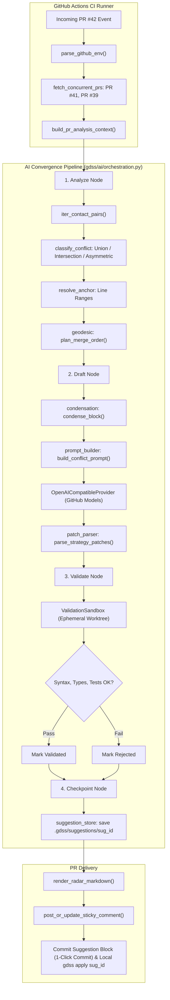

# Implementation Plan: AI Convergence Orchestration & Context Injection for PR Audit Pipeline

## Goal Description
Fully integrate the entire GDSS AI subsystem ([`gdss/ai/`](file:///home/sarakb/projects/GDSS/gdss/ai)) into the PR Audit CI pipeline ([`gdss/validation/pr_audit.py`](file:///home/sarakb/projects/GDSS/gdss/validation/pr_audit.py)).

Instead of lightweight ad-hoc prompting, PR audit in GitHub Actions CI will harness the full multi-tier AI architecture:
1. **Multi-Branch PR Analysis Context (`gdss/drift/context.py` & `gdss/ai/context.py`)**:
   - Constructs an `AnalysisContext` binding the incoming PR branch (`head_ref`/`head_sha`), base branch (`base_ref`), and all concurrently open PRs.
   - Extracts indexed cross-branch contact pairs (`iter_contact_pairs`) affecting the same semantic AST symbols in $O(j + i + c)$ time.
2. **LangGraph & State Machine Orchestration (`gdss/ai/orchestration.py`)**:
   - Executes the 4-phase convergence lifecycle (`analyze` ➔ `draft` ➔ `validate` ➔ `checkpoint`):
     - `analyze`: Mathematical conflict classification (`Union`, `Intersection`, `Asymmetric`, `Disjoint` via `conflict_topology.py`), line anchor resolution (`anchors.py`), ranking (`ranking.py`), and optimal merge order sequence (`geodesic.py`).
     - `draft`: Context-injected prompt synthesis (`prompt_builder.py`) with AST condensation (`condensation.py`), multi-strategy resolution drafting (`patch_combinations.py`, `patch_parser.py`) via GitHub Models Copilot (`openai_provider.py`).
     - `validate`: Ephemeral Git worktree sandboxing (`gdss/validation/sandbox.py`) verifying syntax, static types, and targeted unit tests.
     - `checkpoint`: Unique audited suggestion IDs (`sug_<id>`) saved to `.gdss/suggestions/` (`suggestion_store.py`).
   - Uses `build_langgraph_workflow()` when `langgraph` is available, with zero-dependency pure-Python fallback.
3. **Sticky Radar PR Presentation**:
   - Surfaces collision topology classification badges, optimal merge orders, audited Suggestion IDs (`sug_<id>`), verified 1-click ` ```suggestion ` commit blocks on GitHub, and local developer CLI commands (`gdss apply sug_<id>`).

---

## User Review Required

> [!IMPORTANT]
> **Zero Token Cost / GitHub Models**: In GitHub Actions CI, the AI convergence pipeline uses the runner's native `GITHUB_TOKEN` to access the GitHub Models endpoint (`https://models.inference.ai.azure.com`). If run in environments without token or external models, it gracefully emits deterministic multi-strategy suggestions (`keep_left`, `keep_right`, `reconcile_union`) without failing the CI build.

> [!TIP]
> **Unified Local and Remote Lifecycle**: A suggestion generated during CI audit gets a permanent audited ID (`sug_<id>`). A developer can either click **"Commit suggestion"** in the GitHub web UI or run `gdss apply sug_<id> --strategy <strategy>` locally on their machine with full preflight checks and self-healing rollback.

---

## Architecture Flow



---

## Proposed Changes

### Layer 9: AI Convergence Engine (`gdss/ai/`)

#### [MODIFY] `gdss/ai/context.py` & `gdss/drift/context.py`
Add `build_pr_analysis_context()` tailored for PR CI execution:
```python
def build_pr_analysis_context(
    repo_path: str,
    context: PRAuditContext,
    concurrent_prs: list[dict[str, Any]],
) -> AnalysisContext:
    """Build AnalysisContext from an incoming PR and concurrent open PRs against base_ref."""
```
- Fetches and resolves refs for the incoming PR (`head_ref` / `head_sha`) and concurrent PRs (`head_ref` / `head_sha`).
- Extracts trajectory operators for each branch relative to `context.base_ref`.
- Computes `drift_magnitudes` and `TensorEngine().compute(branch_ops, drift_map)`.
- Returns a complete `AnalysisContext` ready for full AI convergence pipeline consumption.

---

#### [MODIFY] `gdss/ai/orchestration.py`
Enhance `ConvergenceState` and `OrchestrationPipeline` to seamlessly accept a pre-built `AnalysisContext`:
```python
@dataclass
class ConvergenceState:
    repo_path: str
    reference_branch: str = "main"
    analysis_context: AnalysisContext | None = None
    ...
```
- In `analyze_step`: If `state.analysis_context` is provided, skips re-building context and directly extracts contact pairs, topologies, line anchors, and rankings.
- Ensures `build_langgraph_workflow()` passes `ConvergenceState` through `analyze` ➔ `draft` ➔ `validate` ➔ `checkpoint` with full context preservation.

---

#### [MODIFY] `gdss/ai/prompt_builder.py`
Enhance `build_conflict_prompt` to inject caller/callee downstream impact context from `CodeGraph`:
- Injects affected downstream call sites and dependent functions into the prompt so the LLM understands breaking contractual side effects.
- Includes clear markers for GitHub Actions suggestion formatting.

---

### Layer 10: Validation & CI Delivery (`gdss/validation/`)

#### [MODIFY] `gdss/validation/pr_audit.py`
Refactor PR collision audit to delegate convergence generation to `OrchestrationPipeline` / `LangGraph`:
1. Call `build_pr_analysis_context(repo_path, context, concurrent_prs)`.
2. Instantiate `OrchestrationPipeline` (or LangGraph compiled workflow if available):
   ```python
   pipeline = OrchestrationPipeline(
       repo_path=repo_root,
       reference_branch=context.base_ref,
       analysis_context=analysis_ctx,
       llm=bool(context.github_token or os.environ.get("GITHUB_TOKEN")),
       validate=True,
       combos=3,
       provider=OpenAICompatibleProvider(
           model=config.get("model", "gpt-4o-mini"),
           api_key=context.github_token,
       ),
   )
   state = pipeline.run()
   ```
3. Map resulting `Suggestion` objects:
   - Extract audited `suggestion_id` (`sug_<hash>`).
   - Extract `topology` (`Union`, `Intersection`, `Asymmetric`).
   - Extract validated patch combinations (`take_left`, `take_right`, `reconcile_union` / `compose`).
   - Populate `PRCollisionDetail` with `suggestion_code`, `suggestion_id`, `topology_kind`, and strategies.
4. Update `render_radar_markdown()`:
   - Add **Topology Badge** column in the radar table (e.g. `🔀 Union`, `⚡ Intersection`, `📐 Asymmetric`).
   - Add **Audited Suggestion ID** and 1-click ` ```suggestion ` block for the validated strategy.
   - Add local CLI instructions: `gdss apply <sug_id> --strategy <label>`.

---

### Tests: `tests/`

#### [MODIFY] `tests/validation/test_pr_audit.py`
Add comprehensive test cases:
1. `test_pr_audit_uses_orchestration_pipeline`:
   - Verifies that `audit_pr_collisions` invokes `OrchestrationPipeline` / LangGraph.
2. `test_pr_audit_context_injection`:
   - Verifies that `AnalysisContext` contact pairs and AST line anchors are injected into prompt generation.
3. `test_pr_audit_saves_audited_suggestion`:
   - Asserts that CI audit saves `.gdss/suggestions/sug_<id>.json` matching the suggestion referenced in the sticky PR comment.
4. `test_pr_audit_markdown_surfaces_topology_and_strategies`:
   - Verifies that the Markdown report displays topology classifications, optimal merge order, and 1-click suggestion blocks.

#### [NEW] `tests/ai/test_pr_context_orchestration.py`
- Tests `build_pr_analysis_context` with concurrent PR branch operators and tensor computation.
- Tests LangGraph execution on multi-branch PR states.

---

## Verification Plan

### Automated Sensors & Gates
1. **Layer 1 Static**:
   - `bash harness/sensors/lint.sh` (`ruff` clean).
   - `bash harness/sensors/typecheck.sh` (`mypy` clean across all 87 source files).
   - `python harness/sensors/architecture_fitness.py` (Validation Layer 10 & AI Layer 9 purity holds).
   - `python harness/sensors/dsa_fitness.py` (0 unsuppressed DSA violations).
2. **Layer 2 Runtime Tests**:
   - `pytest tests/validation/test_pr_audit.py`
   - `pytest tests/ai/test_pr_context_orchestration.py`
   - `bash harness/sensors/run_tests.sh` (entire test suite passes).
3. **Layer 3 End-to-End Smoke**:
   - `bash harness/sensors/cli_smoke.sh` (fixture repo execution).
4. **Master Verification**:
   - `bash harness/verify.sh` passes with **ALL LAYERS GREEN**.
