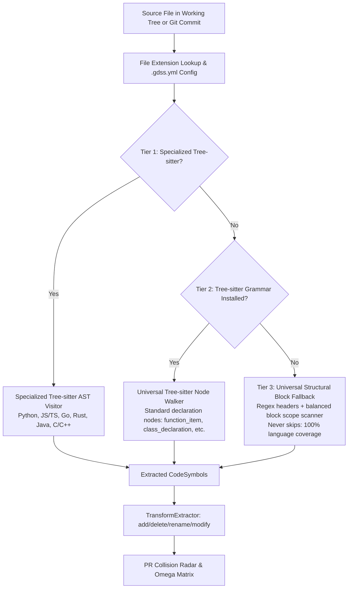

# Implementation Plan: Repository-Agnostic & Multi-Language AST Parser

## Goal Description
Currently, `gdss/core/ast_parser.py` hardcodes `LANGUAGE_REGISTRY` to only 4 languages: **Python, JavaScript, TypeScript, and Go**. It also hardcodes `SOURCE_EXTENSIONS = ('.py', '.js', '.jsx', '.ts', '.tsx', '.go')`, which is imported by 6 major subsystems (`GitObserver`, `Trajectory`, `GraphBuilder`, `DriftEngine`, `Embeddings`, and CLI) to filter repository files.

When a repository contains other languages—such as **Rust (`.rs`), Java (`.java`), C/C++ (`.c`, `.cpp`, `.h`), C# (`.cs`), Ruby (`.rb`), PHP (`.php`), Kotlin (`.kt`), Swift, Scala, or custom DSLs**—GDSS silently ignores the files, records them in `_skipped_extensions`, and returns `[]` symbols. Consequently:
1. `TransformExtractor` produces zero semantic operators for non-supported languages.
2. The collision radar matrix ($\Omega_{ij}$) remains 0.0, failing to alert developers to concurrent branch collisions in those files.
3. The AI convergence assistant has no AST symbol anchors.

This plan upgrades `gdss/core/ast_parser.py` to be **fully repository-agnostic and multi-language extensible**, aligning it with the architectural principles established in Phase 6 validation.

---

## Architecture: The 3-Tier Parsing Hierarchy



### 1. Tier 1: Specialized Tree-sitter AST Parsers
- Built-in visitors for Python, JavaScript, TypeScript, and Go.
- Add visitors for **Rust (`.rs`)**, **Java (`.java`)**, and **C / C++ (`.c`, `.h`, `.cpp`, `.hpp`, `.cc`, `.cxx`)** using safe dynamic loading of optional tree-sitter grammar packages (`tree-sitter-rust`, `tree-sitter-java`, `tree-sitter-c`, `tree-sitter-cpp`).
- If the optional grammar packages are installed, GDSS uses full AST grammar parsing, extracting functions, methods, classes, structs, signatures, docstrings, calls, and body blocks.

### 2. Tier 2: Universal Tree-sitter Node Walker
- If a tree-sitter grammar is available for a language (either via pip or a registered grammar) but no custom visitor method is coded, GDSS runs a **Universal Tree-sitter Walker**.
- Common Tree-sitter AST conventions:
  - Functions: `function_item`, `function_declaration`, `function_definition`, `method_declaration`, `method_definition`, `subroutine`.
  - Classes/Types: `class_declaration`, `class_definition`, `struct_item`, `struct_specifier`, `interface_declaration`, `type_declaration`, `enum_item`.
  - Imports: `use_declaration`, `import_statement`, `import_declaration`, `preproc_include`.
- Extracts `CodeSymbol` instances automatically without requiring language-specific boilerplate.

### 3. Tier 3: Universal Structural Block Fallback (Never Skip)
- For any language where **no compiled Tree-sitter grammar is installed** (e.g. Ruby, PHP, Kotlin, Swift, Scala, Zig, Elixir, Lua, Shell, or proprietary DSLs), GDSS **never** returns `[]` or skips the file.
- Instead, the **Universal Structural Fallback**:
  - Scans lines for signature and declaration patterns (`def `, `fn `, `func `, `function `, `class `, `struct `, `interface `, `type `, `pub fn `, `export `, etc.).
  - Tracks block scopes using balanced braces (`{ ... }`) or indentation / `end` keywords to accurately locate start and end line ranges.
  - Extracts structural tokens and normalized signatures.
  - Generates valid `CodeSymbol(type=SymbolType.FUNCTION | CLASS, ...)` objects with `language=ext`.
- **Impact**: GDSS works on **100% of repositories and 100% of programming languages out of the box** without failing or requiring the user to compile C extensions.

### 4. Dynamic & Configurable Source Extensions
- Expand default `SOURCE_EXTENSIONS` to include all standard programming language extensions:
  ```python
  DEFAULT_SOURCE_EXTENSIONS: tuple[str, ...] = (
      ".py", ".pyi",
      ".js", ".jsx", ".mjs", ".cjs",
      ".ts", ".tsx",
      ".go",
      ".rs",
      ".java",
      ".c", ".h", ".cpp", ".hpp", ".cc", ".cxx",
      ".cs",
      ".rb",
      ".php",
      ".kt", ".kts",
      ".swift",
      ".scala",
      ".sh", ".bash", ".zsh",
      ".dart",
      ".lua",
      ".sol",
  )
  ```
- Support `.gdss.yml` configuration:
  ```yaml
  ast:
    additional_extensions:
      - .vue
      - .svelte
      - .zig
    exclude:
      - "vendor/**"
  ```
- Provide `ASTParser.register_language(ext, language_name, loader=None, visitor=None)` for runtime extensibility.

---

## User Review Required

> [!IMPORTANT]
> **Optional vs Required Dependencies in `pyproject.toml`**  
> We recommend adding `tree-sitter-rust`, `tree-sitter-java`, `tree-sitter-c`, and `tree-sitter-cpp` to `pyproject.toml` as standard dependencies (they all have official pre-built wheels on Linux, macOS, and Windows with zero C compiler required). For all other languages, Tier 3 Universal Fallback guarantees 100% coverage with zero extra dependencies.

> [!NOTE]
> **Zero Breaking Changes to Existing APIs**  
> `SOURCE_EXTENSIONS` will remain exported as a tuple at module level in `gdss/core/ast_parser.py` for backward compatibility with `GitObserver`, `Trajectory`, `GraphBuilder`, `DriftEngine`, and CLI, while being expanded with the new supported languages and backed by a dynamic `get_source_extensions(repo_root)` function.

---

## Open Questions

> [!TIP]
> **Default Extensions vs Strict Extension Mode**  
> Should GDSS by default scan all standard programming language extensions listed above, or should it restrict itself to languages detected in the repo root manifests (e.g. `Cargo.toml` $\rightarrow$ Rust, `pom.xml` $\rightarrow$ Java)?  
> *Recommendation*: Scan all recognized source code extensions by default, while ignoring build/output artifacts (`node_modules`, `target`, `vendor`, `.venv`, `.git`), and allow `.gdss.yml` to specify additional extensions or exclusions.

---

## Proposed Changes

### Layer 4 / Core: Multi-Language & Universal AST Parser

#### [MODIFY] `gdss/core/ast_parser.py`
- Expand `LANGUAGE_REGISTRY` with lazy-loader functions for Rust, Java, C, C++, and any registered tree-sitter languages using safe dynamic import (`_try_load_language`).
- Expand `DEFAULT_SOURCE_EXTENSIONS` and `SOURCE_EXTENSIONS`.
- Implement `_parse_rust(root, content_bytes, symbols, ...)` extracting functions, traits, impls, structs, enums, and use statements.
- Implement `_parse_java(root, content_bytes, symbols, ...)` extracting classes, interfaces, records, methods, and imports.
- Implement `_parse_c_cpp(root, content_bytes, symbols, ...)` extracting functions, classes, structs, and includes.
- Implement `_parse_universal_tree_sitter(root, content_bytes, symbols, language, ...)` for any Tree-sitter grammar loaded without a dedicated visitor.
- Implement `_parse_universal_fallback(content_bytes, filepath, ext)` using structural block scanning for languages without Tree-sitter.
- Add `ASTParser.register_language(ext, name, loader=None, visitor=None)`.
- Add `get_source_extensions(repo_path: str | Path | None = None) -> tuple[str, ...]`.

#### [MODIFY] `gdss/validation/discovery.py`
- Add `ast` section to `.gdss.yml` parser:
  - `additional_extensions: list[str]`
  - `ignored_paths: list[str]`

#### [MODIFY] `pyproject.toml`
- Add `tree-sitter-rust>=0.21.0`, `tree-sitter-java>=0.21.0`, `tree-sitter-c>=0.21.0`, and `tree-sitter-cpp>=0.21.0` to dependencies.

---

### Layer 5 / Graph & Core Consumers

#### [MODIFY] `gdss/graph/graph_builder.py`
- Use `get_source_extensions(root_path)` so `build_code_graph_from_repo` indexes all detected languages.

#### [MODIFY] `gdss/watcher/git_observer.py` and `gdss/core/trajectory.py`
- Ensure file collection respects `get_source_extensions()` so git diffs and commit trajectories extract semantic operators for all languages.

---

### Tests

#### [NEW] `tests/core/test_multi_language_ast_parser.py`
- Test Rust parsing: `fn add(a: i32) -> i32`, `struct Point`, `impl Point`.
- Test Java parsing: `public class Calculator`, `public int add(int a, int b)`.
- Test C/C++ parsing: `int add(int a, int b) { return a + b; }`, `class Widget`.
- Test Universal Fallback parsing:
  - Ruby (`def hello ... end`, `class Greeter ... end`).
  - PHP (`function add($a, $b) { ... }`, `class Calc { ... }`).
  - Unknown DSL (`sub my_proc { ... }`).
- Test dynamic language registration via `ASTParser.register_language`.
- Test `.gdss.yml` custom extension discovery.

---

## Verification Plan

### Automated Tests
1. **Unit & Multi-Language Tests**:
   ```bash
   pytest tests/core/test_ast_parser.py tests/core/test_multi_language_ast_parser.py -v
   ```
2. **Transform Extractor Multi-Language Verification**:
   ```bash
   pytest tests/core/test_transform_extractor.py -v
   ```
3. **Full Harness Verification**:
   ```bash
   bash harness/verify.sh
   ```
   Must pass all Layer 1 (lint, mypy, architecture fitness, DSA fitness), Layer 2 (pytest), Layer 3 (CLI/API smoke), and Frontend gates.

### Manual Verification
1. Run `gdss analyze` on a fixture containing `.rs`, `.java`, `.cpp`, and `.rb` files.
2. Confirm `gdss analyze` outputs extracted symbols and dependency graph nodes for all languages.
3. Validate that `gdss diff` captures function and class modifications across non-Python/TS files.
