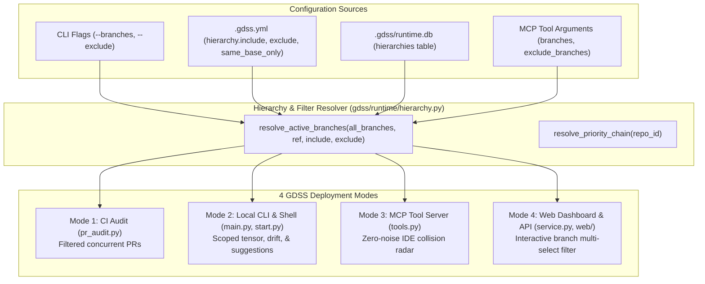

# Implementation Plan - Configurable Branch Selection & Hierarchy Across All 4 Modes

## Goal Description
In multi-developer teams and enterprise repositories, unconstrained $N \times N$ branch analysis produces false-positive noise and computational waste by comparing active PRs against stale prototypes, spike branches, or branches targeting different release lines (e.g., comparing a hotfix targeting `v1.2-patch` against an experimental spike from 6 months ago).

This plan introduces **User-Controlled Branch Selection, Filtering, and Hierarchy Resolution** across all 4 GDSS deployment modes:
1. **GitHub Actions CI (`gdss audit-pr`)**: Scoped PR discovery via `.gdss.yml` (`same_base_only`, `include`, `exclude`, `target_bases`) and CLI flags.
2. **Local CLI (`gdss` & `gdss start`)**: Explicit `--branches` and `--exclude` flags for `status`, `tensor`, `drift`, `suggest`, plus interactive shell commands (`config hierarchy`, `config branches`) persisted in `.gdss/runtime.db`.
3. **MCP Tool Server (IDE Cursor / Claude Code / Copilot)**: Tool argument schemas (`branches`, `exclude_branches`) in `gdss_find_collisions`, `gdss_get_merge_order`, and `gdss_plan_rebase`, falling back to `.gdss.yml`.
4. **Web Visual Dashboard (Next.js 14) & Local API**: Query parameters (`?branches=...&exclude=...`) on `/v1/tensor`, `/v1/drift`, and `/v1/status`, accompanied by interactive multi-branch filtering controls in the UI.

Additionally, this plan provides a comprehensive overhaul of [`docs/CONFIGURATION_GUIDE.md`](file:///home/sarakb/projects/GDSS/docs/CONFIGURATION_GUIDE.md) detailing schema, database persistence, and configuration recipes for all 4 modes.

---

## User Review Required

> [!IMPORTANT]
> **Default Behavior in CI (`same_base_only: true`):**
> In PR collision audits (`gdss audit-pr`), the default will be set to `same_base_only: true`. This ensures PRs targeting `main` are only compared against concurrent PRs also targeting `main`, eliminating false-positive collisions with PRs targeting `v1.0-release` or experimental bases. This can be toggled in `.gdss.yml` or overridden via `--no-same-base-only`.

> [!TIP]
> **Configuration Precedence:**
> 1. Explicit Invocation Argument (CLI `--branches` or MCP `branches=[...]`)
> 2. Local Database Override (`.gdss/runtime.db` via `config branches` / `config ref`)
> 3. Repository Configuration (`.gdss.yml` `hierarchy:` section)
> 4. Default Heuristic (`reference_branch="main"`, all non-attractor branches).

---

## Architecture: Branch Selection & Hierarchy Flow



---

## Proposed Changes

### Component 1: Core Hierarchy & Branch Filter Engine (`gdss/runtime/`)

#### [MODIFY] [`gdss/runtime/hierarchy.py`](file:///home/sarakb/projects/GDSS/gdss/runtime/hierarchy.py)
- Add pattern-matching helper using `fnmatch`:
  ```python
  def matches_any_pattern(name: str, patterns: Sequence[str]) -> bool:
      return any(fnmatch.fnmatch(name, pat) for pat in patterns)

  def filter_branches(
      branches: Sequence[str],
      include: Sequence[str] | None = None,
      exclude: Sequence[str] | None = None,
      reference_branch: str | None = None,
  ) -> list[str]:
      """Filter branch list by include/exclude patterns and exclude reference branch."""
  ```
- Extend `HierarchyManager`:
  - `set_branch_filters(repo_id: int, include: list[str] | None, exclude: list[str] | None)`
  - `get_branch_filters(repo_id: int) -> tuple[list[str], list[str]]`
  - Update `set_config` and `get_config` to cleanly handle `hierarchy`, `include`, `exclude`, and `same_base_only`.

#### [MODIFY] [`gdss/drift/context.py`](file:///home/sarakb/projects/GDSS/gdss/drift/context.py)
- Update `build_analysis_context()` to accept optional branch selections:
  ```python
  def build_analysis_context(
      repo_path: str,
      reference_branch: str,
      *,
      branches: Sequence[str] | None = None,
      exclude_branches: Sequence[str] | None = None,
      ...
  ) -> AnalysisContext:
  ```
- If `branches` is supplied, filter `observer.list_local_branches()` to the selected subset.
- If `exclude_branches` is supplied, remove matching branches.
- If neither is passed, check if `.gdss.yml` defines `hierarchy.include` / `hierarchy.exclude` and apply them.

---

### Component 2: Mode 1 - GitHub Actions PR Collision Radar (`gdss/validation/pr_audit.py`)

#### [MODIFY] [`gdss/validation/pr_audit.py`](file:///home/sarakb/projects/GDSS/gdss/validation/pr_audit.py)
- Update `load_radar_config()` to parse the `hierarchy` block from `.gdss.yml`:
  ```yaml
  hierarchy:
    reference_branch: "main"
    priority_chain: ["develop", "staging", "main"]
    same_base_only: true
    include: ["feature/*", "bugfix/*"]
    exclude: ["spike/*", "wip/*", "temp/*"]
    target_bases: ["main", "develop"]
  ```
- In `fetch_concurrent_prs()`:
  - If `same_base_only` is true (default), filter candidate PRs to only those targeting `context.base_ref`.
  - Filter `pr.head_ref` using `include` and `exclude` patterns.
  - If `target_bases` is defined, ignore PRs whose base is not in `target_bases`.
- In `audit_pr_cmd` in [`gdss/cli/main.py`](file:///home/sarakb/projects/GDSS/gdss/cli/main.py):
  - Add `--branches` / `-b` (audit against specific PR numbers or branch names).
  - Add `--same-base-only / --no-same-base-only`.
  - Add `--exclude` pattern option.

---

### Component 3: Mode 2 - Local CLI & Interactive Shell (`gdss/cli/`)

#### [MODIFY] [`gdss/cli/main.py`](file:///home/sarakb/projects/GDSS/gdss/cli/main.py)
- Add `--branches` / `-b` and `--exclude` options to:
  - `gdss tensor`
  - `gdss drift`
  - `gdss suggest`
  - `gdss converge`
- Pass `branches` and `exclude_branches` directly into `build_analysis_context()`.

#### [MODIFY] [`gdss/cli/start.py`](file:///home/sarakb/projects/GDSS/gdss/cli/start.py)
- Update `do_tensor` and `do_drift` to support arguments:
  - `tensor [ref] [--branches b1,b2] [--exclude pat]`
  - `drift [ref] [--branches b1,b2]`
- Add shell commands for branch configuration in `GDSSShell`:
  - `config branches [include/exclude/clear]`
  - `config hierarchy <chain>`
  - Update `do_hierarchy` to print both the priority chain and active branch filters.
- Persist branch filters into `self.db` via `HierarchyManager`.

---

### Component 4: Mode 3 - MCP Tool Server (`gdss/mcp/`)

#### [MODIFY] [`gdss/mcp/tools.py`](file:///home/sarakb/projects/GDSS/gdss/mcp/tools.py) & [`gdss/mcp/server.py`](file:///home/sarakb/projects/GDSS/gdss/mcp/server.py)
- Update `find_collisions`, `get_merge_order`, `plan_semantic_rebase` signatures:
  ```python
  def find_collisions(
      reference_branch: str = "main",
      repo_path: str = ".",
      branches: list[str] | None = None,
      exclude_branches: list[str] | None = None,
  ) -> dict[str, Any]:
  ```
- Expose `branches` and `exclude_branches` in the tool JSON-RPC input schemas in `gdss/mcp/server.py`.
- Forward `branches` and `exclude_branches` into `build_analysis_context()`.

---

### Component 5: Mode 4 - Web Visual Dashboard & REST API (`gdss/api/` & `web/`)

#### [MODIFY] [`gdss/api/server.py`](file:///home/sarakb/projects/GDSS/gdss/api/server.py) & [`gdss/api/service.py`](file:///home/sarakb/projects/GDSS/gdss/api/service.py)
- In `gdss/api/server.py`:
  - Update `/v1/tensor`, `/v1/drift`, `/v1/status` to accept `branches: str | None = None` and `exclude: str | None = None`.
  - Add `/v1/hierarchy` GET and POST endpoints to query/update hierarchy configuration.
- In `gdss/api/service.py`:
  - Parse comma-separated `branches` and `exclude` query params and filter `all_branches` in `get_tensor` and `get_drift`.

#### [MODIFY] [`web/context/RepoContext.tsx`](file:///home/sarakb/projects/GDSS/web/context/RepoContext.tsx) & [`web/components/navigation.tsx`](file:///home/sarakb/projects/GDSS/web/components/navigation.tsx)
- Add `selectedBranches: string[]` and `setSelectedBranches` to `RepoContext`.
- Add an interactive Branch Filter chip/popover selector in the web app header next to `RepoRefPicker` allowing developers to multi-select or clear branches.
- Update `TensorPage` (`web/app/(dashboard)/tensor/page.tsx`) and `DriftPage` to append `&branches=${selectedBranches.join(',')}` to query URLs.

---

### Component 6: Documentation (`docs/CONFIGURATION_GUIDE.md`)

#### [MODIFY] [`docs/CONFIGURATION_GUIDE.md`](file:///home/sarakb/projects/GDSS/docs/CONFIGURATION_GUIDE.md)
- Add a comprehensive new major section: **`Branch Hierarchy & Selection Guide`**:
  1. **The Core Rationale**: Why unconstrained $N \times N$ fails in large repos and how hierarchy scopes the collision radius.
  2. **Schema Reference**:
     - `hierarchy.reference_branch`
     - `hierarchy.priority_chain`
     - `hierarchy.same_base_only`
     - `hierarchy.include`
     - `hierarchy.exclude`
     - `hierarchy.target_bases`
  3. **The 4 Implementation Recipes**:
     - **Mode 1 (GitHub Actions CI)**: Filtering PRs in `.gdss.yml` and CLI flags.
     - **Mode 2 (Local CLI & Interactive Shell)**: Using flags and persisting filters in `.gdss/runtime.db`.
     - **Mode 3 (MCP Server for Cursor/Claude Code)**: Invoking tools with branch filters.
     - **Mode 4 (Web Dashboard & REST API)**: Query parameters and interactive UI controls.
  4. **Database vs `.gdss.yml` Matrix**: Clear table comparing when to use database overrides vs `.gdss.yml` version control.

---

## Verification Plan

### Automated Tests
1. **Unit Tests for Branch Filtering & Hierarchy:**
   - Author `tests/runtime/test_branch_filters.py` verifying:
     - `filter_branches` with wildcard includes (`feature/*`), excludes (`spike/*`), and exact matches.
     - Hierarchy priority chain resolution.
     - Database persistence in `RuntimeDB` `hierarchies` table.
2. **CI PR Audit Filtering Tests:**
   - Extend `tests/validation/test_pr_audit.py`:
     - Test `fetch_concurrent_prs` with `same_base_only=True` ignores PRs targeting different bases.
     - Test `fetch_concurrent_prs` with `exclude=["spike/*"]` skips spike branches.
3. **Context Engine & Tensor Filtering Tests:**
   - Test `build_analysis_context` with explicit `branches=["feature-a"]` builds $1 \times 1$ tensor instead of all local branches.
4. **Full Verification Gate:**
   - Execute:
     ```bash
     bash harness/verify.sh
     ```
   - Must pass all Layer 1 (lint, mypy, architecture fitness, DSA fitness), Layer 2 (pytest), Layer 3 (CLI smoke, API smoke), and Frontend Gate (vitest, Next.js build, size-limit).

### Manual Verification
1. Test CLI filtering:
   ```bash
   gdss tensor --branches feature-work --ref master
   ```
2. Test interactive shell branch filtering:
   ```bash
   gdss start
   > hierarchy
   > config branches exclude spike/*
   ```
3. Test web app branch filtering at `http://localhost:3000/tensor`.
