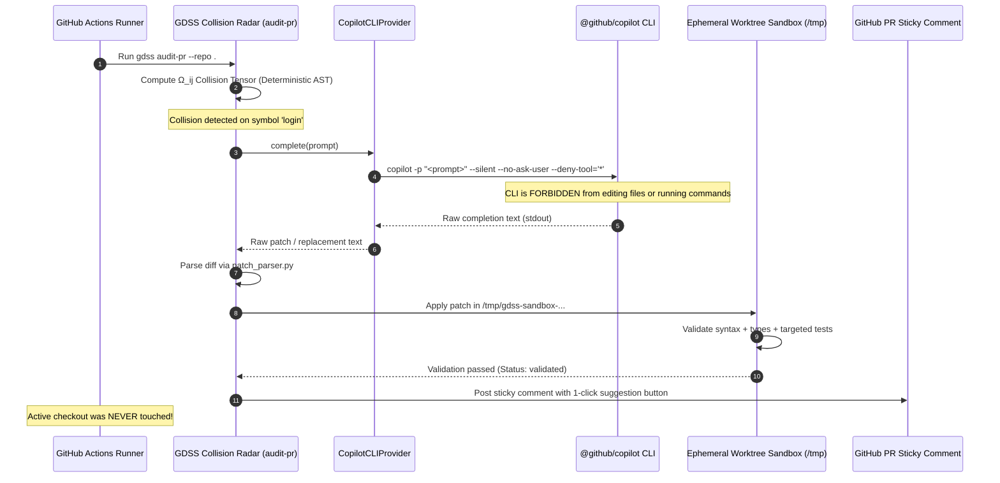

# Plan: GitHub Copilot CLI Adapter & CI Inference Architecture for GDSS

## 1. Goal Description

The user is investigating whether **GitHub Copilot Free** can be used inside GitHub Actions CI via `GITHUB_TOKEN` to generate convergence patches for GDSS, and raised a critical architectural question:
> *"If Copilot is installed in the GitHub Actions runner and automatically edits the repo, won't that break GDSS because Copilot acts as an autonomous harness rather than returning a code patch for GDSS's isolated sandbox validation?"*

This plan:
1. Evaluates the factual findings from primary sources and GitHub documentation regarding Copilot Free, GitHub Actions permissions (`copilot-requests: write`), and `@github/copilot` CLI.
2. Formulates an architectural design that resolves the "agent vs. inference engine" dilemma by enforcing strict tool denial (`--deny-tool='*'`), ensuring Copilot CLI acts strictly as a stateless text generator without touching the workspace.
3. Outlines the implementation of a dedicated `CopilotCLIProvider` adapter in `gdss/ai/copilot_provider.py` conforming to GDSS's `LLMProvider` protocol.
4. Provides clear guidance on Copilot tier requirements (Copilot Free vs. Copilot Business/Enterprise) and zero-cost alternatives (OpenRouter Free Tier and Deterministic Mode).

---

## 2. Web Research & Fact Check: What is True?

### Fact 1: Copilot Free Does NOT Provide an OpenAI-Compatible API Key
* **Verdict:** **Confirmed True.**
* GitHub Copilot Free is an IDE and personal chat subscription. It does **not** provide a standalone HTTP API endpoint or Bearer API key (`sk-...`). You cannot make arbitrary curl or SDK requests to an OpenAI-compatible URL using an individual personal Copilot subscription.

### Fact 2: GitHub Actions Supports `permissions: copilot-requests: write`
* **Verdict:** **Confirmed True, with a critical tier caveat.**
* GitHub recently introduced the `copilot-requests: write` permission scope for GitHub Actions workflows. This allows workflows using the `@github/copilot` CLI to authenticate using the runner's native `GITHUB_TOKEN`.
* **The Catch:** This capability is governed by **Organization or Enterprise Copilot plans** (Copilot Business or Copilot Enterprise). Usage is metered against the organization's pooled AI credits. An individual personal user on **Copilot Free** attempting to use `copilot-requests: write` in CI will be rejected with an entitlement error (`HTTP 403 Forbidden` / missing enterprise seat).

### Fact 3: Copilot CLI Modifying Files Directly Would Break GDSS
* **Verdict:** **100% Valid & Critical Insight.**
* The user's concern is completely correct. `@github/copilot` is an agentic tool. If allowed to execute tools in the CI runner workspace, it would modify files in the active git checkout directly.
* **Why this breaks GDSS:**
  1. **Bypasses Ephemeral Sandboxing:** GDSS never mutates the active checkout. It tests candidate patches in isolated temporary worktrees (`/tmp/gdss-sandbox-...`) with AST syntax checks, type checks, and targeted unit tests.
  2. **Violates Golden Rule #4:** *Never Auto-Merge. Humans decide what lands.*
  3. **Lacks Patch Artifacts:** GDSS needs a parseable diff or replacement block string to score risk $\Omega_{ij}$, register a persistent suggestion ID (`sug_<id>`), and post a native sticky PR comment with a 1-click suggestion button.
* **The Fix:** We must restrict Copilot CLI using `--deny-tool='*'` so it behaves strictly as a stateless LLM inference engine (prompt in, stdout out).

---

## 3. User Review Required

> [!IMPORTANT]
> **Copilot Free Limitation in CI Workflows**:
> If your repository is hosted under a personal GitHub account on **Copilot Free**, GitHub Actions runner workflows using `permissions: copilot-requests: write` will fail due to lack of an organization credit pool. 
> - If you have an **Organization with Copilot Business/Enterprise**, `provider: "copilot"` will authenticate seamlessly via `GITHUB_TOKEN`.
> - If you are on **Copilot Free (Personal)**, the recommended $0-cost CI drop-in is **OpenRouter Free Tier** (`qwen/qwen-2.5-coder-32b-instruct` via `OPENROUTER_API_KEY`) or **Deterministic Mode** ($0, runs 100% locally on CPU).

> [!WARNING]
> **Strict Tool Denial Enforcement**:
> To guarantee that `@github/copilot` never modifies the active checkout or executes shell commands in the runner, the `CopilotCLIProvider` will explicitly invoke:
> `copilot -p "<prompt>" --silent --no-ask-user --deny-tool='*'`
> Standard output will be captured via Python `subprocess.run()`, ensuring 100% preservation of GDSS's isolated worktree sandbox validation.

---

## 4. Open Questions

1. **Copilot CLI Installation Source**:
   - Would you like GDSS to check for `copilot` binary in `PATH` (installed via `npm install -g @github/copilot` or GitHub CLI extension `gh extension install github/gh-copilot`), and automatically fall back to deterministic AST suggestions if it is not installed or lacks entitlements?
   - *(Recommended: Yes, GDSS should never crash if `copilot` is missing or fails; it should gracefully degrade to deterministic suggestions).*

2. **Model Selection in Copilot CLI**:
   - Copilot CLI supports `--model` (e.g. `gpt-4o`, `claude-3.5-sonnet`). Should GDSS pass `radar.model` from `.gdss.yml` directly to the `--model` flag of Copilot CLI?
   - *(Recommended: Yes, defaulting to `gpt-4o` or the model configured in `.gdss.yml`).*

---

## 5. Architectural Flow



---

## 6. Proposed Changes

### Component 1: Copilot CLI Provider Adapter

#### [NEW] `gdss/ai/copilot_provider.py`
Create a dedicated `CopilotCLIProvider` that conforms to `LLMProvider(Protocol)`:
```python
"""GitHub Copilot CLI provider for CI and developer workstations."""

from __future__ import annotations

import hashlib
import os
import shutil
import subprocess
from pathlib import Path

from gdss.logger import get_logger

logger = get_logger("gdss.ai.copilot_provider")


class CopilotCLIProvider:
    """Invokes GitHub Copilot CLI as a stateless inference provider.
    
    CRITICAL SAFETY GUARANTEE:
    Enforces `--deny-tool='*'` and `--no-ask-user` to ensure Copilot CLI CANNOT
    modify the repository files, checkout, or execute arbitrary shell commands.
    All proposed patches are strictly emitted to stdout and returned to GDSS
    for ephemeral worktree sandbox validation.
    """

    def __init__(
        self,
        model: str | None = None,
        cache_dir: Path | None = None,
        timeout: float = 120.0,
    ) -> None:
        self.model = model or os.getenv("COPILOT_MODEL") or "gpt-4o"
        self.cache_dir = cache_dir or Path(".gdss/llm_cache")
        self.timeout = timeout
        self._bin = self._find_binary()

    @staticmethod
    def _find_binary() -> str | None:
        # Check npm global binary '@github/copilot' or 'copilot'
        for name in ("copilot", "github-copilot"):
            path = shutil.which(name)
            if path:
                return path
        return None

    def is_available(self) -> bool:
        return self._bin is not None

    def complete(self, prompt: str, *, temperature: float = 0.0, max_tokens: int = -1) -> str:
        if not self._bin:
            raise RuntimeError(
                "Copilot CLI binary not found in PATH. Install via 'npm install -g @github/copilot' "
                "or configure OPENROUTER_API_KEY / AZURE_OPENAI_API_KEY."
            )

        cache_key = hashlib.sha256(f"copilot:{self.model}:{prompt}".encode()).hexdigest()
        cache_path = self.cache_dir / cache_key
        if cache_path.exists():
            logger.debug("LLM cache hit for Copilot CLI (key: %s)", cache_key[:8])
            return cache_path.read_text(encoding="utf-8")

        cmd = [
            self._bin,
            "-p",
            prompt,
            "--silent",
            "--no-ask-user",
            "--deny-tool=*",
        ]
        if self.model:
            cmd.extend(["--model", self.model])

        logger.info("Executing Copilot CLI inference (model: %s, prompt_len: %d)", self.model, len(prompt))
        try:
            res = subprocess.run(
                cmd,
                capture_output=True,
                text=True,
                timeout=self.timeout,
                check=False,
            )
        except subprocess.TimeoutExpired as e:
            logger.warning("Copilot CLI inference timed out after %.1fs: %s", self.timeout, e)
            return ""
        except Exception as e:
            logger.warning("Copilot CLI execution failed: %s", e)
            return ""

        if res.returncode != 0:
            logger.warning(
                "Copilot CLI returned non-zero exit code %d: %s",
                res.returncode,
                res.stderr.strip() or res.stdout.strip(),
            )
            return ""

        output = res.stdout.strip()
        if output:
            try:
                self.cache_dir.mkdir(parents=True, exist_ok=True)
                cache_path.write_text(output, encoding="utf-8")
            except OSError:
                pass

        return output
```

#### [MODIFY] `gdss/ai/llm_patch.py`
Add `CopilotCLIProvider` to `AnyProvider` union type:
```python
from gdss.ai.copilot_provider import CopilotCLIProvider

AnyProvider = (
    OllamaProvider
    | VLLMProvider
    | OpenAICompatibleProvider
    | CopilotCLIProvider
    | StubProvider
)
```

#### [MODIFY] `gdss/ai/suggester.py`
Add resolution for `provider == "copilot"` in `_resolve_provider`:
```python
    if provider == "copilot" or provider_name == "copilot":
        from gdss.ai.copilot_provider import CopilotCLIProvider
        copilot_prov = CopilotCLIProvider()
        if copilot_prov.is_available():
            return copilot_prov
```

---

### Component 2: PR Audit and CI Workflow Integration

#### [MODIFY] `gdss/validation/pr_audit.py`
In `run_pr_audit`, if `config.get("provider") == "copilot"`:
- Instantiate `CopilotCLIProvider`.
- If `copilot` binary is present and returns completions, run AI convergence.
- If unavailable or fails with an entitlement error, gracefully fall back to deterministic multi-strategy suggestions (`keep_left`, `keep_right`, `reconcile_union`).

#### [MODIFY] `.github/workflows/gdss-radar.yml`
Add an example step illustrating how organizations with Copilot Business/Enterprise can enable Copilot CLI:
```yaml
permissions:
  contents: read
  pull-requests: write
  issues: write
  copilot-requests: write # Required for Copilot CLI inference in CI

steps:
  # Optional: Install Copilot CLI when using provider: "copilot"
  # - name: Setup Node & Copilot CLI
  #   uses: actions/setup-node@v4
  #   with:
  #     node-version: 20
  # - run: npm install -g @github/copilot
```

---

### Component 3: Documentation Updates

#### [MODIFY] `docs/CONFIGURATION_GUIDE.md` & `docs/GITHUB_ACTIONS_GUIDE.md`
- Add a new section: **GitHub Copilot CLI in CI (Requirements & Tool Restrictions)**:
  - Explains the difference between personal Copilot Free (no CI API access) and Organization Copilot Business/Enterprise (supported via `copilot-requests: write`).
  - Explains why GDSS strictly passes `--deny-tool='*'` to protect the working directory and enforce sandbox validation.

---

## 7. Verification Plan

### Automated Tests
1. **Unit Tests for CopilotCLIProvider**:
   - `tests/ai/test_copilot_provider.py`:
     - Test binary discovery (`is_available`).
     - Test command construction asserts `--deny-tool=*`, `--silent`, `--no-ask-user`.
     - Test mock subprocess execution, stdout parsing, and disk caching.
     - Test graceful handling of non-zero exit codes or timeouts.
2. **Provider Resolution Tests**:
   - Test `_resolve_provider` with `provider: "copilot"`.
3. **Full Verification Gate**:
   - Run `bash harness/verify.sh` to ensure Layer 1, Layer 2 (355+ tests), Layer 3, and frontend gate pass.

### Manual Verification
- Run `gdss suggest --help` and verify `copilot` is recognized in provider options.
