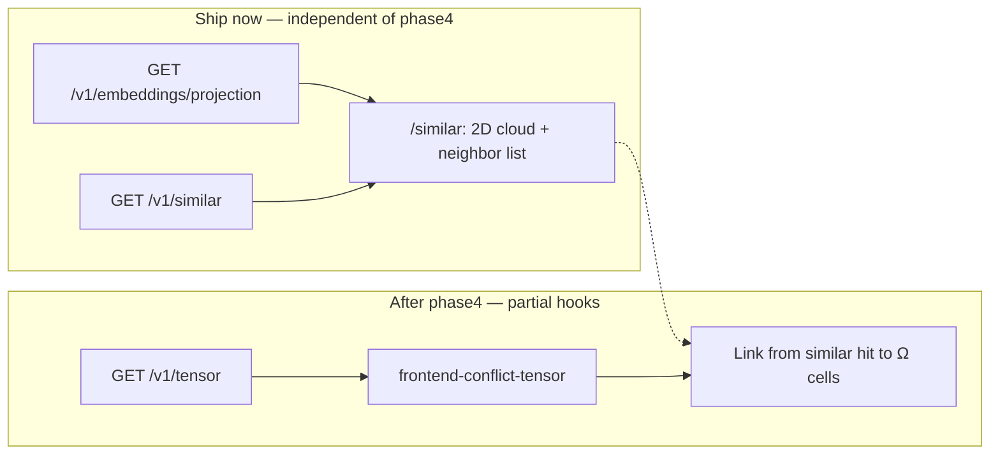

# Embedding Space Visualizer — Now vs After Phase 4

## Product split (locked)

| Route | Brain | Layout meaning |
|---|---|---|
| [`/graph`](web/app/(dashboard)/graph/page.tsx) | Deterministic | Dependency constellation (edges = calls/imports) |
| [`/similar`](web/app/(dashboard)/similar/page.tsx) | Assistive | Embedding projection (distance ≈ cosine similarity) |

Phase 4 ([`phase4_conflict_tensor_89938ae8.plan.md`](.cursor/plans/phase4_conflict_tensor_89938ae8.plan.md)) builds `Ω_ij` in `gdss/conflict/` and explicitly excludes embeddings-based Ω and frontend tensor UI. That means the embedding visualizer **does not block on phase 4** and must not wait for it.



---

## Part A — Implement now (no phase4 dependency)

### A1. Additive API: projected embedding cloud

Extend the local API (same privacy rules: metadata only, no source bodies).

- New handler in [`gdss/api/service.py`](gdss/api/service.py) + route in [`gdss/api/server.py`](gdss/api/server.py):
  - `GET /v1/embeddings/projection?dims=2&limit=500`
  - Response shape:
    ```json
    {
      "assistive": true,
      "method": "pca",
      "dims": 2,
      "encoder": "bag|onnx",
      "dim_full": 384,
      "points": [
        { "id": "...", "name": "...", "type": "...", "location": "...", "x": 0.12, "y": -0.4 }
      ]
    }
    ```
- Implementation path (reuse existing store):
  - `load_or_build_index` + reconstruct vectors via existing [`VectorStore._vectors_for_ids`](gdss/embeddings/vector_store.py) (promote a public `vectors_for_ids` / `export_matrix` helper).
  - Project with **numpy SVD PCA** (no new heavy deps; FAISS optional for index only).
  - Cap `limit` (default 500) for UI/perf; always include `assistive: true`.
- Tests first: [`tests/api/test_handlers.py`](tests/api/test_handlers.py) — projection returns coords, `assistive` flag, empty-index WHAT/WHY/FIX.
- Document in [`docs/f1_api_contract.md`](docs/f1_api_contract.md); extend [`web/lib/api-types.ts`](web/lib/api-types.ts).

### A2. Redesign `/similar` as embedding-space explorer

Stop loading `/v1/graph` as the main canvas.

**Primary UI (2D):**
- New component e.g. `web/components/embedding/embedding-space-canvas.tsx` — SVG/canvas scatter of projection points (token-driven; reduced-motion static).
- Left/main: projected cloud; click selects symbol.
- Right (or docked): ranked neighbor panel driven by existing `/v1/similar` (scores as bars/rings).
- Keep [`AssistiveBadge`](web/components/constellation/assistive-badge.tsx) + copy that this is probabilistic.
- Controls: symbol picker (reuse [`SymbolSearchPicker`](web/components/constellation/symbol-search-picker.tsx)), `k` slider, type filter.
- Cross-link only: “Open in Semantic Graph” → `/graph?symbol=…` (structure stays on `/graph`).

**Remove from `/similar`:**
- `ConstellationCanvas` + graph edges as the primary depiction.
- Legend mode that explains dependency edges as if they were similarity.

**Tests (TDD / frontend skill):**
- Vitest + jest-axe for new canvas + page: empty / loading / error / select → neighbors highlight.
- Update/remove constellation-coupled similar tests that assert graph canvas behavior.

### A3. Harness bookkeeping

- Add feature `frontend-embedding-space` (or reopen `frontend-similarity` as a follow-on) in [`harness/state/feature_list.json`](harness/state/feature_list.json) with deps on `frontend-app-shell` + `phase2-embeddings` only (not phase4).
- Update `progress.md` / `session-handoff.md` after `verify.sh` + `verify-frontend.sh` green.

**Out of scope for Part A:** UMAP, 3D R3F embedding cloud, branch-tip vectors, Ω overlay, reindex button that mutates the server (read-only serve).

---

## Part B — Partial / after phase 4

These are thin bridges once [`phase4-tensor`](harness/state/feature_list.json) and [`frontend-conflict-tensor` (F7)](harness/state/feature_list.json) exist. Do **not** start them before Ω API lands.

| Hook | What | Why after phase4 |
|---|---|---|
| B1. Tensor API surface | `GET /v1/tensor` (+ commutativity summary) from conflict engine | Needs `gdss/conflict` + CLI composition |
| B2. F7 heatmap UI | Ω heatmap / commutativity table on its own route or dashboard card | Explicit F7 dep on phase4 |
| B3. Similar → conflict bridge | From a selected similar pair, deep-link to branches/symbols that contribute to Ω cells (metadata join only) | Needs real Ω entries |
| B4. Assistive “embedding-aware risk” footnote | Optional UI note: “cosine neighbors are assistive; merge risk is deterministic Ω” | Avoids conflating brains before Ω exists |
| B5. Geometric / embedding Ω | Vision-doc ⟨v_i, P(v_j)⟩ form | Explicitly **out of scope** in phase4 plan; separate later phase if ever |

Part B does **not** re-merge `/similar` into the graph constellation; F7 stays a conflict surface, `/similar` stays embedding space.

---

## Implementation order (when executing)

1. **Now:** A1 projection API (TDD) → A2 `/similar` redesign (TDD) → verify gates → A3 state.
2. **Parallel track:** phase4-tensor (existing plan) — independent.
3. **After phase4 green:** B1 API → B2 F7 UI → B3/B4 bridges only.

## Success criteria (Part A)

- `/similar` no longer depends on `/v1/graph` for layout.
- Selecting a symbol shows PCA neighbors in 2D + ranked `/v1/similar` hits with scores.
- Assistive labeling preserved; two-brain purity unchanged (frontend only consumes assistive JSON).
- `bash harness/verify.sh` and `bash harness/verify-frontend.sh` green.
