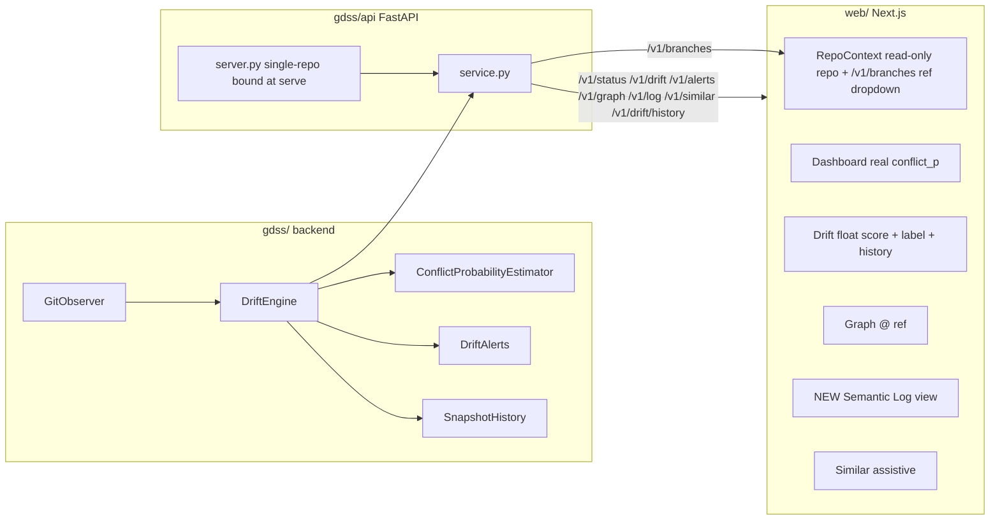

## Goal

Make the frontend depiction accurate and messages clear across every page. Five tiers: (0) serialization bug fixes + honest single-repo handling, (1) CLI/API parity, (2) built-but-unused UI surfaces, (3) structural improvements (branches + history + types), (4) honest depiction labels. All work test-first; `bash harness/verify.sh` and `bash harness/verify-frontend.sh` stay green.

## Target data flow

## Tier 0 — Serialization bug fixes (backend)

### T0.1 Fix convergence schema
- `DriftSnapshot.convergence` is a float in [0,1] ([gdss/drift/types.py:43](gdss/drift/types.py)), but UI reads it as boolean/string.
- In [gdss/api/service.py](gdss/api/service.py) `get_drift`: serialize `convergence_score` (float) + `convergence_label` from velocity sign (v<-eps=converging, v>eps=diverging, else stable).
- Test: `tests/api/test_handlers.py` asserts score is float, label is one of three literals.

### T0.2 Fix alert message
- [gdss/api/service.py:248](gdss/api/service.py) writes `f"Alert severity {alert}"` where `alert` is a DriftAlert dataclass — stringifies the whole object. Rich message from [gdss/drift/alerts.py:44-58](gdss/drift/alerts.py) is discarded.
- Fix: use `alert.message`. Serialize `affected` with `distance` and `reason` (currently stripped to id/name).
- Test: assert `message` contains branch name and "Magnitude:".

### T0.3 Remove dead `?repo=` query params (honest single-repo)
- The server is single-repo bound at `gdss serve --repo PATH` ([gdss/api/server.py:11](gdss/api/server.py), [gdss/cli/main.py:119](gdss/cli/main.py)). No handler reads `repo`. Yet every frontend query appends `?repo=...` ([dashboard-grid.tsx:59](web/components/dashboard/dashboard-grid.tsx), [drift/page.tsx:51](web/app/(dashboard)/drift/page.tsx), [graph/page.tsx:39](web/app/(dashboard)/graph/page.tsx), [similar/page.tsx](web/app/(dashboard)/similar/page.tsx)). The `RepoRefPicker` free-text repo input is a UX lie.
- Fix: remove `?repo=` from all frontend query strings. Make the repo field in [web/components/repo-ref-picker.tsx](web/components/repo-ref-picker.tsx) read-only (display the served repo path; optionally fetch it from a new `GET /v1/health` field or just show a static label). Keep the `ref` input — that becomes a real dropdown in T4.1.
- Test: `web/tests/repo-ref-picker.test.tsx` asserts repo field is read-only and ref dropdown renders branches from `/v1/branches`.

## Tier 1 — CLI/API parity (backend)

### T1.1 Expose drift sub-fields
- CLI shows `tip_distance`, `trajectory_integral` ([gdss/cli/start.py:500-501](gdss/cli/start.py)); API strips them.
- Fix: return both per branch in `get_drift`. UI can show the tip-vs-trajectory decomposition — the actual geometric story.

### T1.2 Expose conflict_probability
- `ConflictProbabilityEstimator` ([gdss/conflict/probability.py](gdss/conflict/probability.py)) used by CLI ([gdss/cli/start.py:470,493](gdss/cli/start.py)) but not exposed by API. Dashboard fabricates percentages instead.
- Fix: in `get_drift`, compute `conflict_probability` per branch via existing estimator. Return `score` (float), `reasons` (list), `heuristic: "flat"` (honesty label from [docs/MANIFOLD_TENSOR_GUIDE.md](docs/MANIFOLD_TENSOR_GUIDE.md)).
- Test: assert score in [0,1], reasons is list.

### T1.3 Enrich alerts response
- Return `affected` with `distance` and `reason` per symbol, plus full `message`.

## Tier 2 — Built-but-unused API surfaces (frontend)

### T2.1 Semantic Log view
- `GET /v1/log` implemented and tested ([gdss/api/service.py:253](gdss/api/service.py), [tests/api/test_handlers.py:41](tests/api/test_handlers.py)) but no UI.
- Fix: add `web/app/(dashboard)/log/page.tsx` — commit timeline where each row is a `dC` (commit) and each operator is a `T_i` (tangent vector). Most geometrically honest view. Add nav entry in [web/components/navigation.tsx](web/components/navigation.tsx).
- Test: `web/tests/log/log-page.test.tsx` renders, queries `/v1/log`, jest-axe clean.

### T2.2 Use /v1/symbols in search picker
- [web/app/(dashboard)/graph/page.tsx:60](web/app/(dashboard)/graph/page.tsx) re-derives symbols from `/v1/graph` nodes. `/v1/symbols` exists for this.
- Fix: `SymbolSearchPicker` in graph and similar pages sources from `/v1/symbols`.

## Tier 3 — Structural improvements (backend + frontend)

### T3.1 GET /v1/branches
- New endpoint listing local branches via `observer.list_local_branches()` (already used in get_drift/get_alerts). Ref picker becomes a real dropdown, not free text.
- Test: `tests/api/test_handlers.py::test_get_branches`.

### T3.2 GET /v1/drift/history?branch=
- `DriftEngine.snapshot` records to `SnapshotHistory` ([gdss/drift/history.py](gdss/drift/history.py)) but API only returns current snapshot. Drift timeline sparklines have no time-series data.
- Fix: new endpoint returning `[(timestamp, magnitude), ...]` from `SnapshotHistory.recent(branch, n=k)`. Sparklines become real trajectories gamma_i(t).
- Test: `tests/api/test_handlers.py::test_get_drift_history`.

### T3.3 API schema to TypeScript contract
- Each frontend page redeclares its own `interface DriftResponse` and they disagree (e.g. `convergence: boolean | string` in [drift/page.tsx:32](web/app/(dashboard)/drift/page.tsx) vs `convergence: string` in [drift-timeline-chart.tsx:13](web/components/drift/drift-timeline-chart.tsx)).
- Fix: hand-write `web/lib/api-types.ts` from [gdss/api/models.py](gdss/api/models.py) as single source of truth; all pages import from it. (Or generate via `openapi-typescript` if toolchain allows — decide during execution.)

## Tier 4 — Honest depiction (frontend)

### T4.1 Phase badges on every card
- Each dashboard/drift card declares its evidence source via a small badge component:
  - "Deterministic (phase 1-3)" — trajectory, graph, drift magnitude
  - "Assistive heuristic (phase 3 flat)" — conflict_probability, similar
  - "Not yet available (phase 4+)" — anything currently fabricated (remove or mark speculative)
- Files: [conflict-tree-card.tsx](web/components/dashboard/conflict-tree-card.tsx), [resolution-probability-card.tsx](web/components/dashboard/resolution-probability-card.tsx), [global-health-dial-card.tsx](web/components/dashboard/global-health-dial-card.tsx), [trajectory-card.tsx](web/components/dashboard/trajectory-card.tsx), [drift-attractor-card.tsx](web/components/dashboard/drift-attractor-card.tsx), [integrity-ribbon.tsx](web/components/dashboard/integrity-ribbon.tsx).

### T4.2 Replace fabricated metrics with real signals
- [web/components/dashboard/dashboard-grid.tsx:107-119](web/components/dashboard/dashboard-grid.tsx) fabricates `autoResolvePercent`, `aiAssistedPercent`, `manualReviewPercent` from operator counts.
- Fix: `ResolutionProbabilityCard` consumes real `conflict_probability.score` + `reasons` from `/v1/drift` (T1.2). Rename to `ConflictRiskCard`. Remove the three-way split (that is phase 5/6, not built).
- Fix: `GlobalHealthDialCard` consumes `remote_sync` ahead/behind (real, from `/v1/status`) + max drift magnitude (real). Drop invented `alignmentScore` formula. Label "Remote Sync and Drift".
- Fix: `ConflictTreeCard` rename to `OperatorBreakdownCard` — it shows operators, not a tensor.

### T4.3 Fix convergence handling in drift components
- [web/app/(dashboard)/drift/page.tsx:91-96](web/app/(dashboard)/drift/page.tsx) coerces a float to a label.
- Fix: use `convergence_score` (float) for gauge and `convergence_label` (string from T0.1) for badges. Update [drift-timeline-chart.tsx](web/components/drift/drift-timeline-chart.tsx), [drift-manifold-radar.tsx](web/components/drift/drift-manifold-radar.tsx), [severity-alerts-matrix.tsx](web/components/drift/severity-alerts-matrix.tsx), [drift-attractor-card.tsx](web/components/dashboard/drift-attractor-card.tsx).

### T4.4 Honesty footer + landing caveat
- Add a "What this shows / What it doesn't" footer to the dashboard mirroring [docs/MANIFOLD_TENSOR_GUIDE.md](docs/MANIFOLD_TENSOR_GUIDE.md). The landing hero ([web/components/landing/hero-panel.tsx](web/components/landing/hero-panel.tsx)) Omega_ij claim links to that guide's caveat about the flat R^m limit.

### T4.5 Sync docs
- Update [docs/FRONTEND_ROADMAP.md](docs/FRONTEND_ROADMAP.md) to match [harness/state/feature_list.json](harness/state/feature_list.json) statuses (F0.1-F6 are done, not pending). Update [docs/f1_api_contract.md](docs/f1_api_contract.md) with new fields and endpoints (`/v1/branches`, `/v1/drift/history`, `convergence_score`, `convergence_label`, `tip_distance`, `trajectory_integral`, `conflict_probability`). Remove `?repo=` from documented routes.

## Execution order (test-first, one feature at a time per harness rules)

1. T0.1 + T0.2 (backend serialization fixes) — smallest, unblocks all frontend drift work
2. T1.1 + T1.2 + T1.3 (backend parity) — unblocks T4.2
3. T3.1 + T3.2 (branches + history endpoints) — unblocks T4.3 sparklines + ref picker
4. T3.3 (TS types contract) — unblocks all frontend type-safe rewrites
5. T0.3 + T4.3 (remove dead ?repo=, read-only repo picker, ref dropdown, convergence fix)
6. T4.1 + T4.2 (phase badges + replace fabricated metrics)
7. T2.1 + T2.2 (semantic log view + symbols picker)
8. T4.4 + T4.5 (honesty footer + docs sync)

## Key files

- Backend API: [gdss/api/server.py](gdss/api/server.py), [gdss/api/service.py](gdss/api/service.py), [gdss/api/models.py](gdss/api/models.py)
- Backend drift/conflict: [gdss/drift/engine.py](gdss/drift/engine.py), [gdss/drift/types.py](gdss/drift/types.py), [gdss/drift/alerts.py](gdss/drift/alerts.py), [gdss/drift/history.py](gdss/drift/history.py), [gdss/conflict/probability.py](gdss/conflict/probability.py)
- Backend CLI: [gdss/cli/main.py](gdss/cli/main.py) (serve command)
- Frontend core: [web/lib/api.ts](web/lib/api.ts), [web/context/RepoContext.tsx](web/context/RepoContext.tsx), [web/components/repo-ref-picker.tsx](web/components/repo-ref-picker.tsx)
- Frontend dashboard: [web/components/dashboard/dashboard-grid.tsx](web/components/dashboard/dashboard-grid.tsx) + all card components
- Frontend drift: [web/app/(dashboard)/drift/page.tsx](web/app/(dashboard)/drift/page.tsx) + drift components
- Docs: [docs/FRONTEND_ROADMAP.md](docs/FRONTEND_ROADMAP.md), [docs/f1_api_contract.md](docs/f1_api_contract.md)
- Tests: [tests/api/test_handlers.py](tests/api/test_handlers.py), [tests/api/test_server.py](tests/api/test_server.py), [tests/api/test_privacy.py](tests/api/test_privacy.py)