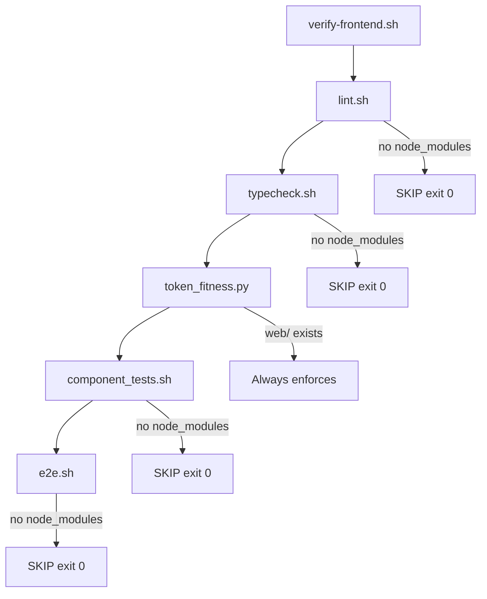

# Frontend hard gates (F0.1)

## Goal

Turn the existing graceful SKIP sensors into real gates by installing deps. Done when [`harness/state/feature_list.json`](harness/state/feature_list.json) `frontend-hard-gates` criteria are met:

- `cd web && pnpm install` completes (commit `pnpm-lock.yaml`)
- `bash harness/verify-frontend.sh` runs **eslint, tsc, token_fitness, vitest** (not SKIP for missing `node_modules`)
- **size-limit runs**; Playwright may still SKIP for missing browsers
- `bash harness/verify.sh` green
- Evidence in `progress.md` / feature status / handoff

Deps satisfied: `frontend-harness` is already `done`.

## Current state



- Sensors already exist and intentionally SKIP without toolchain ([`lint.sh`](harness/sensors/frontend/lint.sh), [`typecheck.sh`](harness/sensors/frontend/typecheck.sh), [`component_tests.sh`](harness/sensors/frontend/component_tests.sh), [`e2e.sh`](harness/sensors/frontend/e2e.sh)).
- [`web/package.json`](web/package.json) pins `"packageManager": "pnpm@9.0.0"`; no lockfile yet; `web/node_modules` absent (gitignored).
- [`harness/init.sh`](harness/init.sh) does **not** install Node/pnpm — out of scope for this feature (keep Python-only machines able to skip; hard gates are local once deps exist).

## Implementation steps

### 1. Toolchain bootstrap

- Ensure **Node 20** (matches `@types/node@20`) and **pnpm 9** (`corepack enable` or `npm i -g pnpm@9`).
- Run `cd web && pnpm install`.
- Commit the generated **`web/pnpm-lock.yaml`** so installs are reproducible (do not commit `node_modules`).

### 2. Make F1/F2 hard (expect real failures)

Run sensors individually, then the full gate:

```bash
bash harness/sensors/frontend/lint.sh
bash harness/sensors/frontend/typecheck.sh
python3 harness/sensors/frontend/token_fitness.py
bash harness/sensors/frontend/component_tests.sh
bash harness/verify-frontend.sh
```

Fix only what breaks once gates are live (likely candidates from the scaffold):

- Missing types (e.g. `@types/jest-axe` if `tsc` complains)
- ESLint/Next config issues under `web/`
- Vitest/jsdom setup gaps in existing tests

No product UI work in this slice — only make the scaffold pass under enforcement.

### 3. Make F3 size-limit actually run

[`e2e.sh`](harness/sensors/frontend/e2e.sh) already runs size-limit when `@size-limit/preset-app` is present; Playwright SKIP for missing browsers stays allowed.

Fix the known config mismatch so size-limit can succeed:

- [`web/size-limit.json`](web/size-limit.json) currently uses paths like `web/.next/...` and `web/components/...`, but `pnpm run size` runs with cwd `web/` — change paths to be **relative to `web/`** (e.g. `.next/static/chunks/main-*.js`, `components/ui/button.tsx`).
- Ensure the `size-limit` CLI package is available (add `size-limit` if the preset alone does not provide the binary).
- Before size-limit, ensure a Next build exists: update [`harness/sensors/frontend/e2e.sh`](harness/sensors/frontend/e2e.sh) to run `$pm run build` (or equivalent) when enforcing the main-route budget, with WHAT/WHY/FIX on build/size failure.

Do **not** install Playwright browsers in this feature unless needed to unblock something else; browser SKIP remains valid per done_criteria.

### 4. Full verify + harness state

- `bash harness/verify.sh` must stay green (backend layers + frontend hard gates).
- Update:
  - [`harness/state/feature_list.json`](harness/state/feature_list.json) — `frontend-hard-gates` → `done` + short `evidence`
  - [`harness/state/progress.md`](harness/state/progress.md) — what ran, key output lines
  - [`harness/state/session-handoff.md`](harness/state/session-handoff.md) — next feature is `frontend-local-api` (still blocked on backend deps) or whatever is next with deps satisfied

## Out of scope

- Playwright browser install / making axe-core CLS a hard gate
- Teaching `init.sh` or CI to install Node (belongs with later ops / `sp1-cicd`)
- Any `frontend-local-api` / app-shell product work
- Editing `gdss/**` or existing `tests/**` baselines

## Success evidence (for progress.md)

Gate output should show sensors **running** (not SKIP for `node_modules`), e.g.:

- `frontend/lint: running eslint...` → `OK`
- `frontend/typecheck: ...` → `OK`
- `token_fitness: OK`
- `frontend/component_tests: ...` → `OK`
- `frontend/e2e: running size-limit...` (Playwright may still say SKIP browsers)
- `verify-frontend: ALL FRONTEND LAYERS GREEN` and parent `verify.sh` green
