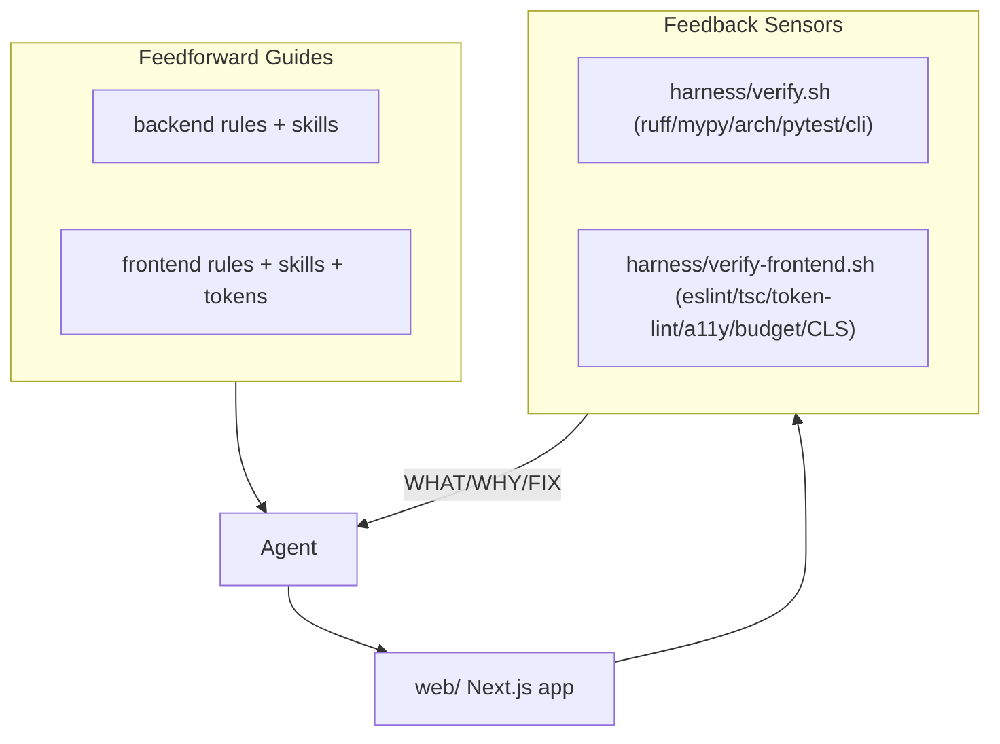

# Frontend Harness (the visual brain)

## Goal
The current harness answers *"How should an AI write correct code?"*. This adds a second brain answering *"How should an AI create an interface that feels polished, intuitive, and alive?"* by making the visual language part of the harness (feedforward guides + skills) and adding real, degrade-gracefully verification gates (feedback sensors), mirroring the backend harness in [harness/verify.sh](harness/verify.sh) and [.cursor/rules/40-verification-and-tdd.mdc](.cursor/rules/40-verification-and-tdd.mdc).

Decisions locked in: **harness + minimal scaffolded starter**, frontend lives in **`web/`**, package manager **pnpm**. No changes to `gdss/` Python code.

## Two-brain shape

## 1. Shared design + motion tokens (single source of truth)
Tokens live as real code so the harness can lint against them, and are mirrored in docs the agent reads.
- `web/lib/tokens.ts` and `web/lib/motion.ts`: durations `{ tiny:100, secondary:180, primary:250, slow:450, page:500 }`, easings (`easeOut`, `easeIn`, `easeInOut`, `spring`, `anticipation`, `overshoot` as cubic-beziers/spring configs — never `linear`), 4px spacing scale `[4,8,12,16,24,32,48,64]`, and the 8-state machine `Idle -> Hover -> Focused -> Pressed -> Loading -> Success -> Failure -> Disabled`.
- `.cursor/skills/motion-design/motion.md`: the human/agent-readable reference for the animation hierarchy (Level 0 nothing -> Level 10 physics), duration/easing/motion-hierarchy rules, and animation psychology ("movement before color before text; motion explains, not decorates").
- Tailwind config wires the same tokens so components can only use approved spacing/durations.

## 2. Frontend rules (feedforward) - `.cursor/rules/frontend/`
Create the 20 `.mdc` guides exactly as specified, each scoped with `globs: web/**` so they auto-apply on frontend files:
`01-design-language`, `02-layout`, `03-motion`, `04-animation`, `05-state-transitions`, `06-visual-hierarchy`, `07-color-system`, `08-typography`, `09-component-composition`, `10-glassmorphism`, `11-data-visualization`, `12-dashboard`, `13-loading-states`, `14-empty-states`, `15-error-ui`, `16-mobile`, `17-accessibility`, `18-performance`, `19-threejs`, `20-framer-motion`.
Cross-cutting content baked in: animation levels, micro-interactions (button/toggle/card), state-transition system, dashboard "Trend + Context + Comparison + Animation" (never a bare number), information hierarchy via spacing, component anatomy (Container -> Header -> Body -> Actions -> Footer) with staggered reveal, advanced interactions (shared layout `layoutId`, `staggerChildren`/`AnimatePresence`, SVG morph, physics), and the GDSS-specific visualization vision (nodes breathe, edges pulse, conflicts glow, drift moves, trajectory animates, merge converges) tied to the README's semantic-manifold framing.

## 3. Frontend skills (on-demand workflows) - `.cursor/skills/`
Knowledge skills (each a `SKILL.md`): `motion-design`, `animation-system`, `component-composition`, `dashboard-design`, `ux-patterns`, `interaction-design`, `data-visualization`, `glass-ui`, `canvas-effects`, `webgl`, `framer-motion`, `gsap`, `svg-animation`.
Plus two workflow skills mirroring the backend pattern of `verify-changes`/`add-semantic-operator`:
- `build-frontend-component`: token-driven, state-machine-complete, accessible, reduced-motion-aware component build loop.
- `verify-frontend`: how to run and read `harness/verify-frontend.sh`.

## 4. Minimal scaffolded starter - `web/`
Bare but real so gates run immediately:
- Next.js (App Router) + TypeScript + Tailwind + Framer Motion + shadcn/Radix setup, `lucide-react`; `package.json` scripts (`lint`, `typecheck`, `test`, `build`, `size`).
- Recommended stack documented for later growth: React Three Fiber, GSAP, D3/Visx, React Flow, Zustand, TanStack Query, Lottie (installed only as needed).
- Two reference components proving the visual language and giving the gates real targets: `Button` (full 8-state machine, token durations, `prefers-reduced-motion`, keyboard-accessible) and `MetricCard` (animated counter + sparkline + trend + comparison).
- Reference tests: `vitest` + Testing Library + `jest-axe`.

## 5. Frontend verification gates (feedback) - `harness/sensors/frontend/`
Layered like the backend, each layer gating the next, each **degrading gracefully** (skip with WHAT/WHY/FIX if `pnpm`/node/browsers absent) exactly like [harness/sensors/lint.sh](harness/sensors/lint.sh):
- Layer F1 static: `eslint` (+ `eslint-plugin-jsx-a11y`), `tsc --noEmit`, and a custom `token_fitness` sensor (no raw `ms`/`linear`/hex outside token files, no arbitrary Tailwind spacing, every interactive component ships a `prefers-reduced-motion` branch).
- Layer F2 component: `vitest` + `jest-axe` accessibility/behavior tests, reduced-motion tests.
- Layer F3 end-to-end: optional Playwright smoke that runs `axe-core` (keyboard nav + a11y), checks **no layout shift (CLS ~ 0)**, and a `size-limit` **bundle budget**; skips cleanly if browsers not installed.

## 6. Gate orchestration + integration
- New `harness/verify-frontend.sh` runs F1 -> F2 -> F3.
- Extend [harness/verify.sh](harness/verify.sh) to also invoke `verify-frontend.sh` **only when `web/` exists** (no-op otherwise), keeping one green definition of done.
- Extend the fast-sensor hook: add an `afterFileEdit` matcher in [.cursor/hooks.json](.cursor/hooks.json) so edits to `web/**/*.{tsx,ts,css}` trigger a fast frontend sensor (`.cursor/hooks/run-fast-frontend-sensors.sh`: token-lint + eslint on the changed file).

## 7. Docs + state
- Update [AGENTS.md](AGENTS.md) with a "Two brains" section, frontend build/verify commands, and a frontend definition of done.
- Update [harness/README.md](harness/README.md) to document the frontend layer.
- Add a `frontend` section to `harness/state/feature_list.json` and note the new gate in `progress.md` / `session-handoff.md`.

## Notes / defaults chosen
- Rules use `globs: web/**` (not `alwaysApply`) so the backend brain stays uncluttered when working in `gdss/`.
- Gates never hard-fail on missing Node tooling; they emit install instructions, matching backend graceful degradation, so `bash harness/verify.sh` stays runnable on a machine with only Python.
- Starter stays minimal (2 reference components); the animated semantic-graph dashboard is left as a documented next step, not built now.