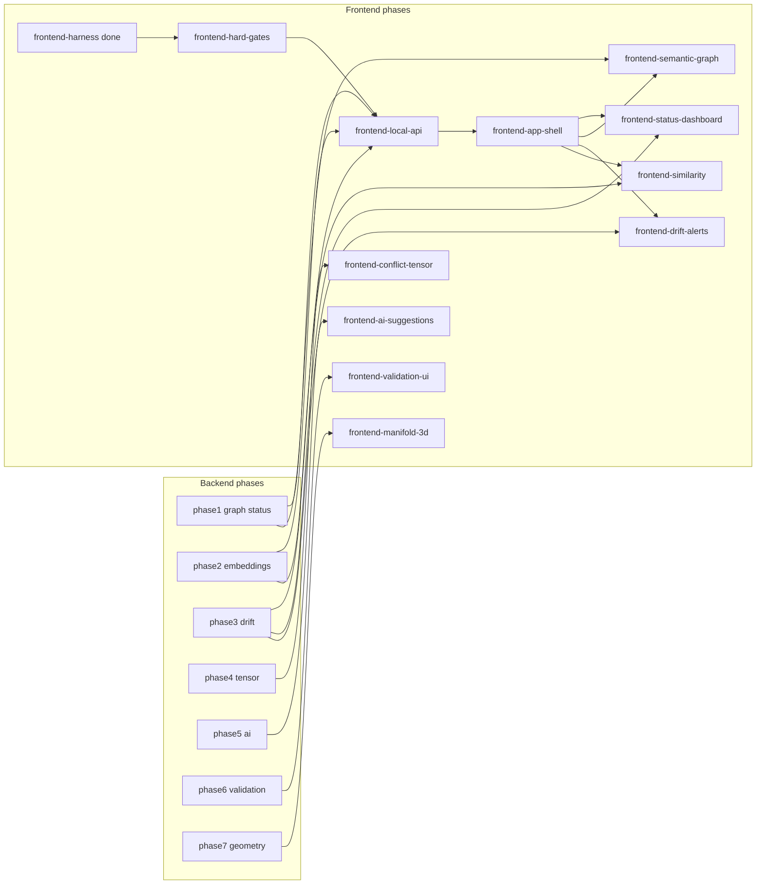

# Phase-Wise Frontend Integration Roadmap

## Decisions locked in
- **Same queue**: frontend features live in [`harness/state/feature_list.json`](harness/state/feature_list.json) as `frontend-*` entries with `deps` on backend phases (one shared one-feature-at-a-time queue).
- **API-first**: after hard gates, the next frontend feature is a local HTTP JSON API (`gdss/api` + `gdss serve`) exposing status/graph/drift/log/similar; UIs consume that API. No CLI-output scraping.
- **Definition of done**: backend work still gated by `bash harness/verify.sh`; frontend product features additionally require `bash harness/verify-frontend.sh` green (hard gates once `pnpm install` is done).
- **Scope of this plan (execution)**: author the roadmap into harness state + docs. Do **not** build the UI/API phases themselves yet — only queue them so agents can pick the next unfinished feature.

## Complementarity map

## Features to add to `feature_list.json`

| id | phase | title | deps | unlocks |
| --- | --- | --- | --- | --- |
| `frontend-harness` | F0 | already **done** | — | visual brain installed |
| `frontend-hard-gates` | F0.1 | Install JS toolchain; make F1/F2 (and F3 size-limit) hard gates green | `frontend-harness` | real frontend DoD |
| `frontend-local-api` | F1 | Local HTTP API: `gdss serve` / `gdss/api` JSON for status, graph export, drift, alerts, log, similar (metadata only; privacy rule) | `frontend-hard-gates`, `phase1-graph`, `phase2-embeddings`, `phase3-drift` | live data for all UIs |
| `frontend-app-shell` | F2 | App shell: nav, repo/ref picker, routes, loading/empty/error patterns, TanStack Query client over the API | `frontend-local-api` | surface for every view |
| `frontend-status-dashboard` | F3 | Instrument dashboard: MetricCards for trajectory length, drift vs attractor, active conflicts — Trend+Context+Comparison+Animation wired to `/status` + `/drift` | `frontend-app-shell` | complements status + drift CLI |
| `frontend-semantic-graph` | F4 | React Flow semantic graph: nodes breathe, edges pulse, select → impact; data from `/graph` | `frontend-app-shell` | complements `analyze` / `graph export` / `impact` |
| `frontend-drift-alerts` | F5 | Drift timeline + severity alerts UI from `/drift` + `/alerts` | `frontend-app-shell` | complements `gdss drift` / `alerts` |
| `frontend-similarity` | F6 | Assistive similarity explorer from `/similar` (labeled assistive; never authoritative) | `frontend-app-shell` | complements `gdss similar` |
| `frontend-conflict-tensor` | F7 | `Omega_{ij}` heatmap + commutativity table; conflicts glow | `frontend-app-shell`, `phase4-tensor` | complements conflict tensor |
| `frontend-ai-suggestions` | F8 | Suggestion review UI; **never auto-merge**; show deterministic validation status | `frontend-app-shell`, `phase5-ai` | complements AI convergence |
| `frontend-validation-ui` | F9 | Validation sandbox results surface | `frontend-ai-suggestions`, `phase6-validation` | complements validation layer |
| `frontend-manifold-3d` | F10 | Lazy-loaded R3F manifold (trajectory/merge/drift in 3D) with 2D React Flow fallback + reduced-motion | `frontend-semantic-graph`, `phase7-research` | complements geometry research |

Each entry gets: `status: pending` (except harness already `done`), `layer: frontend`, concrete `done_criteria` naming files/routes/tests and requiring `verify-frontend.sh` green.

## API contract (phase F1 — design note in feature `done_criteria`)

Additive under `gdss/api/` (already an architecture entrypoint; does not violate two-brain purity). Expose JSON only (no source code / no PII), for example:

- `GET /v1/status?repo=&ref=`
- `GET /v1/graph?repo=` (nodes/edges from existing `CodeGraph` / `graph export` shape)
- `GET /v1/drift?repo=&ref=` / `GET /v1/alerts?repo=&ref=`
- `GET /v1/log?repo=&n=`
- `GET /v1/similar?repo=&symbol=&k=`

CLI: `gdss serve --repo PATH --port 8787`. Frontend `web/` talks to it via env `NEXT_PUBLIC_GDSS_API`.

Privacy: reuse [`60-telemetry-privacy`](.cursor/rules/60-telemetry-privacy.mdc) — metadata/symbol names only; no file bodies in API payloads.

## Docs / harness updates (this plan’s implementation work)

1. **[`harness/state/feature_list.json`](harness/state/feature_list.json)** — append the `frontend-*` features above; set `definition_of_done` note that frontend features also require `verify-frontend.sh`; keep `frontend-harness` as done.
2. **[`AGENTS.md`](AGENTS.md)** — in startup lifecycle / two-brains: agents pick the next unfinished feature from the shared list (backend or frontend); frontend product work uses `build-frontend-component` + `verify-frontend`.
3. **[`harness/README.md`](harness/README.md)** — short “Frontend product phases” pointer to the `frontend-*` ids and the complementarity map.
4. **[`harness/state/session-handoff.md`](harness/state/session-handoff.md)** + **[`progress.md`](harness/state/progress.md)** — next recommended pick: `frontend-hard-gates`, then `frontend-local-api`.
5. **[`docs/FRONTEND_ROADMAP.md`](docs/FRONTEND_ROADMAP.md)** — human-readable phase table + mermaid map (same content as above) so the vision is not only in JSON.

## Explicit non-goals for this plan’s execution
- Do not implement `gdss serve`, React Flow, or dashboard UIs yet.
- Do not modify existing `gdss/` behavior beyond what future agents do when they pick `frontend-local-api` (that feature will explicitly authorize additive `gdss/api/`).
- Do not edit the attached Frontend Harness plan file.