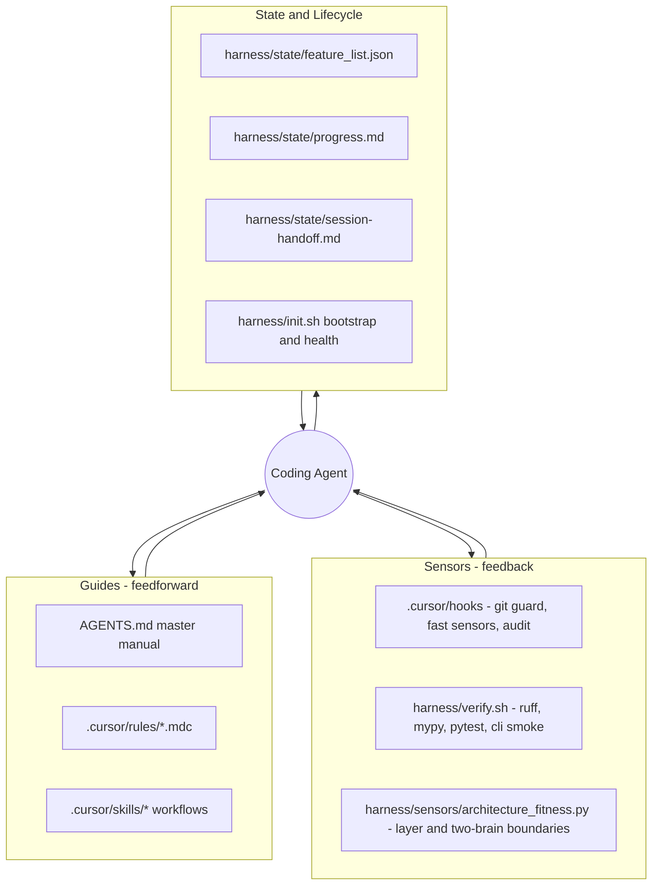

# GDSS Harness Engineering

Build an outer harness so AI agents can extend GDSS safely and reliably. Pure additive work: no edits to any file under `gdss/`, `tests/`, or `pyproject.toml`. Everything below is NEW files in `AGENTS.md`, `.cursor/`, and a new `harness/` folder.

## Grounding (from the references)

- Fowler/Böckeler: `Agent = Model + Harness`; harness = **Guides** (feedforward, steer before acting) + **Sensors** (feedback, validate after acting), each **Computational** (deterministic) or **Inferential** (LLM). Regulate three categories: **Maintainability**, **Architecture fitness**, **Behaviour**. Apply the **ratchet principle** and **keep quality left**.
- walkinglabs: five subsystems — **Instructions, State, Verification, Scope, Lifecycle** — and a structured session lifecycle (init → select one feature → execute → verify → handoff). Lectures 9-10: agents are **systematically overconfident**, so termination must be **externalized** via a **three-layer validation hierarchy** (static → runtime/tests → end-to-end), and failures must use **agent-oriented error messages (WHAT / WHY / FIX)**.
- mattpocock TDD skill: **red-green-refactor** with **vertical slices** (one test → one impl → repeat; never all-tests-then-all-code), tests verify **behavior through public interfaces** (survive refactors), **deep modules** (small interface, deep implementation), **interface design for testability** (inject dependencies, return values over side effects), **mock only at system boundaries**, **never refactor while red**.

## Test-Driven Development (how TDD threads through the harness)

TDD is a first-class part of the **Behaviour harness** and is wired into both guides and sensors, not just mentioned:

- Guide: a dedicated `tdd` skill encodes the red-green-refactor loop and good/bad test rules.
- Guide: rule `40-verification-and-tdd.mdc` makes "write the failing test first" and "no refactor while red" always-on policy.
- Sensor: `harness/verify.sh` is the externalized termination gate implementing the three-layer validation hierarchy; the agent may not declare done on "code is written" — only on green evidence.
- Sensor: pytest is the runtime layer; the GDSS CLI smoke (`gdss status`/`log`) is the end-to-end layer that catches cross-component (parser → extractor → graph → CLI) boundary defects unit tests miss.
- Existing tests in [tests/](tests/) (e.g. [tests/test_transform_extractor.py](tests/test_transform_extractor.py)) define the behavior-through-public-interface baseline the skill points to as exemplars.

## How it maps to GDSS

GDSS already declares a 10-layer + two-brain architecture in [.cursor/plans/gdss_complete_roadmap_e8cc388d.plan.md](.cursor/plans/gdss_complete_roadmap_e8cc388d.plan.md). The harness enforces those invariants and the mission from [FROM WHERE IT ALL STARTED..txt](FROM WHERE IT ALL STARTED..txt).

## Files to create

### Instructions / Guides (feedforward)

- [AGENTS.md](AGENTS.md): master operating manual. Mission/North Star, what GDSS is and is NOT, build/test/verify commands, the startup lifecycle, **TDD-first definition of done** (failing test first; done = three-layer validation green, not "code written"), golden rules (deterministic brain stays pure; never auto-merge; acknowledge halting-problem limits), pointers to deeper docs (progressive disclosure, kept lean).
- [.cursor/rules/00-gdss-context.mdc](.cursor/rules/00-gdss-context.mdc) (`alwaysApply`): the mission and product framing distilled from the source text.
- [.cursor/rules/10-architecture-invariants.mdc](.cursor/rules/10-architecture-invariants.mdc) (`alwaysApply`): 10-layer dependency direction + two-brain rule (deterministic `core/graph/watcher` must never import probabilistic `embeddings/ai`); maps to the roadmap structure.
- [.cursor/rules/20-math-domain-glossary.mdc](.cursor/rules/20-math-domain-glossary.mdc) (`alwaysApply`): ubiquitous language — manifold, trajectory `gamma_i(t)`, tangent `dC`, drift `I(B_i)`, conflict tensor `Omega_{ij}`, commutativity `[T_i,T_j]`. Keeps naming consistent.
- [.cursor/rules/30-python-conventions.mdc](.cursor/rules/30-python-conventions.mdc) (`globs: **/*.py`): dataclass/enum patterns mirroring [gdss/core/transform_types.py](gdss/core/transform_types.py), typing, Typer+Rich CLI conventions from [gdss/cli/main.py](gdss/cli/main.py).
- [.cursor/rules/40-verification-and-tdd.mdc](.cursor/rules/40-verification-and-tdd.mdc) (`alwaysApply`): TDD is mandatory — write the failing test first, red → green → refactor in vertical slices (one behavior at a time), never refactor while red, no premature optimization until core behavior is verified. Definition of done = three-layer validation hierarchy green (static → tests → CLI end-to-end), evidence required; "code is written" is not "done". Termination is externalized to `harness/verify.sh`, not the agent's confidence.
- [.cursor/rules/50-harness-discipline.mdc](.cursor/rules/50-harness-discipline.mdc) (`alwaysApply`): ratchet principle, keep-quality-left, update State files every session, no-edit zones.

### Skills (on-demand workflow guides)

- [.cursor/skills/tdd/SKILL.md](.cursor/skills/tdd/SKILL.md) (+ one-level reference [.cursor/skills/tdd/tests.md](.cursor/skills/tdd/tests.md)): the GDSS-adapted TDD loop — red-green-refactor in vertical slices, behavior-through-public-interface tests, deep modules, interface design for testability, mock only at boundaries (e.g. real `tree-sitter`/`GitPython` over mocks; mock only true externals), never refactor while red. Uses pytest commands and points to existing `tests/` as exemplars.
- [.cursor/skills/add-semantic-operator/SKILL.md](.cursor/skills/add-semantic-operator/SKILL.md): end-to-end workflow to add a new `OperatorType`, **test-first** — write the failing extractor test, then `transform_types` → `transform_extractor` → green → refactor → verify.
- [.cursor/skills/implement-gdss-phase/SKILL.md](.cursor/skills/implement-gdss-phase/SKILL.md): pick one roadmap feature, follow the session lifecycle, update state, verify.
- [.cursor/skills/verify-changes/SKILL.md](.cursor/skills/verify-changes/SKILL.md): run/interpret the verification pipeline.
- [.cursor/skills/audit-harness/SKILL.md](.cursor/skills/audit-harness/SKILL.md): apply the ratchet — turn a recurring failure into a new guide or sensor.

### Sensors (feedback) — Cursor hooks

- [.cursor/hooks.json](.cursor/hooks.json): wire the hooks below (schema `version: 1`).
- [.cursor/hooks/block-dangerous-git.sh](.cursor/hooks/block-dangerous-git.sh): `beforeShellExecution`, blocks `push`, `reset --hard`, `clean -f`, `branch -D`, history rewrites (`exit 2`).
- [.cursor/hooks/run-fast-sensors.sh](.cursor/hooks/run-fast-sensors.sh): `afterFileEdit` (matcher `Write`), runs ruff + `py_compile` on the edited `.py`, returns LLM-optimized self-correction guidance (positive prompt injection).
- [.cursor/hooks/audit-log.sh](.cursor/hooks/audit-log.sh): `afterShellExecution`, appends observability records to `harness/state/audit.log`.

### Verification (computational sensors) + config

- [harness/verify.sh](harness/verify.sh): the externalized termination gate, implementing the **three-layer validation hierarchy** — Layer 1 static (ruff + mypy + architecture fitness), Layer 2 runtime (pytest), Layer 3 end-to-end (`gdss` CLI smoke over a fixture repo). Each layer gates the next; nonzero exit on any failure; emits agent-oriented WHAT/WHY/FIX messages.
- [harness/init.sh](harness/init.sh): bootstrap (venv, `pip install -e .`, verify tree-sitter languages, `gdss --help` smoke, health checks).
- [harness/sensors/lint.sh](harness/sensors/lint.sh), [harness/sensors/typecheck.sh](harness/sensors/typecheck.sh) (Layer 1), [harness/sensors/run_tests.sh](harness/sensors/run_tests.sh) (Layer 2, pytest), [harness/sensors/cli_smoke.sh](harness/sensors/cli_smoke.sh) (Layer 3, end-to-end CLI run that exercises parser → extractor → graph → CLI together): individual computational sensors composing the validation hierarchy.
- [harness/sensors/architecture_fitness.py](harness/sensors/architecture_fitness.py): the sophisticated custom structural sensor (ArchUnit-style). Parses imports across `gdss/` and enforces the 10-layer direction + two-brain purity; emits LLM-optimized violation messages. Read-only over `gdss/`.
- [ruff.toml](ruff.toml) and [mypy.ini](mypy.ini): standalone tool configs (new files; pyproject.toml untouched).

### State + Lifecycle

- [harness/state/feature_list.json](harness/state/feature_list.json): machine-readable scope derived from the 7 roadmap phases (id, status, deps, done-criteria) — Scope subsystem.
- [harness/state/progress.md](harness/state/progress.md): seeded session progress log.
- [harness/state/session-handoff.md](harness/state/session-handoff.md): seeded handoff template.
- [harness/README.md](harness/README.md): explains the harness, maps every artifact to Fowler's guides/sensors and the five subsystems, and how to extend it via the ratchet.

## Notes / decisions

- Tool-agnostic `AGENTS.md` is the single master guide (Cursor reads it); no separate CLAUDE.md unless requested.
- All Python tool config goes in standalone files (`ruff.toml`, `mypy.ini`) to honor "no change to existing code/config".
- The workspace is not currently a git repo; `block-dangerous-git.sh` still protects future git use, and `init.sh` will note/optionally `git init` only with explicit consent.
- All `.sh` and hook scripts will be made executable; hook scripts depend only on `bash`, `python3`, `jq` (verified before finalizing).

