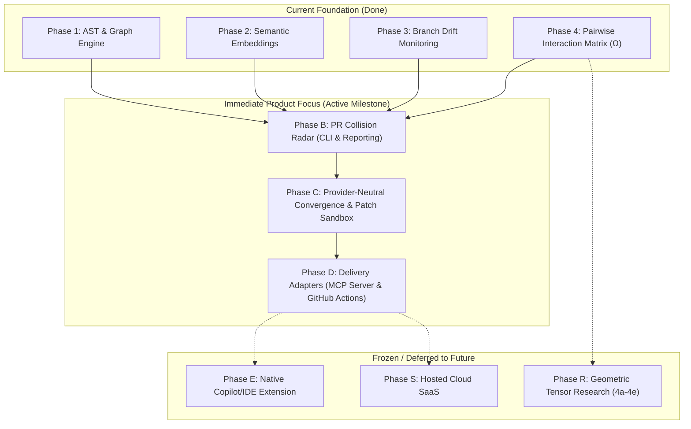

# GDSS Strategic Pivot: PR Collision Radar & Merge Assistance Platform

## Goal Description
Pivot GDSS from an abstract, theoretical differential geometry model of software into a pragmatic, high-impact **Semantic Branch Intelligence and PR Collision Radar**. 
The system detects, explains, and proposes verified resolutions for dangerous branch interactions across concurrent pull requests before merge, delivering value through CLI, an MCP server (zero token cost to GDSS), and GitHub Actions.

---

## User Review Required

> [!IMPORTANT]
> **Jargon Demotion Policy:** We retain mathematical rigor (commutativity $[\mathcal{T}_i, \mathcal{T}_j] = 0$, transform operators, pairwise interaction matrix $\Omega_{ij}$, graph topological ordering) in internal research docs and backend algorithms, but **completely purge alienating jargon from user-facing surfaces** (CLI, PR reports, error messages, docs, dashboard). Users will see "Branch Collision Matrix" and "Integration Risk Score," not "Ricci curvature on continuous manifolds."

> [!IMPORTANT]
> **Freeze Theoretical Geometry (Phases 4a–4e):** The open-ended differential geometry ladder (Riemannian metric $G$, parallel transport $P$, rank-$N$ octopus tensors on $M^N$) is moved to an auxiliary research track (`Phase R: Geometry Research`). It will **not block** product delivery.

> [!IMPORTANT]
> **Zero-Token-Cost Inference Architecture:**
> 1. **MCP First:** Cursor / Claude Code / Copilot invokes GDSS deterministic analysis tools using the client's own LLM subscription. GDSS incurs zero API cost.
> 2. **GitHub Actions:** Leverages the repository's native `GITHUB_TOKEN` (via GitHub Models) or developer-supplied secrets.
> 3. **Local Dev:** Retains optional Ollama/vLLM support without requiring it for core functionality.
> 4. **No Mandatory LLM:** Deterministic collision detection and ranking always work offline without an AI model.

---

## Restructured Roadmap & Phases



| New Phase | Old Mapping | Focus & Deliverable | Status |
| :--- | :--- | :--- | :--- |
| **Phase A** | Phase 1 & 1.1 | AST symbol extraction, operator engine, dependency graph | **Done** |
| **Phase B** | Phase 3 & 4 | **PR Collision Radar:** Pairwise collision matrix ($\Omega$), affected caller analysis, actionable risk ranking | **Focus Now** |
| **Phase C** | Phase 5 & 6 | **Convergence Assistant & Sandbox:** Provider-neutral LLM adapter (cloud + local), patch synthesis, isolated worktree test validation | **Focus Next** |
| **Phase D** | New | **Delivery Interfaces:** Read-only MCP Server for Cursor/Copilot + GitHub Actions PR check workflow | **Focus Next** |
| **Phase E** | New | Native VS Code / GitHub Copilot Extension (bespoke UI) | Deferred |
| **Phase R** | Phase 4a–4e | Geometric Manifold Research (Riemannian metric, parallel transport) | Frozen (Research only) |

---

## Proposed Changes

### 1. Specification & Context Documentation
#### [NEW] `PRODUCT_SPEC.md`
- Master technical specification defining the Problem Statement, Solution, extensive User Stories, Implementation Decisions, Testing Decisions, and Scope boundaries using the `/to-spec` standard.

#### [MODIFY] `AGENTS.md`
- Refocus mission: "Semantic Branch Intelligence and Merge Assistance Platform."
- Demote manifold theory to background research; prioritize developer tool delivery.
- Update startup lifecycle and definition of done to reference the new product roadmap.

#### [MODIFY] `.agents/rules/00-gdss-context.mdc`
- Define GDSS as a pragmatic developer tool (PR collision radar & convergence assistant).
- Enforce the 3-tier zero-token-bleed inference model.

#### [MODIFY] `.agents/rules/20-math-domain-glossary.mdc`
- Clearly separate user-facing terminology (Collision Matrix, Drift, Merge Order) from internal mathematical abstractions ($\Omega_{ij}$, commutativity).

### 2. Roadmap & State Alignment
#### [MODIFY] `harness/state/feature_list.json`
- Deprecate Phase 4a–4e as blockers; mark them as `deferred/research`.
- Insert `phase-b-collision-radar`, `phase-c-convergence-assistant`, and `phase-d-mcp-github-actions` with clear acceptance criteria.

#### [MODIFY] `docs/PRODUCT_INTENT.md` & `docs/IMPLEMENTATION_GAP.md`
- Update North Star to emphasize PR collision detection, MCP integration, and sandboxed patch validation.

### 3. AI & Provider Modernization
#### [MODIFY] `gdss/ai/model_manager.py` & `vllm_provider.py`
- Remove the restrictive `localhost`-only check when valid credentials/remote URLs are supplied.
- Generalize `VLLMProvider` into an `OpenAICompatibleProvider` capable of routing to GitHub Models, Azure, OpenAI, or local vLLM.

#### [NEW] `gdss/mcp/`
- Implement an MCP server exposing deterministic tools (`gdss_analyze_collisions`, `gdss_get_merge_order`, `gdss_inspect_symbol_impact`, `gdss_validate_patch`).

---

## Verification Plan

### Automated Tests
```bash
# Run backend validation gate (lint + typecheck + architecture + pytest + CLI smoke)
bash harness/verify.sh

# Verify provider neutrality (mocked cloud + local backends)
pytest tests/ai/ -q

# Verify MCP server tool registry and serialization
pytest tests/mcp/ -q
```

### Manual Verification
1. Inspect `PRODUCT_SPEC.md` to confirm complete user-story and architectural alignment.
2. Verify that CLI commands (`gdss status`, `gdss tensor`, `gdss suggest`) output human-readable labels instead of academic jargon.
3. Test MCP server connection with Cursor/Claude Code to verify zero-token-bleed tool execution.
