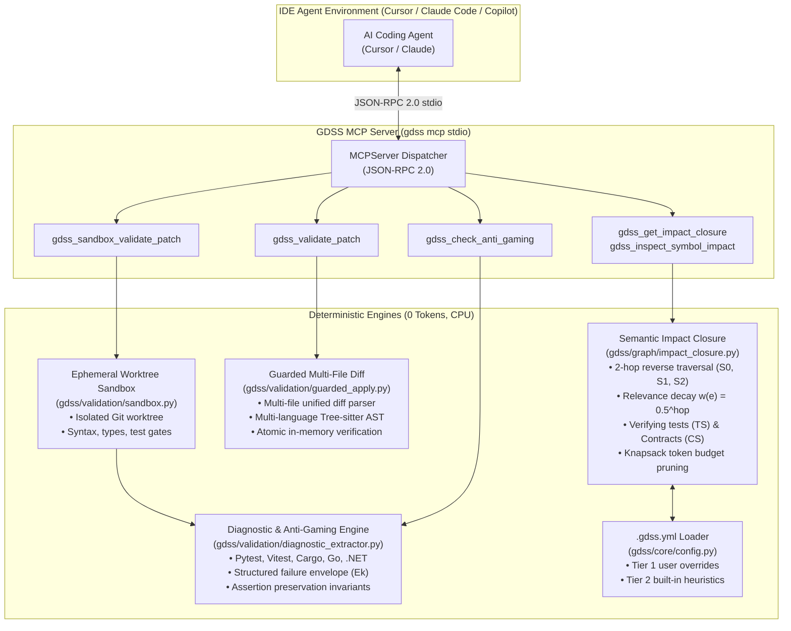

# 🧠 Plan: GDSS MCP Layer Semantic Intelligence & Diagnostics Integration

## Goal Description

GDSS operates across 4 core deployment verticals:
1. **GitHub Actions PR Radar (`gdss-radar`)**: Merge-time gatekeeper.
2. **Local CLI (`gdss`)**: Developer terminal workflows.
3. **IDE-First MCP Server (`gdss mcp`)**: Authoring-time Copilot intelligence in Cursor, Claude Code, and Copilot.
4. **Web Visual Manifold (`web/`)**: Spatial repository geometry and drift observability.

While the PR Radar and Local CLI were recently upgraded with the 3 major deterministic engines (Semantic Impact Closure, Multi-File Guarded Apply, and Closed-Loop Diagnostics with Anti-Gaming Invariants), the **MCP server** (`gdss/mcp/`) remained in a legacy state:
- `gdss_inspect_symbol_impact` was restricted to a naive 1-hop downstream lookup, unaware of 2-hop closures, contract files, verifying tests, token budgets, or `.gdss.yml` patterns.
- `gdss_validate_patch` only supported single-file Python diffs via naive `ast.parse`, failing on multi-file refactors and non-Python languages.
- `gdss_sandbox_validate_patch` discarded structured `report.diagnostics` ($E_k$) and anti-gaming audit results, returning raw unparsed strings.
- IDE agents had no direct tools to query Semantic Impact Closure or check anti-gaming invariants.

This change elevates the MCP tool server to full architectural parity with the core engines, expanding the MCP tool registry from 6 to 8 tools and delivering $0-token deterministic intelligence directly to Cursor, Claude Code, and Copilot.

---

## User Review Required

> [!IMPORTANT]
> **MCP Tool Inventory Recheck: Current 6 Active Tools ➔ Expanding to 8 Registered Tools**
> We performed an exhaustive audit across `gdss/mcp/server.py`, `gdss/mcp/tools.py`, `tests/mcp/test_mcp_server.py`, and git history to verify the exact tool counts:
> 
> 1. **Current Codebase State (Exactly 6 Registered Tools)**:
>    In `gdss/mcp/server.py` (lines 25–198) and verified by `test_mcp_server.py:32` (`assert len(tool_names) == 6`), there are currently **6 registered MCP tools**:
>    - `gdss_find_collisions`
>    - `gdss_get_merge_order`
>    - `gdss_inspect_symbol_impact`
>    - `gdss_validate_patch`
>    - `gdss_plan_semantic_rebase`
>    - `gdss_sandbox_validate_patch`
> 
> 2. **Why "8 Tools" is Familiar (Origins of the 8 Count)**:
>    - **Origin A (Source File Functions)**: In `gdss/mcp/tools.py`, there are exactly **8 top-level functions**: the 6 exposed tools above plus 2 internal helpers (`_serialize_op` and `_apply_unified_diff`).
>    - **Origin B (Early Architecture Spec)**: An early pre-pivot commit (`d852381`) conceived 8 tools (`status`, `tensor`, `conflict_check`, `merge_order`, `rebase_plan`, `find_similar`, `suggest_resolutions`, `validate_patch`). During the Zero-Token-Bleed & Two-Brain Purity overhaul, probabilistic tools (`suggest_resolutions`, `find_similar`) were removed, and radar commands were unified into `find_collisions`, leaving 6 deterministic tools.
> 
> 3. **The Target State (8 Registered Tools)**:
>    By implementing this plan, the official MCP tool registry will officially expand from **6 to 8 tools**:
>    1. `gdss_find_collisions` (Existing - Pairwise $\Omega_{ij}$ tensor & drift)
>    2. `gdss_get_merge_order` (Existing - Optimal branch merge sequence)
>    3. `gdss_plan_semantic_rebase` (Existing - Commutativity-aware transport plan)
>    4. `gdss_inspect_symbol_impact` (**Upgraded** - Backward-compatible, now powered by 2-hop Semantic Impact Closure)
>    5. `gdss_get_impact_closure` (**NEW (Tool #7)** - Dedicated, highly-configurable Semantic Impact Closure engine with symbol/file targets, token budgeting, and contract/test discovery)
>    6. `gdss_validate_patch` (**Upgraded** - Multi-file, multi-language Tree-sitter AST validation with atomic in-memory diff application)
>    7. `gdss_sandbox_validate_patch` (**Upgraded** - Returns structured diagnostics $E_k$ payload and anti-gaming status)
>    8. `gdss_check_anti_gaming` (**NEW (Tool #8)** - Dedicated tool to audit proposed test file modifications against assertion-preservation invariants)

> [!NOTE]
> **Zero Token Core + Bring Your Own Key (BYOK) Purity**:
> All MCP tools run strictly on local CPU within the user's IDE environment for **$0 and 0 tokens**. The external IDE LLM (Cursor, Claude Code) powers the chat using the developer's existing subscription, using GDSS as a deterministic intelligence oracle.

---

## Architecture & Data Flow



---

## Proposed Changes

 Grouped by layer and component:

### 1. Validation Types Layer

#### [MODIFY] [types.py](file:///home/sarakb/projects/GDSS/gdss/validation/types.py)
- Extend `ValidationReport` to include `anti_gaming: Any = None` alongside `diagnostics: Any = None`.
- This ensures sandboxed runs can capture and expose both structured test failure diagnostics and anti-gaming audit results to callers.

---

### 2. Validation Sandbox Layer

#### [MODIFY] [sandbox.py](file:///home/sarakb/projects/GDSS/gdss/validation/sandbox.py)
- In `ValidationSandbox.validate_patch`:
  - Collect `anti_gaming_results: list[dict[str, Any]]` during the Gate 1 test diff inspection.
  - Store `anti_gaming=anti_gaming_results` on the generated `ValidationReport`.
  - When test execution fails in Gate 3, ensure `diagnostics=diag_payload` is always populated and preserved.

---

### 3. MCP Tools & Server Layer

#### [MODIFY] [tools.py](file:///home/sarakb/projects/GDSS/gdss/mcp/tools.py)

1. **Upgrade `inspect_symbol_impact` & Implement `get_impact_closure`**:
   - Load `ImpactClosureConfig` from `.gdss.yml` via `load_gdss_config(repo_path)`.
   - Build `CodeGraph` and invoke `compute_semantic_impact_closure(code_graph, conflict_symbols=[symbol], max_hops=max_hops, token_budget=token_budget, relevance_threshold=relevance_threshold, config=config.impact_closure)`.
   - Return structured closure:
     - `symbol`: queried symbol name.
     - `closure_nodes`: list of nodes with `symbol_id`, `file_path`, `node_type`, `hop_distance`, `weight`, `implicated_by`, `relation`.
     - `implicated_files`: sorted list of files implicated by the 2-hop closure.
     - `target_tests`: list of verifying test suite paths ($T_S$).
     - `contract_files`: list of API contracts/schemas/routes ($C_S$).
     - `total_estimated_tokens`: estimated token count.
     - `modifying_branches`: active branches touching these symbols.
     - `downstream_impact_count`: count of impacted symbols.
     - `node_info`: AST details of the root symbol.

2. **Upgrade `validate_patch`**:
   - Replace the single-file in-memory diff applicator with `parse_multi_file_unified_diff` from `gdss.validation.guarded_apply`.
   - For each file in the diff:
     - Read base content from disk if it exists; otherwise use empty string.
     - Apply diff hunks using `_apply_unified_diff`.
     - Validate syntax across languages using `validate_source_syntax` (Python, TS, JS, Go, Rust, C#, Java, C, C++).
   - If any file fails syntax or diff application, return `valid: false` with detailed `error` and per-file failures.
   - Return `valid: true`, total hunks applied, lines added/removed, and list of validated files.

3. **Upgrade `sandbox_validate_patch`**:
   - In `sandbox_validate_patch`, serialize `report.diagnostics` (using `.to_dict()` if `DiagnosticPayload`, or raw dict).
   - Surface `anti_gaming`: list of anti-gaming check outcomes or warnings.
   - Return rich structured payload including failed test names, line numbers, expected vs. actual values, and suggested actions.

4. **Add `check_anti_gaming`**:
   - New tool function `check_anti_gaming(patch: str, file_path: str, repo_path: str = ".", strict: bool = True, allow_callsite_updates: bool = True)`.
   - Inspects test diff for deletion of assertions or replacement with trivial passes using `inspect_test_diff_anti_gaming`.
   - Returns `passed`, `deleted_assertions_count`, `modified_assertions_count`, and `warnings`.

#### [MODIFY] [server.py](file:///home/sarakb/projects/GDSS/gdss/mcp/server.py)
- Bump `SERVER_VERSION = "0.2.0"`.
- Update `TOOLS` registry with:
  - Upgraded schema for `gdss_inspect_symbol_impact` (adds `file_path`, `max_hops`, `token_budget`, `relevance_threshold`).
  - New schema for `gdss_get_impact_closure`.
  - Upgraded schema for `gdss_validate_patch` (makes `file_path` optional for multi-file git diffs with `diff --git` headers).
  - Upgraded schema for `gdss_sandbox_validate_patch`.
  - New schema for `gdss_check_anti_gaming`.
- Update `MCPServer.call_tool` dispatcher to handle `gdss_get_impact_closure` and `gdss_check_anti_gaming`.

---

### 4. Documentation & Guide Synchronization

#### [MODIFY] [STANDALONE_BINARY_AND_MCP_GUIDE.md](file:///home/sarakb/projects/GDSS/docs/STANDALONE_BINARY_AND_MCP_GUIDE.md)
- Update "The 6 Native MCP Tools" to "The 8 Native MCP Tools Available to AI".
- Add comprehensive documentation and example prompts for:
  - `gdss_get_impact_closure`
  - `gdss_check_anti_gaming`
  - Upgraded multi-file `gdss_validate_patch`
  - Upgraded structured diagnostics in `gdss_sandbox_validate_patch`

---

### 5. Test Suite

#### [MODIFY] [test_mcp_server.py](file:///home/sarakb/projects/GDSS/tests/mcp/test_mcp_server.py)
- Update `test_mcp_tools_list` to assert 8 tools and check new schemas.
- Add `test_mcp_inspect_symbol_impact_semantic_closure`: verifies 2-hop closure nodes, verifying tests, and contract files are returned.
- Add `test_mcp_get_impact_closure`: verifies dedicated SIC tool with token budget and hop limits.
- Add `test_mcp_validate_patch_multi_file_multi_language`: verifies a unified diff modifying a Python file and a TypeScript file validates both cleanly.
- Add `test_mcp_sandbox_validate_patch_structured_diagnostics`: verifies failed test executions include structured `diagnostics` with failed test names, line numbers, and expected vs actual.
- Add `test_mcp_check_anti_gaming_violation`: verifies test assertion deletions are flagged with anti-gaming warnings over MCP.

---

## Verification Plan

### Automated Tests
1. Run MCP-specific tests:
   ```bash
   pytest tests/mcp/test_mcp_server.py -v
   ```
2. Run the complete GDSS Verification Gate (all layers):
   ```bash
   bash harness/verify.sh
   ```
   Must pass:
   - Layer 1: `ruff`, `mypy`, `architecture_fitness.py`
   - Layer 2: `pytest` (all 440+ backend unit and integration tests)
   - Layer 3: `cli_smoke.sh`
   - Frontend Gate: F1 lint/typecheck, F2 vitest (118 tests), F3 size-limit.

### Manual Verification
- Execute stdio JSON-RPC tool calls via Python sub-process piping `tools/list` and `tools/call` for `gdss_get_impact_closure`, `gdss_validate_patch`, and `gdss_check_anti_gaming`.
- Confirm `SERVER_VERSION` returns `0.2.0` in `initialize`.

