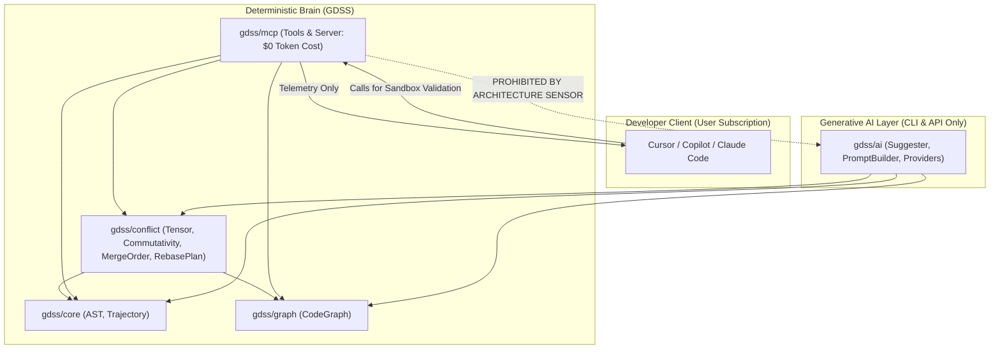

# Plan: MCP Zero-Token-Bleed & Provider Type Safety Overhaul

## Goal Description
Address two core architectural defects identified during review:
1. **Provider Type Safety in Suggester (`gdss/ai/suggester.py:84`):** Replace runtime-opaque `Protocol` duck typing with explicit concrete Union types (`OllamaProvider | VLLMProvider | OpenAICompatibleProvider | StubProvider`) across `suggester.py` and `main.py` to eliminate runtime ambiguities and guarantee transparent attribute/method resolution.
2. **Strict Zero-Token-Bleed & Two-Brain Purity in MCP (`gdss/mcp/`):** 
   - Remove `suggest_resolutions` (which accepted an `llm` flag and triggered generative LLM calls inside MCP), ensuring the MCP server adheres strictly to Rule 16–17 in `.agents/rules/00-gdss-context.mdc` ($0 token cost to GDSS).
   - Re-home deterministic algorithms (`plan_merge_order` and `build_transport_plan`) from `gdss/ai/` into `gdss/conflict/`, as they are pure discrete mathematics (not probabilistic generative AI).
   - Enforce that `gdss/mcp/` imports exclusively from deterministic layers (`conflict`, `core`, `graph`, `watcher`) and never touches `gdss/ai/`.
   - Update `harness/sensors/architecture_fitness.py` to classify `mcp` and `conflict` as `DETERMINISTIC`, permanently ratcheting two-brain purity.

---

## User Review Required

> [!IMPORTANT]
> **MCP is Exclusively Deterministic ($0 Token Cost):**
> Cursor, Claude Code, and GitHub Copilot are the generative brains. When a developer asks their IDE assistant to resolve a collision, the IDE assistant queries GDSS for deterministic radar telemetry (`gdss_find_collisions`, `gdss_get_merge_order`, `gdss_plan_semantic_rebase`, `gdss_inspect_symbol_impact`), synthesizes the patch using the user's IDE model subscription, and tests it via `gdss_validate_patch`. GDSS MCP **never** makes server-side LLM calls.

> [!IMPORTANT]
> **Relocating Misplaced Deterministic Algebra:**
> `geodesic.py` (greedy nearest-neighbor graph search over $\Omega_{ij}$) and `semantic_rebase.py` (discrete commutativity operator filtering) contain zero AI/LLM code. They are discrete commutativity mathematics. We re-home them into `gdss/conflict/merge_order.py` and `gdss/conflict/rebase_plan.py`, maintaining backward-compatible aliases in `gdss/ai/`.

---

## Proposed Changes



---

### Component 1: Explicit Provider Union Types (`gdss/ai/`)

#### [MODIFY] `gdss/ai/provider_types.py` (or `gdss/ai/types.py`)
Define an explicit type union:
```python
from gdss.ai.llm_patch import StubProvider
from gdss.ai.ollama_provider import OllamaProvider
from gdss.ai.openai_provider import OpenAICompatibleProvider
from gdss.ai.vllm_provider import VLLMProvider

AnyProvider = OllamaProvider | VLLMProvider | OpenAICompatibleProvider | StubProvider
```

#### [MODIFY] `gdss/ai/suggester.py`
Replace `provider: LLMProvider` annotations in `_draft_combinations`, `_pick_provider`, and `suggest()` with `AnyProvider`:
```python
def _draft_combinations(
    context: AnalysisContext,
    suggestion: Suggestion,
    provider: AnyProvider,
) -> Suggestion:
    ...

def suggest(
    repo_path: str,
    reference_branch: str,
    *,
    llm: bool = False,
    combos: int = 3,
    provider: AnyProvider | None = None,
    max_candidates: int = 50,
) -> list[Suggestion]:
    ...
```

#### [MODIFY] `gdss/cli/main.py`
Update `suggest` command to type `provider: AnyProvider | None = None`.

---

### Component 2: Re-home Deterministic Algebra (`gdss/conflict/`)

#### [NEW] `gdss/conflict/merge_order.py`
Move `plan_merge_order`, `minimize_omega_sequence`, `MergeOrderPlan`, and `MergeOrderStep` from `gdss/ai/geodesic.py` to `gdss/conflict/merge_order.py`.
- Operates directly on `Mapping[tuple[Hashable, Hashable], float]` and `ConflictTensor`.
- Pure deterministic graph calculation; does not import anything from `gdss/ai`.

#### [NEW] `gdss/conflict/rebase_plan.py`
Move `build_transport_plan`, `parallel_transport`, and `TransportPlan` from `gdss/ai/semantic_rebase.py` to `gdss/conflict/rebase_plan.py`.
- Discrete commutativity classification of operator sets using `CommutativityClass`.
- Pure deterministic operator algebra; does not import anything from `gdss/ai`.

#### [MODIFY] `gdss/ai/geodesic.py` & `gdss/ai/semantic_rebase.py`
Re-export functions and classes from `gdss.conflict.*` to preserve 100% backward compatibility for existing tests.

---

### Component 3: Zero-Token-Bleed MCP Toolset (`gdss/mcp/`)

#### [MODIFY] `gdss/mcp/tools.py`
1. **Remove `suggest_resolutions`:** Completely purge the tool that had `llm: bool` and triggered model generation inside MCP.
2. **Update imports:** Import `plan_merge_order` from `gdss.conflict.merge_order` and `build_transport_plan` from `gdss.conflict.rebase_plan`.
3. **Purity Verification:** Ensure `gdss/mcp/tools.py` does **NOT** import any module from `gdss.ai` or `gdss.embeddings`.

Final list of deterministic MCP tools:
1. `gdss_find_collisions`: Returns pairwise interaction matrix ($\Omega_{ij}$), commutativity verdict, and total integration risk score.
2. `gdss_get_merge_order`: Returns topological merge sequence minimizing semantic drift and friction.
3. `gdss_inspect_symbol_impact`: Queries the call graph for callers and dependent symbols.
4. `gdss_plan_semantic_rebase`: Analyzes commuting operators vs. blocked non-commutative collisions across branches.
5. `gdss_validate_patch`: Validates unified diff syntax and symbol boundaries in sandbox.

#### [MODIFY] `gdss/mcp/server.py`
Remove `gdss_suggest_resolutions` from `TOOLS` registry and dispatch table.

---

### Component 4: Architecture Fitness Sensor Enforcement

#### [MODIFY] `harness/sensors/architecture_fitness.py`
Ratchet the architecture fitness sensor:
```python
# Two-brain partition: deterministic modules must NEVER import probabilistic ones.
DETERMINISTIC: set[str] = {"core", "graph", "watcher", "conflict", "mcp"}
PROBABILISTIC: set[str] = {"ai", "embeddings"}
```
Now, if `gdss/mcp/` (or `gdss/conflict/`) ever imports `gdss.ai` or `gdss.embeddings`, `architecture_fitness.py` will fail with an explicit violation error:
```
WHAT: gdss/mcp/tools.py:X imports gdss.ai from the deterministic brain.
WHY: two-brain purity requires the deterministic brain to stay independent of the probabilistic brain.
```

---

## Verification Plan

### Automated Tests
1. **Architecture Fitness:**
   ```bash
   python harness/sensors/architecture_fitness.py
   ```
   Must verify that `two-brain purity holds` across `core`, `graph`, `watcher`, `conflict`, and `mcp`.
2. **Layer 1 Static Checks:**
   ```bash
   bash harness/sensors/lint.sh
   bash harness/sensors/typecheck.sh
   python harness/sensors/dsa_fitness.py
   ```
   Must pass with 0 errors across all 72 source files.
3. **MCP Tool Suite:**
   ```bash
   pytest tests/mcp/ -v
   ```
   Must verify all 5 deterministic tools over JSON-RPC.
4. **Full Verification Gate:**
   ```bash
   bash harness/verify.sh
   ```
   Must pass Layer 1 (static), Layer 2 (pytest), Layer 3 (smoke), and frontend checks.

### Manual Verification
1. Inspect `gdss/mcp/tools.py` to confirm zero imports from `gdss.ai`.
2. Run `gdss --help` and verify CLI subcommands.
3. Test MCP stdio loop with sample JSON-RPC calls.
