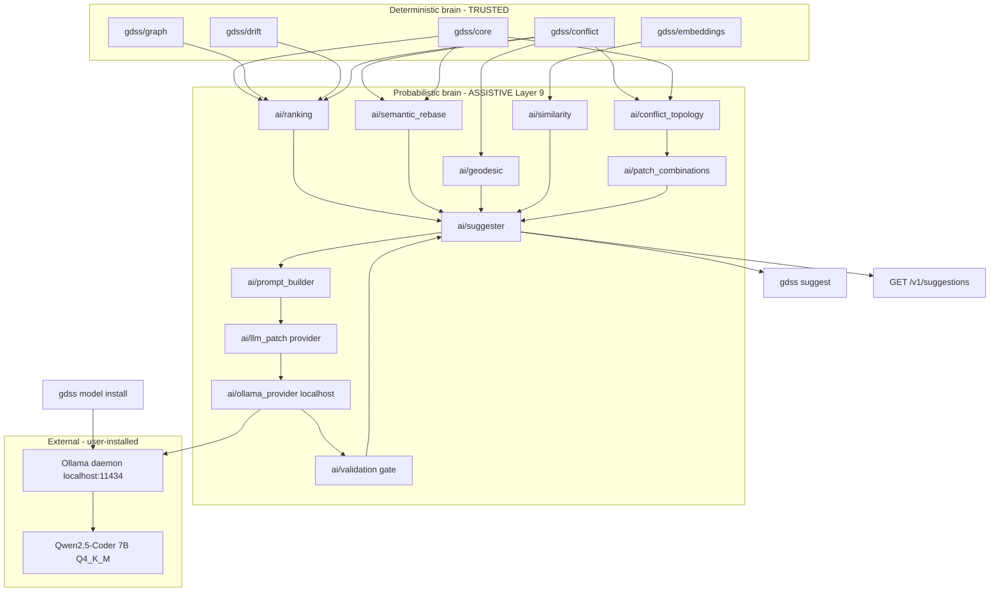

# Phase 5 — AI Convergence Layer (`phase5-ai`)

## What it is

The **assistive** brain on top of the deterministic layers (core, graph, embeddings, drift, conflict). It produces **ranked, location-anchored suggestions** that help a developer converge a branch toward the attractor  and resolve predicted conflicts.

- It **ranks** and **proposes**; it never auto-merges, never writes to the working tree, never mutates git state.
- It **optionally** drafts patch text via a **GDSS-managed local model** (Qwen2.5-Coder 7B quantized, pulled through Ollama), only when the user opts in, and only behind a deterministic validation gate.
- For each predicted conflict it classifies the **conflict topology** (union / intersection / disjoint / asymmetric) from the commutativity table and symbol overlap, then asks the local model to enumerate **patch combinations** for each viable topology — i.e. the different ways the conflict can play out (take both, take common, pick one, sequence A-then-B, etc.).
- Output is a `Suggestion` with exact `file_path` + `line_start` + `line_end` + `symbol_id`, a structured `reason`, a `topology` label, and (when opted in) one or more validated `patch_text` candidates, so the developer can open the file at the right line and apply by hand.

## Agent orchestration and apply boundary

This phase remains the pure suggestion pipeline. A successor queue item,
`phase5a-agent-orchestration`, may optionally use LangGraph to orchestrate the modules below,
retain metadata-only checkpoints, and pause at human review. It must call the deterministic
ranker, topology classifier, and validator rather than replace them; it cannot write files,
choose strategies, or mutate Git state.

Actual local file edits belong to `phase6-human-approved-apply`, after `phase6-validation`.
That phase may apply exactly one user-selected validated strategy only after canonical-path,
single-file, symbol-range, and source/AST freshness checks. It is atomic, reports the resulting
diff and rollback result, and never invokes merge, rebase, stage, commit, push, or pull.

## Distribution & privacy invariant (1.7 compatibility)

- `pip install gdss` ships **deterministic GDSS only** — no model, no Ollama, no cloud SDK, no API key. The wheel stays small.
- The local model is an **opt-in accessory** installed by a separate command (`gdss model install`). Ollama is an **external dependency the user installs themselves** (detected at runtime, never vendored or bundled).
- Default `gdss suggest` works offline with no model: deterministic ranking + `--as-prompt` (copy-pasteable prompt the user can feed to any assistant).
- `gdss suggest --llm` talks only to `localhost:11434` by default; any non-localhost base URL requires explicit `GDSS_LLM_ALLOW_REMOTE=1`. No source code or PII enters telemetry (telemetry stays metadata-only per `[.cursor/rules/60-telemetry-privacy.mdc](.cursor/rules/60-telemetry-privacy.mdc)`).

## MIT math mapping

Directly implemented (discrete analogs):

- **Parallel transport `P_{j->i}`** -> *semantic rebase*: replay branch `j`'s `SemanticOperator`s in branch `i`'s frame using commutativity + symbol-id remap.
- **Geodesic** -> *merge sequencing*: order operators to minimize cumulative `Omega` (drift-minimizing path to the attractor). Greedy nearest-neighbor over the commutativity graph.
- **Riemannian metric `G`** -> *embedding similarity kernel* (cosine in MiniLM space) for ranking rename/move targets and duplicate-work detection.
- **Commutativity `[T_i, T_j]`** (phase 4) -> *merge ordering*: commuting operators reorder safely; non-commuting ones surface the conflict.
- **Linear independence of branch vectors** (vision doc) -> *duplicate-work detector*: near-parallel branches are doing the same thing -> suggest merge or pick one.
- **Subspace decomposition / lattice of subspaces** -> *conflict topology* (phase 4f): for two operators acting on the same symbol, decompose their joint outcome into the lattice join/meet: **union** (join, both apply, commuting), **intersection** (meet, common sub-operator), **disjoint** (incompatible, choose one), **asymmetric** (A-then-B vs B-then-A). This is the discrete analog of decomposing a vector along subspaces; it drives which patch combinations are even worth generating.

Metaphor only (not implemented in code):

- Continuous curvature / connection forms / holonomy -> language for drift accumulation in docs, not a code module.
- Rank-N tensor on `M^N` (octopus merge) -> deferred to the geometric ladder (phase 4d/4e), not phase 5.

## Architecture (two-brain purity preserved)

`gdss/ai` is **Layer 9**. It imports downward (core, graph, embeddings, drift, conflict). The deterministic brain (core, graph, watcher) must never import `gdss/ai`. The probabilistic brain never acts without deterministic validation.




## Components (all new files; no edits to existing source)

### Deterministic assistive layer (no model, no network)

1. [gdss/ai/types.py](gdss/ai/types.py) - dataclasses:
  - `Suggestion`: `kind`, `file_path`, `line_start`, `line_end`, `symbol_id`, `operator`, `action`, `rationale` (one-line), `reason` (structured multi-line), `confidence`, `rank`, `topology` (`ConflictTopology|None`), `patch_combinations` (`list[PatchCombination]`, optional), `source` (`"deterministic"|"llm"`), `validated`.
  - `ConflictTopology`: `kind` (`"union"|"intersection"|"disjoint"|"asymmetric"`), `symbol_id`, `operator_i`, `operator_j`, `commutativity` (`"commute"|"interfere"|"independent"`), `justification` (str).
  - `PatchCombination`: `label` (e.g. `"union: take both"`), `strategy`, `patch_text` (str|None), `source`, `validated` (bool).
2. [gdss/ai/ranking.py](gdss/ai/ranking.py) - pure deterministic ranker. Inputs: drift, `ConflictTensor`, `commutativity_table`. Outputs ranked candidates. No LLM, no network.
3. [gdss/ai/semantic_rebase.py](gdss/ai/semantic_rebase.py) - `parallel_transport(operators_j, frame_i)`: remap symbol ids into branch `i`'s table, drop already-applied commuting operators, keep the rest as an ordered rebase plan anchored to `file:line`.
4. [gdss/ai/geodesic.py](gdss/ai/geodesic.py) - `minimize_omega_sequence(operators)`: greedy nearest-neighbor on the commutativity graph. O(n^2) over operator count, justified in docstring.
5. [gdss/ai/similarity.py](gdss/ai/similarity.py) - `detect_duplicate_work(branch_embeddings)`: cosine similarity over branch operator-vector profiles; flag near-parallel pairs.

### Conflict topology (phase 4f extension — deterministic)

1. [gdss/ai/conflict_topology.py](gdss/ai/conflict_topology.py) - `classify_conflict(operator_i, operator_j, symbol_overlap) -> ConflictTopology`. Rules (grounded in the existing `gdss/conflict/commutativity.py` table + symbol-id overlap from `gdss/graph`):
  - **union** — operators commute AND act on disjoint sub-symbols of the same parent (e.g., add method `a` vs add method `b` in the same class). Safe to take both.
  - **intersection** — operators partially overlap (same symbol, overlapping body blocks but non-identical edits). Resolution = the common sub-operator; the rest must be reconciled.
  - **disjoint** — operators interfere (`[T_i,T_j] != 0`) on the same symbol with no common sub-operator (e.g., rename `foo`->`bar` vs delete `foo`). Must choose one.
  - **asymmetric** — operators interfere but are order-sensitive (A-then-B differs from B-then-A). Surface both orderings as candidates.
   Pure function; no network. This is the discrete analog of the lattice-of-subspaces decomposition (join = union, meet = intersection, incomparable = disjoint).

### Patch combinations (phase 5c — model-assisted, validation-gated)

1. [gdss/ai/patch_combinations.py](gdss/ai/patch_combinations.py) - `enumerate_combinations(topology, anchored_symbol_block) -> list[PatchCombination]`. For each topology it returns the **strategies** worth trying (deterministic labels; patch text filled later by the model or left None):
  - union -> `[take both, take i-then-j, take j-then-i]`
  - intersection -> `[take common, keep i drop j, keep j drop i]`
  - disjoint -> `[keep i, keep j, keep neither]`
  - asymmetric -> `[i-then-j, j-then-i]`
   This step is deterministic; it only decides *which* candidates exist, not their code.

### Model layer (opt-in, local-first)

1. [gdss/ai/llm_patch.py](gdss/ai/llm_patch.py) - `LLMProvider` Protocol (`complete(prompt: str, *, temperature=0.0, max_tokens=1024) -> str`) and `StubProvider` for tests. Env-gated: provider unset -> `None` (deterministic-only). No SDK dependency; raw `httpx`.
2. [gdss/ai/ollama_provider.py](gdss/ai/ollama_provider.py) - `OllamaProvider`: talks to local Ollama `POST /api/chat` (`http://localhost:11434` by default). **Localhost guard**: refuses any non-loopback base URL unless `GDSS_LLM_ALLOW_REMOTE=1`. Sends only the anchored symbol block + the GDSS semantic context (drift, Omega, commutativity, topology, strategies) — never whole files, no PII. On-disk cache keyed by `sha256(prompt)` under `.gdss/llm_cache/`.
3. [gdss/ai/prompt_builder.py](gdss/ai/prompt_builder.py) - two pure functions:
  - `build_prompt(suggestions, repo, ref) -> str` — the copy-pasteable prompt for `--as-prompt`.
    - `build_conflict_prompt(suggestion, topology, combinations, repo, ref) -> str` — the rich prompt sent to the local model for one conflict. It embeds: repo path, attractor branch, current branch, `R_merge`, the `Omega_ij` for this pair, the commutativity verdict, the **conflict topology** with its justification, the anchored symbol block (signature + body of the one symbol), and the list of strategy labels to produce patches for. It explicitly instructs: *"propose one patch per strategy; do not apply or run anything; return only patch text with file paths and line ranges; flag any strategy you believe is wrong."*
4. [gdss/ai/validation.py](gdss/ai/validation.py) - `validate_patch(suggestion, patch_text)`: parse the patch, assert it touches only `suggestion.symbol_id` within `[line_start, line_end]`. The deterministic gate every model-produced patch must pass before it is surfaced. A patch that touches a neighbor symbol is dropped (not shown to the user).

### Orchestrator

1. [gdss/ai/suggester.py](gdss/ai/suggester.py) - `suggest(repo, ref, *, llm=False, combos=3) -> list[Suggestion]`. Pipeline:
  `rank -> rebase -> geodesic -> similarity -> classify_conflict (per predicted conflict) -> enumerate_combinations -> (if llm) build_conflict_prompt -> OllamaProvider.complete -> validate_patch per combination -> attach validated patches`. Assigns `rank` 1..N and builds the structured `reason` for each. Public entrypoint. When `llm=False` or no provider configured, `patch_combinations` carry `patch_text=None` (strategies only) and the CLI/API still return ranked suggestions + topologies + strategies.

### CLI

1. `gdss model` command (new, in `gdss/cli/`) — manages the local model via Ollama's REST API:
  - `gdss model install [--tag qwen2.5-coder:7b]` -> `POST /api/pull` (stream NDJSON progress to stderr).
    - `gdss model list` -> `GET /api/tags` (prints installed models).
    - `gdss model ensure` -> install if missing, no-op if present (used by `gdss suggest --llm` as a preflight).
    - `gdss model status` -> `GET /api/ps` + `/api/version` (is Ollama running? is the model loaded?).
    - `gdss model remove [--tag]` -> `DELETE /api/delete`.
    Default tag: `qwen2.5-coder:7b` (Q4_K_M, ~4.7 GB, 32K context). Documented VRAM guidance in `--help`.
2. `gdss suggest` command (new, in `gdss/cli/`) - modes:
  - default: human-readable ranked suggestions with `reason` + `topology` (no model).
    - `--as-prompt`: copy-pasteable LLM prompt to stdout.
    - `--json`: machine output including `reason`, `rank`, `topology`, `patch_combinations`.
    - `--llm`: enable the local model path (requires Ollama + installed model; runs `gdss model ensure` as preflight).
    - `--topology union|intersection|disjoint|asymmetric`: filter to one topology.
    - `--combos N`: limit patch combinations per conflict to N.
    - `--rank N`: limit to top N suggestions.

### API

1. [gdss/api/server.py](gdss/api/server.py) + [gdss/api/service.py](gdss/api/service.py) - add:
  - `GET /v1/suggestions` -> `Suggestion` list (same shape as CLI `--json`).
    - `GET /v1/suggestions?format=prompt` -> the prompt string.
    - `GET /v1/model/status` -> Ollama + model presence (metadata only; no source).
    Document all three in [docs/f1_api_contract.md](docs/f1_api_contract.md). All payloads stay metadata-only (privacy-safe).

### Docs

1. Add a Phase 5 section to [docs/MANIFOLD_TENSOR_GUIDE.md](docs/MANIFOLD_TENSOR_GUIDE.md) covering: `P` (semantic rebase), geodesic (merge ordering), `G` (embedding kernel), linear-independence (duplicate work), **conflict topology** (lattice join/meet analog), the local-model management story (Ollama + Qwen2.5-Coder 7B), the validation gate, and the `--as-prompt` / `--llm` developer workflows. Update [docs/IMPLEMENTATION_GAP.md](docs/IMPLEMENTATION_GAP.md) and add/advance three entries in [harness/state/feature_list.json](harness/state/feature_list.json): `phase4f-conflict-topology`, `phase5b-local-model`, `phase5c-patch-combinations` (see "Phase extensions" below).

## CLI output shape

Default human-readable (one suggestion per block, no model):

```
#1  [rename] src/foo.py:42-60  function `bar` -> `baz`   (omega=0.71, conf=0.66)
  rationale: branch `feature/x` renamed `bar`; `dev` still calls `bar`.
  topology: disjoint  (rename vs delete on `bar`; [T_i,T_j]!=0; no common sub-operator)
  reason:
    - Branch `feature/x` applied RENAME_FUNCTION `bar`->`baz` (commit abc123).
    - `dev` (attractor) still references `bar` at src/foo.py:42 and src/caller.py:88.
    - Operator pair (RENAME on `dev`, DELETE on `feature/x`) is non-commuting ([T_i,T_j]!=0),
      so a naive merge would conflict at the rename site.
    - Recommended action: rename `bar`->`baz` in `dev` at src/foo.py:42-60 to converge.
  strategies (no model): [keep i, keep j, keep neither]
  location: src/foo.py:42
```

With `--llm` (local Qwen2.5-Coder 7B via Ollama), each strategy gets a validated patch:

```
#1  [rename] src/foo.py:42-60  function `bar` -> `baz`   (omega=0.71, conf=0.66)
  topology: disjoint
  reason: ...
  patch combinations (2/3 validated):
    [keep i]      VALID   --- patch: src/foo.py:42-60 --- <diff> --- end ---
    [keep j]      VALID   --- patch: src/foo.py:42-60 --- <diff> --- end ---
    [keep neither] DROPPED (patch touched src/caller.py outside anchor)
```

`--as-prompt` mode emits a single self-contained, copy-pasteable LLM prompt to stdout. The
developer can paste it into ChatGPT/Claude/Copilot Chat, or pipe it to a local assistant.
The prompt bundles repo context, the ranked suggestions with their `reason` and `topology`
blocks, and an explicit instruction to *propose* patches (not apply one). Shape:

```
You are a code-merge assistant for the <repo-project> project. Below are ranked, deterministic
suggestions computed from branch drift, the conflict tensor (Omega_ij), operator
commutativity, and conflict topology (union/intersection/disjoint/asymmetric). For each
suggestion, propose a concrete patch per listed strategy. DO NOT apply or run anything;
return only patch text with file paths and line ranges. Flag any suggestion you believe is
wrong and explain why.

Repository: <path>
Reference (attractor) branch: dev
Current branch: feature/x
Merge risk R_merge: 0.74 (high)

Ranked suggestions:

#1 [rename] src/foo.py:42-60  function `bar` -> `baz`  (omega=0.71, conf=0.66)
   topology: disjoint
   reason:
     - Branch `feature/x` applied RENAME_FUNCTION `bar`->`baz` (commit abc123).
     - `dev` still references `bar` at src/foo.py:42 and src/caller.py:88.
     - Non-commuting operator pair; naive merge would conflict at the rename site.
     - Recommended: rename `bar`->`baz` in `dev` at src/foo.py:42-60.
   strategies: [keep i, keep j, keep neither]

#2 [reorder_merge] merge `feature/y` before `feature/x`  (omega=0.58, conf=0.61)
   topology: union
   reason:
     - `feature/y`'s operators commute with `dev`; `feature/x`'s do not.
     - Reordering reduces cumulative Omega from 1.29 to 0.71.
   strategies: [take both, i-then-j, j-then-i]

#3 [reorder_merge] merge `feature/y` before `feature/x`  (omega=0.58, conf=0.61)
   topology: intersection
   reason:
     - `feature/y`'s operators commute with `dev`; `feature/x`'s do not.
     - Reordering reduces cumulative Omega from 1.29 to 0.71.
   strategies: [take both, i-then-j, j-then-i]


For each suggestion, output:
  --- patch: <file>:<start>-<end> (strategy: <label>) ---
  <unified diff or exact replacement>
  --- end ---
```

The rich per-conflict prompt sent to the local model (`build_conflict_prompt`) additionally
embeds the anchored symbol block (signature + body of the single symbol), the `Omega_ij` for
the pair, the commutativity verdict, and the topology justification, then asks for one patch
per strategy. Example for a same-function conflict classified as `intersection`:

```
You are a code-merge assistant. Resolve ONE predicted conflict. Propose one patch per
strategy. DO NOT apply or run anything; output only patch text.

Repository: <path>   Attractor: dev   Current: feature/x
Conflict pair: feature/x vs dev on symbol `src/foo.py::process()`
Omega_ij: 0.66   commutativity: interfere   topology: intersection
justification: both branches MODIFY `process()` with overlapping body blocks
  (lines 50-58) but non-identical edits; common sub-operator = the guard clause at line 50.

Anchored symbol block (dev frame):
  def process(x):            # src/foo.py:42
      if x is None: return    # :50  (common)
      ...dev body...          # :51-58 (overlap)
      return r               # :60

Strategies to produce patches for:
  - take common   (keep only the shared guard clause + one branch's body)
  - keep i drop j (dev body wins)
  - keep j drop i (feature/x body wins)

Output:
  --- patch: src/foo.py:42-60 (strategy: take common) ---
  <patch>
  --- end ---
  --- patch: src/foo.py:42-60 (strategy: keep i drop j) ---
  <patch>
  --- end ---
  --- patch: src/foo.py:42-60 (strategy: keep j drop i) ---
  <patch>
  --- end ---
```

The `reason` + `topology` fields are the load-bearing additions: structured (operator,
attractor reference, commutativity verdict, topology, recommended action) so they are both
human-readable and directly usable as LLM context. The deterministic `rationale` (one-line) is
kept for compact default output; `reason` + `topology` are the expanded forms used in
`--as-prompt` and `--json`.

## Frontend (optional follow-up, not blocking)

A `/suggestions` page with "Open file at line L" deep links is a natural F8 card after
`phase5a-agent-orchestration`. It reviews metadata-only agent checkpoints, deterministic
evidence, and user-selected strategies; it cannot write files. F9 then surfaces validation
evidence, and F9.1 is the later explicit confirmation UI for `phase6-human-approved-apply`.
None of these frontend phases is required for `phase5-ai` done criteria (backend:
`gdss/ai/* produces validated suggestions; never auto-merges; tests green`).

## TDD order (vertical slices, red -> green -> refactor)

1. `tests/ai/test_types.py` - `Suggestion`, `ConflictTopology`, `PatchCombination` shapes; `validated` defaults False.
2. `tests/ai/test_ranking.py` - divergent fixture -> ordered candidates, highest `Omega` first, confidence in [0,1].
3. `tests/ai/test_semantic_rebase.py` - `parallel_transport` remaps symbol ids and drops already-applied commuting operators.
4. `tests/ai/test_geodesic.py` - `minimize_omega_sequence` returns lower cumulative `Omega` than input order on a 4-operator fixture.
5. `tests/ai/test_similarity.py` - near-parallel branches flagged; orthogonal branches not.
6. `tests/ai/test_conflict_topology.py` - classify each of union/intersection/disjoint/asymmetric from operator pairs + symbol overlap; commutativity verdict carried through.
7. `tests/ai/test_patch_combinations.py` - `enumerate_combinations` returns the expected strategy labels per topology; deterministic.
8. `tests/ai/test_validation.py` - patch touching only the anchored symbol passes; touching a neighbor is rejected.
9. `tests/ai/test_llm_patch.py` - `StubProvider` returns draft text; provider env unset returns `None` and opens no socket.
10. `tests/ai/test_ollama_provider.py` - `OllamaProvider` POSTs to `/api/chat` on localhost; non-localhost base URL raises unless `GDSS_LLM_ALLOW_REMOTE=1`; cache hit returns cached text without HTTP.
11. `tests/ai/test_prompt_builder.py` - `build_prompt` and `build_conflict_prompt` return non-empty strings containing topology, reason, strategies, the "do not apply" instruction, and (for conflict prompt) the anchored symbol block; deterministic.
12. `tests/ai/test_suggester.py` - deterministic suggestions always present with topology + strategies; LLM patches attached only when opted in and validated; `rank` 1..N; `reason` populated.
13. `tests/cli/test_model.py` - `gdss model install` calls Ollama `/api/pull` (mocked); `list` calls `/api/tags`; `status` reports Ollama down vs model loaded; `ensure` no-op when present.
14. `tests/cli/test_suggest.py` - `gdss suggest --no-llm` prints topology + strategies; `--json` valid and includes `topology`/`patch_combinations`; `--as-prompt` contains "DO NOT apply" and every topology; `--topology disjoint` filters; `--combos 2` limits; `--llm` without Ollama errors with WHAT/WHY/FIX.
15. `tests/api/test_handlers.py` + `tests/api/test_server.py` - `get_suggestions`, `/v1/suggestions`, `?format=prompt`, `/v1/model/status`; all payloads pass `assert_privacy_safe`.

## Phase extensions (to add to feature_list.json during implementation)

These extend phase 4 and phase 5 in the shared queue. They are tracked here so the plan is self-contained; they will be added as real entries in [harness/state/feature_list.json](harness/state/feature_list.json) during the docs todo (no edits to existing entries — additive only, per harness rules).

- `phase4f-conflict-topology` (layer: conflict, phase 1.9f, deps: `phase4-tensor`): classify each predicted conflict into union / intersection / disjoint / asymmetric from the commutativity table + symbol overlap. Done criteria: `gdss/ai/conflict_topology.py` + tests green; surfaced in CLI/API.
- `phase5b-local-model` (layer: ai, phase 1.10b, deps: `phase5-ai`): `gdss model` CLI managing a local quantized Qwen2.5-Coder 7B via Ollama (`/api/pull`, `/api/tags`, `/api/ps`, `/api/delete`); `OllamaProvider` with localhost guard + on-disk cache. Done criteria: `gdss model install/list/ensure/status/remove` work with a real Ollama daemon; graceful degrade when absent; tests use `StubProvider` + mocked HTTP.
- `phase5c-patch-combinations` (layer: ai, phase 1.10c, deps: `phase5b-local-model`, `phase4f-conflict-topology`): per conflict, enumerate strategy labels from topology, ask the local model for one patch per strategy, validate each through `validation.py`, surface only validated ones. Done criteria: `gdss suggest --llm --combos N` returns validated `patch_combinations`; dropped patches are reported with a WHAT/WHY/FIX reason; never auto-applies.

## Verification (definition of done)

`bash harness/verify.sh` green: ruff, mypy, architecture fitness (two-brain boundary holds — `gdss/core|graph|watcher` never import `gdss/ai`), pytest, and `gdss suggest` CLI smoke over a fixture repo **with no Ollama running** (proves the default path is model-free and offline). A second smoke run with `StubProvider` proves the `--llm` path attaches validated `patch_combinations`. `pip install gdss` must not require Ollama, any LLM SDK, or an API key. Update [harness/state/progress.md](harness/state/progress.md) and [harness/state/session-handoff.md](harness/state/session-handoff.md).