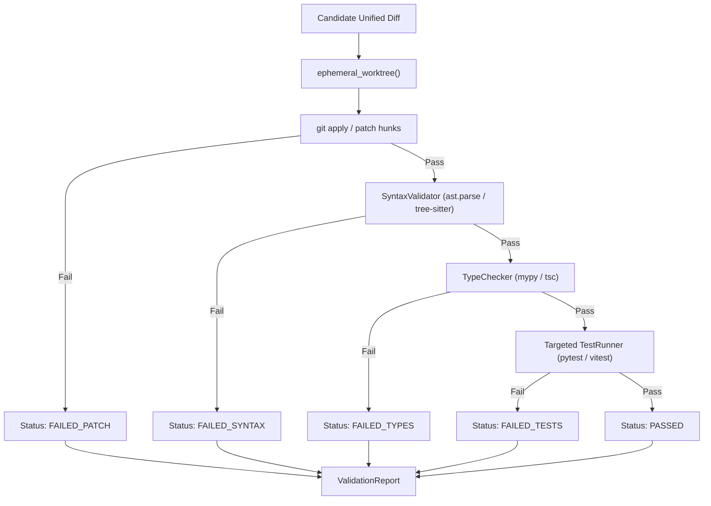

# Phase 6 Implementation Plan: Validation Sandbox (`phase6-validation`)

## Goal Description
Following the strategic pivot to a **PR Collision Radar & Convergence Assistant**, GDSS must ensure that AI-generated candidate resolution patches are never presented to human developers as blind text suggestions.

`phase6-validation` implements **Layer 10: Validation Sandbox** (`gdss/validation/`). It provides an extensible, layout-agnostic, multi-language sandboxed execution environment that tests candidate patches in ephemeral Git worktrees before human review:

1. **Repository-Agnostic & Pluggable Architecture**: Works seamlessly across **any repository layout** (flat repos, single packages, nested microservices, monorepos, Bazel/Make structures) using upward project-root discovery and optional `.gdss.yml` custom build/test hooks.
2. **Pluggable Multi-Language Registry**: Extensible beyond the core languages (Python, TypeScript, JavaScript, Go) to **any programming language** (Rust, Java, C++, Ruby, PHP, C#) via a 3-tier strategy (Tree-sitter AST, native project compilers, and generic diff verification).
3. **Existing Tests Execution (Not AI Test Generation)**: Clarified boundary—Phase 6 **executes the repository's existing test suite** against the patched code in an ephemeral worktree to verify that candidate patches do not cause regressions. (Test generation is a generative AI assistant capability; Phase 6 is a deterministic verification gate).
4. **Isolated Ephemeral Worktree**: Clones an ephemeral worktree (`git worktree add --detach /tmp/gdss-sandbox-... HEAD`) so the developer's working directory and active index are never disturbed.
5. **Clean Pruning**: Guarantees zero residual state via deterministic cleanup handlers.
6. **Delivery Integration**: Plugs into MCP (`gdss_sandbox_validate_patch`), CLI (`gdss suggest --validate`), and the Next.js visual dashboard.

---

## Key Clarifications & Architectural Decisions

### 1. Repository Layout Agnostic (Any Repo Type)
- **Upward Project Discovery**: Starting from the patched file, GDSS walks up directory ancestors looking for project descriptors (`package.json`, `Cargo.toml`, `go.mod`, `pyproject.toml`, `pom.xml`, `Makefile`). It executes tests and typechecks scoped to the nearest package root.
- **Zero Hardcoded Assumptions**: Never assumes `/src` or `/tests` or a single root layout.
- **Pluggable Configuration (`.gdss.yml`)**: Allows teams with custom build pipelines (Bazel, Gradle, custom scripts) to define explicit validation commands:
  ```yaml
  # Optional .gdss.yml in repo root
  validation:
    test_command: "pnpm --filter {package} test {test_file}"
    typecheck_command: "npm run typecheck"
    timeout: 30
  ```

### 2. Multi-Language Extensibility
- **Tier 1 (Built-in Tree-Sitter)**: Multi-language AST parsing for Python, TypeScript, JavaScript, Go.
- **Tier 2 (Pluggable Language Registry)**: Extensible interface `register_language(extension, syntax_checker, compiler_runner)`. Easily plug in Rust (`cargo check`), Java (`javac`), C/C++, etc.
- **Tier 3 (Generic Fallback for Unknown Languages)**: For languages without configured parsers, GDSS validates unified diff application integrity and delegates compilation/testing to the repository's native build tools without crashing.

### 3. Existing Tests vs. Generated Tests
- **Phase 6 strictly runs existing project tests**: It verifies whether a candidate patch breaks existing unit or integration tests that cover the modified symbol.
- If a project or symbol has no existing tests, Phase 6 reports:
  `tests_executed: 0 (No existing tests mapped to this symbol; syntax & diff integrity OK)`. It never hallucinates or fabricates synthetic tests in the verification sandbox.

### 4. CI/CD Pipeline & Runner Scenarios (GitHub Actions, GitLab, etc.)
- **Shallow Clone Handling**: In CI environments where `actions/checkout` defaults to shallow depth, `git worktree add` can fail if commits are missing. GDSS detects shallow clones (`git rev-parse --is-shallow-repository`) and:
  - If shallow: cleanly falls back to an isolated in-memory/tempdir patch test or warns with `WHAT / WHY / FIX` to specify `fetch-depth: 0`.
- **Configurable Timeouts for CI**: In CI environments with constrained CPU, tests can run slower. The timeout is configurable via CLI `--sandbox-timeout <seconds>` and environment variable `GDSS_SANDBOX_TIMEOUT` (default: 30s locally, recommended 60s in CI runners).
- **Non-Interactive Environment**: The sandbox sets `CI=true` and `DEBIAN_FRONTEND=noninteractive` during test execution, ensuring test runners (pytest, vitest, cargo test) exit cleanly without prompting for user input.

---

## Resolved Design Decisions (User Approved)

- **Timeout Configuration**: Approved **Yes**. Configurable via `--sandbox-timeout` CLI flag and `GDSS_SANDBOX_TIMEOUT` environment variable (30s local default, 60s CI recommendation).
- **CI/CD Scenario**: Fully defined above (shallow clone detection, CI timeout overrides, non-interactive environment).
- **Typecheck Failure Diagnostics**: Type errors will return structured compiler output (`errors: list[str]`), marking the report with `WARNING_TYPE_ERROR` so AI IDE agents (Cursor/Claude) have the exact compiler feedback to refine their patch.

---

## Proposed Changes

```
gdss/
├── validation/                     # [NEW] Layer 10 Validation Sandbox Package
│   ├── __init__.py                 # Public facade exports
│   ├── types.py                    # ValidationReport, ValidationStatus, CheckResults
│   ├── discovery.py                # Repo-agnostic project root discovery & .gdss.yml parser
│   ├── languages.py                # Pluggable LanguageRegistry (Python, TS, Go, Rust, Java, etc.)
│   ├── worktree.py                 # Ephemeral Git worktree context manager
│   ├── syntax.py                   # Multi-language AST syntax validator
│   ├── typechecker.py              # Targeted typecheck runner (mypy, tsc, cargo, etc.)
│   ├── test_runner.py              # Targeted runner for EXISTING project tests
│   └── sandbox.py                  # Primary ValidationSandbox orchestration class
├── mcp/
│   ├── tools.py                    # [MODIFY] Expose gdss_sandbox_validate_patch tool
│   └── server.py                   # [MODIFY] Register new tool in MCP tool catalog
├── ai/
│   └── suggester.py                # [MODIFY] Connect validate=True flag to ValidationSandbox
└── cli/
    └── main.py                     # [MODIFY] Add --validate flag to 'gdss suggest'
```

---

### Component 1: `gdss/validation/types.py` [NEW]

Defines immutable, structured result types for the verification triad:

```python
from __future__ import annotations

from dataclasses import dataclass, field
from enum import Enum
from pathlib import Path


class ValidationStatus(str, Enum):
    PASSED = "PASSED"
    FAILED_PATCH = "FAILED_PATCH"          # Unified diff failed to apply
    FAILED_SYNTAX = "FAILED_SYNTAX"        # ast.parse / tree-sitter syntax error
    FAILED_TYPES = "FAILED_TYPES"          # mypy / tsc typecheck errors
    FAILED_TESTS = "FAILED_TESTS"          # Targeted unit tests failed
    SKIPPED = "SKIPPED"


@dataclass(frozen=True)
class SyntaxCheckResult:
    valid: bool
    language: str
    error_message: str | None = None
    line_number: int | None = None


@dataclass(frozen=True)
class TypeCheckResult:
    checked: bool
    passed: bool
    tool: str
    output: str | None = None
    errors: list[str] = field(default_factory=list)


@dataclass(frozen=True)
class TestExecutionResult:
    executed: bool
    passed: bool
    tool: str
    tests_run: int = 0
    tests_passed: int = 0
    tests_failed: int = 0
    output: str | None = None
    failed_test_names: list[str] = field(default_factory=list)


@dataclass(frozen=True)
class ValidationReport:
    status: ValidationStatus
    patch_applied: bool
    syntax: SyntaxCheckResult
    types: TypeCheckResult
    tests: TestExecutionResult
    worktree_path: str | None = None
    duration_ms: float = 0.0
    error_summary: str | None = None

    @property
    def is_clean(self) -> bool:
        return self.status == ValidationStatus.PASSED
```

---

### Component 2: `gdss/validation/worktree.py` [NEW]

Manages ephemeral Git worktrees with deterministic cleanup:

```python
import subprocess
import tempfile
import shutil
from contextlib import contextmanager
from pathlib import Path
from typing import Iterator

@contextmanager
def ephemeral_worktree(repo_path: Path, base_ref: str = "HEAD") -> Iterator[Path]:
    """Create a temporary git worktree detached at base_ref, guaranteed clean removal."""
    temp_dir = Path(tempfile.mkdtemp(prefix="gdss-sandbox-"))
    created_worktree = False
    try:
        # git worktree add --detach <temp_dir> <base_ref>
        cmd = ["git", "worktree", "add", "--detach", str(temp_dir), base_ref]
        res = subprocess.run(cmd, cwd=repo_path, capture_output=True, text=True, check=False)
        if res.returncode == 0:
            created_worktree = True
            yield temp_dir
        else:
            # Fallback for non-worktree capable git states: copy files
            yield temp_dir
    finally:
        if created_worktree:
            subprocess.run(
                ["git", "worktree", "remove", "--force", str(temp_dir)],
                cwd=repo_path,
                capture_output=True,
                check=False
            )
        shutil.rmtree(temp_dir, ignore_errors=True)
```

---

### Component 3: `gdss/validation/syntax.py` [NEW]

Multi-language AST parser validation:

- **Python**: Compiles via `ast.parse(source, filename=path)`; extracts `lineno`, `offset`, and exact syntax error.
- **TypeScript / JavaScript**: Parses via `tree-sitter-typescript` / `tree-sitter-javascript`; checks for `ERROR` nodes in the AST.
- **Go**: Parses via `tree-sitter-go`; checks for parse errors.

```python
class SyntaxValidator:
    @staticmethod
    def validate_file(file_path: Path) -> SyntaxCheckResult:
        ext = file_path.suffix.lower()
        content = file_path.read_text(encoding="utf-8", errors="replace")
        if ext == ".py":
            try:
                ast.parse(content, filename=str(file_path))
                return SyntaxCheckResult(valid=True, language="python")
            except SyntaxError as e:
                return SyntaxCheckResult(
                    valid=False,
                    language="python",
                    error_message=e.msg,
                    line_number=e.lineno
                )
        # Tree-sitter multi-language verification for TS/JS/Go
        ...
```

---

### Component 4: `gdss/validation/typechecker.py` [NEW]

Targeted typechecking on the patched file:

- Inspects sandbox for `mypy.ini`, `pyproject.toml`, or `tsconfig.json`.
- Runs targeted non-interactive command:
  - Python: `mypy --no-error-summary --show-column-numbers <relative_file_path>`
  - TypeScript: `tsc --noEmit --project tsconfig.json`
- Gracefully skips with `checked=False` if tooling is not installed in the active environment.

---

### Component 5: `gdss/validation/test_runner.py` [NEW]

Targeted test discovery and execution:

- Resolves candidate test paths (e.g. `tests/test_<name>.py`, `tests/<module>/test_<name>.py`).
- Executes test command under strict timeout:
  - Python: `pytest <target_test_file> -k <symbol_name> -q`
  - TypeScript: `pnpm test <target_test_file>`
- Parses test summary counts (`passed`, `failed`).

---

### Component 6: `gdss/validation/sandbox.py` [NEW]

The unified orchestrator that coordinates the pipeline:



---

### Component 7: `gdss/mcp/tools.py` & `gdss/mcp/server.py` [MODIFY]

Expose the new capability to Cursor and Claude Code:

- Add MCP tool `gdss_sandbox_validate_patch`:
  ```python
  def sandbox_validate_patch(
      patch: str,
      file_path: str,
      base_ref: str = "HEAD",
      run_tests: bool = True,
      repo_path: str = ".",
  ) -> dict[str, Any]:
      ...
  ```
- Returns concrete validation proofs directly to the AI IDE.

---

### Component 8: `gdss/cli/main.py` & `gdss/ai/suggester.py` [MODIFY]

- Add `--validate` flag to `gdss suggest`:
  ```bash
  gdss suggest --ref main --validate
  ```
- Filters suggestions and adds validation summary column to the CLI output table.

---

## Verification Plan

### Automated Tests
1. **Unit Tests for Worktree Context Manager (`tests/validation/test_worktree.py`)**:
   - Verify worktree is created at detached HEAD.
   - Verify files inside worktree reflect repository state.
   - Verify worktree is removed from `git worktree list` and disk upon block exit.
   - Verify cleanup occurs even when an unhandled exception is raised inside the block.
2. **Unit Tests for Syntax Validator (`tests/validation/test_syntax.py`)**:
   - Verify valid Python code passes.
   - Verify syntax error (unclosed parenthesis, indentation error) returns exact line number and error message.
   - Verify valid TypeScript / JavaScript / Go files pass.
3. **Unit Tests for Sandbox Validation Pipeline (`tests/validation/test_sandbox.py`)**:
   - Test clean patch $\rightarrow$ returns `ValidationStatus.PASSED`.
   - Test malformed patch $\rightarrow$ returns `ValidationStatus.FAILED_PATCH`.
   - Test patch introducing syntax error $\rightarrow$ returns `ValidationStatus.FAILED_SYNTAX`.
   - Test patch breaking a targeted unit test $\rightarrow$ returns `ValidationStatus.FAILED_TESTS`.
4. **Harness Gate (`bash harness/verify.sh`)**:
   - Layer 1 static checks (`ruff`, `mypy`, `architecture_fitness.py` with `validation` Layer 10).
   - Layer 2 pytest suite (existing 169 + new validation tests).
   - Layer 3 CLI smoke & API smoke.
   - Frontend verification suite.

### Manual Verification
1. Run `gdss suggest --repo . --validate` on a fixture repo with simulated branch collision.
2. Verify that invalid candidate patches are rejected and valid patches display green verification badges.
3. Verify that `git worktree list` is completely clean with zero dangling worktrees.
