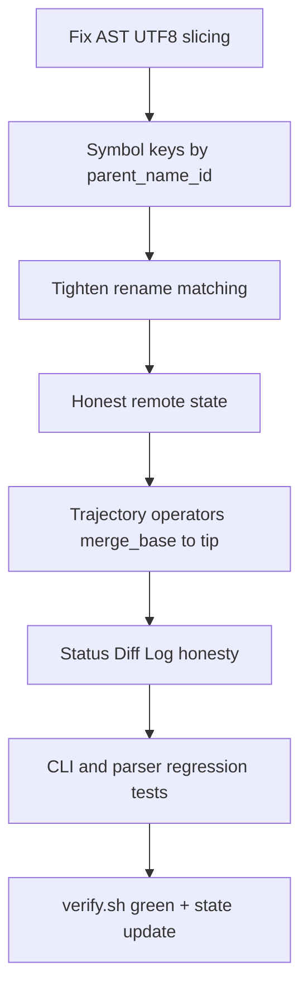

# Phase 1.1 Transcendence (Correctness + Honesty)

## Why this exists

Phase 1.1 is marked `done` in `[feature_list.json](harness/state/feature_list.json)`, but live use showed the foundation is not yet trustworthy:

- `status` shows **DRIFT DETECTED** from remote *event recency*, not semantic/remote divergence
- Uncommitted tables emit **garbage renames** (`self, _): -> , _):`) driven by AST text slicing + name-keyed symbol maps
- CLI names claim branch/manifold semantics while computing **working-tree vs HEAD** only; `--ref` is ignored
- Philosophy requires branch count to define the math; with one branch GDSS still speaks as if multi-trajectory drift exists

This plan is **Phase 1.1.2 only**. No embeddings, no continuous I(B_i) integral, no conflict tensor.

---

## Workstream A - AST / Transform Correctness (load-bearing)

### A1. Fix UTF-8 node text extraction

`[ASTParser._get_node_text](gdss/core/ast_parser.py)` indexes a Python `str` with Tree-sitter **byte** offsets. Non-ASCII before a symbol corrupts `name`/`signature`/`body`.

- Decode via `content_bytes[start:end].decode("utf-8")` (keep both str and bytes)
- Tests in `[tests/core/test_ast_parser.py](tests/core/test_ast_parser.py)`: symbols after non-ASCII comments/docstrings

### A2. Stable symbol map keys

`[TransformExtractor](gdss/core/transform_extractor.py)` builds `old_map = {s.name: s}` - class methods sharing `__init__`/`run` collide.

- Key by `(parent_class or "", name)` and prefer `symbol_id` when present
- Align `[get_indexed_symbols](gdss/core/ast_parser.py)` with the same keying
- Tests: two classes with same method name - modify/rename does not drop sibling methods

### A3. Rename precision

- Wire `_build_rename_buckets` / `fingerprint_bucket` inside `_match_symbol_renames` (currently unused)
- Raise bar: require score >= threshold **and** either name change with high structural similarity, or block false positives for near-empty stubs
- Reject matches where either symbol name fails identifier regex (defense against corrupt names)
- Tests: false-positive case (two dissimilar stubs must be delete+add); true rename passes

---

## Workstream B - Runtime / CLI Honesty

### B1. Replace `remote_aware` UX

- Add helper: compare `HEAD` vs `origin/<ref>` for ahead/behind; handle missing remote
- Stop writing "DRIFT DETECTED" from context topic in `[start.py](gdss/cli/start.py)`
- Fix prompt indicator so it means **local semantic WT delta**, not remote topic

### B2. Honor `--ref` and attractor config

- `do_status` must accept/use reference branch (from CLI arg and/or hierarchy)
- Make `config ref <branch>` persist via hierarchy/DB
- Default attractor remains configured reference; document that glossary `dev` is configurable

### B3. Trajectory operators on status

Add deterministic core/helper:

- Inputs: repo, `ref`, `HEAD`
- Output: file-level + symbol-level operators aggregated across commits `merge_base..HEAD`
- `status` layout:
  1. Branch / attractor / remote ahead-behind (honest)
  2. **Trajectory since reference** (empty when on attractor with no divergence)
  3. **Uncommitted semantic delta** (WT vs HEAD)
- Align language extensions across status/log/diff: `.py/.js/.ts/.jsx/.tsx`

### B4. Single-branch messaging

When `len(local_branches)==1` and tip equals reference: print honesty note that multi-branch conflict tensor is N/A; current state is the attractor trajectory.

---

## Workstream C - Graph / Performance (bounded)

- Content-hash cache for `parse_file(..., content=...)` path
- Do **not** expand into full import-resolution redesign

---

## Workstream D - Tests, Smoke, Docs, State

### Tests (TDD vertical slices)

- UTF-8 AST names: `tests/core/test_ast_parser.py`
- Multi-class name collision: `tests/core/test_transform_extractor.py`
- Rename false-positive: `tests/core/test_transform_extractor.py`
- Trajectory helper: `tests/watcher/` or `tests/core/`
- Status/ref/remote honesty: new `tests/cli/`
- Smoke: extend `[cli_smoke.sh](harness/sensors/cli_smoke.sh)` to assert no false "DRIFT DETECTED"

### Docs

- Update `[IO and VIZ.md](docs/IO%20%26%20VIZ.md)` and README so names match behavior
- SVG-first if diagrams change (`author-doc-diagrams` skill)

### State

- Add feature `phase1-transcendence` in `feature_list.json`
- Log new findings: UTF-8 slicing, name-key collision, unused rename buckets, status/ref ignored
- Mark complete only after `bash harness/verify.sh` green with evidence

**Workstream E — Language extensibility**

**E1. Pluggable Tree-sitter grammars**

- Add Go (`tree-sitter-go`), Rust (`tree-sitter-rust`), Java (`tree-sitter-java`) to `ASTParser.get_parser_for_ext()`.
- Move language config to a registry/dict rather than hardcoded `if/elif`.
- Update `SOURCE_EXTENSIONS` in `graph_builder.py` and unify across all CLI commands (status/log/diff currently only check `.py`/`.js`).

**E2. Graceful skip for unsupported files**

- Log or count files with no parser available (instead of silent ignore).
- CLI `analyze` should show "Skipped 12 .go files (no parser)" etc.

### **Workstream F — Scale tuning**

**F1. Content-hash memoization** (overlap with existing `c-parser-cache` todo)

- Hash file content on `parse_file(content=...)` path, not only mtime.
- LRU or disk cache for large repos.

**F2. Incremental graph**

- On `status` / `diff`, don't walk entire tree; use Git changed-file list only.
- `analyze` / `graph export` can still do full walk.

**F3. Streaming / chunked processing**

- For huge monorepos, process in batches (e.g. 500 files) with progress bar.
- Avoid holding all symbols in RAM; write to graph incrementally.

**F4. Profiling guard**

- Add a `--profile` flag or env var to dump timing per phase (parse, resolve_calls, export).
- Document known-slow spots (call resolution, rename matching).

---

## Definition of Done

Phase 1.1 transcendence is done when all are true:

1. Non-ASCII sources yield correct symbol names (tests green)
2. Same-named methods in different classes do not collide in operator extraction
3. Rename false positives on stub pairs are rejected; true renames still detected
4. `gdss status` never labels remote-topic recency as "DRIFT DETECTED"; remote row is ahead/behind or N/A
5. `--ref` affects status trajectory section; on single attractor branch with clean WT, trajectory section is empty/quiet
6. Working-tree section is labeled as uncommitted semantic delta, not branch drift energy
7. `bash harness/verify.sh` exits 0; harness findings and feature_list updated with evidence
8. **Updated definition of done**
  Add:
  - At least one non-Python grammar wired and tested (e.g. Go).
  - `analyze` on a 5k-file repo completes in reasonable time (< 60s) with progress feedback.
  - CLI shows skipped-file summary for unsupported languages.

