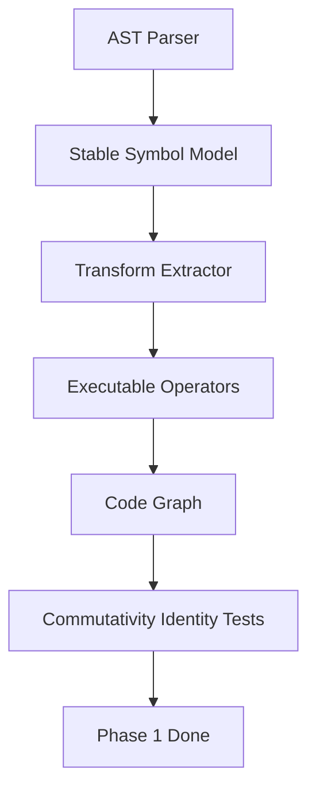

# Phase 1 Implementation And State Update Plan

## Current State

Phase 1 is partially complete, not fully done:

- `phase1-git-watcher` is `done` in `[/home/sbasnet/projects/GDSS/harness/state/feature_list.json](/home/sbasnet/projects/GDSS/harness/state/feature_list.json)`.
- `phase1-ast-parser` is `done` in `[/home/sbasnet/projects/GDSS/harness/state/feature_list.json](/home/sbasnet/projects/GDSS/harness/state/feature_list.json)`.
- `phase1-transform` is already `in_progress`.
- `phase1-graph` is already `in_progress`.
- Phase 2+ remain correctly blocked behind Phase 1.

The implementation should therefore be treated as **Phase 1.1: Rigor Refactor**, not Phase 2.

## Target Outcome

Phase 1 is complete only when GDSS can treat transformations as stable, executable semantic state transitions:




## Implementation Steps

1. **Add stable semantic identity to symbols**
  Update `[/home/sbasnet/projects/GDSS/gdss/core/transform_types.py](/home/sbasnet/projects/GDSS/gdss/core/transform_types.py)` so `CodeSymbol` can expose a deterministic, position-independent symbol ID based on language/type/parent/name/signature. The file path should remain metadata, not identity.
   This prepares `[/home/sbasnet/projects/GDSS/gdss/graph/code_graph.py](/home/sbasnet/projects/GDSS/gdss/graph/code_graph.py)` to stop using `file_path::symbol_name` as the primary semantic node identity.
2. **Introduce executable semantic operators**
  Refactor `SemanticOperator` in `[/home/sbasnet/projects/GDSS/gdss/core/transform_types.py](/home/sbasnet/projects/GDSS/gdss/core/transform_types.py)` from a passive dataclass into a model that can support:
  - `apply(graph)`
  - `invert()`
  - serialization compatibility with the existing CLI and storage code
   Keep the first implementation conservative: concrete handling for add/delete/rename/modify function and class operations, with unsupported operations failing clearly rather than silently pretending to be algebraically valid.
3. **Replace text similarity with structural fingerprints and AST edit distance**
  Update `[/home/sbasnet/projects/GDSS/gdss/core/transform_extractor.py](/home/sbasnet/projects/GDSS/gdss/core/transform_extractor.py)` so rename detection uses structural fingerprints instead of `difflib.SequenceMatcher` over cleaned text.
   Initial approach:
  - Extend AST extraction to record a syntax token sequence or structural fingerprint per symbol.
  - Compare fingerprint token sequences with normalized Levenshtein distance:
  `similarity = 1 - distance(tokens_a, tokens_b) / max(len(tokens_a), len(tokens_b))`.
  - Treat Levenshtein as an edit-distance metric over AST node kinds, not source text, so formatters like Black/Prettier do not create fake semantic drift.
  - Use hash buckets to reduce O(D x A) rename comparisons.
  - Keep a small fallback for legacy symbols without fingerprints.
4. **Add sub-symbolic function block tracking**
  Extend `[/home/sbasnet/projects/GDSS/gdss/core/ast_parser.py](/home/sbasnet/projects/GDSS/gdss/core/ast_parser.py)` and `CodeSymbol` to represent function body blocks, for example top-level `if`, `try`, `for`, `return`, and assignment blocks.
   Then update `MODIFY_FUNCTION` output in `[/home/sbasnet/projects/GDSS/gdss/core/transform_extractor.py](/home/sbasnet/projects/GDSS/gdss/core/transform_extractor.py)` to include changed block IDs instead of only `body_changed: true`.
5. **Update graph node identity and maintain chart location**
  Update `[/home/sbasnet/projects/GDSS/gdss/graph/code_graph.py](/home/sbasnet/projects/GDSS/gdss/graph/code_graph.py)`:
  - Use stable symbol IDs for function/class nodes.
  - Store file path as `chart_location` or `file` metadata.
  - Preserve compatibility for tests and CLI display where possible.
  - Maintain `_file_nodes` and `_symbol_index` indexes.
6. **Fix stale and open harness findings**
  Reconcile `[/home/sbasnet/projects/GDSS/harness/state/feature_list.json](/home/sbasnet/projects/GDSS/harness/state/feature_list.json)`:
  - Mark already-fixed stale findings as resolved only after verification confirms them.
  - Fix or update `finding-rename-downstream-crash` based on current CLI location in `[/home/sbasnet/projects/GDSS/gdss/cli/start.py](/home/sbasnet/projects/GDSS/gdss/cli/start.py)`, not the stale `gdss/cli/main.py:228` reference.
  - Keep unresolved findings open with accurate file/line references.
7. **Add tests before implementation changes**
  Add or update focused tests:
  - `[/home/sbasnet/projects/GDSS/tests/test_transform_extractor.py](/home/sbasnet/projects/GDSS/tests/test_transform_extractor.py)`: formatter-invariant rename detection, AST-token Levenshtein rename scoring, and block-level modification detection.
  - `[/home/sbasnet/projects/GDSS/tests/test_code_graph.py](/home/sbasnet/projects/GDSS/tests/test_code_graph.py)`: file move preserves symbol identity.
  - New test such as `tests/test_operator_algebra.py`: `test_operator_commutativity_identity()` where applying operators and their inverses returns the graph to the initial state.
8. **Run verification gate**
  Run:

```bash
   bash harness/verify.sh
   

```

   If it fails, fix only failures caused by Phase 1 changes. Do not start Phase 2.

## State Update Plan

After implementation and verification:

1. Update `[/home/sbasnet/projects/GDSS/harness/state/feature_list.json](/home/sbasnet/projects/GDSS/harness/state/feature_list.json)`:
  - Set `phase1-transform` to `done` only if executable operators, structural fingerprints, block-level modify details, and tests pass.
  - Set `phase1-graph` to `done` only if stable symbol graph identity and graph tests pass.
  - Keep `phase2-embeddings` as `pending`, unless Phase 1 is fully green.
  - Update `harness_findings` statuses with evidence, not claims.
2. Update `[/home/sbasnet/projects/GDSS/harness/state/progress.md](/home/sbasnet/projects/GDSS/harness/state/progress.md)`:
  Add a newest-top entry documenting:
  - Phase 1.1 Rigor Refactor scope.
  - Files changed.
  - Tests added.
  - `bash harness/verify.sh` result.
  - Remaining risks, if any.
3. Update `[/home/sbasnet/projects/GDSS/.cursor/plans/sprint_phase1_cli_beta.plan.md](/home/sbasnet/projects/GDSS/.cursor/plans/sprint_phase1_cli_beta.plan.md)`:
  - Add a Phase 1.1 Rigor Refactor section.
  - Move stale backlog items to resolved only after verification.
  - Keep telemetry/distribution/CI work pending until semantic foundation is green.

## Definition Of Done

Phase 1 is done when all of the following are true:

- `SemanticOperator` supports executable application and inversion for core operators.
- Structural fingerprints plus normalized Levenshtein edit distance make rename detection resilient to formatting-only changes.
- Function modification operators include changed block scope.
- Code graph node identity is stable across file moves.
- `test_operator_commutativity_identity()` passes.
- `bash harness/verify.sh` exits 0.
- State files accurately reflect the result with evidence.

