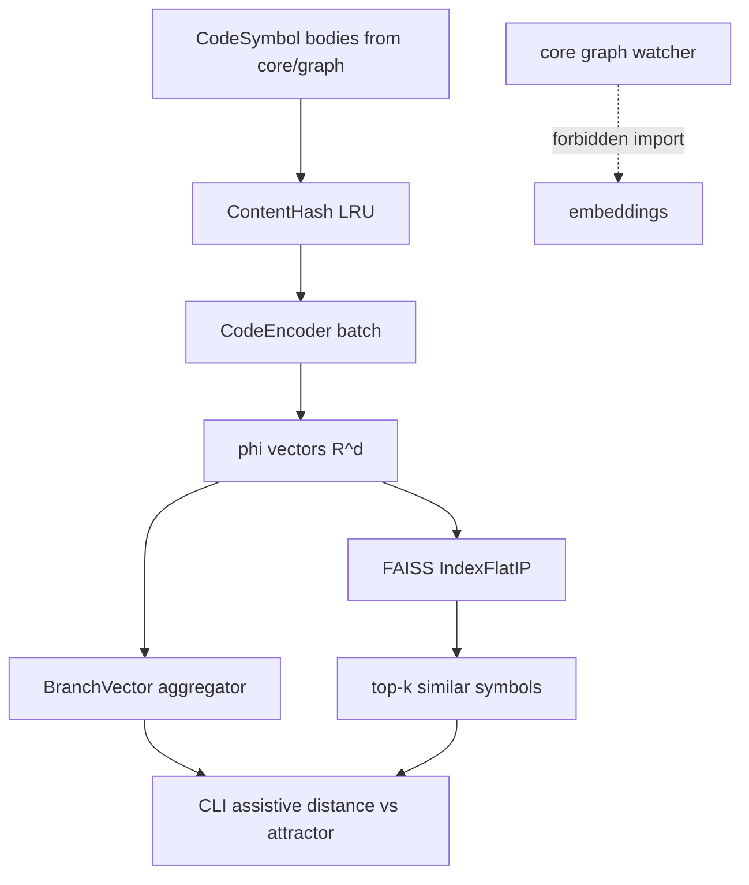

# Phase 2: Semantic Embedding Layer

## Locked scope (defaults)

From [feature_list.json](harness/state/feature_list.json) done criteria and [README](README.md) / [roadmap](.cursor/plans/gdss_complete_roadmap_e8cc388d.plan.md):

- **In:** `gdss/embeddings/` with φ(C), cosine similarity, branch tip vectors, LRU content-hash cache, batched encode (DSA rule), and **local FAISS** vector index for nearest-neighbor search.
- **Encoder:** Protocol + two implementations — `OnnxMiniLMEncoder` (all-MiniLM-L6-v2 via `onnxruntime`) and `DeterministicBagEncoder` (always available for offline CI / `verify.sh` without model download). Default factory: bag unless `GDSS_EMBEDDING_BACKEND=onnx` and model present.
- **Vector DB:** **FAISS** (`faiss-cpu`) — open-source, in-process, no Docker. Index + id map persisted under `.gdss/vectors/` in the repo. Replaces the roadmap’s Qdrant for this phase.
- **Out of this phase:** Qdrant / remote vector services; continuous drift integral / alerts (`phase3-drift`); conflict tensor; AI suggestions.

## Architecture invariants

- Layer 6 only: [architecture_fitness.py](harness/sensors/architecture_fitness.py) already ranks `embeddings: 6`.
- **Two-brain purity:** `gdss/core`, `gdss/graph`, `gdss/watcher` must never import `gdss.embeddings`. CLI/runtime may call downward into embeddings.
- Vectors are **assistive**; never rename Phase 1.1 "uncommitted semantic delta" as drift energy. Label embedding tip distance as "embedding distance to attractor (assistive)".
- FAISS lives in the embeddings package (probabilistic brain), not in deterministic core/graph.

## Deliverables (TDD vertical slices)

### 1. Package + types — `gdss/embeddings/`

| File                                                                   | Role                                                                                                               |
| ---------------------------------------------------------------------- | ------------------------------------------------------------------------------------------------------------------ |
| `[gdss/embeddings/__init__.py](gdss/embeddings/__init__.py)`           | Public exports                                                                                                     |
| `[gdss/embeddings/types.py](gdss/embeddings/types.py)`                 | `EmbeddingVector` (ndarray + dim + source_id), `BranchTipVector`                                                   |
| `[gdss/embeddings/encoder.py](gdss/embeddings/encoder.py)`             | `CodeEncoder` protocol: `encode_texts(texts: Sequence[str]) -> np.ndarray` shape `(n, d)`; factory `get_encoder()` |
| `[gdss/embeddings/cache.py](gdss/embeddings/cache.py)`                 | LRU keyed by SHA-256 of text; batch miss → one encode call (no per-item inference loop)                            |
| `[gdss/embeddings/similarity.py](gdss/embeddings/similarity.py)`       | `cosine_similarity`, `cosine_distance` (vectorized numpy)                                                          |
| `[gdss/embeddings/branch_vector.py](gdss/embeddings/branch_vector.py)` | Mean (L2-normalized) of symbol-body embeddings for a tip; `embedding_distance_to_attractor(branch, ref)`           |
| `[gdss/embeddings/vector_store.py](gdss/embeddings/vector_store.py)`   | **FAISS** `VectorStore`: upsert, search top-k, save/load under `.gdss/vectors/`                                    |

### 2. Encoders

- `**DeterministicBagEncoder`:** hash bag of tokens (name + structural tokens / body lines) into fixed `d=384` to match MiniLM dim; pure Python + numpy; unit-testable without network.
- `**OnnxMiniLMEncoder`:** load quantized/local ONNX under `.gdss/models/` or env path; batch `encode_texts`; fail clearly if model missing (WHAT/WHY/FIX).

### 3. FAISS vector store (locked choice)

Open-source local ANN via Meta’s [FAISS](https://github.com/facebookresearch/faiss) (`faiss-cpu`):

- **Index type:** `IndexFlatIP` on L2-normalized vectors (inner product ≡ cosine). Exact search for MVP; no GPU required.
- **API:** `upsert(ids: list[str], vectors: np.ndarray)`, `search(query: np.ndarray, k: int) -> list[(id, score)]`, `save(path)`, `load(path)`.
- **Persistence:** `.gdss/vectors/index.faiss` + `.gdss/vectors/id_map.json` (FAISS uses integer ids; map to `symbol_id` strings).
- **Rebuild:** CLI/`analyze` path can rebuild from current graph symbols when the index is stale or missing.
- **Privacy:** stores only vectors + symbol ids / paths — never full source bodies in the index files beyond what ids already imply.

Qdrant remains deferred (optional later SaaS/self-hosted tier); this phase does **not** require Docker.

### 4. Wire from deterministic outputs (downward only)

Public helpers that accept already-parsed data (no reverse imports into core):

- `embed_symbols(symbols: list[CodeSymbol], encoder) -> dict[symbol_id, EmbeddingVector]` using body/signature text.
- `index_symbols(store, embeddings)` → FAISS upsert.
- Reuse [CodeSymbol](gdss/core/transform_types.py) / trajectory tips from CLI wiring only.

### 5. CLI (thin, honest)

- Add `gdss similar <symbol>` / shell `do_similar`: encode query symbol, **FAISS top-k** neighbors in the current index (rebuild from graph if needed).
- Optionally append one assistive row on `status` when backend available: embedding tip distance vs `--ref` — **not** "DRIFT DETECTED".

### 6. Dependencies

- Add `numpy` (required for Layer 6 DSA).
- Add `faiss-cpu` under optional `[embeddings]` extras (or main if verify needs it always — prefer optional with in-memory numpy fallback for search when FAISS absent, but **primary path is FAISS** when extras installed).
- Add `onnxruntime` under the same `[embeddings]` extras.
- Document: `pip install -e ".[embeddings]"` + model fetch note in README / [docs/IO & VIZ.md](docs/IO%20%26%20VIZ.md).

### 7. Tests

- `tests/embeddings/test_similarity.py` — cosine identity/orthogonality.
- `tests/embeddings/test_encoder_bag.py` — stable φ for same text; batch shape; cache hit.
- `tests/embeddings/test_branch_vector.py` — tip aggregation; distance 0 to self.
- `tests/embeddings/test_vector_store.py` — FAISS upsert/search round-trip; save/load; top-1 self-match after normalize; skip or soft-fail only if `faiss` not installed (prefer requiring `faiss-cpu` in test env when extras present).
- `tests/embeddings/test_architecture.py` — core must not import embeddings (fitness sensor covers production tree).
- ONNX: `@pytest.mark.integration` skip-if-no-model; not required for `verify.sh` green.

### 8. Harness state

- Set `phase2-embeddings` → `done` only after `bash harness/verify.sh` green.
- Update `progress.md` / `session-handoff.md` with evidence.
- Docs: IO & VIZ + README reflect FAISS-backed `similar` and assistive distance; honesty that Phase 3 owns continuous I(B_i).

## Explicit non-goals

- Qdrant / Docker / remote vector DB
- Claiming merge conflict prediction from embeddings alone
- Continuous daemon drift alerts
- Deterministic brain calling φ inside transform_extractor / CodeGraph
- GPU FAISS / IVF/HNSW tuning (exact FlatIP is enough for local symbol counts)

## Definition of done

1. `gdss/embeddings/`* exists with tests; `phi` + cosine green under bag encoder (offline).
2. Batched encode + content-hash LRU; no inference-in-Python-for-loop over symbols without batching.
3. FAISS `VectorStore` upsert/search/persist green; `gdss similar` uses top-k from the index.
4. Architecture fitness still green (no core→embeddings import).
5. Branch tip vector helper + CLI surface for similarity / assistive distance.
6. `bash harness/verify.sh` exit 0; `feature_list.json` updated with evidence.

