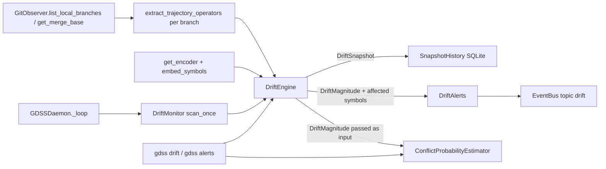

# Phase 3: Continuous Branch Drift Monitoring

## Goal
Real-time semantic synchronization awareness: quantify how far each branch trajectory `gamma_i(t)` has diverged from the attractor (`dev`/reference), track velocity and convergence, raise alerts, and estimate conflict probability — on demand and in the background.

## Dependencies
- `phase2-embeddings` (done) — provides `embed_symbols`, `aggregate_branch_tip`, `embedding_distance_to_attractor`, `cosine_distance`, `get_encoder`.

## Architecture constraint (load-bearing)
The fitness sensor ranks `conflict=7`, `drift=8`. Dependencies flow downward, so:
- `gdss/drift` (8) MAY import `embeddings` (6), `core` (4), `graph` (5), `conflict` (7), `watcher` (2).
- `gdss/conflict` (7) MAY import `embeddings` (6), `core` (4), `graph` (5) — but **MUST NOT import `gdss/drift`** (upward). The conflict estimator receives drift results as **inputs** from the orchestrator (CLI/runtime, both unlisted/entrypoints), not by importing the drift engine.
- `gdss/runtime` is unlisted in `LAYER_RANK` → its imports are not direction-checked; it orchestrates drift + conflict.

## Combined drift metric (the "elite" form)
Two components fused into one `DriftMagnitude`:

1. **Tip proxy** `d_tip = cosine_distance(branch_tip, attractor_tip)` — reuses `embedding_distance_to_attractor` (fast, snapshot).
2. **Trajectory integral** `I_traj = Σ_c ||phi(C_{c+1}) - phi(C_c)||` — discrete line integral (path length) of the branch trajectory in embedding space from `merge_base(ref, branch)` to the branch tip. Computed by walking commits `merge_base..tip`, embedding each commit's symbols, and summing step norms. This is the faithful approximation of `I(B_i) = integral ||B_i(t) - D(t)|| dt`.

Combined: `magnitude = alpha * d_tip + beta * I_traj` (default `alpha=0.5, beta=0.5`; `I_traj` min-max normalized against a configurable ceiling so both terms live in `[0, ~1]`).

- **Velocity** `v = d(magnitude)/dt` from the snapshot history (drift snapshots persisted with timestamps).
- **Convergence score** `s in [0,1]`: `s = clamp(1 - magnitude/threshold)` penalized by velocity sign — diverging (`v>0`) lowers `s`, converging (`v<0`) raises it.
- **Affected symbols**: symbols modified in both branch and attractor trajectories (via `extract_trajectory_operators`), each tagged with per-symbol cosine distance from the attractor's matching symbol.

## Data flow

## Deliverables (TDD vertical slices, in order)

### Slice 1 — Drift types
- `gdss/drift/__init__.py` — public exports.
- `gdss/drift/types.py` — frozen dataclasses:
  - `DriftMagnitude(tip_distance: float, trajectory_integral: float, magnitude: float, alpha: float, beta: float)`
  - `AffectedSymbol(symbol_id: str, name: str, distance: float, reason: str)`
  - `DriftSnapshot(branch: str, reference_branch: str, timestamp: float, magnitude: DriftMagnitude, velocity: float, convergence: float, affected: tuple[AffectedSymbol, ...])`
  - `DriftAlert(severity: Literal["low","medium","high"], branch: str, reference_branch: str, magnitude: float, message: str, affected: tuple[AffectedSymbol, ...], timestamp: float)`
- Test: `tests/drift/test_types.py` — construction + immutability + `magnitude` recomputation invariant.

### Slice 2 — Drift engine (tip + trajectory integral)
- `gdss/drift/engine.py` — `DriftEngine`:
  - `__init__(self, observer: GitObserver, parser: ASTParser, extractor: TransformExtractor, encoder: CodeEncoder | None = None, alpha=0.5, beta=0.5, trajectory_ceiling=2.0)`
  - `compute_magnitude(self, branch: str, reference_branch: str) -> DriftMagnitude` — builds branch + attractor tip vectors (`embed_symbols` + `aggregate_branch_tip`), computes `d_tip`; walks `merge_base..branch` commits summing step norms for `I_traj`; returns combined magnitude.
  - `affected_symbols(self, branch: str, reference_branch: str) -> list[AffectedSymbol]` — uses `extract_trajectory_operators` for both directions, intersects modified symbol ids, computes per-symbol cosine distance.
- Test: `tests/drift/test_engine.py` — zero magnitude when branch tip == attractor tip; positive magnitude for divergent branch; `I_traj == 0` for single-commit-no-change; affected symbols non-empty when both sides modify the same function. Use a temp git fixture (real GitPython + real `ASTParser`, per TDD skill — mock only at system boundaries).

### Slice 3 — Snapshot history, velocity, convergence
- `gdss/drift/history.py` — `SnapshotHistory`:
  - SQLite-backed (reuse `gdss.storage.db` pattern) or JSON file under `.gdss/drift/snapshots.json` (simpler, MVP). Stores `(branch, timestamp, magnitude)` rows.
  - `record(snapshot)`, `recent(branch, n) -> list[(timestamp, magnitude)]`.
- `DriftEngine.snapshot(branch, reference_branch) -> DriftSnapshot` — calls `compute_magnitude` + `affected_symbols`, reads history for velocity, computes convergence, records snapshot.
  - Velocity: `(mag_new - mag_old) / (t_new - t_old)` over the two most recent snapshots (0.0 if none).
- Test: `tests/drift/test_history.py` — record/recent round-trip; `tests/drift/test_engine.py` extended — velocity 0 on first snapshot, positive after a divergent second snapshot; convergence in `[0,1]`.

### Slice 4 — Alerts
- `gdss/drift/alerts.py` — `DriftAlerts(thresholds={"low":0.25,"medium":0.5,"high":0.75})`:
  - `evaluate(snapshot) -> DriftAlert | None` — maps magnitude to severity, builds human-readable message listing top affected symbols with distances (matches roadmap's `HIGH DRIFT ALERT` format).
  - `format(alert) -> str` — rich-renderable multi-line string.
- Test: `tests/drift/test_alerts.py` — no alert below low threshold; correct severity buckets; message contains branch name and an affected symbol.

### Slice 5 — Conflict probability estimator (initial, heuristic)
- `gdss/conflict/__init__.py`, `gdss/conflict/probability.py` — `ConflictProbabilityEstimator`:
  - Pure function of inputs (does NOT import `gdss.drift`): `estimate(branch_ops, reference_ops, shared_files, drift_magnitude) -> ConflictProbability` where `ConflictProbability(score: float, reasons: tuple[str,...]) in [0,1]`.
  - Heuristic: weighted sum of `symbol_overlap`, `shared_modified_files`, `drift_magnitude` (passed in), `operator_interference` (rename/modify/delete collisions from the two operator lists). May import `embeddings` (cosine similarity for symbol overlap) and `core` (operator types).
- Test: `tests/conflict/test_probability.py` — zero score with no overlap; high score with shared modified files + rename collision + high drift magnitude; reasons enumerate the contributing factors.

### Slice 6 — CLI (on-demand) — `gdss drift` / `gdss alerts`
- `gdss/cli/main.py` — register `drift` and `alerts` commands.
- `gdss/cli/start.py` — `do_drift` and `do_alerts` on `GDSSShell`:
  - `do_drift`: iterate `list_local_branches()` (skip the reference branch), compute `DriftEngine.snapshot` per branch, render a Rich table (branch, magnitude, d_tip, I_traj, velocity, convergence, top affected symbol). Wire `ConflictProbabilityEstimator` here (passes drift magnitude in). Honest messaging when only one branch exists (reuse `is_single_attractor_trajectory`).
  - `do_alerts`: evaluate latest snapshot per branch via `DriftAlerts`, print any non-None alerts.
- Test: `tests/cli/test_drift_cli.py` — `gdss drift` runs over the fixture repo without error; single-attractor case prints an honest "no other trajectories" message; a divergent fixture branch yields a row with positive magnitude.

### Slice 7 — Daemon integration (background)
- `gdss/drift/monitor.py` — `DriftMonitor(observer, parser, extractor, bus, engine)`:
  - `scan_once(reference_branch)` — iterate local branches, `engine.snapshot`, `alerts.evaluate`, `bus.emit("drift", {...})` for any alert; always emit a `"drift"` snapshot event for the active branch.
- `gdss/runtime/daemon.py` — extend `GDSSDaemon`:
  - Own a `DriftMonitor` (constructed alongside `LocalObserver`/`RemoteMonitor`).
  - In `_loop`, after `local_observer.scan_once()`, call `drift_monitor.scan_once(reference_branch)` (reference resolved via `context_engine.get_reference_branch()`). Throttle drift scans (e.g., every N iterations or on HEAD change) to keep the 5s loop cheap.
- `gdss/runtime/context_engine.py` — extend `on_any_event` to handle `topic == "drift"` (store drift summary in the context packet).
- Test: `tests/runtime/test_daemon_drift.py` — start daemon on a fixture repo, run one loop iteration, assert a `"drift"` event was emitted on the bus and `DriftMonitor.scan_once` was invoked (smoke; use a real fixture repo, not a mock of GDSS modules).

### Slice 8 — Architecture fitness + verify + state
- Confirm `harness/sensors/architecture_fitness.py` stays green (no `conflict→drift` import; `drift→embeddings/core/graph/conflict` downward). No sensor edit needed — `drift` and `conflict` are already in `LAYER_RANK`.
- Add `# dsa:ignore` only if the DSA sensor flags intentional per-iteration calls in the commit-walk loop.
- Run `bash harness/verify.sh` to green (static + pytest + cli-smoke). Add `gdss drift` to `harness/sensors/cli_smoke.sh`.
- Update `harness/state/feature_list.json` (`phase3-drift` → `done` with evidence), `progress.md`, `session-handoff.md`.
- Docs: extend `README.md` CLI table + `docs/IO & VIZ.md` with `gdss drift` / `gdss alerts`; refresh `assets/product/roadmap.svg` and `pipeline.svg` to mark Phase 3 done.

## Explicit non-goals (deferred)
- Full `Omega_{ij}` conflict tensor (Phase 4).
- Non-commutativity detector / commutativity table (Phase 4).
- Geometric trajectory / parallel transport (Phase 4 / research).
- AI suggestions or semantic rebase (Phase 5).
- Auto-resolution of conflicts (never — GDSS predicts, never auto-merges).

## Definition of done
1. `gdss/drift/{__init__,types,engine,history,alerts,monitor}.py` and `gdss/conflict/{__init__,probability}.py` exist with passing tests.
2. `DriftEngine` computes the combined magnitude (tip + trajectory integral), velocity, convergence, and affected symbols.
3. `DriftAlerts` produces severity-bucketed notifications in the roadmap format.
4. `ConflictProbabilityEstimator` scores heuristically **without importing `gdss.drift`**.
5. `gdss drift` and `gdss alerts` CLI commands work over a fixture repo; `GDSSDaemon` emits `"drift"` events each loop.
6. `harness/sensors/architecture_fitness.py` green (layer direction + two-brain purity hold).
7. `bash harness/verify.sh` exits 0; `feature_list.json` updated with evidence.