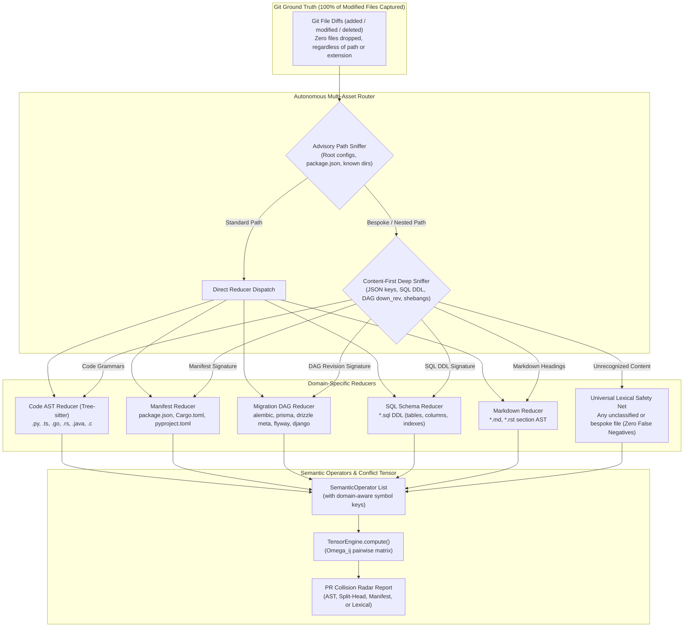

# Implementation Plan: Universal Multi-Asset Collision Engine & Domain Reducers

GDSS currently filters all file comparisons through `SOURCE_EXTENSIONS` (`.py`, `.ts`, `.js`, `.go`, `.rs`, `.java`, `.c`, `.cpp`), silently discarding any non-code file (`if not path.endswith(ext_tuple): continue`). In production repositories, this causes critical failure modes:
1. **False "All Clear" ($\Omega_{ij} = 0.0$)**: Concurrent edits to `package.json`, `.env.example`, or `.github/workflows/ci.yml` are invisible to GDSS, leading to unpredicted Git merge conflicts.
2. **Database Migration "Split-Head" Catastrophe**: Two branches adding new migration files (e.g. Alembic `down_revision = '0022'`, Prisma migrations) merge cleanly in Git because the filenames differ, but crash at runtime in production with `MultipleHeadRevisionsError`.
3. **Lockfile Diff Hallucination**: LLM convergence assistants hallucinate cryptographic package hashes when attempting to textually diff 10,000-line lockfiles.
4. **Documentation Merge Friction**: Concurrent edits to markdown changelogs or README feature lists are flagged either as untracked files or as raw textual clashes, rather than being parsed as structured section additions.

This plan specifies the architecture, file modifications, new domain reducers, and verification pipeline to make GDSS a **Universal Multi-Asset Repository Intelligence Engine**.

---

## User Review Required

> [!IMPORTANT]
> **Zero False Negatives Invariant**: With this change, if two branches concurrently modify **any** identical file in a repository (even raw text or declarative config), GDSS will **never** report $\Omega_{ij} = 0.0$ ("All Clear"). It will always emit at least a `lexical_concurrent` warning on the PR Collision Radar.

> [!NOTE]
> **Lockfile Regeneration Policy**: Lockfiles (`pnpm-lock.yaml`, `package-lock.json`, `poetry.lock`, `Cargo.lock`) will **never** be patched textually by the LLM. Instead, the ephemeral validation sandbox will execute native lockfile update commands (`pnpm install --lockfile-only`, `cargo generate-lockfile`) against the reconciled manifest.

---

## Open Questions

> [!TIP]
> **SQL Parser Selection**: Should the initial implementation of `SQLSchemaReducer` use a regex-based DDL tokenizer or embed `tree-sitter-sql`?  
> *Recommendation*: Start with a robust, zero-dependency DDL regex/lexer for `CREATE TABLE`, `ALTER TABLE`, `ADD COLUMN`, `DROP COLUMN`, and `RENAME TO` to maintain lightweight offline operation without requiring additional C compiler toolchains.

---

## Architecture Overview

---

## Proposed Changes

### Component 1: Domain Reducer Architecture (`gdss/reducers/`)

Create an extensible subsystem for domain-specific semantic extraction.

#### [NEW] `gdss/reducers/base.py`
- Define `DomainReducer` protocol with method:
  `extract_operators(file_path: str, old_content: str | None, new_content: str | None, commit_sha: str) -> list[SemanticOperator]`
- Standardize domain symbol naming conventions:
  - Manifests: `manifest::package.json::dependencies.axios`
  - Migrations: `migration::alembic::0023_add_roles (parent: 0022)`
  - SQL: `table::users`, `column::users.status`
  - Markdown: `doc::README.md#Changelog`
  - Lexical: `file::.github/workflows/ci.yml:lines 40-55`

#### [NEW] `gdss/reducers/registry.py`
- `DomainReducerRegistry`: Resolves file paths to the appropriate reducer:
  - If matches manifest patterns (`package.json`, `Cargo.toml`, `pyproject.toml`) $\rightarrow$ `ManifestReducer`
  - If matches migration directories or metadata journals (`**/migrations/**`, `**/migration/**`, `**/migrate/**`, `alembic/**`, `prisma/migrations/**`, `drizzle/**`, `db/migrations/meta/*.json`, `supabase/migrations/**`, `hasura/migrations/**`, `typeorm/migrations/**`, `flyway/**`, etc.) $\rightarrow$ `MigrationDAGReducer`
  - If ends with `.sql` $\rightarrow$ `SQLSchemaReducer`
  - If ends with `.md`, `.rst` $\rightarrow$ `MarkdownSectionReducer`
  - If in `SOURCE_EXTENSIONS` $\rightarrow$ Standard `ASTParser` + `TransformExtractor`
  - Fallback for all other files $\rightarrow$ `UniversalLexicalReducer`

#### [NEW] `gdss/reducers/manifest_reducer.py`
- Implements JSON and TOML key-level parsing.
- Emits operators for `add_dependency`, `remove_dependency`, `change_version_constraint`, `modify_script`.
- Encodes commutativity: additions of distinct packages commute ($[\mathcal{T}_A, \mathcal{T}_B] = 0$); overlapping additions with divergent version ranges do not commute.

#### [NEW] `gdss/reducers/migration_reducer.py`
- **Dynamic Config Sniffers**: Auto-detects project structure and custom migration directories by parsing root configuration files:
  - `alembic.ini` (`script_location`)
  - `drizzle.config.{ts,js,json}` (`out` directory, e.g. `./drizzle` or `./db/migrations`)
  - `prisma/schema.prisma` (`prisma/migrations/`)
  - `knexfile.{js,ts}` (`migrations.directory`)
  - `flyway.conf` (`flyway.locations`)
  - `manage.py` / `settings.py` (Django `**/migrations/**`)
  - `package.json` / `pyproject.toml` (ORM dependency sniffing)
  - `.gdss.yml` (`migrations.paths` override)
- **Comprehensive Directory Normalizer**:
  Matches all production path patterns:
  - `**/migrations/**`, `**/migration/**`, `**/migrate/**`, `**/db/migrate/**`, `**/db/migrations/**`, `**/database/migrations/**`
  - `alembic/versions/**`, `alembic/**`
  - `prisma/migrations/**`
  - `drizzle/**`, `db/migrations/meta/*.json`, `drizzle/meta/*.json`
  - `supabase/migrations/**`, `hasura/migrations/**`
  - `typeorm/migrations/**`, `src/migration/**`
  - `flyway/sql/**`, `db/migration/**`
- **Metadata Journal & Snapshot Collision Engine**:
  - Parses Drizzle / metadata journals (`drizzle/meta/_journal.json`, `db/migrations/meta/*.json`, `meta/*_snapshot.json`).
  - Evaluates entry sequence indices (`entries[].idx`) and snapshot hashes. If two PRs append entries sharing the same index or branching off the same snapshot, flags a `MigrationJournalClash`.
- **Topological Parent Matching**:
  - Extracts `down_revision` (Alembic), `dependencies` (Django), timestamp sequence (Prisma, Rails, Flyway, Supabase).
  - Emits `OperatorType.MIGRATION_STEP` operators carrying parent and child revision metadata.
  - If two branches emit migrations with the same parent revision, flags **`SplitHeadHazard`** with critical severity ($\Omega = 1.0$) and generates an automated re-parenting command for rebasing.

#### [NEW] `gdss/reducers/sql_reducer.py`
- Lightweight DDL tokenizer extracting `CREATE TABLE`, `ALTER TABLE`, `ADD COLUMN`, `DROP COLUMN`, and `RENAME TO`.
- Emits schema symbols: `table::<name>`, `column::<table.col>`.

#### [NEW] `gdss/reducers/markdown_reducer.py`
- Parses Markdown ATX headings (`#`, `##`, `###`) and unordered list items.
- Emits section symbols (`doc::<file>#<heading>`).
- Marks concurrent list additions under the same section as low-risk union candidates ($\Omega \le 0.25$).

#### [NEW] `gdss/reducers/lexical_reducer.py`
- Computes line-level diff chunks for any arbitrary text file (e.g. `.yaml`, `.env`, `Dockerfile`).
- Emits `lexical_chunk` operators with line ranges and content hashes.

---

### Component 2: Core Trajectory & Commutativity Engine

#### [MODIFY] `gdss/core/trajectory.py`
- Refactor `extract_trajectory_operators()`:
  - Remove the hard filter `if not path.endswith(ext_tuple): continue`.
  - Route each modified, added, or deleted path through `DomainReducerRegistry.get_reducer(path)`.
  - Accumulate semantic operators from code ASTs, manifests, migrations, SQL, docs, and lexical fallbacks.

#### [MODIFY] `gdss/core/transform_types.py`
- Extend `OperatorType` enum with new domain operator kinds:
  - `ADD_DEPENDENCY`, `MODIFY_DEPENDENCY`, `REMOVE_DEPENDENCY`
  - `MIGRATION_STEP`, `SPLIT_HEAD_HAZARD`
  - `SCHEMA_ADD_TABLE`, `SCHEMA_MODIFY_COLUMN`, `SCHEMA_DROP_COLUMN`
  - `DOC_SECTION_APPEND`, `LEXICAL_CHUNK_EDIT`

#### [MODIFY] `gdss/conflict/commutativity.py`
- Update commutativity matrix:
  - `(ADD_DEPENDENCY, ADD_DEPENDENCY)`: Commutative if package keys differ; Non-commutative if package keys match and versions diverge.
  - `(MIGRATION_STEP, MIGRATION_STEP)`: Non-commutative if `down_revision` / parent matches (Split-Head Hazard).
  - `(DOC_SECTION_APPEND, DOC_SECTION_APPEND)`: Commutative (Union merge).

---

### Component 3: Sandboxed Validation & PR Collision Radar

#### [MODIFY] `gdss/validation/pr_audit.py`
- Expand `audit_pr_collisions()` to report domain-specific collision topologies:
  - `🗄️ Database Migration Split-Head`: Highlighting colliding revision IDs and recommended re-parenting command.
  - `📦 Package Manifest Divergence`: Highlighting colliding package keys and versions.
  - `📄 Documentation Section Union`: Low-risk info badge with auto-merge recommendation.
  - `⚙️ Configuration / Lexical Overlap`: Surface exact overlapping line ranges for CI and config files.

#### [MODIFY] `gdss/validation/test_runner.py`
- Add native lockfile synchronization hook:
  - If a patch modifies `package.json`, execute `pnpm install --lockfile-only` or `npm install --package-lock-only` in the sandbox worktree before running tests.
  - If a patch modifies `Cargo.toml`, execute `cargo generate-lockfile` in the sandbox worktree.

---

### Component 4: Production Documentation & SVG Diagram Assets

In accordance with the `author-doc-diagrams` repository standard:

#### [NEW] `assets/reducers/universal_multi_asset_flow.svg`
- Hand-authored, production-grade SVG diagram conforming to the GDSS palette (`#06b6d4`, `#2563eb`, `#7c3aed`, `#10b981`, `#f59e0b`, Segoe UI font, reusable arrowhead markers).
- Illustrates:
  1. 100% Git Ingestion (all modified files captured).
  2. Dual-stage routing: Advisory Path Sniffer + Deep Content-First Sniffer.
  3. The 6 Specialized Reducers (Code AST, Manifests, Migration DAGs, SQL DDL, Markdown Sections, Universal Lexical Fallback).
  4. Unified Collision Tensor ($\Omega_{ij}$) and PR Radar classification.

#### [NEW] `docs/UNIVERSAL_MULTI_ASSET_GUIDE.md`
- Full reference guide detailing:
  - The problem with AST-only merge tools in production repos.
  - Framework discovery and metadata journal tracking (`_journal.json`, `meta/*.json`).
  - Zero-token lockfile reconciliation strategy.
  - Centered SVG diagram display paired with an editable collapsible `

🔄 Mermaid source (click to expand)
` block.
  - Cross-references in `docs/README.md` and `docs/USER_GUIDE.md`.

---

## Verification Plan

### Automated Tests
1. **Unit Tests for Domain Reducers**:
   - `pytest tests/reducers/test_manifest_reducer.py`: Test `package.json` dependency additions and version conflicts.
   - `pytest tests/reducers/test_migration_reducer.py`: Test Alembic `down_revision` split-head detection and Prisma timestamp sequencing.
   - `pytest tests/reducers/test_sql_reducer.py`: Test SQL DDL schema symbol extraction.
   - `pytest tests/reducers/test_markdown_reducer.py`: Test section-based markdown diffing.
   - `pytest tests/reducers/test_lexical_reducer.py`: Test line-range chunking on `.yml` and `.env` files.
2. **Trajectory Integration Tests**:
   - `pytest tests/core/test_trajectory_multi_asset.py`: Verify that non-code files produce `SemanticOperator` records and are not discarded.
3. **PR Collision Radar End-to-End Tests**:
   - `pytest tests/validation/test_pr_audit_multi_asset.py`: Test radar comment formatting for manifest collisions and migration split-heads.
4. **Harness Gate**:
   - `bash harness/verify.sh`: Ensure Layer 1 (lint, mypy, architecture fitness, DSA fitness), Layer 2 (pytest), Layer 3 (cli smoke), and frontend gate all remain 100% green.

### Manual Verification
1. Run `gdss status` and `gdss log` in a fixture repo containing concurrent `package.json` and migration edits.
2. Verify that `gdss audit-pr` produces a detailed radar table distinguishing code collisions from manifest and database migration split-heads.
