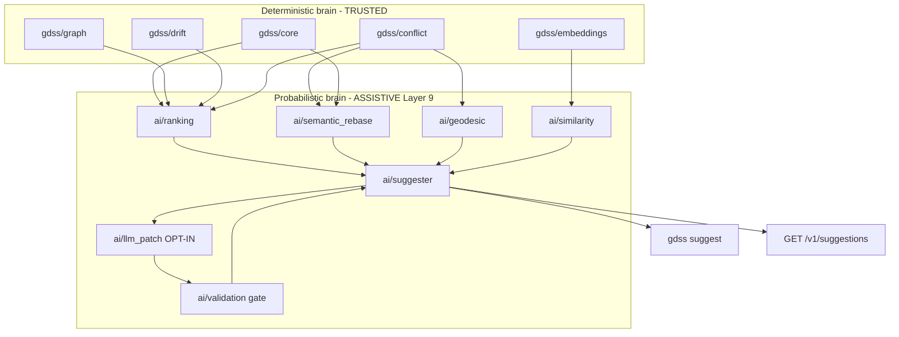

# Phase 5 — AI Convergence Layer (`phase5-ai`)

## What it is

The **assistive** brain on top of the deterministic layers (core, graph, embeddings, drift, conflict). It produces **ranked, location-anchored suggestions** that help a developer converge a branch toward the attractor (`dev`) and resolve predicted conflicts.

- It **ranks** and **proposes**; it never auto-merges, never writes to the working tree, never mutates git state.
- It **optionally** drafts patch text via an LLM, only when the user opts in, and only behind a deterministic validation gate.
- Output is a `Suggestion` with exact `file_path` + `line_start` + `line_end` + `symbol_id`, so the developer can open the file at the right line and apply by hand.

## MIT math mapping

Directly implemented (discrete analogs):

- **Parallel transport `P_{j->i}`** -> *semantic rebase*: replay branch `j`'s `SemanticOperator`s in branch `i`'s frame using commutativity + symbol-id remap.
- **Geodesic** -> *merge sequencing*: order operators to minimize cumulative `Omega` (drift-minimizing path to the attractor). Greedy nearest-neighbor over the commutativity graph.
- **Riemannian metric `G`** -> *embedding similarity kernel* (cosine in MiniLM space) for ranking rename/move targets and duplicate-work detection.
- **Commutativity `[T_i, T_j]`** (phase 4) -> *merge ordering*: commuting operators reorder safely; non-commuting ones surface the conflict.
- **Linear independence of branch vectors** (vision doc) -> *duplicate-work detector*: near-parallel branches are doing the same thing -> suggest merge or pick one.

Metaphor only (not implemented in code):

- Continuous curvature / connection forms / holonomy -> language for drift accumulation in docs, not a code module.
- Rank-N tensor on `M^N` (octopus merge) -> deferred to the geometric ladder (phase 4d/4e), not phase 5.

## Architecture (two-brain purity preserved)

`gdss/ai` is **Layer 9**. It imports downward (core, graph, embeddings, drift, conflict). The deterministic brain (core, graph, watcher) must never import `gdss/ai`. The probabilistic brain never acts without deterministic validation.



## Components (all new files; no edits to existing source)

1. [gdss/ai/types.py](gdss/ai/types.py) - `Suggestion` dataclass: `kind`, `file_path`, `line_start`, `line_end`, `symbol_id`, `operator`, `action`, `rationale`, `confidence`, `patch_text` (optional), `source`, `validated`.
2. [gdss/ai/ranking.py](gdss/ai/ranking.py) - pure deterministic ranker. Inputs: drift, `ConflictTensor`, `commutativity_table`. Outputs ranked candidates. No LLM, no network.
3. [gdss/ai/semantic_rebase.py](gdss/ai/semantic_rebase.py) - `parallel_transport(operators_j, frame_i)`: remap symbol ids into branch `i`'s table, drop already-applied commuting operators, keep the rest as an ordered rebase plan anchored to `file:line`.
4. [gdss/ai/geodesic.py](gdss/ai/geodesic.py) - `minimize_omega_sequence(operators)`: greedy nearest-neighbor on the commutativity graph. O(n^2) over operator count, justified in docstring.
5. [gdss/ai/similarity.py](gdss/ai/similarity.py) - `detect_duplicate_work(branch_embeddings)`: cosine similarity over branch operator-vector profiles; flag near-parallel pairs.
6. [gdss/ai/llm_patch.py](gdss/ai/llm_patch.py) - **opt-in only**, gated by `GDSS_LLM_PROVIDER` env (unset = disabled, zero network). Sends only the anchored symbol block, never whole files, no PII. Pluggable `LLMProvider` protocol; a `StubProvider` for tests.
7. [gdss/ai/validation.py](gdss/ai/validation.py) - `validate_patch(suggestion, patch_text)`: parse the patch, assert it touches only `suggestion.symbol_id` within `[line_start, line_end]`. The deterministic gate the LLM output must pass.
8. [gdss/ai/suggester.py](gdss/ai/suggester.py) - orchestrator: `suggest(repo, ref) -> list[Suggestion]`. Runs ranking -> rebase -> geodesic -> similarity -> optional LLM -> validation. Public entrypoint.
9. CLI - add `gdss suggest` in `gdss/cli/`. Default `--no-llm`. `--json` for machine output. `--llm` requires a configured provider.
10. API - add `GET /v1/suggestions` in [gdss/api/server.py](gdss/api/server.py) and `get_suggestions` in [gdss/api/service.py](gdss/api/service.py). Document in [docs/f1_api_contract.md](docs/f1_api_contract.md).
11. Docs - add a Phase 5 section to [docs/MANIFOLD_TENSOR_GUIDE.md](docs/MANIFOLD_TENSOR_GUIDE.md). Update [docs/IMPLEMENTATION_GAP.md](docs/IMPLEMENTATION_GAP.md) and the `phase5-ai` entry in [harness/state/feature_list.json](harness/state/feature_list.json) to `done` with evidence.

## CLI output shape

```
[rename] src/foo.py:42-60  function `bar` -> `baz`   (omega=0.71, conf=0.66)
  rationale: branch `feature/x` renamed `bar`; `dev` still calls `bar`.
  location: src/foo.py:42
```

## Frontend (optional follow-up, not blocking)

A `/suggestions` page with "Open file at line L" deep links is a natural F8 card. Not required for `phase5-ai` done criteria (backend: `gdss/ai/* produces validated suggestions; never auto-merges; tests green`). Noted as the next frontend phase.

## TDD order (vertical slices, red -> green -> refactor)

1. `tests/ai/test_types.py` - `Suggestion` shape, `validated` defaults False.
2. `tests/ai/test_ranking.py` - divergent fixture -> ordered candidates, highest `Omega` first, confidence in [0,1].
3. `tests/ai/test_semantic_rebase.py` - `parallel_transport` remaps symbol ids and drops already-applied commuting operators.
4. `tests/ai/test_geodesic.py` - `minimize_omega_sequence` returns lower cumulative `Omega` than input order on a 4-operator fixture.
5. `tests/ai/test_similarity.py` - near-parallel branches flagged; orthogonal branches not.
6. `tests/ai/test_validation.py` - patch touching only the anchored symbol passes; touching a neighbor is rejected.
7. `tests/ai/test_llm_patch.py` - `StubProvider` returns draft text; env unset returns `None` and opens no socket.
8. `tests/ai/test_suggester.py` - deterministic suggestions always present; LLM patch attached only when opted in and validated.
9. `tests/cli/test_suggest.py` - `gdss suggest --no-llm` prints anchored suggestions; `--json` valid; `--llm` without provider errors with WHAT/WHY/FIX.
10. `tests/api/test_handlers.py` + `tests/api/test_server.py` - `get_suggestions` and `/v1/suggestions` route.

## Verification (definition of done)

`bash harness/verify.sh` green: ruff, mypy, architecture fitness (two-brain boundary holds), pytest, and `gdss suggest` CLI smoke over a fixture repo. Update [harness/state/progress.md](harness/state/progress.md) and [harness/state/session-handoff.md](harness/state/session-handoff.md).