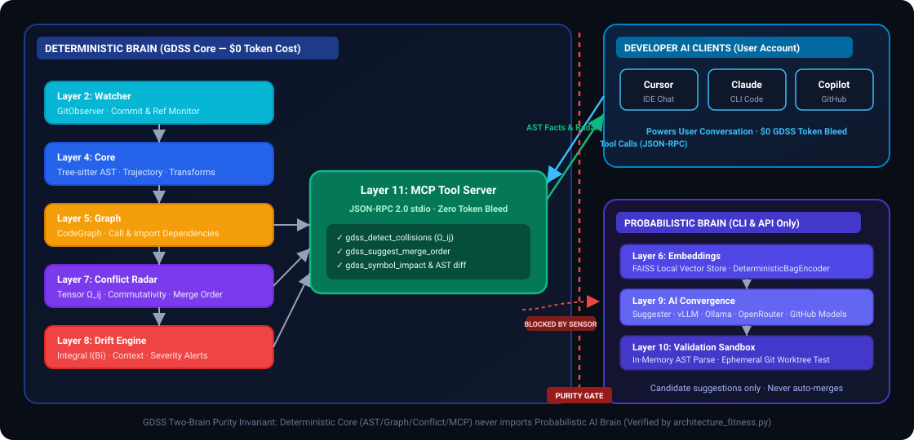
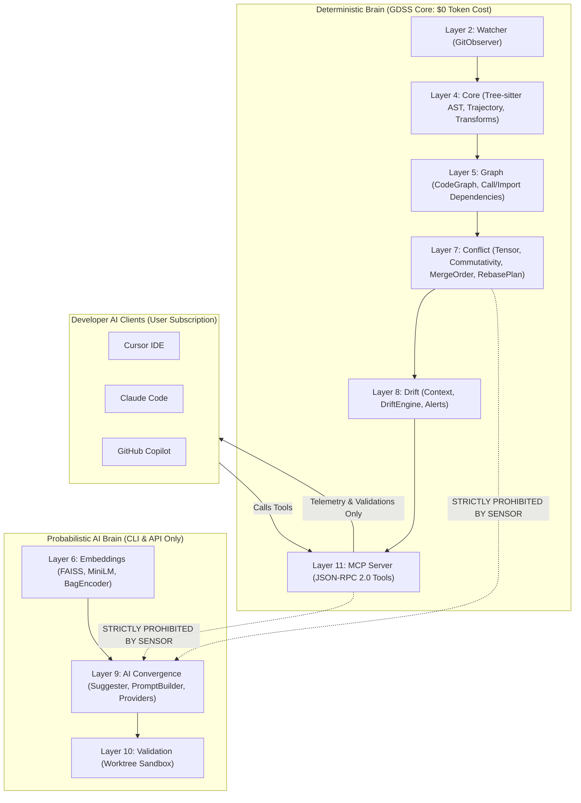
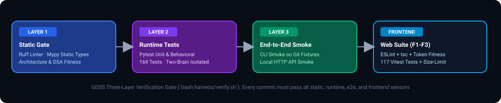

# GDSS Contributor & Developer Guide

> **Gate Distributive Semantic Synopsis (GDSS)**: A Semantic Intelligence Layer Above Git that detects cross-branch semantic collisions, predicts merge interference, and assists code convergence before merge.

Welcome to the GDSS Contributor Guide! This document is the engineering manual for **developers and researchers contributing to the GDSS codebase**.

> [!NOTE]
> 📖 **Looking to USE GDSS in your projects or workflows?**
> - For installation, IDE setup (Cursor, Claude Code, Copilot), CLI usage, and CI/CD pipelines, see the [**User & Integrator Guide** (`docs/USER_GUIDE.md`)](docs/USER_GUIDE.md).
> - For `.gdss.yml` configuration schema, context window allocation, and provider recipes, see the [**Configuration Guide** (`docs/CONFIGURATION_GUIDE.md`)](docs/CONFIGURATION_GUIDE.md).
> - For automated GitHub Actions pull request collision radar, see the [**GitHub Actions Guide** (`docs/GITHUB_ACTIONS_GUIDE.md`)](docs/GITHUB_ACTIONS_GUIDE.md).

---

## 📑 Table of Contents

- [Contributor Quickstart](#-contributor-quickstart)
- [Architecture & Two-Brain Purity](#-architecture--two-brain-purity)
  - [The 10-Layer Hierarchy](#the-10-layer-hierarchy)
  - [The Golden Invariants](#the-golden-invariants)
- [Key Architectural Decisions](#-key-architectural-decisions)
  - [Zero Token Cost Deterministic Core](#1-zero-token-cost-deterministic-core-0-token-bleed)
  - [Concrete AST Ground Truth in Radar Tools](#2-concrete-ast-ground-truth-in-radar-tools)
  - [Ephemeral Worktree Sandboxed Validation](#3-ephemeral-worktree-sandboxed-validation)
  - [Guarded Local Application Engine (`gdss apply`)](#4-guarded-local-application-engine-gdss-apply)
  - [3-Tier Repository-Agnostic AST Parser](#5-3-tier-repository-agnostic-ast-parser)
- [Engineering Discipline & The Verification Gate](#-engineering-discipline--the-verification-gate)
  - [The Three-Layer Verification Gate](#the-three-layer-verification-gate)
  - [TDD-First Workflow](#tdd-first-workflow)
  - [Architecture Fitness Sensor](#architecture-fitness-sensor)
  - [The Ratchet Principle](#the-ratchet-principle)
- [Developer Workflows](#-developer-workflows)
  - [Adding a New Semantic Operator](#adding-a-new-semantic-operator)
  - [Adding Language Support to AST Parser](#adding-language-support-to-ast-parser)
  - [Working on the Web Dashboard (`web/`)](#working-on-the-web-dashboard-web)
- [Submitting Pull Requests](#-submitting-pull-requests)
- [Project Documentation Map](#-project-documentation-map)

---

## ⚡ Contributor Quickstart

### 1. Clone & Bootstrap Environment
```bash
# Clone the repository
git clone https://github.com/Sarthak2233/GDSS.git
cd GDSS

# Bootstrap python virtual environment, install editable package, and run health checks
bash harness/init.sh
```

### 2. Verify Your Environment
Before touching any code, confirm that the verification gate is completely green:
```bash
bash harness/verify.sh
```

### 3. Run Individual Sensors
```bash
bash harness/sensors/lint.sh                        # ruff check
bash harness/sensors/typecheck.sh                   # mypy (87 source files)
python harness/sensors/architecture_fitness.py     # two-brain purity & layer boundaries
bash harness/sensors/run_tests.sh                   # pytest suite
bash harness/sensors/cli_smoke.sh                   # end-to-end CLI smoke fixture
```

---

## 🏛 Architecture & Two-Brain Purity

GDSS strictly segregates its architecture into two brains:

<p align="center">
  
</p>

<details>
<summary>🏛️ Mermaid source (click to expand)</summary>



</details>

### The 10-Layer Hierarchy

Dependencies flow strictly downward. Higher numbered layers may import lower layers; lower layers **never** import higher layers:

| Layer Rank | Subsystem | Package Path | Primary Responsibility |
| :---: | :--- | :--- | :--- |
| **0** | **Runtime** | `gdss/runtime/`, `gdss/storage/` | Workspace state, Git DB coordination, configuration storage |
| **2** | **Watcher** | `gdss/watcher/` | `GitObserver`: branch listing, commit DAG walking, diff extraction |
| **4** | **Core** | `gdss/core/` | Tree-sitter multi-language ASTs, transform operators, trajectories |
| **5** | **Graph** | `gdss/graph/` | `CodeGraph`, NetworkX directed graph, caller/import dependencies |
| **6** | **Embeddings** | `gdss/embeddings/` | Symbol vector encoding, FAISS vector index, 3D PCA projection |
| **7** | **Conflict** | `gdss/conflict/` | Collision tensor $\Omega_{ij}$, commutativity algebra, merge ordering |
| **8** | **Drift** | `gdss/drift/` | Trajectory integral $I(B_i)$, drift alerts, snapshot history |
| **9** | **AI** | `gdss/ai/` | Suggester, prompt builder, providers (Ollama, vLLM, OpenAI/GitHub) |
| **10** | **Validation** | `gdss/validation/` | Ephemeral worktree sandboxes, guarded local apply, PR collision audit |
| **11** | **MCP / CLI** | `gdss/mcp/`, `gdss/cli/` | Entrypoints: JSON-RPC MCP server, CLI commands, HTTP API |

### The Golden Invariants
1. **Two-Brain Purity**: The deterministic brain (`core`, `graph`, `watcher`, `conflict`, `drift`, `mcp`) must **never import** the probabilistic brain (`ai`, `embeddings`). Enforced statically by `python harness/sensors/architecture_fitness.py`.
2. **Layer Direction**: Dependencies strictly flow downward; lower layers never import higher layers.
3. **Zero Token Bleed**: The MCP server never makes server-side LLM calls or consumes token budgets.
4. **Never Auto-Merge**: GDSS calculates, diagnoses, and proves; humans always make the decision to merge code.

---

## 🔍 Key Architectural Decisions

### 1. Zero Token Cost Deterministic Core ($0 Token Bleed)
- **Problem**: Running LLMs inside local analysis or MCP tool servers causes double-token billing and high latency.
- **Resolution**: All collision detection, commutativity equations, dependency impact tracing, and merge order scheduling run deterministically on local CPU. The MCP server incurs **literal 0 tokens and $0 API fees**. When AI synthesis is requested, the user's IDE model or CI runner supplies the compute.

### 2. Concrete AST Ground Truth in Radar Tools
- **Resolution**: [`gdss_find_collisions`](gdss/mcp/tools.py) returns exact structural facts:
  - Exact file paths: `conflicting_files: ["services/auth.py"]`
  - Exact symbol names: `conflicting_symbols: ["login_user"]`
  - Concrete operator pairs: `branch_a_operator: "modify_function"`, `branch_b_operator: "change_signature"`
  - Commutativity classification: `commutes: false`

### 3. Ephemeral Worktree Sandboxed Validation
- **Resolution**: [`gdss/validation/sandbox.py`](gdss/validation/sandbox.py) checks out an isolated, temporary Git worktree (`/tmp/gdss-sandbox-...`):
  1. Applies unified diff via `git apply --whitespace=fix`.
  2. Multi-language AST syntax validator detects syntax breaks.
  3. Static typechecker (`tsc`, `mypy`, `cargo check`, `go vet`).
  4. Targeted test runner (`run_targeted_tests`) executes only existing automated tests covering the affected symbol.
  - Results in zero uncommitted file changes in the developer's working directory.

### 4. Guarded Local Application Engine (`gdss apply`)
- **Resolution**: [`gdss/validation/guarded_apply.py`](gdss/validation/guarded_apply.py) provides preflight HEAD freshness checks, canonical path traversal gates (`../` prevention), atomic rollback snapshot creation (`.gdss/rollback/<id>.json`), and self-healing automatic rollback if post-apply AST syntax checks fail.

### 5. 3-Tier Repository-Agnostic AST Parser
- **Tier 1 (Specialized Tree-sitter Visitors)**: Python, JavaScript, TypeScript, Go, Rust, Java, C/C++.
- **Tier 2 (Universal Tree-sitter Walker)**: Automatically walks standard declaration nodes for any dynamically loaded grammar.
- **Tier 3 (Universal Structural Fallback)**: Scans declaration keywords and tracks block scopes via balanced braces `{ ... }` or keyword indentation (`def`, `func`, `fn`, `end`) for Ruby, PHP, Shell, Kotlin, Swift, Scala, Lua, etc., guaranteeing **100% repository coverage**.

---

## 🛠 Engineering Discipline & The Verification Gate

### The Three-Layer Verification Gate

Every change to GDSS must satisfy the **Definition of Done** enforced by `bash harness/verify.sh`:

<p align="center">
  
</p>

```bash
# Run the complete verification gate
bash harness/verify.sh
```

| Layer | Type | Checks | Tooling |
| :--- | :--- | :--- | :--- |
| **Layer 1** | Static | Code quality, static types, architecture invariants, DSA fitness | Ruff, Mypy (87 files), `architecture_fitness.py`, `dsa_fitness.py` |
| **Layer 2** | Runtime | Unit, integration, and behavioral tests | Pytest (271 tests) |
| **Layer 3** | End-to-End | CLI smoke and API smoke on Git fixtures | `cli_smoke.sh`, `api_smoke.sh` |
| **Frontend** | Visual Quality | ESLint, TypeScript, component accessibility, bundle budget | ESLint, `tsc`, Vitest (117 tests), `size-limit` |

### TDD-First Workflow
GDSS follows strict Test-Driven Development:
1. **Red**: Write a failing test first in `tests/` verifying behavior through public interfaces.
2. **Green**: Write the minimal implementation to satisfy the test.
3. **Refactor**: Clean up and optimize while staying green.
4. **Gate**: Run `bash harness/verify.sh` to confirm all layers pass before pushing.

### Architecture Fitness Sensor
The sensor `harness/sensors/architecture_fitness.py` statically parses every Python file in `gdss/` using the Python `ast` module:
- Asserts that deterministic modules never import `gdss.embeddings` or `gdss.ai`.
- Asserts that higher-layer modules only import equal or lower layer ranks.
- Fails with explicit `WHAT / WHY / FIX` diagnostic output.

### The Ratchet Principle
Whenever a bug slips through or a design mistake is repeated, **tighten the harness**: add a guide or a sensor so the mistake is caught automatically forever.

---

## 🚀 Developer Workflows

### Adding a New Semantic Operator
Follow the `add-semantic-operator` workflow:
1. Add the enum value to `OperatorType` in [`gdss/core/transform_types.py`](gdss/core/transform_types.py).
2. Update the commutativity classification matrix in [`gdss/conflict/commutativity.py`](gdss/conflict/commutativity.py).
3. Add AST extraction logic in [`gdss/core/transform_extractor.py`](gdss/core/transform_extractor.py).
4. Author unit tests in `tests/core/` and verify commutativity tests in `tests/conflict/`.

### Adding Language Support to AST Parser
1. Add file extensions to `DEFAULT_SOURCE_EXTENSIONS` in [`gdss/core/ast_parser.py`](gdss/core/ast_parser.py).
2. If compiling a new Tree-sitter grammar, implement a specialized visitor class inheriting from `_BaseVisitor`.
3. If relying on structural blocks, ensure keyword declarations (`fn`, `func`, `sub`) map to `CodeSymbolType`.
4. Add language test fixtures in `tests/core/test_ast_parser.py`.

### Working on the Web Dashboard (`web/`)
The visual brain lives in `web/` (Next.js 14, Tailwind CSS, Framer Motion, React Flow):
```bash
cd web
pnpm install
pnpm dev              # Dev server on http://localhost:3000
pnpm lint             # ESLint + jsx-a11y
pnpm typecheck        # tsc --noEmit
pnpm test             # Vitest + jest-axe (117 tests)
pnpm size             # Bundle budget check (<= 180 kB)
bash ../harness/verify-frontend.sh  # Frontend gate
```

---

## 📝 Submitting Pull Requests

1. **Keep PRs Focused**: One vertical slice per PR.
2. **Verify Locally First**: Ensure `bash harness/verify.sh` exits with code 0.
3. **Write Descriptive PR Messages**:
   - What was changed and why.
   - Evidence: test count, verify script output.
   - Any architectural considerations or layer boundary interactions.

---

## 📚 Project Documentation Map

- **User & Integrator Manual**: [`docs/USER_GUIDE.md`](docs/USER_GUIDE.md) — Comprehensive guide to using GDSS (MCP, CLI, GitHub Actions, Web UI).
- **Configuration Guide**: [`docs/CONFIGURATION_GUIDE.md`](docs/CONFIGURATION_GUIDE.md) — `.gdss.yml` schema, context discovery tiers, and recipes.
- **GitHub Actions Guide**: [`docs/GITHUB_ACTIONS_GUIDE.md`](docs/GITHUB_ACTIONS_GUIDE.md) — CI/CD PR collision radar setup, permissions, and 1-click buttons.
- **Convergence & Suggestion Guide**: [`docs/SUGGESTION_AND_CONVERGENCE_GUIDE.md`](docs/SUGGESTION_AND_CONVERGENCE_GUIDE.md) — Model-free suggester, audited state IDs (`sug_...`), and safe landing lifecycle.
- **Master Product Specification**: [`PRODUCT_SPEC.md`](PRODUCT_SPEC.md) — 31 user stories, implementation decisions, and roadmap.
- **Product Intent (North Star)**: [`docs/PRODUCT_INTENT.md`](docs/PRODUCT_INTENT.md) — Canonical statement of goals, non-goals, and two-brain honesty.
- **Frontend Roadmap & Design System**: [`docs/FRONTEND_ROADMAP.md`](docs/FRONTEND_ROADMAP.md) — Visual brain specification and motion hierarchy.
- **AI Layer Deep Dive**: [`docs/AI_LAYER.md`](docs/AI_LAYER.md) — Suggester pipeline, prompt construction, and provider contracts.
- **Data Flow & Visualization**: [`docs/IO & VIZ.md`](docs/IO%20%26%20VIZ.md) — Input/output pipelines and graph exports.
- **Manifold Tensor Guide (Research Track)**: [`docs/MANIFOLD_TENSOR_GUIDE.md`](docs/MANIFOLD_TENSOR_GUIDE.md) — Theoretical reference for Phase R differential geometry.
