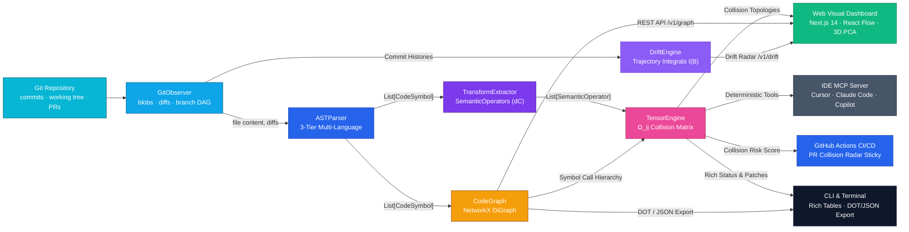
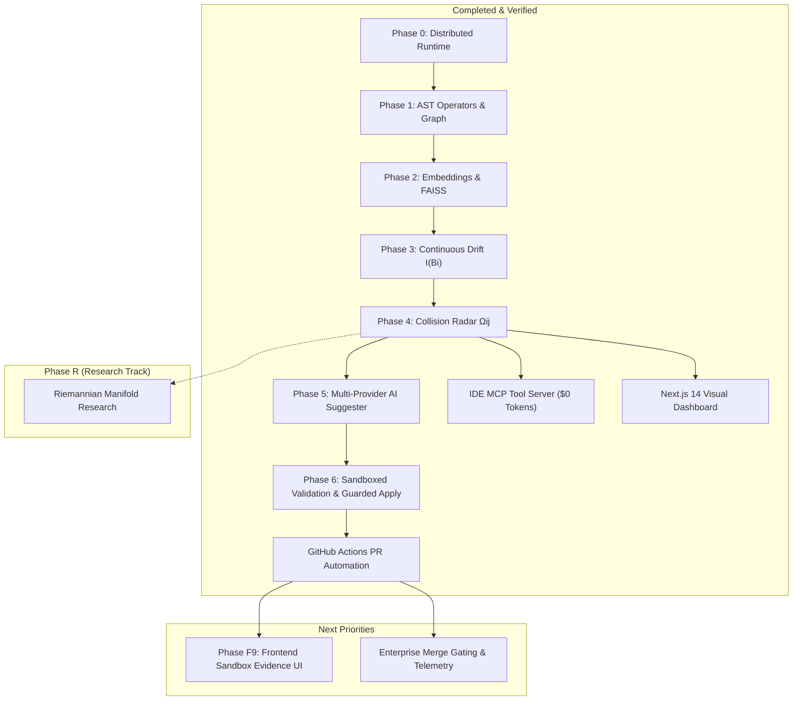
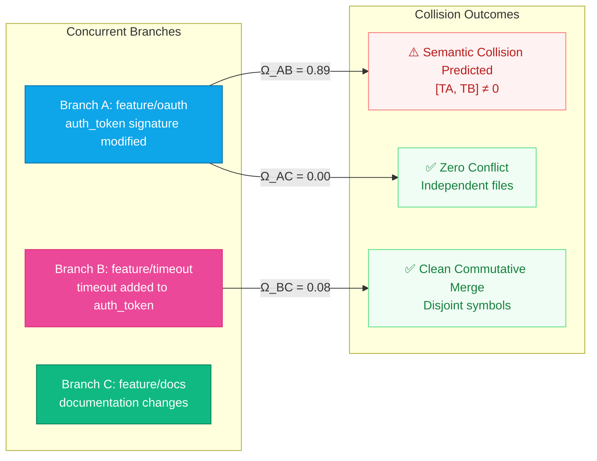

# GDSS: Gate Distributive Semantic Synopsis

<div align='center'>


</div>

**A Semantic Intelligence Layer Above Git** — PR Collision Radar & Convergence Assistant. GDSS detects semantic collisions across concurrent pull requests, identifies affected AST symbols and contractual changes, predicts merge interference before checkout, and proposes validated convergence patches.

- **User & Integrator Manual:** [`docs/USER_GUIDE.md`](docs/USER_GUIDE.md)
- **Contributor & Developer Guide:** [`CONTRIBUTING.md`](CONTRIBUTING.md) (or [`DEVELOPER_GUIDE.md`](DEVELOPER_GUIDE.md))
- **Repository Configuration Guide (`.gdss.yml`):** [`docs/CONFIGURATION_GUIDE.md`](docs/CONFIGURATION_GUIDE.md)
- **GitHub Actions PR Radar Guide:** [`docs/GITHUB_ACTIONS_GUIDE.md`](docs/GITHUB_ACTIONS_GUIDE.md)
- **Convergence & Suggestion Guide:** [`docs/SUGGESTION_AND_CONVERGENCE_GUIDE.md`](docs/SUGGESTION_AND_CONVERGENCE_GUIDE.md)
- **Master Product Specification:** [`PRODUCT_SPEC.md`](PRODUCT_SPEC.md)
- **Product Intent & Philosophy:** [`docs/PRODUCT_INTENT.md`](docs/PRODUCT_INTENT.md)
- **Harness & Verification Gate:** [`harness/README.md`](harness/README.md)

> **North Star:** Pinpoint PR collisions, name affected symbols, and recommend optimal merge order before merge — raising collaboration throughput. GDSS is **not** an auto-merge bot or universal merge oracle: humans always decide what lands.

---

## 📖 Project Overview

### The Philosophy: Beyond String Diffs to PR Collision Radar

Traditional version control systems (like Git) treat code as static, flat lines of text. Merges are performed via text-based three-way diffs, which frequently succeed at the Git level while introducing silent semantic breakage, broken type contracts, or interface collisions.

GDSS builds a deterministic semantic layer above Git:

| Traditional Git | GDSS Semantic Intelligence Layer |
| :--- | :--- |
| **Files & raw text lines** | Repository-agnostic multi-language ASTs (Python, TypeScript, Go, Rust, Java, C/C++, Ruby, PHP, and Universal Fallback) |
| **String diffs** | Semantic transformation operators (add, modify, delete, rename, change signature) |
| **Branch as commit list** | Cumulative semantic trajectory $\gamma_i(t)$ capturing contractual changes |
| **Merge conflict** | Pairwise collision tensor $\Omega_{ij}$ and non-commutative operator orderings |
| **Manual resolve / trial-and-error** | AI convergence assistant proposing verified minimal patches ($0 token IDE MCP or local LLM) |
| **Blind landing** | Ephemeral Git worktree sandboxed validation before human review |

<p align="center">
  
</p>

<details>
<summary>📐 Mermaid source (click to expand)</summary>



</details>

### 🎯 The Problem: Why Traditional Git & Copilot Miss Merge Breakages

Traditional Git and AI code assistants operate with two major blind spots:
1. **Single-PR Isolation:** Standard CI and GitHub Copilot only inspect **one PR at a time (`PR vs main`)**. They have zero awareness of the other 15 concurrent branches your teammates are actively writing.
2. **"Silent Semantic Collisions":** Git diffs only care about text line overlaps. If Branch A changes a function signature in `auth.py`, and Branch B calls the old signature in `billing.py`, Git reports **0 conflicts** and merges cleanly—only for production to crash with runtime errors.

| Scenario | Standard Git & Copilot | GDSS Semantic Radar |
| :--- | :--- | :--- |
| **Cross-PR Interference** | ❌ Blind to other open PRs | ✅ **Repository-Wide Radar:** Computes pairwise collision matrix ($\Omega_{ij}$) across all active PRs |
| **Cross-File Contract Breaks** | ❌ Merges cleanly; crashes in prod | ✅ **AST Dependency Graph:** Flags broken signatures and callers before merge |
| **Suggestion Verification** | ❌ Unchecked text (hallucinations) | ✅ **Sandboxed Validation:** Ephemeral worktree tests types, syntax, and regressions |
| **Merge Order Scheduling** | ❌ Trial-and-error guesswork | ✅ **Optimal Merge Scheduling:** Recommends which PR to merge 1st, 2nd, and 3rd to minimize rework |

> **Air Traffic Control vs. Auto-Complete:** GitHub Copilot is an auto-complete tool for the file you are currently typing in. GDSS is an **Air Traffic Control radar** monitoring all branch flight paths across the entire repository to prevent mid-air collisions before they occur.

### ⚡ At a Glance: The End-to-End Workflow

When developers push code and open pull requests, GDSS turns blind merge conflicts into early, verified convergence:

1. **Repository-Wide Radar ($N$-Branch Analysis):** Unlike standard CI which only tests `PR vs main` in isolation, GDSS evaluates the incoming branch against **all concurrently open PRs** across the repository, constructing an $N \times N$ collision matrix ($\Omega_{ij}$) using AST symbol graphs and commutativity algebra.
2. **Early Collision Diagnosis:** When branches touch overlapping symbols or broken dependency contracts (e.g., Branch A modifies a function signature that Branch B calls), GDSS flags the non-commutative clash before anyone attempts to merge.
3. **Validated AI Convergence Patch:** Rather than leaving developers to manually guess resolutions, GDSS drafts a minimal reconciliation patch and tests it inside an ephemeral, isolated Git worktree sandbox (`/tmp/gdss-sandbox-...`) against syntax checks, static types, and regression test suites.
4. **1-Click Review & Tensor Reduction:**
   - **In GitHub Actions:** GDSS posts a review comment with a native 1-click **"Commit suggestion"** button directly on the PR.
   - **In AI IDEs (Cursor / Claude Code):** Available live via the Model Context Protocol (`gdss mcp`) at $0 token cost.
   - **In Local CLI:** Applied safely using `gdss apply <suggestion_id>`.
   - **Closing the Loop:** Once committed, the reconciled AST operators eliminate the conflict, driving the collision tensor score $\Omega_{ij} \to 0$ and lowering the repository's overall merge risk.

---

## 🔌 Model Context Protocol (MCP) & Compute Model (BYOC)

GDSS operates on a transparent **Bring Your Own Compute (BYOC)** architecture with zero proprietary token markups:

- **100% Free Deterministic Core (0 Tokens):** AST parsing, dependency graphs, $\Omega_{ij}$ collision radar, drift tracking, and optimal merge order scheduling run **locally on CPU using Git, Tree-sitter, and linear algebra**. This deterministic layer costs **literal 0 tokens and $0 API fees** for everyone.
- **Zero Middleman Markup on AI Synthesis:** GDSS does not act as a SaaS middleman or bill per-token fees. When patch synthesis is requested, it connects directly to compute you already own:
  - **In your AI IDE:** Connects to Cursor, Claude Code, or Copilot via standard MCP (`gdss mcp`) using your existing IDE subscription.
  - **In GitHub CI:** Connects to Copilot CLI or GitHub Models using your team's native `GITHUB_TOKEN`.
  - **On your laptop:** Connects to local offline models via Ollama or vLLM at zero API token cost.

```
┌────────────────────────────────────────────────────────┐
│  Developer AI IDE (Cursor / Claude Code / Copilot)     │
│  Runs in developer's existing account (Zero GDSS fee)  │
└──────────────────────────┬─────────────────────────────┘
                           │ Standard MCP Protocol (JSON-RPC)
┌──────────────────────────▼─────────────────────────────┐
│  GDSS Deterministic MCP Server (`gdss mcp`)            │
│  100% Deterministic Local Core (ASTs, Graphs, Git)     │
│  Literally 0 tokens & runs entirely on local CPU       │
└────────────────────────────────────────────────────────┘
```

The MCP server runs entirely on your local machine using the deterministic brain. It collects **$0 platform fees** and sends zero private code to third parties.

### Setup in Cursor (`~/.cursor/mcp.json`)
```json
{
  "mcpServers": {
    "gdss": {
      "command": "gdss",
      "args": ["mcp"]
    }
  }
}
```

### Setup in Claude Code
```bash
claude mcp add gdss -- gdss mcp
```

### 8 Deterministic Tools Exposed to Your AI Agent:
1. `gdss_detect_collisions`: Pairwise branch collision tensor $\Omega_{ij}$ (overlapping symbols, contractual breaks).
2. `gdss_explain_topology`: Human-readable explanation of why branches collide and where invariants fail.
3. `gdss_suggest_merge_order`: Optimal merge ordering minimizing total merge interference.
4. `gdss_rank_rebase_plan`: Step-by-step rebase order with collision risk scores per rebase step.
5. `gdss_affected_symbols`: Precise list of classes, functions, and interfaces modified or invalidated.
6. `gdss_semantic_diff`: AST-level semantic transformations between branches.
7. `gdss_query_dependencies`: Upstream and downstream call/import dependencies from the semantic graph.
8. `gdss_symbol_impact`: Blast radius analysis detailing which symbols break if a given symbol changes.

---

## 🚀 Quick Start & Usage

### 🛠 Installation

GDSS is designed to run locally on developer hardware without requiring a dedicated GPU.

```bash
# Clone the repository and install in editable mode
git clone https://github.com/sbasnet/GDSS.git
cd GDSS
pip install -e .

# For development (includes ruff, mypy, pytest)
pip install -e ".[dev]"

# Optional: semantic embedding search (faiss-cpu, onnxruntime)
pip install -e ".[embeddings]"

# Verify the three-layer harness gate
bash harness/verify.sh
```

### 🧭 Interactive Shell (First 2 Minutes)

Point GDSS at any Git repository and launch the interactive shell:

```bash
# Launch the interactive shell (use "." for current repo)
gdss start --repo .
```

```text
gdss ▶ help              # 1. see every available command
gdss ▶ status            # 2. attractor/remote + trajectory + uncommitted delta
gdss ▶ analyze           # 3. build dependency graph (node/edge summary)
gdss ▶ similar <symbol>  # 4. assistive embedding neighbors (FAISS / bag)
gdss ▶ drift             # 5. per-branch drift vs attractor (tip + trajectory integral)
gdss ▶ impact <symbol>   # 6. what breaks if you change <symbol>
gdss ▶ log 5             # 7. semantic operators for last 5 commits
gdss ▶ quit              # 8. exit (or press Ctrl+D)
```

### 💻 CLI Operations

| Command | Arguments | Purpose |
| :--- | :--- | :--- |
| `gdss start` | `--repo` | Launch the interactive developer shell |
| `gdss mcp` | `--repo` | Launch the Model Context Protocol (MCP) server |
| `gdss status` | `--repo`, `--ref` | Attractor/remote + trajectory since ref + uncommitted delta |
| `gdss log` | `--repo`, `-n` | Semantic AST operators per commit |
| `gdss analyze` | `--repo` | Build dependency graph, print node/edge summary |
| `gdss diff` | `TARGET`, `--repo` | Semantic AST diff vs another branch |
| `gdss drift` | `--repo`, `--ref` | Per-branch drift magnitude (tip + trajectory integral) |
| `gdss alerts` | `--repo`, `--ref` | Drift alerts above severity thresholds |
| `gdss similar` | `SYMBOL`, `--repo`, `-k` | Assistive FAISS/bag neighbors for a symbol |
| `gdss reindex` | `--repo` | Rebuild `.gdss/vectors/` embedding index |
| `gdss watch` | `--repo` | Real-time event bus monitor |
| `gdss graph export` | `--repo`, `--format`, `-o` | Export dependency graph to DOT or JSON |
| `gdss suggest` | `--repo`, `--ref`, `--llm`, `--provider`, `--model`, `--validate`, `--sandbox-timeout` | Propose ranked semantic resolution patches (with optional ephemeral sandbox validation) |
| `gdss apply` | `SUGGESTION_ID`, `--strategy`, `--dry-run`, `--rollback` | Guarded local application of an approved suggestion with preflight security and rollback |
| `gdss audit-pr` | `--repo`, `--pr-number`, `--token`, `--dry-run`, `--output` | Audit concurrent pull requests for semantic collisions and post sticky radar reports |


---

## 🧠 AI-Powered Convergence Assistant (Phase 5 & 6)

GDSS can generate minimal conflict-free patches and plain-English risk assessments using provider-neutral LLMs, verified in isolated ephemeral worktrees before presentation.

### Supported LLM Providers:
- **vLLM (Local, Recommended):** High-throughput local inference.
  ```bash
  vllm serve Qwen/Qwen2.5-Coder-7B-Instruct --port 8000
  gdss suggest --llm --provider vllm --repo .
  ```
- **Ollama (Local):** Lightweight local runner.
  ```bash
  ollama pull qwen2.5-coder:7b
  gdss suggest --llm --provider ollama --model qwen2.5-coder:7b --repo .
  ```
- **OpenRouter (Cloud / Multi-model):** Access Claude 3.5 Sonnet, DeepSeek V3/R1, or GPT-4o.
  ```bash
  export OPENROUTER_API_KEY="sk-or-..."
  gdss suggest --llm --provider openrouter --model anthropic/claude-3.5-sonnet --repo .
  ```
- **GitHub Models / Azure / Custom OpenAI-compatible:**
  ```bash
  export OPENAI_API_KEY="ghp_..."
  export OPENAI_BASE_URL="https://models.inference.ai.azure.com"
  gdss suggest --llm --provider openai --model gpt-4o --repo .
  ```

### 🛡️ Ephemeral Sandboxed Validation (Phase 6)
When `--validate` is passed, candidate patches are tested in an isolated Git worktree (`/tmp/gdss-sandbox-...`) before presentation:
- **Repository-Agnostic**: Automatically walks up from the patched file to discover the nearest project root (`pyproject.toml`, `package.json`, `Cargo.toml`, `go.mod`, `pom.xml`, `Makefile`), with optional `.gdss.yml` for custom build systems (Bazel, Gradle).
- **Multi-Language Pluggable**: 3-tier registry supporting built-in Tree-Sitter (Py, TS, JS, Go), native project compilers (Rust `cargo check`, Java `javac`), and universal diff fallbacks.
- **Existing Project Tests**: Executes only existing automated tests covering the affected symbol to verify zero regressions.
- **Configurable Timeout**: Set via `--sandbox-timeout <seconds>` or `GDSS_SANDBOX_TIMEOUT` (default: 30s local, 60s CI).
- **GitHub PR Integration**: When run in GitHub Actions, verified patches format as native ````suggestion ```` blocks with a 1-click **"Commit suggestion"** button directly on github.com.

> **Strict Human-in-the-Loop:** Suggestions are proposals for developer review. GDSS **never** auto-merges without human approval.

### 🔒 Guarded Local Application & Rollback (Phase 6a)

Once suggestions are audited and validated, developers can review and apply them locally with full preflight protection:

```bash
# 1. Preview the unified diff without touching any files
gdss apply sug_abc123 --dry-run

# 2. Apply the approved resolution strategy to the working tree
gdss apply sug_abc123 --strategy keep_left

# 3. Instantly revert an applied suggestion to its original state
gdss apply sug_abc123 --rollback


# Scenario: You want to resolve a known branch collision

# 1. You are working on your feature branch
git checkout feature/auth
# 2. Check collision radar across concurrent branches
gdss status
# Output: PR Collision Radar detected collision with concurrent branch 'feature/billing'
# Affected symbol: services/auth.py::login (Ω_ij = 0.85)
# 3. Request assistive convergence resolutions
gdss suggest --validate
# Output:
# Suggestion 1: conflict on services/auth.py (ID: sug_e83b12)
# Action: Adapt login() signature to accept timeout=30
#   - Strategy: adapt_signature [✓ Sandbox Validated]
# 4. Preview the changes first (Zero risk)
gdss apply sug_e83b12 --strategy adapt_signature --dry-run
# Prints colorized unified diff directly to your terminal
# 5. Apply the approved suggestion
gdss apply sug_e83b12 --strategy adapt_signature
# Output:
# ✓ Preflight checks passed (HEAD commit matches, symbol verified)
# ✓ Snapshot saved to .gdss/rollback/sug_e83b12.json
# ✓ Post-apply AST syntax check passed
# ✓ Successfully applied to services/auth.py
# 6. Standard Git inspection (Human developer retains 100% agency!)
git status
# Changes not staged for commit:
#   modified:   services/auth.py
git diff
# You inspect the code, run your local test suite (pytest / npm test)
# 7. If you change your mind:
gdss apply sug_e83b12 --rollback
# Instantly restored to original content!
# 8. If you are satisfied:
git add services/auth.py
git commit -m "refactor(auth): adapt login signature for billing compatibility"
git push origin feature/auth
```

- **Guarded Preflight Security**: Rejects path traversal attempts outside the repo root, verifies Git `HEAD` freshness against the suggestion's target commit (blocking stale suggestions), and verifies target AST symbol presence.
- **Atomic with Self-Healing Rollback**: Automatically snapshots the original file before modifying disk. If post-apply multi-language AST syntax validation fails, the patch is **automatically rolled back** immediately.
- **Strict Developer Agency**: Modifies only the working tree file. GDSS **never** executes `git merge`, `git rebase`, `git add`, `git commit`, or `git push`.

### ⚙️ Repository Configuration (`.gdss.yml`)

GDSS requires **zero configuration** by default. To customize multi-language tracking, hook into monorepo build tools, or configure explicit models, context windows, and agentic refinement limits, place an optional `.gdss.yml` at the root of your repository:

```yaml
# .gdss.yml - Project-level semantic intelligence configuration

radar:
  # The model to invoke for semantic patch reconciliation
  model: "gpt-4o"
  # Explicit context window in tokens (MANDATORY BEST PRACTICE to prevent heuristic fallback)
  context_window: 128000
  # Provider backend: "github" (GitHub Models in CI), "openai", "openrouter", "ollama", "vllm"
  provider: "github"
  # Maximum agentic self-correction retries when sandbox validation fails
  max_refinements: 2
  # Collision risk cutoff score between 0.0 and 1.0 (Omega_ij)
  risk_threshold: 0.8
  # CI Merge Gate Behavior (fail check if Omega_ij >= risk_threshold)
  fail_on_collision: false

validation:
  # Command to run targeted tests in the ephemeral worktree sandbox ({test_file} placeholder supported)
  test_command: "pnpm test {test_file}"
  # Command for static typechecking
  typecheck_command: "tsc --noEmit"
  # Execution timeout in seconds (CLI --sandbox-timeout > GDSS_SANDBOX_TIMEOUT > config > default 30s)
  timeout_seconds: 60

ast:
  # Additional file extensions to track in collision radar and dependency graphs
  additional_extensions:
    - .vue
    - .svelte
    - .sol
    - .zig
```

> [!TIP]
> 📖 **Configuration Reference:** See [`docs/CONFIGURATION_GUIDE.md`](docs/CONFIGURATION_GUIDE.md) for full provider recipes (Ollama, vLLM, OpenRouter, OpenAI, GitHub Models) and details on why explicit `context_window` configuration is crucial over fallback heuristics. For cascading precedence rules, see [Repository Configuration in CONTRIBUTING.md](CONTRIBUTING.md#️-repository-configuration-gdssyml).

---

## 🛰️ Automated PR Collision Radar (GitHub Actions)

GDSS delivers proactive branch collision intelligence directly inside your pull requests before merging. Whenever a developer opens or pushes to a pull request, GDSS:
1. **Discovers Concurrent PRs**: Scans all concurrently open pull requests targeting the base branch via the GitHub REST API.
2. **Computes Collision Tensor Matrix ($\Omega_{ij}$)**: Detects contractual shifts, breaking caller/callee signatures, and non-commutative operations across branches.
3. **Tests Candidate Resolutions**: Validates candidate patches inside an ephemeral worktree sandbox (syntax checks, type checks, targeted unit tests).
4. **Posts/Updates Sticky Radar Comment**: Maintains a single sticky Markdown comment per PR with collision topologies, merge order recommendations, and 1-click **"Commit suggestion"** buttons.

<p align="center">
  
</p>

### Drop-in Workflow (`.github/workflows/gdss-radar.yml`)

Add this workflow to your repository to activate PR collision audits in 2 minutes:

```yaml
name: GDSS PR Collision Radar

on:
  pull_request:
    types: [opened, synchronize, reopened]

permissions:
  contents: read
  pull-requests: write
  issues: write

jobs:
  collision-radar:
    name: Audit Cross-Branch PR Collisions
    runs-on: ubuntu-latest
    steps:
      - uses: actions/checkout@v4
        with:
          fetch-depth: 0
      - uses: actions/setup-python@v5
        with:
          python-version: "3.11"
      - run: pip install gdss
      - name: Run Collision Audit
        env:
          GITHUB_TOKEN: ${{ secrets.GITHUB_TOKEN }}
          GITHUB_EVENT_PATH: ${{ github.event_path }}
          GITHUB_REPOSITORY: ${{ github.repository }}
        run: gdss audit-pr
```

> 📖 **Full User & Setup Guide:** See [`docs/GITHUB_ACTIONS_GUIDE.md`](docs/GITHUB_ACTIONS_GUIDE.md) for blocking vs. informational modes, `.gdss.yml` configuration schema, and fork security.

---

## 🖥️ Web Visual Dashboard (`web/`)

GDSS includes a modern Next.js 14 web dashboard that visualizes repository geometry, collision radar heatmaps, and optimal rebase orders.

```bash
cd web
pnpm install
pnpm dev
```
Open [http://localhost:3000](http://localhost:3000) in your browser:
- **PR Collision Radar:** Real-time matrix of concurrent branches and pairwise conflict scores ($\Omega_{ij}$).
- **Interactive Manifold Graph:** Symbol dependency and impact graph powered by React Flow.
- **Merge Order Visualizer:** Animated rebase trajectories and recommended merge queues.

---

## 🗺️ Project Direction & Roadmap

This section tracks the roadmap. **Done** means the feature is implemented, tested, and verified green via `bash harness/verify.sh`.

### Current Status: **Phases 0–6 + MCP Server + GitHub Actions CI + Web Dashboard Complete**

| Phase / Module | Status | Deliverables |
| :--- | :--- | :--- |
| **Phase 0 — Distributed Runtime** | **Done** | Event bus, local/remote observers, daemon, context engine |
| **Phase 1 — Deterministic Brain** | **Done** | Multi-language AST (Py/TS/JS/Go/Rust/Java/C/C++), transform algebra, CodeGraph, semantic diff |
| **Phase 2 — Semantic Embeddings** | **Done** | Symbol encoders, FAISS vector index, assistive similarity search |
| **Phase 3 — Continuous Drift** | **Done** | Trajectory integral $I(B_i)$, drift alerts, snapshot history, `gdss drift` |
| **Phase 4 — PR Collision Radar** | **Done** | Interaction tensor $\Omega_{ij}$, non-commutative operators, optimal merge order |
| **Phase 5 — AI Convergence Assistant** | **Done** | Multi-provider suggester (vLLM, Ollama, OpenRouter, GitHub Models), topology explanations |
| **IDE Protocol — MCP Server** | **Done** | 8 deterministic tools for Cursor, Claude Code, Copilot ($0 token cost) |
| **Visual Brain — Next.js Dashboard** | **Done** | Manifold view, collision radar matrix, React Flow graph |
| **Phase 6 — Sandboxed Validation & Guarded Apply** | **Done** | Ephemeral Git worktrees for syntax/type validation + guarded local apply engine |
| **CI/CD — GitHub Actions** | **Done** | Automated PR audit action commenting sticky collision radar reports with 1-click apply |
| **Phase R — Geometric Research** | **Research** | Riemannian metric $G$ & octopus tensors (theoretical exploration; non-blocking) |

<p align="center">
  
</p>

<details>
<summary>🗺️ Mermaid source (click to expand)</summary>



</details>

---

## 🔬 Core Concepts

### Branch Drift Energy

$$
I(B_i) \approx \alpha\, d_{\mathrm{tip}} + \beta\, \widehat{I}_{\mathrm{traj}}
$$

Quantifies how far branch \(B_i\) has diverged from the attractor (`main`), combining tip-to-tip cosine distance with cumulative trajectory length.

### PR Collision Radar & Interaction Tensor Ω_ij

Computes pairwise interference between concurrent branches \(B_i\) and \(B_j\) before merge:

$$
\begin{aligned}
\Omega_{ij} ={}&
w_{\text{file}} \cdot \text{same\_file} \\
&+ w_{\text{function}} \cdot \text{same\_function} \\
&+ w_{\text{symbol}} \cdot \text{same\_symbol} \\
&+ w_{\text{dep}} \cdot \text{dep\_term} \\
&+ w_{\text{interfere}} \cdot \text{interference}
\end{aligned}
$$

<p align="center">
  
</p>

<details>
<summary>🔄 Mermaid source (click to expand)</summary>



</details>

---

## 🛡️ Architecture & The Two-Brain Purity Rule

GDSS enforces strict **Two-Brain Purity**:
1. **Deterministic Brain (`gdss/core`, `gdss/graph`, `gdss/conflict`, `gdss/mcp`):** Relies only on ASTs, graphs, and Git history. Must **never** import the probabilistic brain. Operates at $0 token cost.
2. **Probabilistic Brain (`gdss/embeddings`, `gdss/ai`):** Consumes deterministic analysis to provide similarity hints and candidate convergence patches.

The architecture fitness sensor (`python harness/sensors/architecture_fitness.py`) runs on every commit and strictly enforces layer boundaries.

For architecture guidelines and contribution details, see [`CONTRIBUTING.md`](CONTRIBUTING.md).

---

<p align="center">
  <b>GDSS</b> &copy; 2026<br>
  Maintained by <b><a href="https://github.com/sbasnet">Sarthak Basnet</a></b>
</p>


