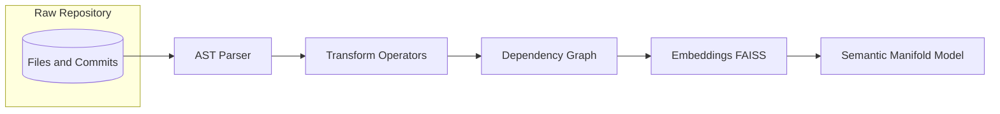
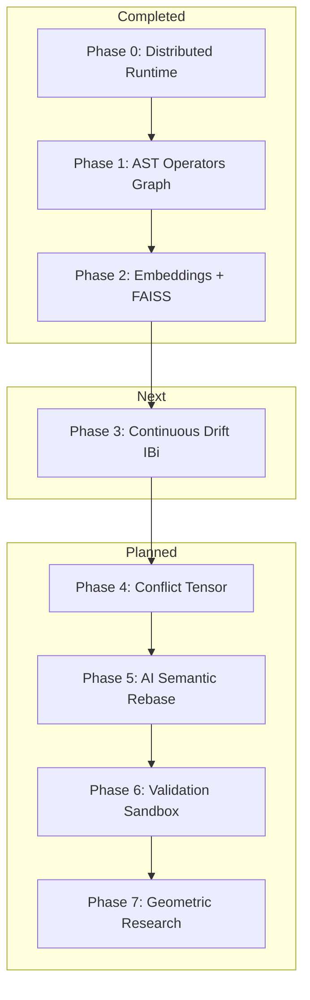
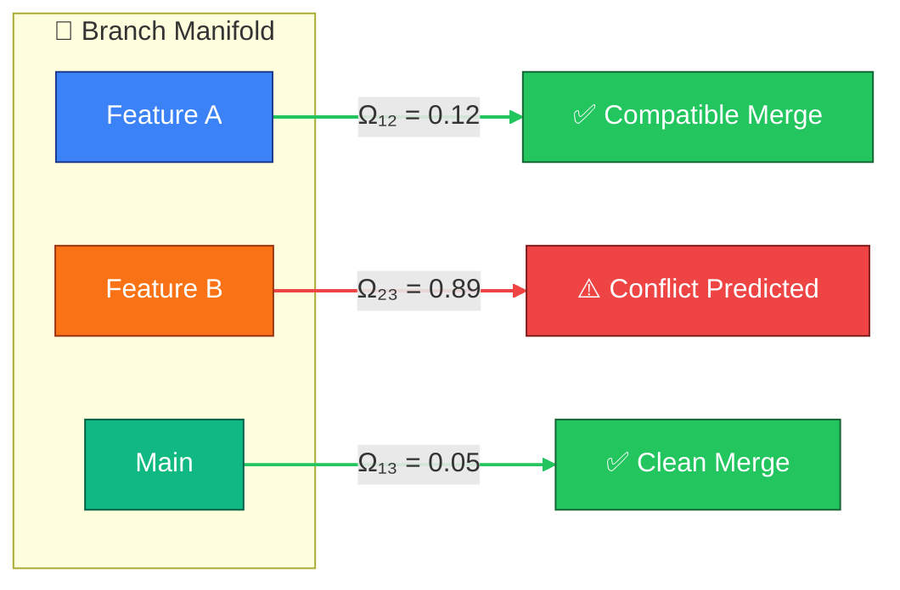
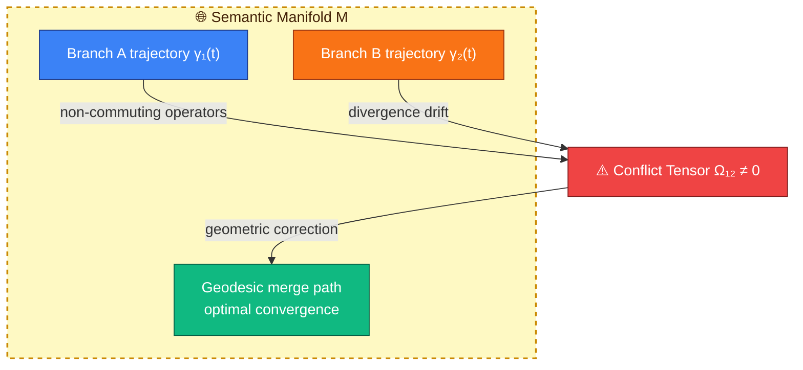
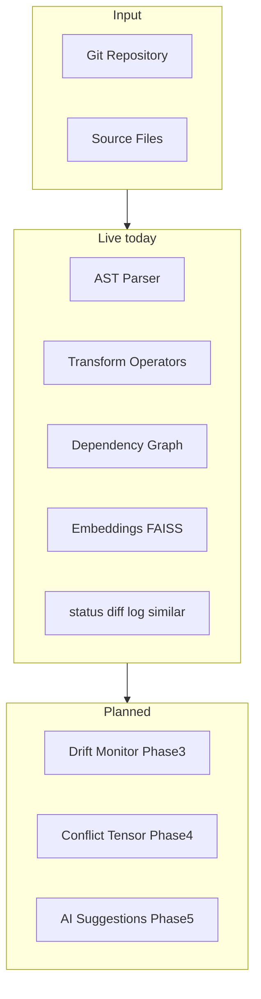

# GDSS: Geometric Distributed Software Synchronizer

<div align='center'>


</div>
A Semantic Intelligence Layer Above Git that transforms traditional, text-based software collaboration into continuous geometric-semantic manifold synchronization. 

---

## 📖 Project Overview

### The Philosophy: Code as a Semantic Manifold 

The geodesic output for Merge is what I believe. 

Traditional version control systems (like Git) treat code as static, flat lines of text. Merges are done by string matching (diffs), which frequently leads to syntax breaks, silent semantic failures, and costly merge conflicts.

GDSS reframes software evolution through **Differential Geometry** and **Operator Algebra**:

| Concept | Traditional Git | GDSS Mathematical Mapping |
| :--- | :--- | :--- |
| **Codebase** | Files & lines of text | Semantic manifold $\mathcal{M}$ |
| **Commit** | String diff patch | Tangent vector/operator $dC$ |
| **Branch** | Commits list | Trajectory $\gamma_i(t) = \int dC_i$ |
| **Conflict** | Text overlap | Non-commutativity $[\mathcal{T}_i, \mathcal{T}_j] \neq 0$ |
| **Merge** | String alignment | Geometric path convergence |

<p align="center">
  
</p>

<details>
<summary>📐 Mermaid source (click to expand)</summary>



</details>

---

## 🚀 Quick Start & Usage

### 🛠 Installation

GDSS is designed to run locally on low-end hardware without requiring a GPU.

```bash
# Clone the repository and install in editable mode
git clone https://github.com/sbasnet/GDSS.git
cd GDSS
pip install -e .

# For development
pip install -e ".[dev]"

# Verify the three-layer harness gate
bash harness/verify.sh
```

### 🧭 Getting Started (first 2 minutes)

New here? Point GDSS at any Git repository and explore it interactively.

```bash
# 1. Launch the interactive shell against a repo (use "." for the current folder)
gdss start --repo /path/to/your/repo
```

On first launch you pick a color theme, the daemon wakes, and you land at the
`gdss ▶` prompt. From there, move around with these steps:

```text
gdss ▶ help              # 1. see every available command
gdss ▶ status            # 2. attractor/remote + trajectory + uncommitted semantic delta
gdss ▶ analyze           # 3. build the dependency graph (node/edge summary)
gdss ▶ similar <symbol>  # 4. assistive embedding neighbors (FAISS / bag)
gdss ▶ impact <symbol>   # 5. what breaks if you change <symbol>
gdss ▶ log 5             # 6. semantic operators for the last 5 commits
gdss ▶ quit              # 7. exit (or press Ctrl+D)
```

> Prefer one-off commands without the shell? Everything works directly too, e.g.
> `gdss status --repo .`, `gdss analyze --repo .`, or `gdss similar foo --repo .`.
> See the reference below. Full I/O map: [`docs/IO & VIZ.md`](docs/IO%20%26%20VIZ.md).

### 💻 CLI Operations

GDSS provides both a standard CLI and a rich interactive shell for deep repository awareness.

#### One-off CLI commands

Every command accepts `--repo PATH` (defaults to the current directory).

```bash
# Start the GDSS interactive shell (recommended)
gdss start --repo .

# Show attractor/remote, committed trajectory vs --ref, and uncommitted semantic delta
gdss status --repo . --ref main

# Show the semantic transformation log for the last N commits
gdss log --repo . -n 5

# Deep semantic analysis + dependency graph summary
gdss analyze --repo .

# Assistive semantic neighbors (bag/ONNX + FAISS index under .gdss/vectors/)
gdss similar process_payment --repo . -k 5
gdss reindex --repo .

# Semantic diff of the active branch against a target branch
gdss diff main --repo .

# Live monitor of the distributed event bus
gdss watch --repo .

# Export the dependency graph to DOT (render with Graphviz)
gdss graph export --repo . --format dot -o gdss_graph.dot
dot -Tpng gdss_graph.dot -o graph.png

# Export as JSON snapshot
gdss graph export --repo . --format json -o gdss_graph.json
```

| Command | Arguments | Purpose |
| :--- | :--- | :--- |
| `gdss start` | `--repo` | Launch the interactive shell |
| `gdss status` | `--repo`, `--ref` | Attractor/remote + trajectory since ref + uncommitted semantic delta |
| `gdss log` | `--repo`, `-n` | Semantic operators per commit |
| `gdss analyze` | `--repo` | Build dependency graph, print node/edge summary |
| `gdss similar` | `SYMBOL`, `--repo`, `-k` | Assistive FAISS/bag neighbors for a symbol |
| `gdss reindex` | `--repo` | Rebuild `.gdss/vectors/` embedding index |
| `gdss diff` | `TARGET`, `--repo` | Semantic diff vs another branch |
| `gdss watch` | `--repo` | Real-time event bus monitor |
| `gdss graph export` | `--repo`, `--format`, `-o` | Export dependency graph to DOT or JSON |

#### Interactive shell commands

Run `gdss start`, then use these at the `gdss ▶` prompt:

| Command | Purpose |
| :--- | :--- |
| `status` | Show attractor/remote, trajectory since ref, uncommitted semantic delta |
| `analyze` | Deep semantic analysis and dependency mapping |
| `impact <symbol>` | Downstream impact of a specific symbol |
| `log [count] [--type=OP]` | Semantic commit log (optionally filtered by operator) |
| `diff [target]` | Semantic diff against a target branch (default `main`) |
| `similar <name> [k]` | Assistive embedding neighbors (FAISS/bag) |
| `reindex` | Rebuild `.gdss/vectors/` index |
| `watch` | Real-time monitoring of the distributed event bus |
| `hierarchy` | Show the distributed branch priority chain |
| `config [ref <branch>]` | View or set the reference branch |
| `clear` | Clear the console and show the banner |
| `help` | List all available commands |
| `quit` / `Ctrl+D` | Exit the shell (daemon stops) |

> For how data flows through these commands (Git → AST → operators → graph → terminal)
> and how to visualize the dependency graph, see [`docs/IO & VIZ.md`](docs/IO%20%26%20VIZ.md).

#### 📊 How Semantic Diffing Works (`diff` command)

The `diff` command calculates structural and semantic changes by finding the split point (common ancestor) between the active branch and the target branch:

* **Comparing against a different branch (e.g. `diff dev`)**:
  GDSS finds the **Merge Base** (common ancestor commit) between the current branch and the target branch, then compares that ancestor to the local working directory. The result shows all **cumulative changes** (committed branch changes + uncommitted edits) since divergence.
* **Comparing against the active branch (e.g. running `diff` without arguments)**:
  GDSS compares your branch's `HEAD` commit to the working directory. The result tracks the **uncommitted and untracked changes** currently in your local workspace.

For modified code files, GDSS parses both the original state (at the ancestor commit) and the current working tree state into ASTs to extract precise symbol-level transformations (such as class modifications, function renames, or new dependencies).

#### How embeddings work (`similar` / `reindex`)

Phase 2 adds an **assistive** probabilistic layer (Layer 6). It does **not** replace AST operators or claim continuous drift energy \(I(B_i)\) (that is Phase 3).

1. Symbols are encoded to \(\phi(C) \in \mathbb{R}^d\) (default: offline **DeterministicBagEncoder**; optional **ONNX MiniLM** via `GDSS_EMBEDDING_BACKEND=onnx`).
2. Vectors are indexed locally with **FAISS** (`IndexFlatIP` on L2-normalized vectors; numpy fallback if `faiss-cpu` is missing).
3. Index + id map live under `.gdss/vectors/` (gitignored). Rebuild with `gdss reindex`.
4. `gdss similar <symbol>` returns top-\(k\) neighbors — useful for overlap hints, not a merge oracle.

```bash
pip install -e ".[embeddings]"          # faiss-cpu + onnxruntime
gdss reindex --repo .
gdss similar process_payment --repo . -k 5
# Optional real MiniLM: place ONNX under .gdss/models/ and set GDSS_EMBEDDING_BACKEND=onnx
```

---

## Project Direction & Phases

This section tracks the 10-layer roadmap. **Done** means `bash harness/verify.sh` green with tests.

### Current Status: **Phase 0 + Phase 1 + Phase 2 Complete**

| Phase | Status | What you get today |
| :--- | :--- | :--- |
| **0 — Runtime** | Done | Daemon, event bus, local/remote observers, context DB |
| **1.1 — Deterministic brain** | Done | AST (Py/JS/TS/Go), operators, CodeGraph, honest `status`/`diff`/`log` |
| **1.1.2 — Transcendence** | Done | UTF-8 AST, rename precision, trajectory since `--ref`, no false “DRIFT DETECTED” |
| **1.2 — Embeddings** | Done | \(\phi(C)\), cosine, FAISS index, `similar` / `reindex` (assistive) |
| **1.3 — Drift** | Next | Continuous \(I(B_i)\), alerts, daemon monitoring |
| **1.4+** | Planned | Conflict tensor \(\Omega_{ij}\), AI suggestions, validation |

#### Phase 0 — Distributed Runtime Foundation

- **Goal**: Local-first runtime that tracks repo state and broadcasts semantic change events.
- **Components**: [event_bus](gdss/runtime/event_bus.py), [local_observer](gdss/runtime/local_observer.py), [remote_monitor](gdss/runtime/remote_monitor.py), [daemon](gdss/runtime/daemon.py), [context_engine](gdss/runtime/context_engine.py), [registry](gdss/runtime/registry.py), [hierarchy](gdss/runtime/hierarchy.py).
- **Honesty**: Remote row on `status` is ahead/behind or N/A — never event-topic “drift”.

#### Phase 1 — Semantic Observation (deterministic brain)

- **AST**: Tree-sitter multi-language parser with UTF-8-safe text and content-hash cache — [ast_parser](gdss/core/ast_parser.py).
- **Operators**: Diffs → `SemanticOperator`s; structural fingerprints; rename gates — [transform_extractor](gdss/core/transform_extractor.py).
- **Graph**: Stable `symbol_id` nodes, DOT/JSON export — [code_graph](gdss/graph/code_graph.py), [graph export](gdss/graph/graph_export.py).
- **Trajectory**: Committed operators `merge_base(ref)..HEAD` plus uncommitted semantic delta — [trajectory](gdss/core/trajectory.py).
- **CLI**: `status --ref`, `diff`, `log`, `analyze`, `graph export`.

#### Phase 2 — Semantic Embedding Layer (probabilistic brain)

- **Goal**: Approximate semantic similarity without claiming continuous drift or auto-merge.
- **Package**: [gdss/embeddings/](gdss/embeddings/) — encoders, cosine, branch tip vectors, FAISS `VectorStore`, CLI helpers.
- **Two-brain rule**: `core` / `graph` / `watcher` never import `embeddings`. CLI may use embeddings downward.
- **CLI**: `gdss similar`, `gdss reindex`; `status` may note an assistive embedding tip (not \(I(B_i)\)).

<p align="center">
    
</p>

<details>
<summary>🗺️ Mermaid source (click to expand)</summary>



</details>


## 🔬 Core Concepts

### Branch Drift Energy

**Planned for Phase 3.** GDSS will quantify how far a branch has diverged from the attractor over time:

$$I(B_i) = \int_0^T \| \dot{\gamma}_i(t) - \dot{\gamma}_{\text{main}}(t) \|_{\mathcal{M}} \, dt$$

Today, Phase 1 gives **deterministic** trajectory operators + uncommitted semantic delta; Phase 2 gives **assistive** embedding distance / neighbors. Continuous \(I(B_i)\) alerts are not implemented yet.

### Conflict Tensor

**Planned for Phase 4.** Branch interaction matrix \(\Omega_{ij}\) will predict merge compatibility before checkout:

<p align="center">
  
</p>

<details>
<summary>⚡ Mermaid source (click to expand)</summary>



</details>

### Semantic Merge Geometry

<p align="center">
  
</p>

<details>
<summary>🌀 Mermaid source (click to expand)</summary>



</details>

---

## 📊 Architecture Overview

<p align="center">
  
</p>

<details>
<summary>🏗️ Mermaid source (click to expand)</summary>



</details>

---
### Next Milestones
1. **Phase 3 (Drift Monitoring)**: Continuous branch drift energy \(I(B_i)\), velocity, alerts, daemon.
2. **Phase 4 (Conflict Tensor)**: Interaction matrix \(\Omega_{ij}\) and commutativity table before merge.
3. **Phase 5+**: AI suggestions (never auto-merge), validation sandbox, geometric research.

---

<p align="center">
  <b>GDSS</b> &copy; 2026<br>
  Maintained by <b><a href="https://github.com/sbasnet">S. Basnet</a></b>
</p>

