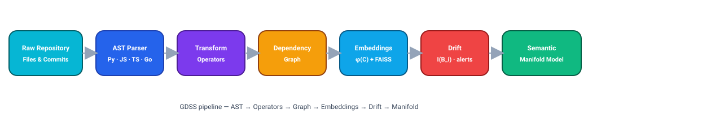
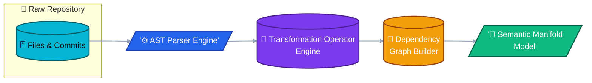
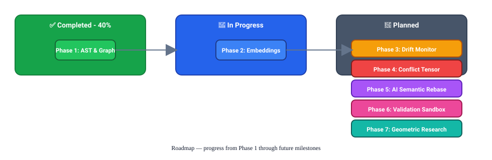
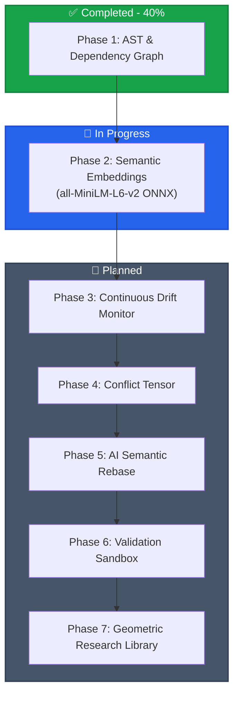
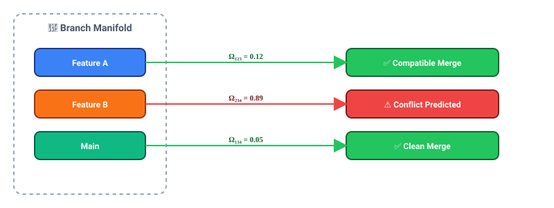
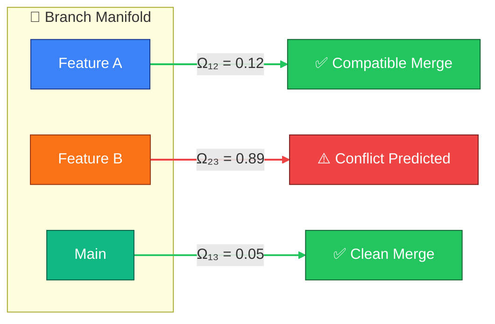
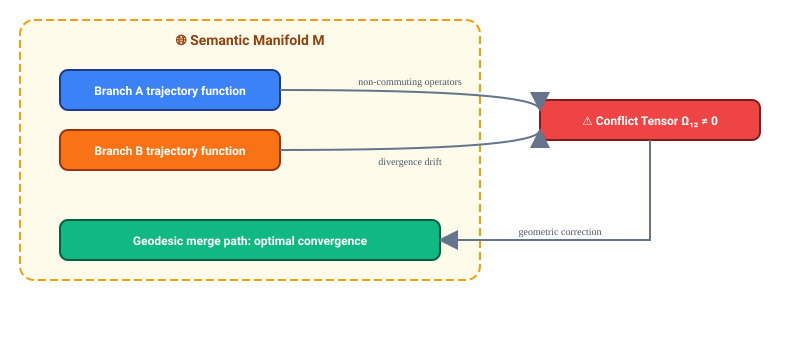
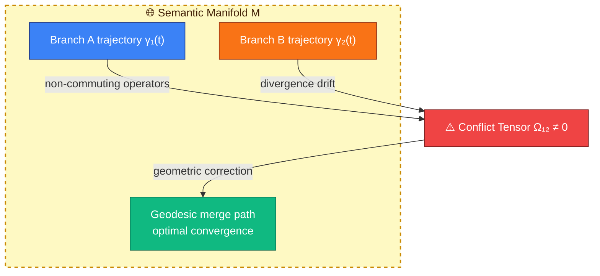
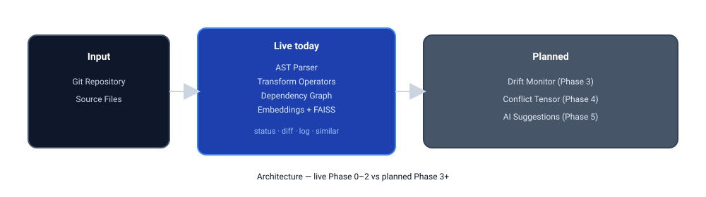
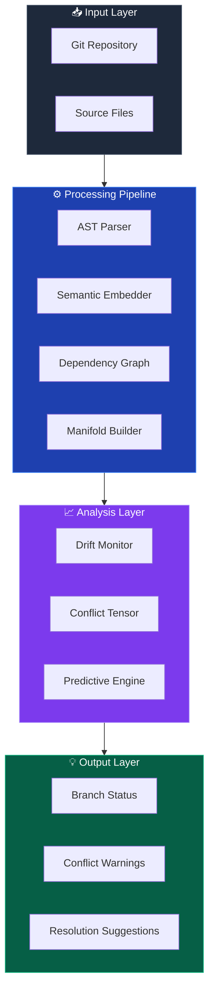

# GDSS: Geometric Distributed Software Synchronizer

<div align='center'>


</div>
A Semantic Intelligence Layer Above Git that transforms traditional, text-based software collaboration into continuous geometric-semantic manifold synchronization. 

---

## 📖 Project Overview

### The Philosophy: Code as a Semantic Manifold 

The geodesic output for Merge is what I believe. 

Traditional version control systems (like Git) treat code as static, flat lines of text. Merges are done by string matching (diffs), which frequently leads to syntax breaks, silent semantic failures, and costly merge conflicts.

GDSS reframes software evolution through **Differential Geometry** and **Operator Algebra**:

| Concept | Traditional Git | GDSS Mathematical Mapping |
| :--- | :--- | :--- |
| **Codebase** | Files & lines of text | Semantic manifold $\mathcal{M}$ |
| **Commit** | String diff patch | Tangent vector/operator $dC$ |
| **Branch** | Commits list | Trajectory $\gamma_i(t) = \int dC_i$ |
| **Conflict** | Text overlap | Non-commutativity $[\mathcal{T}_i, \mathcal{T}_j] \neq 0$ |
| **Merge** | String alignment | Geometric path convergence |

<p align="center">
  
</p>

<details>
<summary>📐 Mermaid source (click to expand)</summary>



</details>

---

## 🚀 Quick Start & Usage

### 🛠 Installation

GDSS is designed to run locally on low-end hardware without requiring a GPU.

```bash
# Clone the repository and install in editable mode
git clone https://github.com/sbasnet/GDSS.git
cd GDSS
pip install -e .

# For development
pip install -e ".[dev]"
```

### 🧭 Getting Started (first 2 minutes)

New here? Point GDSS at any Git repository and explore it interactively.

```bash
# 1. Launch the interactive shell against a repo (use "." for the current folder)
gdss start --repo /path/to/your/repo
```

On first launch you pick a color theme, the daemon wakes, and you land at the
`gdss ▶` prompt. From there, move around with these steps:

```text
gdss ▶ help              # 1. see every available command
gdss ▶ status            # 2. current branch + uncommitted semantic drift
gdss ▶ analyze           # 3. build the dependency graph (node/edge summary)
gdss ▶ impact <symbol>   # 4. what breaks if you change <symbol> (e.g. a function)
gdss ▶ log 5             # 5. semantic operators for the last 5 commits
gdss ▶ quit              # 6. exit (or press Ctrl+D)
```

> [!TIP]
> Prefer one-off commands without the shell? Everything works directly too, e.g.
> `gdss status --repo .` or `gdss analyze --repo .`. See the reference below.

### 💻 CLI Operations

GDSS provides both a standard CLI and a rich interactive shell for deep repository awareness.

#### One-off CLI commands

Every command accepts `--repo PATH` (defaults to the current directory).

```bash
# Start the GDSS interactive shell (recommended)
gdss start --repo .

# Show distributed status and semantic drift vs a reference branch
gdss status --repo . --ref main

# Show the semantic transformation log for the last N commits
gdss log --repo . -n 5

# Deep semantic analysis + dependency graph summary
gdss analyze --repo .

# Semantic diff of the active branch against a target branch
gdss diff main --repo .

# Live monitor of the distributed event bus
gdss watch --repo .

# Export the dependency graph to DOT (render with Graphviz)
gdss graph export --repo . --format dot -o gdss_graph.dot
dot -Tpng gdss_graph.dot -o graph.png

# Export as JSON snapshot
gdss graph export --repo . --format json -o gdss_graph.json
```

| Command | Arguments | Purpose |
| :--- | :--- | :--- |
| `gdss start` | `--repo` | Launch the interactive shell |
| `gdss status` | `--repo`, `--ref` | Branch status + uncommitted semantic drift |
| `gdss log` | `--repo`, `-n` | Semantic operators per commit |
| `gdss analyze` | `--repo` | Build dependency graph, print node/edge summary |
| `gdss diff` | `TARGET`, `--repo` | Semantic diff vs another branch |
| `gdss watch` | `--repo` | Real-time event bus monitor |
| `gdss graph export` | `--repo`, `--format`, `-o` | Export dependency graph to DOT or JSON |

#### Interactive shell commands

Run `gdss start`, then use these at the `gdss ▶` prompt:

| Command | Purpose |
| :--- | :--- |
| `status` | Show distributed status and semantic drift |
| `analyze` | Deep semantic analysis and dependency mapping |
| `impact <symbol>` | Downstream impact of a specific symbol |
| `log [count] [--type=OP]` | Semantic commit log (optionally filtered by operator) |
| `diff [target]` | Semantic diff against a target branch (default `main`) |
| `watch` | Real-time monitoring of the distributed event bus |
| `hierarchy` | Show the distributed branch priority chain |
| `config [ref <branch>]` | View or set the reference branch |
| `clear` | Clear the console and show the banner |
| `help` | List all available commands |
| `quit` / `Ctrl+D` | Exit the shell (daemon stops) |

> For how data flows through these commands (Git → AST → operators → graph → terminal)
> and how to visualize the dependency graph, see [`docs/IO & VIZ.md`](docs/IO%20%26%20VIZ.md).

#### 📊 How Semantic Diffing Works (`diff` command)

The `diff` command calculates structural and semantic changes by finding the split point (common ancestor) between the active branch and the target branch:

* **Comparing against a different branch (e.g. `diff dev`)**:
  GDSS finds the **Merge Base** (common ancestor commit) between the current branch and the target branch, then compares that ancestor to the local working directory. The result shows all **cumulative changes** (committed branch changes + uncommitted edits) since divergence.
* **Comparing against the active branch (e.g. running `diff` without arguments)**:
  GDSS compares your branch's `HEAD` commit to the working directory. The result tracks the **uncommitted and untracked changes** currently in your local workspace.

For modified code files, GDSS parses both the original state (at the ancestor commit) and the current working tree state into ASTs to extract precise symbol-level transformations (such as class modifications, function renames, or new dependencies).

---

## 🗺 Project Direction & Phases

This section details the development roadmap towards building the full 10-layer GDSS architecture.

### Current Status: **Phase 0 & 1 Complete (45%)**

The **Distributed Runtime Foundation (Phase 0)** is fully implemented and optimized, providing GitHub awareness, local/remote observers, an event bus, and a rich interactive interface.

#### Phase 0 — Distributed Runtime Foundation

- **Goal**: Provide a lightweight, local-first distributed runtime that tracks repository state, detects local and remote changes, and broadcasts semantic change events for downstream analysis.
- **Primary components**:
    - **Event Bus**: centralized pub/sub used for local and remote events — [gdss/runtime/event_bus.py](gdss/runtime/event_bus.py).
    - **Local Observer**: watches the local Git repository, parses ASTs, and emits semantic operators — [gdss/runtime/local_observer.py](gdss/runtime/local_observer.py).
    - **Remote Monitor**: polls remote refs (`git ls-remote`) and emits remote events to detect upstream drift — [gdss/runtime/remote_monitor.py](gdss/runtime/remote_monitor.py).
    - **GDSS Daemon**: orchestrates observers and periodic scans; starts the context engine and lifecycle loop — [gdss/runtime/daemon.py](gdss/runtime/daemon.py).
    - **Context Engine**: subscribes to events, builds awareness packets, and persists context to the runtime DB — [gdss/runtime/context_engine.py](gdss/runtime/context_engine.py).
    - **Repository Registry**: DB-backed registry for repositories, branches and branch state helpers — [gdss/runtime/registry.py](gdss/runtime/registry.py).
    - **Hierarchy Manager**: resolves branch priority chains and trajectory configuration used by the context engine — [gdss/runtime/hierarchy.py](gdss/runtime/hierarchy.py).

- **How these files help the project**:
    - `LocalObserver` extracts `semantic_operators` (via `ASTParser` and `TransformExtractor`) and emits them on the `EventBus`, enabling downstream systems (graph builder, embedder, drift monitor) to consume a normalized semantic stream.
    - `RemoteMonitor` and `LocalObserver` use consistent topics (`"local"`, `"remote"`, and global `"all"`) so components can subscribe uniformly to a single event layer.
    - `ContextEngine` assembles awareness packets (source, event, timestamp, repo id, reference branch, semantic operators) and persists them for later analysis and UI display.

- **Evidence & verification**: Phase 0 components are implemented under `gdss/runtime/` and are exercised by the harness verification pipeline; run `bash harness/verify.sh` to validate the static checks and tests.

<p align="center">
    
</p>

<details>
<summary>🗺️ Mermaid source (click to expand)</summary>



</details>


## 🔬 Core Concepts

### Branch Drift Energy

GDSS quantifies how far a branch has diverged from the main semantic manifold:

$$I(B_i) = \int_0^T \| \dot{\gamma}_i(t) - \dot{\gamma}_{\text{main}}(t) \|_{\mathcal{M}} \, dt$$

- **Low drift** → Seamless integration
- **High drift** → Automatic conflict anticipation

### Conflict Tensor

Branch interaction matrix $\Omega_{ij}$ predicts merge compatibility before checkout:

<p align="center">
  
</p>

<details>
<summary>⚡ Mermaid source (click to expand)</summary>



</details>

### Semantic Merge Geometry

<p align="center">
  
</p>

<details>
<summary>🌀 Mermaid source (click to expand)</summary>



</details>

---

## 📊 Architecture Overview

<p align="center">
  
</p>

<details>
<summary>🏗️ Mermaid source (click to expand)</summary>



</details>

---
### Next Milestones:
1. **Phase 2 (Embeddings)**: Integrate local all-MiniLM-L6-v2 ONNX embeddings to represent codebase symbols in $\mathbb{R}^d$.
2. **Phase 3 (Drift Monitoring)**: Compute branch drift energy: $I(B_i) = \int \|B_i(t) - D(t)\| dt$.
3. **Phase 4 (Conflict Tensor)**: Compute branch interaction matrix $\Omega_{ij}$ to predict merge compatibility before checkout.

---

<p align="center">
  <b>GDSS</b> &copy; 2026<br>
  Maintained by <b><a href="https://github.com/sbasnet">S. Basnet</a></b>
</p>

