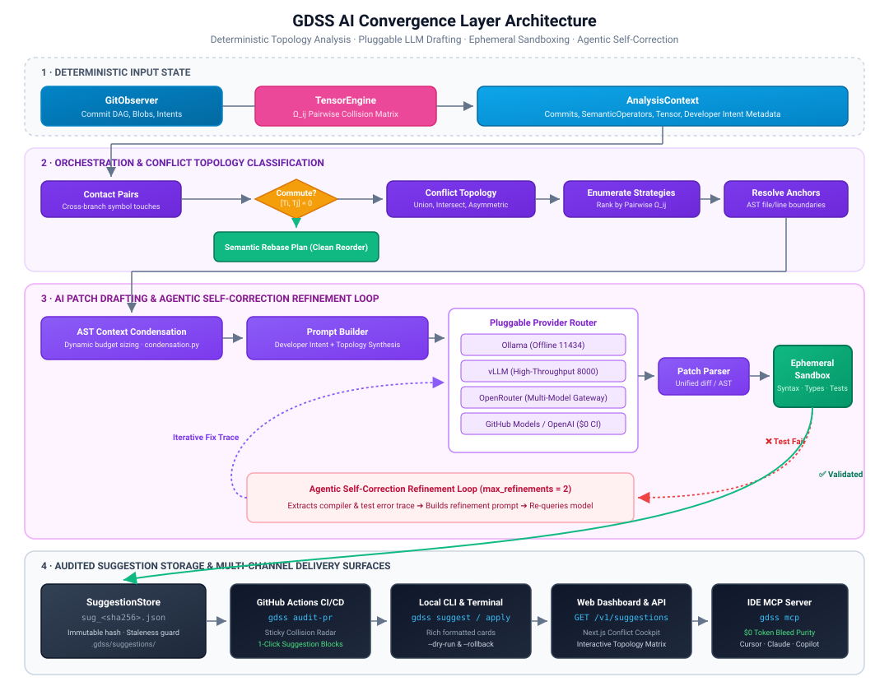
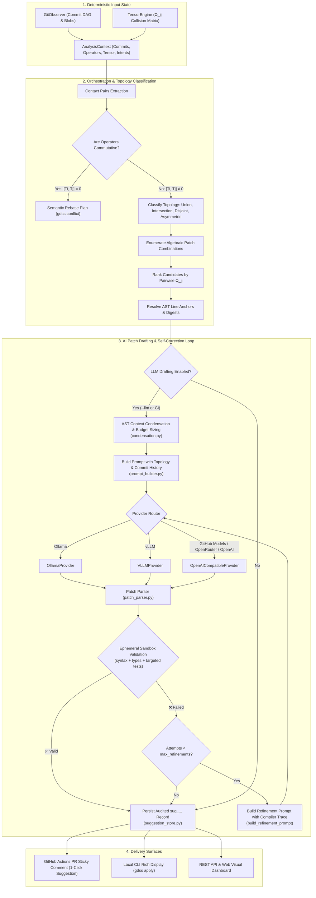

# GDSS AI Layer (`gdss/ai/`)

Welcome to the GDSS AI Convergence Layer documentation. This subsystem is responsible for deterministically filtering, classifying, predicting, and generating merge-resolution suggestions. It acts as the intelligent orchestration bridge between the Git database (`gdss/watcher`), semantic AST operators (`gdss/core`), deterministic collision tensors (`gdss/conflict`), sandboxed validation (`gdss/validation`), and pluggable LLM suggestion backends.

---

## 📑 Table of Contents

- [High-Level Architecture (Data I/O)](#high-level-architecture-data-io)
- [How the AI Layer Interacts Across Modes](#how-the-ai-layer-interacts-across-modes)
  - [1. In GitHub Actions CI/CD (`gdss audit-pr`)](#1-in-github-actions-cicd-gdss-audit-pr)
  - [2. In Local CLI & Terminal (`gdss suggest`)](#2-in-local-cli--terminal-gdss-suggest)
  - [3. In AI IDEs (Cursor / Claude Code / Copilot MCP)](#3-in-ai-ides-cursor--claude-code--copilot-mcp)
  - [4. In Web Dashboard & REST API (`GET /v1/suggestions`)](#4-in-web-dashboard--rest-api-get-v1suggestions)
- [Core Architectural Mechanisms](#core-architectural-mechanisms)
  - [Developer Intent & Commit History Injection](#developer-intent--commit-history-injection)
  - [3-Tier Model Context Window Discovery & Condensation](#3-tier-model-context-window-discovery--condensation)
  - [Agentic Self-Correction Refinement Loop](#agentic-self-correction-refinement-loop)
  - [Audited Suggestion State (`sug_...`)](#audited-suggestion-state-sug_)
- [Directory & Module Breakdown](#directory--module-breakdown)
- [Core Function Signatures & Data Models](#core-function-signatures--data-models)

---

## High-Level Architecture (Data I/O)

<p align="center">
  
</p>

<details>
<summary>🔄 Mermaid source (click to expand)</summary>



</details>

---

## How the AI Layer Interacts Across Modes

GDSS's AI layer does not operate in isolation; it integrates across 4 distinct delivery environments:

### 1. In GitHub Actions CI/CD (`gdss audit-pr`)
When an incoming pull request is opened or updated:
- [`gdss/validation/pr_audit.py`](../gdss/validation/pr_audit.py) builds a `PRAuditContext` from GitHub Actions environment variables (`GITHUB_EVENT_PATH`, `GITHUB_TOKEN`).
- It discovers concurrent PRs via the GitHub REST API and calls `build_pr_analysis_context()` to extract cross-PR commit histories, PR titles, and descriptions.
- If collisions are found ($\Omega_{ij} > 0.1$) and `GITHUB_TOKEN` is present:
  - It initializes `ConvergenceState` and executes `run_convergence_pipeline()`.
  - Connects to **GitHub Models** (`https://models.inference.ai.azure.com`) via `OpenAICompatibleProvider` with zero cloud billing.
  - Runs ephemeral worktree sandbox validation (`ValidationSandbox`). If tests fail, it executes self-correction refinement loops up to `radar.max_refinements` times.
  - Embeds the verified candidate patch into native GitHub ````suggestion ```` markdown blocks in a sticky comment, enabling developers to merge the fix with a 1-click web commit button.

### 2. In Local CLI & Terminal (`gdss suggest`)
When run by a developer in their terminal:
- Invokes `suggest()` in [`gdss/ai/suggester.py`](../gdss/ai/suggester.py) or `run_convergence_pipeline()` in [`gdss/ai/orchestration.py`](../gdss/ai/orchestration.py) if `--validate` is passed.
- Supports provider flags: `--provider ollama`, `--provider vllm`, `--provider openrouter`, or `--provider openai`.
- Supports context overrides: `--context-window <N>` and `--max-refinements <N>`.
- Displays Rich-formatted suggestion cards with confidence ratings, topological rationale, and refinement attempt badges:
  ```text
  Suggestion 1: modify_function on services/auth.py (Confidence: 0.85) (ID: sug_e83b12)
  Rationale: Reconcile signature timeout with OAuth2 token verification
  Action: review taking both compatible changes
    ℹ Refined through 1 self-correction attempt(s)
    - Strategy: adapt_signature [✓ Sandbox Validated]
  ```
- Persists suggestions to `.gdss/suggestions/<id>.json`, enabling safe local application via `gdss apply sug_e83b12`.

### 3. In AI IDEs (Cursor / Claude Code / Copilot MCP)
- **Strict Two-Brain Purity:** The MCP server (`gdss mcp`) **never calls `gdss.ai` or third-party LLMs**.
- Instead, the developer's IDE agent (e.g. Cursor or Claude Code) powers the chat conversation using the developer's existing IDE subscription ($0 token cost for GDSS).
- The IDE calls deterministic tools:
  - `gdss_find_collisions`: Returns exact AST symbol overlaps and commutativity brackets.
  - `gdss_validate_patch`: Performs in-memory diff application and AST syntax compilation to allow the IDE model to self-correct invalid syntax in real time.

### 4. In Web Dashboard & REST API (`GET /v1/suggestions`)
- The FastAPI backend (`gdss/api/service.py`) calls `suggest(repo_path, ref, llm=False)` to return ranked collision suggestions.
- The Next.js frontend (`web/`) visualizes conflict topologies (`Union`, `Intersection`, `Disjoint`, `Asymmetric`), affected symbols, and merge order queues without executing cloud LLM calls by default.

---

## Core Architectural Mechanisms

### Developer Intent & Commit History Injection
Generic AI merge tools fail because they only see conflicting file diffs without understanding **why** each developer made the changes. GDSS solves this by extracting developer intent:
- [`GitObserver.get_commits_between(base_ref, head_ref)`](../gdss/watcher/git_observer.py): Extracts commit SHAs, author names, timestamps, and commit messages along each branch trajectory.
- In CI, PR metadata (title and body description) is also captured.
- [`prompt_builder.py`](../gdss/ai/prompt_builder.py) injects this context directly into the prompt:
  ```text
  Developer Intent & Commit History for branch 'feature/oauth':
  - [a1b2c3d4] feat(auth): add OAuth2 token verification to login (by Alice)
  - [e5f6g7h8] refactor(auth): support bearer tokens

  Developer Intent & Commit History for branch 'feature/timeout':
  - [9f8e7d6c] fix(auth): introduce 30s timeout to prevent hang (by Bob)
  ```
  This allows the model to synthesize a patch that fulfills **both** developers' original architectural goals.

### 3-Tier Model Context Window Discovery & Condensation
In [`gdss/ai/condensation.py`](../gdss/ai/condensation.py), GDSS dynamically discovers model context windows and sizes code prompts:
1. **Tier 1 (Explicit User Override):** Configured via `.gdss.yml` `radar.context_window`, CLI `--context-window`, or `GDSS_CONTEXT_WINDOW`.
2. **Tier 2 (Dynamic Provider Metadata Inspection):** Queries OpenRouter `GET /api/v1/models`, Ollama `POST /api/show`, or vLLM `GET /v1/models` in memory.
3. **Tier 3 (Resilient Pattern Heuristics):** Pattern matches model families (`gpt-4o` ➔ 128k, `claude-3` ➔ 200k, `deepseek` ➔ 64k, `qwen2.5` ➔ 32k, fallback ➔ 16k).

**Adaptive Code Budget Sizing:**
- Reserves ~9,000 tokens for system rules, commit histories, developer intent, and generation headroom.
- Allocates up to 45% of the remaining window (up to 96,000 characters) for code symbols.
- If code exceeds this budget, `condense_block()` uses Tree-sitter AST parsing to replace unmodified inner functions with `# ... (unmodified code omitted) ...`, perfectly preserving outer class signatures and interfaces.

### Agentic Self-Correction Refinement Loop
In [`gdss/ai/orchestration.py`](../gdss/ai/orchestration.py), GDSS implements an agentic self-healing loop:
- When a candidate patch is drafted, it is tested inside an ephemeral Git worktree sandbox across three gates: AST syntax, static types (`mypy`, `tsc`, `cargo check`), and targeted unit tests.
- If validation fails, `should_refine(state)` routes execution to `refine_step(state)`.
- `build_refinement_prompt()` packages the original code, the failed patch, and the exact compiler/linter error trace:
  ```text
  The previous patch for strategy 'adapt_signature' failed sandbox validation:
  --- ERROR TRACE ---
  services/auth.py:52: error: Incompatible types in assignment (expression has type "int", variable has type "str")
  --- END ERROR TRACE ---
  Analyze the error trace above and produce a corrected patch that resolves the failure.
  ```
- The model repairs the patch iteratively up to `radar.max_refinements` times (default: 2 retries).

### Audited Suggestion State (`sug_...`)
In [`gdss/ai/suggestion_store.py`](../gdss/ai/suggestion_store.py):
- Every suggestion is assigned an immutable SHA256 hash:
  $$\text{id} = \text{"sug\_"} + \text{sha256}(commit\_sha, file\_path, line\_start, line\_end, operator)[:20]$$
- Stored as JSON under `.gdss/suggestions/<id>.json`.
- `is_suggestion_stale()` verifies whether the target Git branch has moved, preventing developers from applying stale suggestions against drifted files.

---

## Directory & Module Breakdown

| Module | Location | Purpose |
| :--- | :--- | :--- |
| **`suggester.py`** | [`gdss/ai/suggester.py`](../gdss/ai/suggester.py) | Main read-only entry point. Coordinates context, anchor resolution, topology classification, and LLM drafting. |
| **`orchestration.py`** | [`gdss/ai/orchestration.py`](../gdss/ai/orchestration.py) | Full state machine (`Analyze -> Draft -> Validate -> Refine -> Checkpoint`) with LangGraph support and self-correction loops. |
| **`condensation.py`** | [`gdss/ai/condensation.py`](../gdss/ai/condensation.py) | AST-aware code block condensation, 3-tier context discovery, and code budget calculations. |
| **`prompt_builder.py`** | [`gdss/ai/prompt_builder.py`](../gdss/ai/prompt_builder.py) | Synthesizes structured conflict prompts and targeted error-trace refinement prompts. |
| **`openai_provider.py`** | [`gdss/ai/openai_provider.py`](../gdss/ai/openai_provider.py) | Adapter for GitHub Models (`models.inference.ai.azure.com`), OpenRouter, and standard OpenAI endpoints. |
| **`ollama_provider.py`** | [`gdss/ai/ollama_provider.py`](../gdss/ai/ollama_provider.py) | Local offline Ollama REST client (`http://localhost:11434`). |
| **`vllm_provider.py`** | [`gdss/ai/vllm_provider.py`](../gdss/ai/vllm_provider.py) | Local high-throughput vLLM client (`http://localhost:8000`). |
| **`llm_patch.py`** | [`gdss/ai/llm_patch.py`](../gdss/ai/llm_patch.py) | Abstract `LLMProvider` protocol and `AnyProvider` union type definition. |
| **`suggestion_store.py`** | [`gdss/ai/suggestion_store.py`](../gdss/ai/suggestion_store.py) | Generates immutable `sug_...` IDs, persists records in `.gdss/suggestions/`, and detects commit staleness. |
| **`conflict_topology.py`** | [`gdss/ai/conflict_topology.py`](../gdss/ai/conflict_topology.py) | Classifies conflicts into `Union`, `Intersection`, `Disjoint`, and `Asymmetric`. |
| **`anchors.py`** | [`gdss/ai/anchors.py`](../gdss/ai/anchors.py) | Resolves abstract AST symbols to concrete Git file paths and line boundaries (`SuggestionAnchor`). |
| **`patch_combinations.py`**| [`gdss/ai/patch_combinations.py`](../gdss/ai/patch_combinations.py)| Enumerates algebraic strategies (`reconcile_both`, `keep_left`, `keep_right`). |
| **`patch_parser.py`** | [`gdss/ai/patch_parser.py`](../gdss/ai/patch_parser.py) | Extracts and parses unified diffs and code blocks from LLM markdown outputs. |
| **`ranking.py`** | [`gdss/ai/ranking.py`](../gdss/ai/ranking.py) | Ranks tensor candidates by pairwise interaction score $\Omega_{ij}$ and merge risk. |
| **`semantic_rebase.py`** | [`gdss/ai/semantic_rebase.py`](../gdss/ai/semantic_rebase.py) | Rebase transport planner re-export. |
| **`geodesic.py`** | [`gdss/ai/geodesic.py`](../gdss/ai/geodesic.py) | Optimal merge order planner re-export. |
| **`model_manager.py`** | [`gdss/ai/model_manager.py`](../gdss/ai/model_manager.py) | Detects reachable local servers (Ollama on 11434, vLLM on 8000). |
| **`validation.py`** | [`gdss/ai/validation.py`](../gdss/ai/validation.py) | In-memory AST syntax validation helper. |
| **`types.py`** | [`gdss/ai/types.py`](../gdss/ai/types.py) | Core domain models (`Suggestion`, `PatchCombination`, `SuggestionContext`, `SuggestionAnchor`). |
| **`context.py`** | [`gdss/ai/context.py`](../gdss/ai/context.py) | Re-exports `AnalysisContext` and `build_analysis_context` from `gdss.drift.context`. |

---

## Core Function Signatures & Data Models

### `suggest()`
```python
def suggest(
    repo_path: str,
    reference_branch: str,
    *,
    llm: bool = False,
    combos: int = 3,
    provider: AnyProvider | LLMProvider | None = None,
    max_candidates: int = 50,
    context: AnalysisContext | None = None,
) -> list[Suggestion]:
```

### `run_convergence_pipeline()`
```python
def run_convergence_pipeline(
    state: ConvergenceState,
    *,
    use_langgraph: bool = True,
) -> ConvergenceState:
```

### `resolve_context_window()`
```python
def resolve_context_window(
    model_name: str | None,
    provider: Any | None = None,
    user_override: int | None = None,
) -> int:
```
