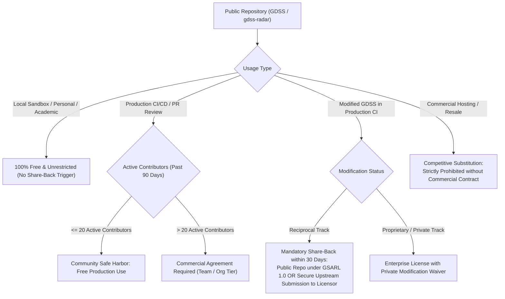

# 🚀 GDSS Distribution & Go-to-Market Plan

> **Strategic roadmap for source-available distribution (GSARL 1.0), developer onboarding, and progressive scaling from GitHub Marketplace Actions & Standalone Binaries (Phase 1) to an Enterprise Hosted SaaS App (Phase 2).**

---

## 📑 Table of Contents

- [Executive Summary: Strategic Decision & Verdict](#executive-summary-strategic-decision--verdict)
- [Phased Distribution Matrix](#phased-distribution-matrix)
- [Phase 1: Immediate Implementation](#phase-1-immediate-implementation)
  - [Approach A: Source-Available GitHub Marketplace Action](#approach-a-source-available-github-marketplace-action)
    - [Architecture: Public Action Repo + Container Image](#architecture-public-action-repo--container-image)
    - [Container Packaging & Automated Deployment](#container-packaging--automated-deployment)
    - [`action.yml` Specification](#actionyml-specification)
    - [Marketplace Publishing Workflow](#marketplace-publishing-workflow)
    - [End-User Experience (BYOC Model)](#end-user-experience-byoc-model)
  - [Approach C: Standalone Compiled Binary for CLI & IDE MCP](#approach-c-standalone-compiled-binary-for-cli--ide-mcp)
    - [Native Compilation Pipeline (Zero-Dependency Portability)](#native-compilation-pipeline-zero-dependency-portability)
    - [Multi-Platform Matrix](#multi-platform-matrix)
    - [Distribution Channels](#distribution-channels)
    - [IDE MCP Zero-Config Setup (Cursor, Claude Code, Copilot)](#ide-mcp-zero-config-setup-cursor-claude-code-copilot)
- [Phase 2: Growth & Enterprise Expansion](#phase-2-growth--enterprise-expansion)
  - [Approach B: Hosted GitHub App SaaS](#approach-b-hosted-github-app-saas)
    - [Transition Triggers & Thresholds](#transition-triggers--thresholds)
    - [Hosted Architecture & Dedicated LLM Fleet](#hosted-architecture--dedicated-llm-fleet)
    - [Enterprise Gating & Marketplace Billing](#enterprise-gating--marketplace-billing)
- [Intellectual Property (IP) & Commercial Governance Playbook](#intellectual-property-ip--commercial-governance-playbook)
- [Immediate Execution Checklist (Sprint Roadmap)](#immediate-execution-checklist-sprint-roadmap)

---

## Executive Summary: Strategic Decision & Verdict

### The Decision
**Deploy Approach A (GitHub Marketplace Action) and Approach C (Standalone Binary CLI/MCP) immediately under the GDSS Source-Available Reciprocal License 1.0 (GSARL 1.0), while deferring Approach B (Hosted GitHub App SaaS) until traction, customer demand, and volume justify operating dedicated cloud GPU infrastructure.**

### Why This Strategy Is Superior

```
                   ┌───────────────────────────────────────────────┐
                   │               PHASE 1 (NOW)                   │
                   │   Approach A (CI/CD) + Approach C (Local/MCP) │
                   └───────┬───────────────────────────────┬───────┘
                           │                               │
             ┌─────────────▼─────────────┐   ┌─────────────▼─────────────┐
             │   $0 Hosting OpEx (BYOC)  │   │  Source-Available IP      │
             │  GitHub Actions / Laptop  │   │  GSARL 1.0 Legal Defense  │
             └─────────────┬─────────────┘   └─────────────┬─────────────┘
                           │                               │
                           └───────────────┬───────────────┘
                                           │
                                  Traction & Feedback
                             (50+ Active Orgs, Proven ROI)
                                           │
                                           ▼
                   ┌───────────────────────────────────────────────┐
                   │               PHASE 2 (LATER)                 │
                   │        Approach B: Hosted GitHub App          │
                   │  Zero-Config Webhooks · Managed LLM Cluster   │
                   └───────────────────────────────────────────────┘
```

1. **Zero Cloud Infrastructure Burn ($0 OpEx):**
   - Approaches A & C leverage **Bring Your Own Compute (BYOC)**. GitHub Actions runners execute the analysis, and users supply their own tokens or use free OpenRouter / Azure AI Foundry. You incur **$0 in server or GPU hosting bills** while proving product-market fit.
2. **Public Transparency with Legally Enforceable Commercial Reciprocity (GSARL 1.0):**
   - Both the core engine ([`GDSS`](https://github.com/Sarthak2233/GDSS)) and the action wrapper ([`gdss-radar`](https://github.com/sarthak2233/gdss-radar)) are **public on GitHub**. Full source availability builds immediate developer credibility, peer auditing, and technical trust.
   - Commercial IP is legally secured via **GSARL 1.0**:
     - **Community Safe Harbor:** 100% free production usage for organizations with $\le 20$ active Git contributors.
     - **Commercial Licensing Requirement:** Organizations with $> 20$ active Git contributors must purchase a commercial agreement.
     - **Mandatory Reciprocal Share-Back:** Internal production modifications deployed in CI/CD must be contributed back under GSARL 1.0, or covered by an Enterprise Private Modification Waiver.
     - **Anti-Competitive SaaS Clause:** Third-party cloud providers and aggregators cannot repackage or resell GDSS as a hosted SaaS.
3. **High Security Trust from Early Adopters:**
   - Security-conscious developers and enterprise teams are hesitant to install closed-box, multi-tenant third-party apps that ingest proprietary code into unverified external cloud servers. Running GDSS **locally in their existing GitHub Actions environment or on their developer laptop** with full source code transparency builds instantaneous trust.
4. **Captures Both Developer & Team Personas:**
   - **Approach A** serves engineering leads and PR reviewers (team collision radar, sticky PR comments, 1-click merge suggestions).
   - **Approach C** serves individual contributors inside their daily editor (Cursor / Claude Code / Copilot MCP server, local `gdss status`, `gdss apply`).
5. **Clear De-risked Path to Phase 2:**
   - Self-hosting high-throughput LLMs (e.g. Qwen-2.5-Coder / DeepSeek on vLLM with H100s/A100s) requires significant recurring revenue. Deferring Approach B until you have active users guarantees that you only build high-scale SaaS infrastructure when there is clear, paying enterprise demand.

---

## Phased Distribution Matrix

| Capability / Attribute | Phase 1: Approach A (Action) | Phase 1: Approach C (Binary / MCP) | Phase 2: Approach B (Hosted App) |
| :--- | :--- | :--- | :--- |
| **Target Surface** | GitHub Marketplace / CI/CD | Developer Laptops & IDEs | GitHub Marketplace SaaS |
| **Delivery Mechanism** | GitHub Action (`gdss-radar`) + Container | Native Single Executable | Multi-Tenant Cloud Webhooks |
| **Source Code State** | **Source-Available (GSARL 1.0)** | **Source-Available (GSARL 1.0)** | Source-Available Engine + Hosted SaaS |
| **Compute Cost to You** | **$0** (Runs on GitHub Runners) | **$0** (Runs on User Laptops) | Paid (Your Cloud / GPU Fleet) |
| **LLM Inference** | OpenRouter / Azure AI / User Keys | Local Ollama/vLLM or User Keys | Self-Hosted vLLM GPU Cluster |
| **Setup Friction** | Low (5-line `.github/workflows`) | Minimal (1-line install script) | Zero-Config (1-click app install) |
| **Target Audience** | PR reviewers, team leads | Individual developers, IDE users | Large enterprises, CTOs |
| **Monetization Mode** | Free for $\le 20$ devs; Paid commercial $> 20$ | Free IDE tool; Paid Enterprise waiver | Paid Organization SaaS / Team plans |

---

## Phase 1: Immediate Implementation

### Approach A: Source-Available GitHub Marketplace Action

#### Architecture: Public Action Repo + Container Image
The action repository `sarthak2233/gdss-radar` is public and distributed on the GitHub Marketplace. It pulls the container image built directly from the public `GDSS` repository under GSARL 1.0:

```
┌────────────────────────────────────────────────────────┐
│ PUBLIC REPOSITORY: sarthak2233/gdss-radar (GSARL 1.0)  │
│  - action.yml (metadata, inputs, marketplace branding) │
│  - README.md (documentation & quickstart examples)     │
└───────────────────────────┬────────────────────────────┘
                            │ pulls at runtime
                            ▼
┌────────────────────────────────────────────────────────┐
│ PUBLIC CONTAINER: ghcr.io/sarthak2233/gdss-runner:v1   │
│  (Built automatically from public GDSS repository)     │
│  - Zero-dependency runtime environment                 │
│  - Tree-sitter parsers & NetworkX collision tensor     │
│  - Licensed under GSARL 1.0                            │
└────────────────────────────────────────────────────────┘
```

#### Container Packaging & Automated Deployment
In the `GDSS` repository, a GitHub Actions release workflow builds and publishes the production runner container:

```dockerfile
# Multi-stage container build for GDSS PR Collision Radar
FROM python:3.11-slim AS builder

WORKDIR /build
RUN apt-get update && apt-get install -y --no-install-recommends \
    build-essential git && rm -rf /var/lib/apt/lists/*

COPY . /build
RUN pip install --no-cache-dir pyinstaller
RUN pyinstaller --onefile --clean \
    --name gdss \
    --hidden-import=tree_sitter \
    --hidden-import=tree_sitter_python \
    --hidden-import=tree_sitter_javascript \
    --hidden-import=tree_sitter_typescript \
    --hidden-import=tree_sitter_go \
    --hidden-import=tree_sitter_rust \
    --hidden-import=tree_sitter_java \
    --hidden-import=tree_sitter_c \
    --hidden-import=tree_sitter_cpp \
    gdss/cli/main.py

# Final minimal runtime image
FROM debian:bookworm-slim

RUN apt-get update && apt-get install -y --no-install-recommends \
    git ca-certificates curl && rm -rf /var/lib/apt/lists/*

COPY --from=builder /build/dist/gdss /usr/local/bin/gdss
RUN chmod +x /usr/local/bin/gdss

ENTRYPOINT ["/usr/local/bin/gdss"]
CMD ["audit-pr"]
```

#### `action.yml` Specification
Inside the public `sarthak2233/gdss-radar` repository:

```yaml
name: 'GDSS PR Collision Radar'
description: 'Detect cross-branch semantic collisions and generate validated convergence patches'
author: 'Sarthak Basnet'
branding:
  icon: 'git-merge'
  color: 'blue'

inputs:
  token:
    description: 'GitHub Token for posting sticky radar comments and querying concurrent PRs'
    required: true
    default: ${{ github.token }}
  threshold:
    description: 'Collision intensity threshold to flag (default: 0.1)'
    required: false
    default: '0.1'
  fail_on_collision:
    description: 'Whether to exit with code 1 if severe collision is detected'
    required: false
    default: 'false'
  model:
    description: 'Model for candidate patch drafting (e.g. gpt-4o, qwen2.5-coder)'
    required: false
    default: 'gpt-4o'
  provider:
    description: 'LLM provider (openai, openrouter, azure, copilot)'
    required: false
    default: 'openai'

runs:
  using: 'docker'
  image: 'docker://ghcr.io/sarthak2233/gdss-runner:v1'
  env:
    GITHUB_TOKEN: ${{ inputs.token }}
  args:
    - 'audit-pr'
    - '--threshold'
    - ${{ inputs.threshold }}
    - '--provider'
    - ${{ inputs.provider }}
    - '--model'
    - ${{ inputs.model }}
```

#### Marketplace Publishing Workflow
1. Public repository: `https://github.com/sarthak2233/gdss-radar`.
2. Commit `action.yml`, [`docs/USER_GUIDE.md`](USER_GUIDE.md), and the `LICENSE` (GSARL 1.0).
3. Click **Releases** ➔ **Draft a new release**.
4. Check **"Publish this Action to the GitHub Marketplace"**.
5. Select categories: **Code quality**, **Continuous integration**.
6. Publish release tag `v1.0.0` and point floating tag `v1` to it.

#### End-User Experience (BYOC Model)
Developers enable GDSS in any repository by adding `.github/workflows/gdss.yml`:

```yaml
name: GDSS PR Collision Radar
on:
  pull_request:
    types: [opened, synchronize, reopened]

permissions:
  contents: read
  pull-requests: write

jobs:
  radar:
    runs-on: ubuntu-latest
    steps:
      - uses: actions/checkout@v4
        with:
          fetch-depth: 0

      - name: Run Collision Radar
        uses: sarthak2233/gdss-radar@v1
        with:
          token: ${{ secrets.GITHUB_TOKEN }}
```

---

### Approach C: Standalone Compiled Binary for CLI & IDE MCP

#### Native Compilation Pipeline (Zero-Dependency Portability)
Developers who use GDSS locally should not have to install Python 3.11, create virtual environments, or compile Tree-sitter bindings manually. We compile the CLI and MCP server into a single standalone binary.

The compilation is designed for **instant portability and performance** rather than artificial obfuscation:

```bash
# Compilation command for release distribution
pyinstaller --onefile --clean \
    --name gdss \
    --hidden-import=tree_sitter \
    --hidden-import=tree_sitter_python \
    --hidden-import=tree_sitter_javascript \
    --hidden-import=tree_sitter_typescript \
    --hidden-import=tree_sitter_go \
    --hidden-import=tree_sitter_rust \
    --hidden-import=networkx \
    gdss/cli/main.py
```

#### Multi-Platform Matrix
A GitHub Actions release workflow compiles binaries across 3 major developer targets:
1. `gdss-linux-amd64` (Linux x86_64)
2. `gdss-darwin-arm64` (macOS Apple Silicon M1/M2/M3/M4)
3. `gdss-darwin-amd64` (macOS Intel)

#### Distribution Channels

##### Channel 1: Universal 1-Line Installer Script
Hosted directly in the public repository:
```bash
curl -fsSL https://raw.githubusercontent.com/sarthak2233/GDSS/main/install.sh | bash
```
The script:
1. Detects OS and architecture (`uname -s`, `uname -m`).
2. Downloads the matching binary from the latest GitHub Release.
3. Installs it to `/usr/local/bin/gdss` and makes it executable.
4. Verifies installation with `gdss --help`.

##### Channel 2: Homebrew Tap (macOS Developers)
Lightweight tap repository `homebrew-tap`:
```ruby
class Gdss < Formula
  desc "Semantic PR collision radar & merge convergence assistant"
  homepage "https://github.com/Sarthak2233/GDSS"
  version "1.1.1"

  if OS.mac? && Hardware::CPU.arm?
    url "https://github.com/sarthak2233/GDSS/releases/download/v1.1.1/gdss-darwin-arm64.tar.gz"
    sha256 "..."
  end

  def install
    bin.install "gdss"
  end
end
```
Installed with:
```bash
brew tap sarthak2233/tap
brew install gdss
```

#### IDE MCP Zero-Config Setup (Cursor, Claude Code, Copilot)
Once installed, developers register the GDSS Model Context Protocol (MCP) server directly:

**In Cursor (`~/.cursor/mcp.json`):**
```json
{
  "mcpServers": {
    "gdss": {
      "command": "gdss",
      "args": ["mcp"]
    }
  }
}
```

**In Claude Code:**
```bash
claude mcp add gdss -- gdss mcp
```

**What the Developer Gets:**
- The AI inside Cursor or Claude Code gains 8 native deterministic tools (`gdss_get_impact_closure`, `gdss_validate_patch`, `gdss_sandbox_validate_patch`, `gdss_check_anti_gaming`, `gdss_get_omega_matrix`, `gdss_inspect_symbol_impact`, `gdss_find_similar_symbols`, `gdss_predict_conflicts`).
- Operates at **$0 token cost** from GDSS; powered entirely by the developer's local CPU and IDE subscription.

---

## Phase 2: Growth & Enterprise Expansion

### Approach B: Hosted GitHub App SaaS

When the product gains traction and large organizations request a managed enterprise solution, transition to **Approach B**.

#### Transition Triggers & Thresholds
Do not build Approach B until at least 3 of the following milestones are met:
1. **50+ active repositories** actively running the GitHub Action.
2. **User requests for zero-configuration:** Teams managing 20+ microservices who say *"We don't want to add a YAML file to every repo; we want a single organization-level switch."*
3. **Inbound enterprise requests** for cross-repository collision radar, team drift dashboards, or automated merge gating.
4. **Sufficient capital/revenue** to finance dedicated GPU inference ($500–$2,000/month for cloud instances).

#### Hosted Architecture & Dedicated LLM Fleet

```
                               GITHUB ECOSYSTEM
                                      │
              ┌───────────────────────┴───────────────────────┐
              │ PR Webhooks (opened, synchronize, labeled)   │
              ▼                                               ▼
┌───────────────────────────┐                   ┌───────────────────────────┐
│ GitHub App Ingestion      │                   │ Multi-Tenant Web Cockpit  │
│ FastAPI + Celery + Redis  │                   │ Next.js 14 (web/)         │
└─────────────┬─────────────┘                   └─────────────┬─────────────┘
              │                                               │
              ▼                                               ▼
┌───────────────────────────┐                   ┌───────────────────────────┐
│ Ephemeral Analysis Nodes  │                   │ Central Persistence       │
│ Scaled K8s Worker Pods    │◄─────────────────►│ PostgreSQL + S3 Cache     │
└─────────────┬─────────────┘                   └───────────────────────────┘
              │
              ▼
┌───────────────────────────────────────────────────────────┐
│ Dedicated Private GPU Inference Fleet                     │
│ vLLM on RunPod / Modal / AWS (Qwen-2.5-Coder / DeepSeek)  │
└───────────────────────────────────────────────────────────┘
```

1. **Zero-Configuration Onboarding:**
   - Organizations click **"Install App"** on GitHub Marketplace.
   - Grants permissions for selected or all repositories.
   - Instantly monitors every incoming PR without writing a single line of YAML.
2. **High-Throughput Self-Hosted LLMs:**
   - Dedicated cluster of vLLM engines running code-specialized open weights.
   - Generates candidate patches with sub-second latency and zero rate-limit throttling.
3. **Enterprise Merge Policy Gating:**
   - Acts as a required GitHub Branch Protection check.
   - Automatically blocks merging if pairwise collision tensor $\Omega_{ij} > \tau_{\text{crit}}$ or if candidate rebase plans fail sandbox validation.

#### Enterprise Gating & Marketplace Billing
- **Free Tier:** Public open-source repos & personal developers (BYOC / rate-limited).
- **Team Tier ($49–$99/month/org):** Up to 25 engineers, unlimited PR audits, web dashboard access.
- **Enterprise Tier (Custom / Seat-based):** Cross-repo dependency tracking, custom SLA, VPC/On-Premises deployment option, SOC2 compliance.

---

## Intellectual Property (IP) & Commercial Governance Playbook

Because GDSS is public on GitHub, its intellectual property is protected by **clear legal license boundaries** under the **GDSS Source-Available Reciprocal License 1.0 (GSARL 1.0)** rather than relying on source code obscurity:



### The 4 Commercial Pillars of GSARL 1.0

| Pillar | Scope | Commercial Rule |
| :--- | :--- | :--- |
| **Community Safe Harbor** | Teams $\le 20$ Active Git Contributors | **100% Free Forever** for internal repository intelligence, local MCP, and PR auditing. |
| **Commercial Enterprise Tier** | Teams $> 20$ Active Git Contributors | Requires an executed written commercial agreement with Sarthak Basnet. |
| **Reciprocal Share-Back** | Production CI/CD Modifications | Any modification to GDSS deployed in production CI/CD must be shared back within 30 days (public repo or upstream submission) unless an Enterprise Private Modification Waiver is purchased. |
| **Anti-Competitive SaaS Protection** | Third-party cloud resale & hosting | Reselling, sublicensing, or offering GDSS as a competing multi-tenant hosted SaaS is strictly prohibited. |

### Source-Available vs. Open Source Clarity
GDSS is **Source-Available**, not "Open Source" under the Open Source Initiative (OSI) definition:
- The Open Source Definition (OSD Clause 6) forbids discrimination against commercial fields of endeavor.
- GSARL 1.0 deliberately imposes commercial boundaries (contributor caps, anti-competitive SaaS clauses, and paid enterprise private modification waivers).
- Like **MongoDB (SSPL)**, **CockroachDB (BSL)**, **Sentry (FSL)**, and **Elastic (ELv2)**, GDSS provides complete source code visibility while preserving the founder's commercial rights.

---

## Immediate Execution Checklist (Sprint Roadmap)

### Sprint 1: Source-Available Packaging & Release Automation (Current Focus)
- [x] Establish GDSS Source-Available Reciprocal License 1.0 (`LICENSE` & `LICENSE.md`).
- [x] Synchronize `gdss-radar` repository with GSARL 1.0 license and badges.
- [ ] Set up GitHub Actions workflow in `GDSS` to build and publish `ghcr.io/sarthak2233/gdss-runner:v1`.
- [ ] Set up standalone binary build matrix for Linux (x86_64) and macOS (ARM64).
- [ ] Create automated installation script (`install.sh`) fetching compiled release binaries.

### Sprint 2: GitHub Marketplace Action Launch
- [x] Create public wrapper repository `sarthak2233/gdss-radar`.
- [x] Author `action.yml` referencing `docker://ghcr.io/sarthak2233/gdss-runner:v1`.
- [x] Add branding assets (icon `git-merge`, color `blue`).
- [ ] Tag release `v1.0.0` and submit to GitHub Marketplace.

### Sprint 3: Beta Testing Onboarding
- [ ] Onboard 3–5 friendly development teams with the 5-line Action workflow.
- [ ] Onboard 5–10 Cursor/Claude Code users with the binary MCP server.
- [ ] Collect data on:
  - $\Omega_{ij}$ collision accuracy and false positive rate.
  - Sticky comment formatting and readability.
  - Candidate patch acceptance rate via 1-click GitHub suggestions.

### Sprint 4: Product-Market Fit Evaluation
- [ ] Analyze PR audit telemetry and user feedback.
- [ ] Evaluate transition triggers for Approach B (Hosted GitHub App).
- [ ] Determine pricing tiers and enterprise feature requirements.
