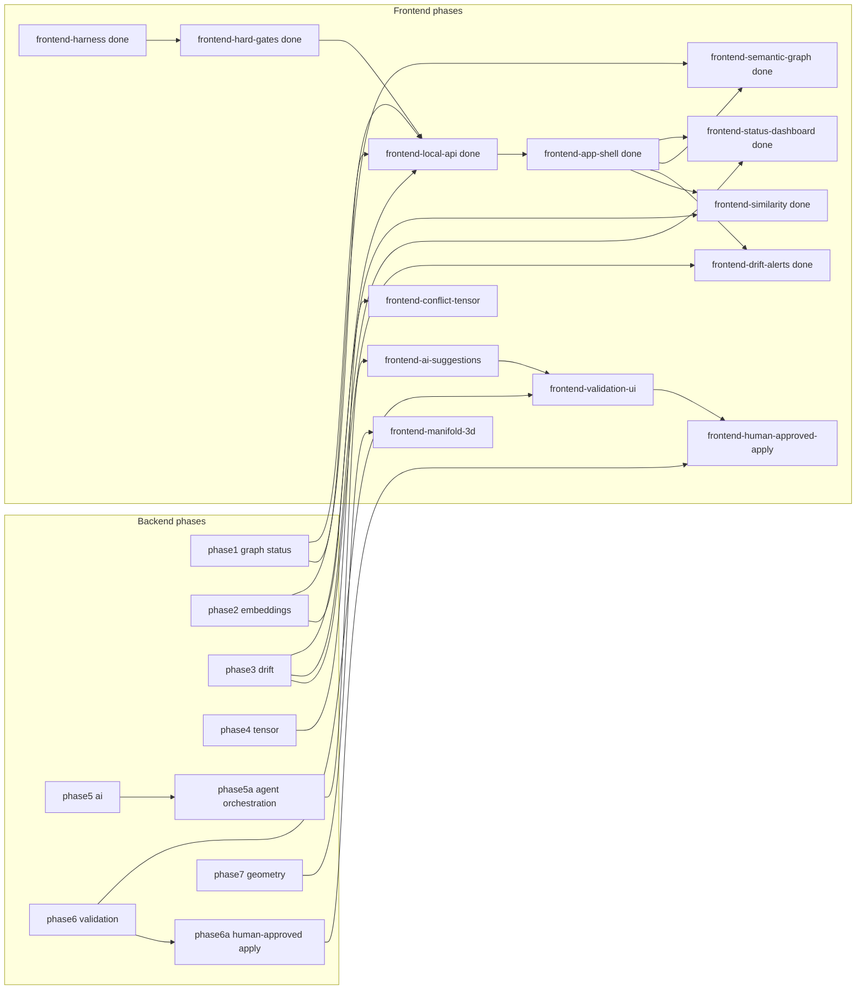

# GDSS Frontend Product Roadmap

Phase-wise frontend integration that complements the backend roadmap in
`harness/state/feature_list.json` (shared one-feature-at-a-time queue).

Machine-readable source of truth: features with `id` starting with `frontend-*`
in [`harness/state/feature_list.json`](../harness/state/feature_list.json).
Visual harness (guides/sensors): `.cursor/rules/frontend/`, `harness/verify-frontend.sh`.

## Decisions

- **Product intent**: UI depicts backend evidence for drift, graph structure, assistive
  similarity / embedding space, and (once phase4 lands) \(\Omega_{ij}\). See
  [`PRODUCT_INTENT.md`](PRODUCT_INTENT.md). Validated ≠ proven correct; never imply
  GDSS guarantees working code.
- **Same queue** as backend: pick exactly one unfinished feature whose `deps`
  are all `done` (backend or frontend).
- **API-first**: after hard gates, build a local HTTP JSON API (`gdss/api` +
  `gdss serve`); UIs never scrape CLI Rich output.
- **Definition of done**: `bash harness/verify.sh` green; frontend product
  features also require `bash harness/verify-frontend.sh` green.
- **Privacy**: API payloads are metadata/symbol names only — no source bodies,
  no PII (see `.cursor/rules/60-telemetry-privacy.mdc`).
- **Human control**: agent controls may start or cancel a local review run and select a
  strategy, but cannot write files. A later apply control requires per-action confirmation,
  visible preflight evidence, and never invokes Git merge, rebase, stage, commit, or push.
- **Honesty**: UI cards declare evidence phase (deterministic / assistive
  heuristic / not yet available). Fabricated metrics are forbidden.

## Complementarity map

## Phase table

| id | phase | status | deps | Complements |
| --- | --- | --- | --- | --- |
| `frontend-harness` | F0 | done | — | Visual brain (guides + sensors + scaffold) |
| `frontend-hard-gates` | F0.1 | done | `frontend-harness` | Turns SKIP sensors into hard gates |
| `frontend-local-api` | F1 | done | hard-gates + graph + embeddings + drift | Live JSON for all UIs (`gdss serve`) |
| `frontend-app-shell` | F2 | done | `frontend-local-api` | Nav, routes, Query client |
| `frontend-status-dashboard` | F3 | done | app-shell | `gdss status` / `gdss drift` |
| `frontend-semantic-graph` | F4 | done | app-shell | `analyze` / `graph export` / `impact` |
| `frontend-drift-alerts` | F5 | done | app-shell | `gdss drift` / `gdss alerts` |
| `frontend-similarity` | F6 | done | app-shell | `gdss similar` (assistive only) |
| `frontend-embedding-space` | F6.1 | done | similarity + embeddings API | PCA cloud on `/similar` |
| `frontend-conflict-tensor` | F7 | done | app-shell + `phase4-tensor` | Conflict tensor `Omega_{ij}` |
| `frontend-ai-suggestions` | F8 | pending | app-shell + `phase5-ai` + `phase5a-agent-orchestration` | Review agent state, select/reject strategies; no writes |
| `frontend-validation-ui` | F9 | pending | AI UI + `phase6-validation` | Validation sandbox |
| `frontend-human-approved-apply` | F9.1 | pending | validation UI + `phase6-human-approved-apply` | Explicit one-patch apply review, confirmation, diff, and rollback result |
| `frontend-manifold-3d` | F10 | pending | semantic-graph + `phase7-research` | Geometric merge / manifold |

## Local API contract (F1)

See [`docs/f1_api_contract.md`](f1_api_contract.md). Summary:

| Method | Path | Purpose |
| --- | --- | --- |
| GET | `/health` | Readiness + bound `repo` path |
| GET | `/v1/status?ref=` | Attractor, trajectory, uncommitted delta |
| GET | `/v1/graph?ref=` | Nodes/edges |
| GET | `/v1/drift?ref=` | Per-branch drift + conflict_probability |
| GET | `/v1/drift/history?branch=` | SnapshotHistory time series |
| GET | `/v1/alerts?ref=` | Severity-bucketed alerts |
| GET | `/v1/log?n=` | Semantic operators per commit |
| GET | `/v1/similar?symbol=&k=` | Assistive neighbors |
| GET | `/v1/embeddings/projection` | Assistive PCA cloud for `/similar` |
| GET | `/v1/tensor?ref=` | Flat pairwise Ω + `R_merge` + commutativity |
| GET | `/v1/symbols` | Symbol index for pickers |
| GET | `/v1/branches` | Local branches for ref dropdown |

CLI: `gdss serve --repo PATH --port 8787` (single repo).  
Frontend: `NEXT_PUBLIC_GDSS_API` (e.g. `http://127.0.0.1:8787`).  
Repo path is read-only in the UI; `ref` is a real branch dropdown.

Future F8-F9.1 API additions remain local and metadata-only: suggestion IDs, agent run state,
strategy IDs, validation evidence, preflight status, and result metadata. Source bodies and patch
text are not exposed through the HTTP API. The apply endpoint/action is unavailable until the
backend human-approved apply phase is complete.

## Visual language (every phase)

- Never a bare number: Trend + Context + Comparison + Animation.
- Evidence-phase badges on every metric card.
- Manifold motion: nodes breathe, edges pulse, conflicts glow, drift moves,
  trajectory animates, merge converges.
- Tokens only: `web/lib/tokens.ts`, `web/lib/motion.ts` (enforced by
  `token_fitness`).
- Accessibility + reduced-motion required (frontend rules 17, 03).

## Related docs

- Backend I/O today: [`docs/IO & VIZ.md`](IO%20%26%20VIZ.md)
- Manifold honesty: [`docs/MANIFOLD_TENSOR_GUIDE.md`](MANIFOLD_TENSOR_GUIDE.md)
- Backend roadmap plan: `.cursor/plans/gdss_complete_roadmap_e8cc388d.plan.md`
- Frontend harness plan: `.cursor/plans/frontend_harness_f4e1bfa0.plan.md`
- Agent operating manual: [`AGENTS.md`](../AGENTS.md)
