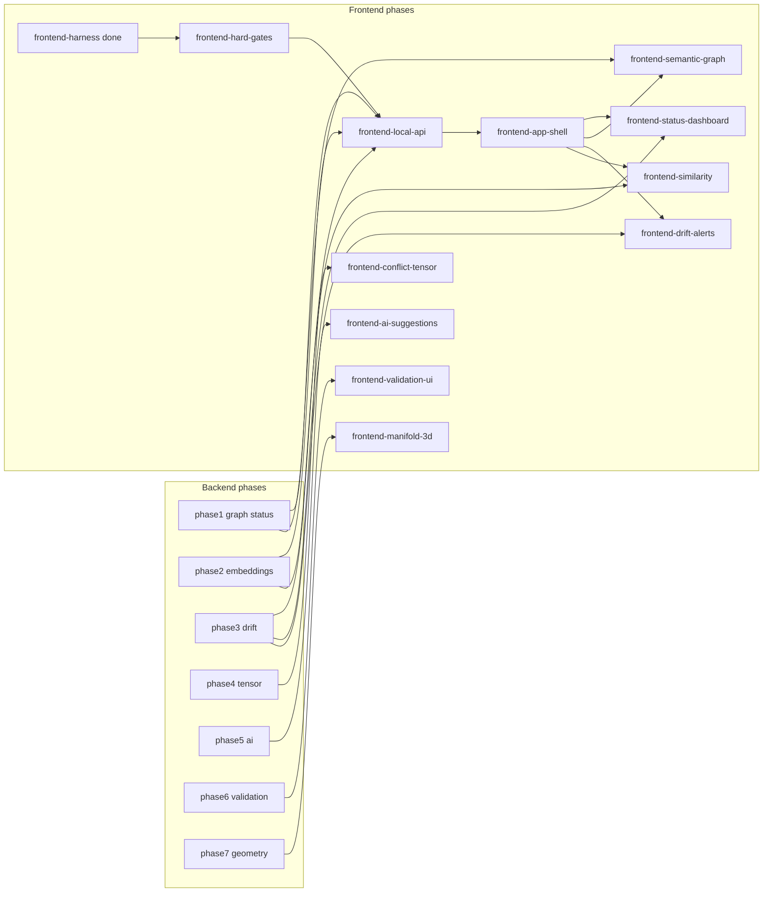

# GDSS Frontend Product Roadmap

Phase-wise frontend integration that complements the backend roadmap in
`harness/state/feature_list.json` (shared one-feature-at-a-time queue).

Machine-readable source of truth: features with `id` starting with `frontend-*`
in [`harness/state/feature_list.json`](../harness/state/feature_list.json).
Visual harness (guides/sensors): `.cursor/rules/frontend/`, `harness/verify-frontend.sh`.

## Decisions

- **Same queue** as backend: pick exactly one unfinished feature whose `deps`
  are all `done` (backend or frontend).
- **API-first**: after hard gates, build a local HTTP JSON API (`gdss/api` +
  `gdss serve`); UIs never scrape CLI Rich output.
- **Definition of done**: `bash harness/verify.sh` green; frontend product
  features also require `bash harness/verify-frontend.sh` green.
- **Privacy**: API payloads are metadata/symbol names only — no source bodies,
  no PII (see `.cursor/rules/60-telemetry-privacy.mdc`).

## Complementarity map

## Phase table

| id | phase | status | deps | Complements |
| --- | --- | --- | --- | --- |
| `frontend-harness` | F0 | done | — | Visual brain (guides + sensors + scaffold) |
| `frontend-hard-gates` | F0.1 | pending | `frontend-harness` | Turns SKIP sensors into hard gates |
| `frontend-local-api` | F1 | pending | hard-gates + graph + embeddings + drift | Live JSON for all UIs (`gdss serve`) |
| `frontend-app-shell` | F2 | pending | `frontend-local-api` | Nav, routes, Query client |
| `frontend-status-dashboard` | F3 | pending | app-shell | `gdss status` / `gdss drift` |
| `frontend-semantic-graph` | F4 | pending | app-shell | `analyze` / `graph export` / `impact` |
| `frontend-drift-alerts` | F5 | pending | app-shell | `gdss drift` / `gdss alerts` |
| `frontend-similarity` | F6 | pending | app-shell | `gdss similar` (assistive only) |
| `frontend-conflict-tensor` | F7 | pending | app-shell + `phase4-tensor` | Conflict tensor `Omega_{ij}` |
| `frontend-ai-suggestions` | F8 | pending | app-shell + `phase5-ai` | AI suggestions (never auto-merge) |
| `frontend-validation-ui` | F9 | pending | AI UI + `phase6-validation` | Validation sandbox |
| `frontend-manifold-3d` | F10 | pending | semantic-graph + `phase7-research` | Geometric merge / manifold |

## Recommended pick order (when deps are satisfied)

1. **`frontend-hard-gates`** — `cd web && pnpm install`, then green `verify-frontend.sh` without SKIP for missing `node_modules`.
2. **`frontend-local-api`** — additive `gdss/api/` + `gdss serve` (authorized exception to no-edit for that feature only).
3. **`frontend-app-shell`** — then parallelizable views F3–F6 (still one feature at a time).
4. F7–F10 wait on their backend deps (`phase4-tensor` … `phase7-research`).

## Local API contract (F1)

Additive under `gdss/api/` (architecture entrypoint). Example routes:

| Method | Path | Purpose |
| --- | --- | --- |
| GET | `/v1/status?repo=&ref=` | Attractor, trajectory, uncommitted delta |
| GET | `/v1/graph?repo=` | Nodes/edges (export shape) |
| GET | `/v1/drift?repo=&ref=` | Per-branch drift |
| GET | `/v1/alerts?repo=&ref=` | Severity-bucketed alerts |
| GET | `/v1/log?repo=&n=` | Semantic operators |
| GET | `/v1/similar?repo=&symbol=&k=` | Assistive neighbors |

CLI: `gdss serve --repo PATH --port 8787`.  
Frontend: `NEXT_PUBLIC_GDSS_API` (e.g. `http://127.0.0.1:8787`).

## Visual language (every phase)

- Never a bare number: Trend + Context + Comparison + Animation.
- Manifold motion: nodes breathe, edges pulse, conflicts glow, drift moves,
  trajectory animates, merge converges.
- Tokens only: `web/lib/tokens.ts`, `web/lib/motion.ts` (enforced by
  `token_fitness`).
- Accessibility + reduced-motion required (frontend rules 17, 03).

## Related docs

- Backend I/O today: [`docs/IO & VIZ.md`](IO%20%26%20VIZ.md)
- Backend roadmap plan: `.cursor/plans/gdss_complete_roadmap_e8cc388d.plan.md`
- Frontend harness plan: `.cursor/plans/frontend_harness_f4e1bfa0.plan.md`
- Agent operating manual: [`AGENTS.md`](../AGENTS.md)
