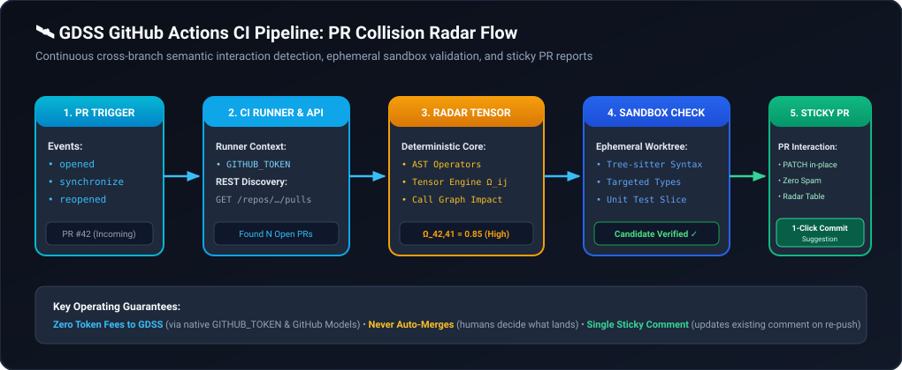
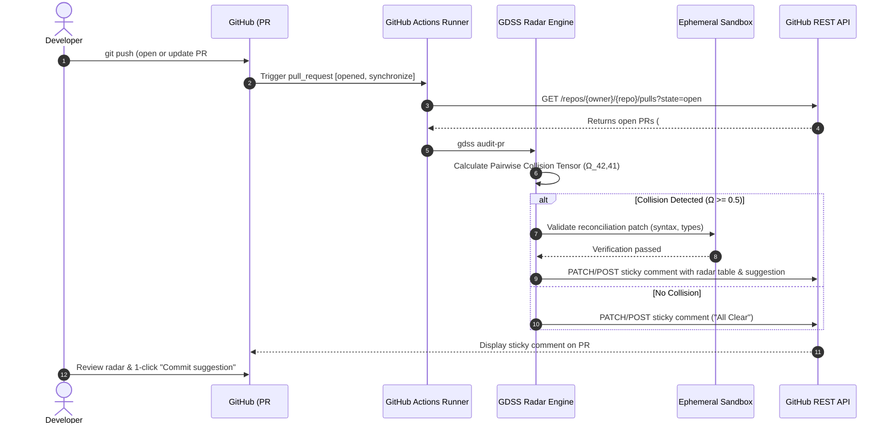

# 🛰️ GDSS GitHub Actions Guide: Automated PR Collision Radar

This guide details how to set up, configure, and use the **GDSS PR Collision Radar** in your GitHub repository CI/CD pipeline.

---

## Overview

In active engineering teams, multiple engineers frequently develop features in parallel branches. Traditional Git and CI tools only evaluate each PR in isolation against the target branch (`main`). They fail to detect when two open PRs introduce breaking semantic changes against each other until one lands and silently breaks the other.

**GDSS PR Collision Radar** runs automatically on every pull request event, discovers all other concurrently open PRs, computes the pairwise semantic interaction tensor matrix ($\Omega_{ij}$), tests candidate reconciliations in an ephemeral sandbox, and posts a single **sticky Markdown collision radar report** directly on the PR.

<p align="center">
  
</p>

<details>
<summary>🔄 Mermaid source (click to expand)</summary>


</details>

---

## 🚀 Quickstart: Adding the Workflow (2 Minutes)

To activate GDSS in your repository, create the file `.github/workflows/gdss-radar.yml` with the following configuration:

### `.github/workflows/gdss-radar.yml`

```yaml
name: GDSS PR Collision Radar

on:
  pull_request:
    types: [opened, synchronize, reopened]

# Cancel superseded runs when rapid pushes occur on the same PR
concurrency:
  group: gdss-radar-${{ github.event.pull_request.number }}
  cancel-in-progress: true

permissions:
  contents: read
  pull-requests: write
  issues: write

jobs:
  collision-radar:
    name: Audit Cross-Branch PR Collisions
    runs-on: ubuntu-latest
    steps:
      - name: Checkout repository
        uses: actions/checkout@v4
        with:
          fetch-depth: 0  # Required to resolve branch histories

      - name: Set up Python
        uses: actions/setup-python@v5
        with:
          python-version: "3.11"
          cache: "pip"

      - name: Install GDSS
        run: |
          python -m pip install --upgrade pip
          pip install gdss

      - name: Run GDSS Collision Radar Audit
        env:
          GITHUB_TOKEN: ${{ secrets.GITHUB_TOKEN }}
          GITHUB_EVENT_PATH: ${{ github.event_path }}
          GITHUB_REPOSITORY: ${{ github.repository }}
        run: |
          gdss audit-pr --output gdss_radar_report.md

      - name: Upload Radar Report Artifact
        if: always()
        uses: actions/upload-artifact@v4
        with:
          name: gdss-radar-report-pr-${{ github.event.pull_request.number }}
          path: gdss_radar_report.md
          if-no-files-found: ignore
```

> [!NOTE]
> No third-party API keys or external secrets are required. The workflow relies entirely on GitHub's built-in `${{ secrets.GITHUB_TOKEN }}`.

---

## ⚙️ Repository Configuration (`.gdss.yml`)

You can customize the radar's behavior by placing a `.gdss.yml` (or `.gdss.yaml`) file in the root of your repository:

```yaml
# .gdss.yml - Place at repository root

radar:
  # AI model used for generating convergence patches
  # Default: gpt-4o-mini (GitHub Models / Copilot)
  model: "gpt-4o"

  # Explicit context window size in tokens (HIGHLY RECOMMENDED)
  # Declaring this explicitly ensures GDSS allocates the optimal code budget (~45% of window,
  # up to 96,000 characters) without falling back to heuristic approximations or gateway probing.
  context_window: 128000

  # Inference provider backend: "github" (default in CI), "openai", "openrouter", "ollama", "vllm"
  provider: "github"

  # Maximum agentic self-correction iterations when sandboxed worktree validation fails
  # Default: 2 retries
  max_refinements: 2

  # Minimum semantic interaction risk (Omega_ij) required to trigger a warning or CI block
  # Range: 0.0 (any overlap) to 1.0 (strict contractual incompatibility)
  # Default: 0.8
  risk_threshold: 0.8

  # Whether to fail the CI check when a high-risk collision is detected
  # Default: false (Informational radar mode: alerts reviewers without blocking unrelated checks)
  # Set to true to make GDSS a mandatory merge gate
  fail_on_collision: false

validation:
  # Targeted test command for the ephemeral sandbox ({test_file} placeholder supported)
  test_command: "pytest {test_file}"
  # Static typechecker command in the sandbox worktree
  typecheck_command: "mypy ."
  # Sandbox execution timeout in seconds
  timeout_seconds: 45

# Optional: Custom source file extensions for AST analysis
ast:
  additional_extensions:
    - ".custom"
    - ".vue"
```

> [!WARNING]
> **Why you should configure `model` and `context_window` explicitly instead of relying on fallbacks:**  
> While GDSS includes multi-tier fallback mechanisms (API discovery and family heuristics), some cloud gateways and private proxies do not expose model context limits consistently. Relying on fallbacks may lead to conservative 16k token estimates, unnecessary HTTP discovery round trips, or code block truncation. Setting `context_window` explicitly guarantees deterministic code budgets and zero latency overhead.  
> 📖 **Full Configuration Reference:** See [`docs/CONFIGURATION_GUIDE.md`](CONFIGURATION_GUIDE.md) for provider-specific recipes and advanced settings.

### Configuration Options Explained

| Setting | Type | Default | Description |
| :--- | :---: | :---: | :--- |
| `radar.model` | `string` | `"gpt-4o-mini"` | The model name routed through the provider endpoint. |
| `radar.context_window` | `integer` | *Dynamic* | **Required best practice.** The exact context window capacity in tokens (e.g. `128000`). Precludes fallback guessing and maximizes the code condensation budget. |
| `radar.provider` | `string` | `"github"` | Provider backend: `"github"` (native GitHub Models via `GITHUB_TOKEN`), `"openai"`, `"openrouter"`, `"ollama"`, or `"vllm"`. |
| `radar.max_refinements` | `integer` | `2` | Maximum agentic self-correction attempts inside ephemeral sandbox worktrees before halting. |
| `radar.risk_threshold` | `float` | `0.8` | The numeric collision risk cutoff score between `0.0` and `1.0`. |
| `radar.fail_on_collision` | `boolean` | `false` | When `true`, the workflow exits with code `1` if $\Omega_{ij} \ge \text{risk threshold}$, blocking the merge button. |

---

## 🔍 The Pull Request Experience

### 1. The "Sticky Comment" Pattern
To avoid spamming PR conversation threads on every `git push`, GDSS tags its report with an invisible signature (`<!-- GDSS_PR_RADAR_SIGNATURE -->`).
- **On first push / PR open:** GDSS creates a new top-level comment.
- **On subsequent pushes (`synchronize`):** GDSS finds the existing comment and updates it in-place via `PATCH /repos/{owner}/{repo}/issues/comments/{comment_id}`.

### 2. When No Collisions Are Detected
When your branch does not semantically intersect with any other open PR, GDSS leaves a reassuring green status:

```markdown
<!-- GDSS_PR_RADAR_SIGNATURE -->
## 🛰️ GDSS PR Collision Radar

✅ **All Clear**: No semantic collisions or contractual breakages detected with other open pull requests.

*Audited 4 open pull request(s) against `feature-billing`.*
```

### 3. When a Semantic Collision Is Detected
If your branch touches contracts, call sites, or symbols that are concurrently being altered in another open PR, GDSS surfaces the collision topology:

```markdown
<!-- GDSS_PR_RADAR_SIGNATURE -->
## 🛰️ GDSS PR Collision Radar

| Status | Target File | Colliding PR | Overlapping Symbol | Topology | Risk ($\Omega_{ij}$) |
| :---: | :--- | :--- | :--- | :---: | :---: |
| 🚨 | `services/auth.py` | #41 by @alice (`feature-auth`) | `login()` signature | 📐 Asymmetric | **0.85 (Critical)** |

### ⚠️ Semantic Collision Topology
- **PR #41** (📐 Asymmetric): Semantic interaction (0.85) [asymmetric] with PR #41 on branch feature-auth.
  - **Recommended Merge Order**: Asymmetric dependency detected. Recommend merging PR #41 first, then rebasing PR #42.
  - **Audited Suggestion ID**: `sug_a1b2c3d4e5f6` (`gdss apply sug_a1b2c3d4e5f6 --strategy reconcile`)
  - **Deterministic Factors**:
    - same_file
    - same_function
    - non_commutative_signature_change

### 🛡️ Verified Convergence Suggestion
Tested in ephemeral sandbox worktree (syntax: OK, types: OK - refined in 1 self-correction attempt(s)):
```suggestion
def login(username: str, password: str, timeout: int = 30, oauth_token: str | None = None) -> bool:
    if oauth_token:
        return verify_oauth(oauth_token)
    return authenticate(username, password, timeout=timeout)
```
*Click **"Commit suggestion"** above to apply the verified reconciliation.*
*Or apply locally via GDSS CLI: `gdss apply sug_a1b2c3d4e5f6 --strategy reconcile`*

*Audited 4 open pull request(s) concurrently targeting `main`.*
```

### 4. What Happens Behind the Scenes: The Agentic Self-Correction Loop
1. **Developer Intent & Commit History Pairing**: GDSS inspects the PR description, title, and the commit log on each branch relative to `main` (`base..head`), pairing intent alongside AST call graph changes.
2. **Ephemeral Sandbox Testing**: When the AI drafts candidate code diffs, GDSS checks out an isolated Git worktree (`/tmp/gdss-sandbox-...`) and runs syntax checks, `mypy`, and targeted tests.
3. **Agentic Refinement**: If a test or typecheck fails, GDSS captures the error output and prompts the model to correct its mistakes up to `max_refinements` (default 2 retries) before presenting it to human reviewers.
4. **1-Click Web Commit**: Clicking **"Commit suggestion"** directly applies the sandbox-proven commit to your branch without needing to context-switch into a local terminal.

### 5. 1-Click Commit Suggestion & CLI Local Apply
Because GDSS formats verified patches using GitHub's native ` ```suggestion ` syntax, reviewers and authors can click **"Commit suggestion"** directly in GitHub's web interface to apply the pre-tested reconciliation with zero copy-pasting.

Additionally, developers who prefer to test and apply changes locally before committing can run:
```bash
# Safely apply the audited suggestion to your local working tree (does not commit or push)
gdss apply sug_a1b2c3d4e5f6

# Or preview with a dry run
gdss apply sug_a1b2c3d4e5f6 --dry-run
```

---

## 🔐 Security, Permissions & Token Model

### Bring Your Own Compute (Zero Token Cost to GDSS)
GDSS operates on a Bring-Your-Own-Compute (BYOC) philosophy:
- **Deterministic Core ($0 Tokens):** AST parsing, dependency graph building, and the collision interaction tensor ($\Omega_{ij}$) run locally inside the GitHub Actions runner. They consume **0 AI tokens**.
- **Reconciliation Patching (GitHub Models):** If patch generation is needed, GDSS connects directly to the GitHub Models endpoint (`https://models.inference.ai.azure.com`) using the workflow's native `GITHUB_TOKEN`. Token usage is billed directly to your GitHub repository or organization plan; GDSS collects zero fees.

### Handling Fork Pull Requests
Pull requests submitted from external forks do not have write access to repository secrets by default. GDSS handles this safely:
- If `GITHUB_TOKEN` has read-only permissions, GDSS still computes the collision radar and logs the Markdown report to the GitHub Actions workflow summary.
- The action **never crashes** if model access or comment permissions are restricted.

---

## 💻 Local Simulation & Testing

Before pushing your branch to GitHub, you can preview the radar report locally using the GDSS CLI:

```bash
# Preview what GDSS will report without touching GitHub
gdss audit-pr --dry-run

# Output the radar report to a markdown file
gdss audit-pr --dry-run --output preview_radar.md

# Audit a specific PR number using a local personal access token
gdss audit-pr --pr-number 42 --token "$GITHUB_TOKEN"
```
