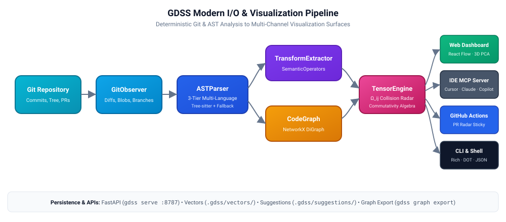
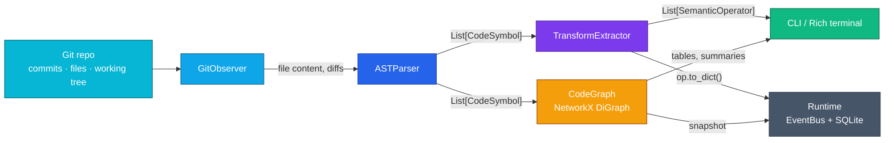
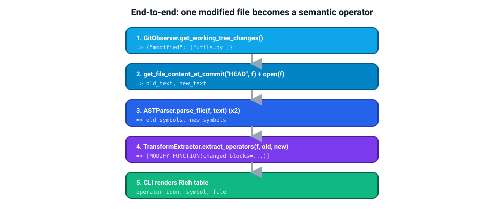
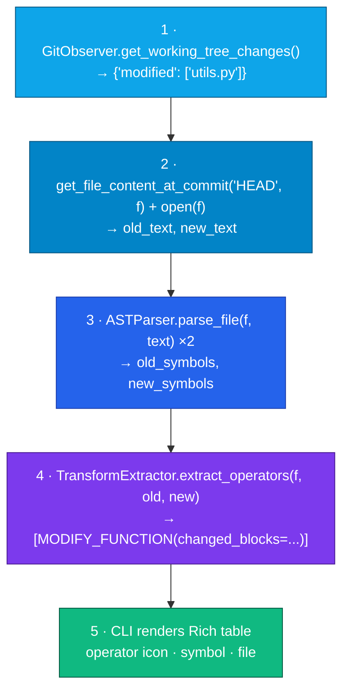
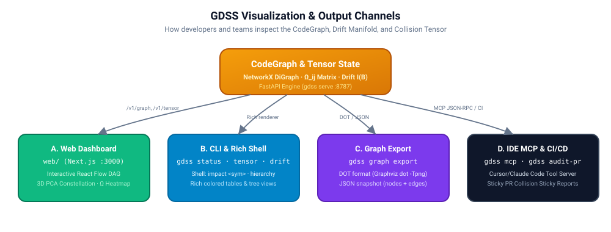
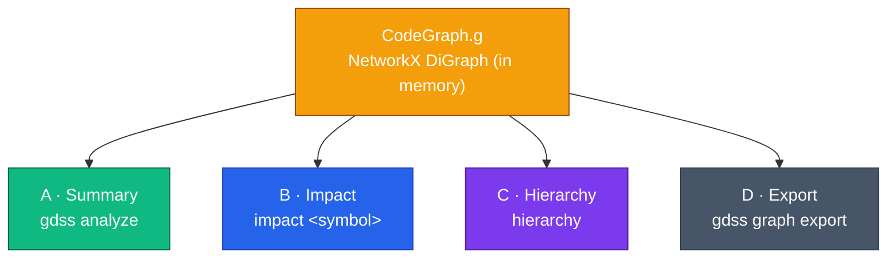

# GDSS I/O and Graph Visualization

How data flows through the codebase today, and what you can run from the shell to inspect the dependency graph.

---

## The big picture: data pipeline

<p align="center">
  
</p>

<details>
<summary>🔄 Mermaid source (click to expand)</summary>



</details>

GDSS does **not** persist a graph file or image. The graph lives in memory (`CodeGraph.g`) and is rendered as **Rich tables/trees in the terminal**.

---

## Layer-by-layer I/O

### 1. Git layer — `GitObserver` (`gdss/watcher/git_observer.py`)

| Direction | Type | Description |
|-----------|------|-------------|
| **In** | `repo_path: str` | Path to a Git repo |
| **In** | commit SHAs, branch names | e.g. `"HEAD"`, `"main"`, merge-base |
| **Out** | `get_file_content_at_commit(sha, path) → str` | File text at a historical commit |
| **Out** | `get_file_diffs_between_commits(a, b) → {added, deleted, modified}` | File-level change lists |
| **Out** | `get_working_tree_changes() → {added, deleted, modified}` | Uncommitted/staged changes vs HEAD |
| **Out** | `get_active_branch()`, `get_merge_base()`, etc. | Branch metadata |

This is the **only Git boundary** most of the pipeline uses.

### 2. AST layer — `ASTParser` (`gdss/core/ast_parser.py`)

```python
parse_file(filepath: str, content: Optional[str] = None) -> List[CodeSymbol]
```

| Direction | Detail |
|-----------|--------|
| **In** | File path (and optionally raw source text) |
| **In** | Supported extensions: `.py`, `.js`, `.ts`, `.jsx`, `.tsx` |
| **Out** | `List[CodeSymbol]` — functions, classes, imports, etc. |

Each `CodeSymbol` carries:

- `name`, `type`, `signature`, `body`, `calls`, `body_blocks`
- `structural_tokens` (AST fingerprint for rename detection)
- `symbol_id` (stable ID, position-independent)
- `chart_location` (file path — metadata, not identity)

When `content` is omitted, the parser reads from disk and caches by mtime.

### 3. Transform layer — `TransformExtractor` (`gdss/core/transform_extractor.py`)

```python
extract_operators(file_path, old_symbols, new_symbols, commit_sha="") -> List[SemanticOperator]
```

| Direction | Detail |
|-----------|--------|
| **In** | Two symbol lists (before/after) |
| **In** | `file_path`, optional `commit_sha` |
| **Out** | `List[SemanticOperator]` — add/delete/rename/modify ops |

Each `SemanticOperator` includes:

- `operator` (`OperatorType`), `file`, `name` / `from_name` / `to_name`
- `symbol_id`, `from_symbol_id`, `to_symbol_id`
- `details` (e.g. `changed_blocks` for block-level modifies)
- `to_dict()` for serialization

### 4. Graph layer — `CodeGraph` (`gdss/graph/code_graph.py`)

```python
add_file_symbols(file_path: str, symbols: List[CodeSymbol]) -> None
resolve_calls() -> None
get_downstream_impact(node_id: str) -> Set[str]
get_summary() -> Dict
snapshot() -> Dict  # for tests
```

| Direction | Detail |
|-----------|--------|
| **In** | `CodeSymbol` lists per file |
| **Out** | NetworkX `DiGraph`: nodes `file` / `function` / `class` / import modules |
| **Out** | Node ID = stable `symbol_id` (not `file::name`) |
| **Out** | Edges: `defines`, `calls`, `imports` |
| **Out** | `get_display_id(node_id) → "path/to/file.py::func_name"` |

Operator application lives in `gdss/graph/operator_engine.py`:

```python
apply_operator(op: SemanticOperator, graph: CodeGraph) -> None
invert_operator(op: SemanticOperator) -> SemanticOperator
```

### 5. CLI layer — entry points (`gdss/cli/main.py` → `gdss/cli/start.py`)

| Shell command | What it reads | What it prints |
|---------------|---------------|----------------|
| `gdss start` | Repo path | Interactive shell |
| `gdss status --repo PATH [--ref main]` | merge_base(ref)..HEAD + working tree | Attractor/remote + trajectory operators + uncommitted semantic delta |
| `gdss log -n 5 --repo PATH` | Last N commits | Semantic operators per commit |
| `gdss analyze --repo PATH` | All supported source files | Graph node/edge counts + symbol breakdown |
| `gdss similar SYMBOL --repo PATH [-k 5]` | Symbol embeddings + FAISS/numpy index | Assistive top-k neighbors |
| `gdss reindex --repo PATH` | All supported source files | Rebuild `.gdss/vectors/` |
| `gdss diff TARGET --repo PATH` | Branch diff vs target | File changes + semantic operators |
| `gdss watch --repo PATH` | Event bus | Live monitor panel |
| `gdss graph export --repo PATH -o FILE` | All supported source files | DOT or JSON graph file on disk |

**Interactive-only** (inside `gdss start`):

| Command | Purpose |
|---------|---------|
| `analyze` | Build graph, print summary |
| `impact <symbol>` | Downstream impact table for a symbol name |
| `hierarchy` | Branch priority chain as a Rich tree |
| `log`, `status`, `diff`, `watch` | Same as above |
| `similar <name> [k]` | Assistive embedding neighbors |
| `reindex` | Rebuild local vector index |

---

## End-to-end example: one file change

<p align="center">
  
</p>

<details>
<summary>🧭 Mermaid source (click to expand)</summary>



</details>

For graph building (`analyze` / `impact`):

```text
walk repo → parse_file(path) → graph.add_file_symbols(path, symbols)
          → graph.resolve_calls()
          → graph.get_summary() or get_downstream_impact(symbol_id)
```

---

## How to visualize the graph from the shell

Built-in terminal views plus first-class graph export.

<p align="center">
  
</p>

<details>
<summary>🕸️ Mermaid source (click to expand)</summary>



</details>

### Option A: Summary stats (built-in)

```bash
cd /path/to/your/repo
gdss analyze --repo .
```

Output looks like:

```text
Nodes: 42 | Edges: 87
  • Function: 30
  • Class: 5
  • Import: 7
```

### Option B: Downstream impact (interactive)

```bash
gdss start --repo .
# then at the prompt:
analyze
impact process_payment
```

Prints a table of nodes that **call or depend on** that symbol (via reversed graph traversal).

### Option C: Branch hierarchy tree

```bash
gdss start --repo .
hierarchy
```

### Option D: Export to DOT or JSON (built-in)

```bash
cd /path/to/your/repo

# DOT for Graphviz
gdss graph export --repo . --format dot -o gdss_graph.dot
dot -Tpng gdss_graph.dot -o graph.png   # requires Graphviz installed

# JSON snapshot (nodes + edges)
gdss graph export --repo . --format json -o gdss_graph.json
```

Nodes are labeled with `chart_location::symbol` (via `get_display_id`). Edge labels
carry the relation (`defines`, `calls`, `imports`).

Or inspect in Python:

```python
graph.snapshot()  # {"nodes": {...}, "edges": [(u, v, relation), ...]}
graph.get_summary()
```

---

## What is **not** implemented yet

- No GraphML export format yet (`--format graphml`)
- No web or GUI graph viewer
- No persistent graph database (Neo4j, etc.)
- `impact` is not exposed as `gdss impact ...` — only inside the interactive shell
- Working tree ≠ drift energy: `status` labels WT as **uncommitted semantic delta**; branch drift integral I(B_i) is Phase 3
- `--ref` selects the attractor branch (glossary `dev` is configurable; default often `main`)
- Embeddings (`gdss similar` / FAISS under `.gdss/vectors/`) are **assistive**; continuous drift monitoring is Phase 3
- Optional extras: `pip install -e ".[embeddings]"` for `faiss-cpu` + `onnxruntime` (bag encoder works offline without them)
---

## Quick reference: core data types

| Type | Role | Serialized? |
|------|------|-------------|
| `CodeSymbol` | One AST entity (function, class, …) | `to_dict()` |
| `SemanticOperator` | One semantic change (`dC`) | `to_dict()` |
| `CodeGraph.g` | Live dependency manifold | `snapshot()` (tests only) |
| EventBus payload | `{event, branch, hexsha, semantic_operators: [...]}` | JSON-ish dict to SQLite |

---

