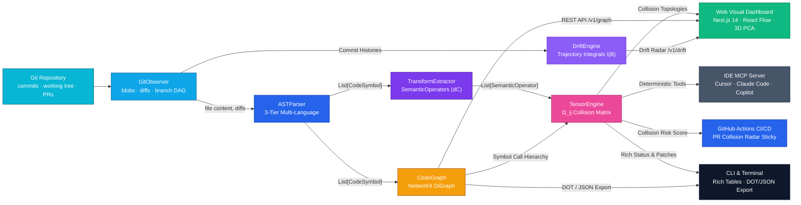
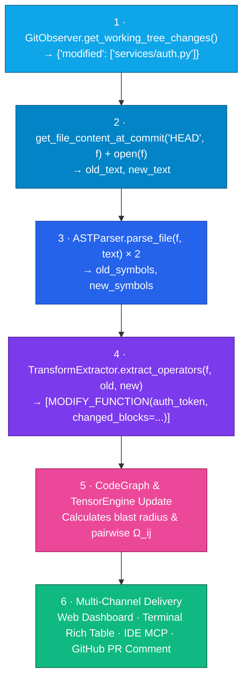
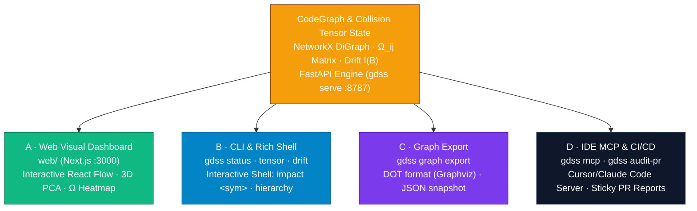

# GDSS I/O and Graph Visualization

Comprehensive guide on how data flows through GDSS, how persistence is handled, and how developers and teams visualize and inspect code intelligence across all delivery channels.

**Product Intent:** GDSS acts as an early PR collision radar and semantic branch intelligence platform — not a general code autocomplete oracle. For full product philosophy, see [`PRODUCT_INTENT.md`](PRODUCT_INTENT.md) and [`PRODUCT_SPEC.md`](../PRODUCT_SPEC.md).

---

## 📑 Table of Contents

- [The Big Picture: End-to-End Data Pipeline](#the-big-picture-end-to-end-data-pipeline)
- [Layer-by-Layer I/O Specifications](#layer-by-layer-io-specifications)
  - [1. Git Boundary — `GitObserver`](#1-git-boundary--gitobserver)
  - [2. Multi-Language AST Parsing — `ASTParser`](#2-multi-language-ast-parsing--astparser)
  - [3. Transform Algebra — `TransformExtractor`](#3-transform-algebra--transformextractor)
  - [4. Dependency Graph — `CodeGraph`](#4-dependency-graph--codegraph)
  - [5. Collision Tensor Engine — `TensorEngine`](#5-collision-tensor-engine--tensorengine)
  - [6. Drift & Trajectory Engine — `DriftEngine`](#6-drift--trajectory-engine--driftengine)
  - [7. Embedding & Dimensionality Projection](#7-embedding--dimensionality-projection)
- [End-to-End Change Flow Example](#end-to-end-change-flow-example)
- [How to Visualize and Inspect GDSS Intelligence](#how-to-visualize-and-inspect-gdss-intelligence)
  - [Channel 1: Next.js Web Visual Dashboard (`web/`)](#channel-1-nextjs-web-visual-dashboard-web)
  - [Channel 2: CLI & Interactive Rich Shell](#channel-2-cli--interactive-rich-shell)
  - [Channel 3: Graph File Export (DOT & JSON)](#channel-3-graph-file-export-dot--json)
  - [Channel 4: IDE MCP Server & CI/CD PR Radar](#channel-4-ide-mcp-server--cicd-pr-radar)
- [Local REST API Reference (`gdss serve`)](#local-rest-api-reference-gdss-serve)
- [Storage & Persistence Architecture](#storage--persistence-architecture)
- [Core Data Models Reference](#core-data-models-reference)

---

## The Big Picture: End-to-End Data Pipeline

<p align="center">
  
</p>

<details>
<summary>🔄 Mermaid source (click to expand)</summary>



</details>

GDSS processes source code through a deterministic pipeline: raw Git objects are parsed into concrete AST symbols, diffed into semantic transformation operators, resolved into an in-memory dependency graph, and analyzed for pairwise non-commutativity and collision. The resulting intelligence is served across 4 distinct delivery channels.

---

## Layer-by-Layer I/O Specifications

### 1. Git Boundary — `GitObserver` (`gdss/watcher/git_observer.py`)

The primary interface to Git. Encapsulates `GitPython` and subprocess calls:

| Direction | Method / Type | Description |
| :--- | :--- | :--- |
| **In** | `repo_path: str` | Path to target Git repository |
| **In** | `base_ref`, `head_ref` | Branch names, tags, or commit SHAs |
| **Out** | `get_file_content_at_commit(sha, path) -> str` | Raw source text at a historical commit |
| **Out** | `get_file_diffs_between_commits(a, b) -> dict` | Added, deleted, and modified file sets |
| **Out** | `get_working_tree_changes() -> dict` | Uncommitted and staged changes vs HEAD |
| **Out** | `get_commits_between(base, head) -> list` | Commit objects with SHAs, messages, authors, and timestamps |
| **Out** | `get_active_branch()`, `get_merge_base()` | Branch topologies and nearest common ancestors |

This is the **only module** in the codebase that interacts with Git directly.

---

### 2. Multi-Language AST Parsing — `ASTParser` (`gdss/core/ast_parser.py`)

Parses source code into structured symbols (`CodeSymbol`). Uses a **3-tier parsing hierarchy**:

```text
Tier 1: Tree-sitter Grammar Loader (Python, TS, JS, Go, Rust, Java, C, C++)
   │
   ├─► Tier 2: Generic Tree-sitter Walker (fallback syntax tree)
   │
   └─► Tier 3: Universal Structural Fallback (indentation & brace-block extraction
              for C#, Ruby, PHP, Kotlin, Swift, Scala, Shell, SQL, CSS, HTML, etc.)
```

```python
parse_file(filepath: str, content: Optional[str] = None) -> List[CodeSymbol]
```

| Direction | Detail |
| :--- | :--- |
| **In** | File path (and optional in-memory text buffer) |
| **Supported Grammars** | `.py`, `.pyi`, `.js`, `.jsx`, `.mjs`, `.cjs`, `.ts`, `.tsx`, `.go`, `.rs`, `.java`, `.c`, `.h`, `.cpp`, `.hpp`, `.cc`, `.cxx` |
| **Universal Fallback** | `.cs`, `.rb`, `.php`, `.kt`, `.kts`, `.swift`, `.scala`, `.sh`, `.bash`, `.html`, `.css`, `.sql` |
| **Out** | `List[CodeSymbol]` — functions, classes, methods, imports, modules |

Each `CodeSymbol` contains:
- `name: str`: Identifier name (e.g., `authenticate_user`).
- `type: SymbolType`: `FUNCTION`, `CLASS`, `METHOD`, `IMPORT`, `VARIABLE`.
- `signature: str`: Normalized parameter list and return type annotations.
- `body: str`: Raw body content.
- `calls: List[str]`: Identifiers invoked within this symbol's scope.
- `body_blocks: List[BodyBlock]`: Fine-grained block AST decomposition for sub-function delta tracking.
- `structural_tokens: List[str]`: Structural AST fingerprint used for position-independent rename detection.
- `symbol_id: str`: Deterministic hash ID based on symbol identity, independent of line numbers.
- `chart_location: str`: Relative file path.

---

### 3. Transform Algebra — `TransformExtractor` (`gdss/core/transform_extractor.py`)

Computes the semantic operator stream ($dC$) between two versions of a file:

```python
extract_operators(file_path, old_symbols, new_symbols, commit_sha="") -> List[SemanticOperator]
```

| Direction | Detail |
| :--- | :--- |
| **In** | Before and after `List[CodeSymbol]` |
| **In** | `file_path`, optional `commit_sha` |
| **Out** | `List[SemanticOperator]` — atomic semantic transformation operators |

Supported `OperatorType` variants:
- `ADD_FUNCTION`, `DELETE_FUNCTION`, `MODIFY_FUNCTION`, `RENAME_FUNCTION`
- `ADD_CLASS`, `DELETE_CLASS`, `MODIFY_CLASS`
- `ADD_IMPORT`, `DELETE_IMPORT`, `MODIFY_IMPORT`
- `MOVE_FUNCTION`, `CHANGE_SIGNATURE`

Each operator contains `changed_blocks`, enabling sub-symbol resolution without rewriting entire files.

---

### 4. Dependency Graph — `CodeGraph` (`gdss/graph/code_graph.py`)

Maintains the in-memory semantic dependency manifold using a NetworkX `DiGraph`:

```python
add_file_symbols(file_path: str, symbols: List[CodeSymbol]) -> None
resolve_calls() -> None
get_downstream_impact(node_id: str) -> Set[str]
get_summary() -> Dict[str, Any]
snapshot() -> Dict[str, Any]
```

| Direction | Detail |
| :--- | :--- |
| **In** | `List[CodeSymbol]` per file across the repository |
| **Out** | NetworkX `DiGraph` of symbols, classes, files, and module imports |
| **Node ID** | Position-independent `symbol_id` |
| **Edges** | Directed relationships: `defines`, `calls`, `imports` |
| **Traversal** | `get_downstream_impact(node_id)` traverses callers in reverse to identify blast radius |

---

### 5. Collision Tensor Engine — `TensorEngine` (`gdss/conflict/tensor.py`)

Computes pairwise branch interaction and collision intensity across all concurrent branches $B_i$ and $B_j$ before merge:

```python
compute(
    branch_ops: Mapping[str, list[SemanticOperator]],
    drift_magnitudes: Mapping[str, float],
    impact_sets: Mapping[str, set[str]] | None = None,
) -> ConflictTensor
```

| Direction | Detail |
| :--- | :--- |
| **In: `branch_ops`** | `Mapping[str, list[SemanticOperator]]` — Extracted semantic operators for each active branch relative to common ancestor or attractor |
| **In: `drift_magnitudes`** | `Mapping[str, float]` — Precomputed drift magnitude per branch used to populate diagonal self-energy |
| **In: `impact_sets`** | `Mapping[str, set[str]] | None` — Transitive caller blast radiuses from `CodeGraph.get_downstream_impact()` |
| **Out: `ConflictTensor`** | Sparse matrix representation containing `branches`, `entries: dict[tuple[str, str], TensorEntry]`, and `merge_risk: float` |
| **Out: `TensorEntry`** | Evaluated branch pair `(i, j)`, computed collision intensity `omega: float` ($\Omega_{ij} \in [0.0, 1.0]$), and explainable `reasons: tuple[str, ...]` |

#### Mathematical Foundations: Two Formulations of $\Omega_{ij}$

In GDSS, the Collision Tensor is modeled through two complementary representations: the **Theoretical Operator-Graph Formulation** (foundational definition over the code dependency manifold) and the **Discrete Production Implementation** (deterministic, clamped $O(|S|)$ execution in `gdss/conflict/tensor.py`).

##### 1. Theoretical Graph-Spectral Operator Formulation
Over the semantic repository manifold $G = (S, E)$ consisting of symbol nodes $s \in S$ and directed dependency edges $(s_u, s_v) \in E$, the theoretical collision intensity between branches $B_i$ and $B_j$ is:

$$\Omega_{ij} = \sum_{s \in S} W_s \cdot \Delta_i(s) \cdot \Delta_j(s) + \sum_{(s_u, s_v) \in E} W_{uv} \cdot [\Delta_i(s_u) \Delta_j(s_v) + \Delta_j(s_u) \Delta_i(s_v)] + \sum_{T_i \in \tau_i, T_j \in \tau_j} \|[T_i, T_j]\|$$

This formulation decomposes collision tension into three fundamental topological components:
1. **Node Space — Direct Symbol Overlap ($\sum_{s \in S}$):** Measures concurrent changes applied to identical symbols (functions, classes, types). $W_s$ is the symbol importance weight, while $\Delta_i(s)$ and $\Delta_j(s)$ represent the magnitude of semantic modification on symbol $s$.
2. **Edge Space — Contractual Call Graph Overlap ($\sum_{(s_u, s_v) \in E}$):** Detects cross-boundary architectural breakage along caller-callee directed edges. If branch $B_i$ alters caller $s_u$ while concurrent branch $B_j$ modifies callee $s_v$'s signature (or vice-versa), this term triggers even if the branches touch completely disjoint files.
3. **Commutator Lie Bracket — Algebraic Non-Commutativity ($\sum \|[T_i, T_j]\|$):** Evaluates whether the transformation operators commute:
   $$[T_i, T_j] = T_i \circ T_j - T_j \circ T_i$$
   - $[T_i, T_j] = 0 \implies$ Commutative (order-independent merge).
   - $[T_i, T_j] \ne 0 \implies$ Non-commutative interference (order-dependent; one ordering causes build or contract failures).

---

##### 2. Discrete Production Implementation (`TensorEngine.compute`)
To run in literal 0 tokens with zero continuous approximation overhead, `TensorEngine` evaluates the theoretical formulation through calibrated discrete indicators clamped to $[0.0, 1.0]$:

$$\Omega_{ij} = \operatorname{clamp}_{[0, 1]}\Big( w_{\text{file}} \cdot S_{\text{file}} + w_{\text{func}} \cdot S_{\text{func}} + w_{\text{sym}} \cdot S_{\text{sym}} + w_{\text{dep}} \cdot D_{ij} + w_{\text{interfere}} \cdot I_{ij} \Big)$$

**Mapping from Theory to Production Code:**
| Theoretical Component | Discrete Production Term | Default Weight | Meaning |
| :--- | :--- | :--- | :--- |
| **Node Space ($\sum_{s \in S}$)** | $w_{\text{file}} \cdot S_{\text{file}}$ | $0.2$ | $1.0$ if $\text{files}(B_i) \cap \text{files}(B_j) \ne \emptyset$ |
| **Node Space ($\sum_{s \in S}$)** | $w_{\text{func}} \cdot S_{\text{func}}$ | $0.5$ | $1.0$ if both branches modify/delete the same function target |
| **Node Space ($\sum_{s \in S}$)** | $w_{\text{sym}} \cdot S_{\text{sym}}$ | $0.7$ | $1.0$ if both branches target identical symbol identifiers |
| **Edge Space ($\sum_{(s_u, s_v) \in E}$)** | $w_{\text{dep}} \cdot D_{ij}$ | $0.4$ | $1.0$ if `CodeGraph` blast radiuses intersect ($\text{impact}_i \cap \text{impact}_j \ne \emptyset$) |
| **Commutator ($\sum \|[T_i, T_j]\|$)**| $w_{\text{interfere}} \cdot I_{ij}$ | $0.3$ | Interference ratio $I_{ij} = \frac{\text{interfering}}{\max(1, \text{contacts})}$ from `commutativity.py` |

##### 3. Contact Topologies
Contacting operator pairs are deterministically classified into four geometric contact topologies (`gdss/ai/conflict_topology.py`):
- **`Disjoint`**: Operators touch disjoint symbols or interfere without a shared parent structure. $\Omega_{ij} \approx 0.0$.
- **`Union`**: Operators affect disjoint children under a common parent (e.g. adding sibling functions to a class) or append non-conflicting sections. Commutes cleanly; eligible for automatic union merge.
- **`Intersection`**: Operators overlap identical blocks or full bodies of the same symbol ($[T_i, T_j] \ne 0$). High collision risk ($\Omega_{ij} \ge 0.50$); requires semantic convergence or developer resolution.
- **`Asymmetric`**: Operator application order alters the resulting AST state (e.g. signature modification vs caller rewrite). Requires explicit merge order sequencing.

##### 4. Diagonal Self-Energy ($\Omega_{ii}$)
Captures the branch's accumulated divergence from the reference attractor branch (internal semantic churn):

$$\Omega_{ii} = \min(1.0, \|\gamma_i(t)\|)$$

##### 5. Repository Merge Risk ($R_{\text{merge}}$)
GDSS measures repository merge risk under two complementary formulations:
- **Total Cumulative Risk ($R_{\text{merge}}^{\text{sum}}$):** Sum of all matrix entries including diagonal self-energy (used by CLI and REST API):
  $$R_{\text{merge}} = \sum_{e \in \text{entries}} \Omega_e = \sum_{i} \Omega_{ii} + \sum_{i < j} \Omega_{ij}$$
- **Normalized Pairwise Average Risk ($R_{\text{merge}}^{\text{avg}}$):** Average collision probability across all $\binom{N}{2}$ active branch pairs:
  $$R_{\text{merge}}^{\text{avg}} = \frac{2}{N(N-1)} \sum_{i < j} \Omega_{ij} \quad (\text{for } N \ge 2)$$

#### What This Calculation Does in the Project:
1. **Early PR Collision Radar:** Runs in GitHub Actions CI and IDE MCP servers to alert developers when two concurrent feature PRs have non-zero $\Omega_{ij}$, before either branch merges.
2. **Topological Merge Ordering:** Directs release orchestration by finding the permutation of branches that minimizes progressive cumulative merge friction.
3. **AI Convergence Grounding:** Provides the AI synthesis prompt builder (`gdss/ai/prompt_builder.py`) with the exact mathematical reasons, contact topology directives, and non-commuting operations that require conflict resolution.

---

### 6. Drift & Trajectory Engine — `DriftEngine` (`gdss/drift/engine.py`)

Measures semantic divergence and trajectory path dynamics of active branch $B_i$ relative to the reference attractor branch ($A$, typically `main` or `develop`):

```python
compute_magnitude(branch: str, reference_branch: str) -> DriftMagnitude
snapshot(branch: str, reference_branch: str) -> DriftSnapshot
affected_symbols(branch: str, reference_branch: str) -> list[AffectedSymbol]
```

| Direction | Detail |
| :--- | :--- |
| **In: `branch`, `reference_branch`** | Git branch names or commit SHAs to compare |
| **In: Parameters** | $\alpha = 0.5$ (tip distance weight), $\beta = 0.5$ (trajectory integral weight), `trajectory_ceiling = 2.0`, `convergence_threshold = 1.0` |
| **Out: `DriftMagnitude`** | `tip_distance: float` ($d_{\text{tip}}$), `trajectory_integral: float` ($I_{\text{norm}}$), combined `magnitude: float` ($\|\gamma(t)\|$), `alpha: float`, `beta: float` |
| **Out: `DriftSnapshot`** | Historical time-series snapshot including `timestamp`, `magnitude`, `velocity: float`, `convergence: float`, and `affected: tuple[AffectedSymbol, ...]` |
| **Out: `AffectedSymbol`** | `symbol_id: str`, `name: str`, `distance: float` (per-symbol cosine distance), `reason: str` (`"modified_in_both"`) |

#### Mathematical Calculation:

##### 1. Divergence Magnitude ($\|\gamma(t)\|$)
The total divergence of a branch tip from its reference attractor combines instantaneous tip distance with historical commit path churn:

$$\|\gamma(t)\| = \alpha \cdot d_{\text{tip}} + \beta \cdot I_{\text{norm}}$$

Where:
- $\alpha = 0.5$: Weight allocated to tip distance.
- $\beta = 0.5$: Weight allocated to normalized discrete trajectory integral.

##### 2. Tip Centroid Embedding Distance ($d_{\text{tip}}$)
Quantifies structural semantic distance between the codebase states at branch tip $C_{\text{branch}}$ and attractor tip $C_{\text{ref}}$:
1. Parse all source symbols present at each tip commit via Tree-sitter: $S_{\text{branch}}$ and $S_{\text{ref}}$.
2. Compute neural dense embeddings for all symbols via the ONNX code encoder (`all-MiniLM-L6-v2` in $\mathbb{R}^{384}$).
3. Compute the normalized branch centroid vector for each tip:
   $$\mathbf{v}_{\text{tip}} = \frac{\sum_{k=1}^{K} \mathbf{v}_k}{\left\|\sum_{k=1}^{K} \mathbf{v}_k\right\|_2} \in \mathbb{R}^{384}$$
4. Calculate cosine distance between the two tip centroids:
   $$d_{\text{tip}} = 1 - \frac{\mathbf{v}_{\text{branch}} \cdot \mathbf{v}_{\text{ref}}}{\|\mathbf{v}_{\text{branch}}\|_2 \|\mathbf{v}_{\text{ref}}\|_2}$$
   *(If both branches have no symbols, $d_{\text{tip}} = 0.0$; if only one has symbols, $d_{\text{tip}} = 1.0$)*.

##### 3. Normalized Discrete Trajectory Path Integral ($I_{\text{norm}}$)
Measures cumulative structural churn along the sequence of commits since the branch diverged from the merge base:
1. Identify nearest common ancestor $M = \operatorname{merge\_base}(B, A)$.
2. Collect the chronological commit sequence: $M = C_0, C_1, C_2, \dots, C_n = B_{\text{tip}}$.
3. Compute the tip centroid vector $\phi(C_c) = \mathbf{v}_{\text{tip}}(C_c)$ at each commit.
4. Integrate Euclidean step distances along the discrete trajectory:
   $$I_{\text{traj}} = \sum_{c=0}^{n-1} \|\phi(C_{c+1}) - \phi(C_c)\|_2$$
5. Normalize against the saturation ceiling (`trajectory_ceiling = 2.0`):
   $$I_{\text{norm}} = \min\left( \frac{I_{\text{traj}}}{\text{trajectory\_ceiling}}, 1.0 \right)$$

##### 4. Drift Velocity ($v$) & Convergence Score ($s$)
Tracking rate of change across consecutive snapshots:
- **Velocity ($v$):**
  $$v(B_i) = \frac{\|\gamma(t_{\text{now}})\| - \|\gamma(t_{\text{prior}})\|}{t_{\text{now}} - t_{\text{prior}}}$$
  $v > 0$ denotes active divergence; $v < 0$ denotes convergence back toward the trunk (e.g. after a rebase or sync).
- **Convergence Score ($s \in [0.0, 1.0]$):**
  Evaluates merge readiness under velocity momentum:
  $$\text{base} = \operatorname{clamp}_{[0, 1]}\left(1 - \frac{\|\gamma(t)\|}{\theta_{\text{conv}}}\right) \quad (\theta_{\text{conv}} = 1.0)$$
  $$s = \begin{cases} \max(0.0, \text{base} - \min(0.25, v)) & \text{if } v > 0 \text{ (diverging penalty)} \\ \min(1.0, \text{base} + \min(0.25, |v|)) & \text{if } v < 0 \text{ (converging bonus)} \\ \text{base} & \text{if } v = 0 \end{cases}$$

##### 5. Affected Symbols Inventory
Determines which symbols have been modified concurrently on both the feature branch and the attractor:
1. Extract trajectory operators from merge base to branch tip ($\tau_{\text{branch}}$) and from merge base to attractor tip ($\tau_{\text{ref}}$).
2. Compute the shared modified target set:
   $$\text{shared} = \text{names}(\tau_{\text{branch}}) \cap \text{names}(\tau_{\text{ref}})$$
3. For each shared symbol $s$, compute its per-symbol cosine distance:
   $$d(s) = 1 - \frac{\mathbf{v}_{\text{branch}}(s) \cdot \mathbf{v}_{\text{ref}}(s)}{\|\mathbf{v}_{\text{branch}}(s)\|_2 \|\mathbf{v}_{\text{ref}}(s)\|_2}$$
   *(If vectors are unavailable, e.g. for non-code schema assets, $d(s) = 0.0$ while still preserving entry in the inventory)*.

##### 6. Separation of Concerns: Neural Embeddings vs. Domain Reducers
- **Neural Embeddings:** Dedicated to programming language AST symbols (Python, TypeScript, Go, Rust, Java, C/C++). AST symbols are parsed into Tree-sitter nodes and projected into $\mathbb{R}^{384}$ dense vector space to capture semantic logic shifts.
- **Domain Reducers (Deterministic Layer):** Non-code project assets (SQL DDL/DML, database migrations, Dockerfiles, YAML CI manifests, documentation Markdown) bypass neural vector encoders. This protects vector space fidelity from noise caused by unstructured prose or tabular schema text, while domain reducers emit precise deterministic `SemanticOperator` instances (`SCHEMA_MODIFY_TABLE`, `MIGRATION_STEP`, `DOC_SECTION_MODIFY`) that directly enter the **Affected Symbols Inventory** and **Collision Tensor**.

#### What This Calculation Does in the Project:
1. **Branch Health Gauges:** Classifies branches into real-time health tiers (`INFO`: $\|\gamma(t)\| < 0.3$, `WARNING`: $0.3 \le \|\gamma(t)\| < 0.7$, `CRITICAL`: $\|\gamma(t)\| \ge 0.7$).
2. **Dashboard Visualizations:** Feeds the Next.js visual manifold (`web/`), rendering dynamic branch trajectory curves, 3D PCA vector space projections, and drift sparklines.
3. **Collision Tensor Diagonal:** Feeds directly into $\Omega_{ii} = \min(1.0, \|\gamma_i(t)\|)$, ensuring branches with heavy semantic churn have accurate self-energy ratings.
4. **Targeted Conflict Resolution:** Identifies exact colliding symbols for the AI Convergence Assistant to focus patch generation only where concurrent edits occurred.

---

### 7. Embedding & Dimensionality Projection

- Symbol vectors are generated via bag-of-words or ONNX/FAISS embeddings and cached under `.gdss/vectors/`.
- Principle Component Analysis (PCA) reduces 128-dimensional symbol vectors to 2D or 3D coordinates.
- Served via `GET /v1/embeddings/projection` for rendering in the 3D Constellation UI.

---

## End-to-End Change Flow Example

<p align="center">
  
</p>

<details>
<summary>🧭 Mermaid source (click to expand)</summary>



</details>

When a developer saves changes to `services/auth.py`:
1. `GitObserver` detects the modified working tree file.
2. `ASTParser` parses both `HEAD` and the modified working copy using Tree-sitter.
3. `TransformExtractor` detects that `auth_token` was modified, identifying the specific AST block that changed.
4. `CodeGraph` updates dependency edges (`calls`, `defines`).
5. `TensorEngine` checks whether another concurrent branch or PR has modified callers of `auth_token`.
6. Output is immediately visible in the Web Dashboard, CLI, and IDE MCP server.

---

## How to Visualize and Inspect GDSS Intelligence

<p align="center">
  
</p>

<details>
<summary>🕸️ Mermaid source (click to expand)</summary>



</details>

---

### Channel 1: Next.js Web Visual Dashboard (`web/`)

The primary graphical cockpit for GDSS. Provides interactive views for repository geometry:

```bash
# Terminal 1: Start local backend API
gdss serve --repo /path/to/repo --port 8787

# Terminal 2: Start Next.js frontend
cd web && pnpm dev
# Open http://localhost:3000
```

#### Dedicated Dashboard Pages:
1. **Repository Geometry Cockpit (`/dashboard`)**:
   - **Global Health Dial**: Real-time aggregate score combining drift velocity, tensor interference, and test integrity.
   - **Integrity Ribbon**: Current status of test suite passes and sandbox validations.
   - **Trajectory Card**: Velocity and cumulative path integral $I(B_i)$ across branches.
   - **Drift Attractor Card**: Divergence metrics relative to `main`/`dev`.
   - **Conflict Tree Card**: Hierarchical view of active collision clusters.
   - **Resolution Probability Card**: Estimated likelihood of automated convergence.
2. **Interactive Dependency Graph (`/graph`)**:
   - Force-directed and hierarchical layouts powered by **React Flow**.
   - Node search and filtering by symbol type (`function`, `class`, `import`).
   - Upstream and downstream impact traversal highlights affected blast radius on click.
3. **Collision Tensor Radar (`/tensor`)**:
   - **$\Omega_{ij}$ Heatmap Matrix**: Pairwise branch conflict intensity with drilldown on click.
   - **Commutativity Table**: Visualizes non-commutative operator pairs $[T_i, T_j] \ne 0$.
   - **Merge Risk Cards**: Ranked branch pairs with estimated landing difficulty.
4. **Drift Manifold View (`/drift`)**:
   - Multi-branch radar chart showing semantic drift dimensions.
   - Historical drift trajectory timeline chart.
   - Severity alerts matrix (`INFO`, `WARNING`, `CRITICAL`).
5. **3D Embedding Constellation (`/similar`)**:
   - Interactive 2D/3D PCA projection canvas of all codebase symbols.
   - Search picker to locate specific functions or classes in vector space.
   - Side panel with symbol metadata, docstrings, and nearest semantic neighbors.
6. **Semantic Commit Log (`/log`)**:
   - Timeline of Git commits showing extracted semantic operators per change.

---

### Channel 2: CLI & Interactive Rich Shell

#### Non-Interactive Shell Commands:

```bash
# Check current attractor alignment and working tree delta
gdss status --repo . --ref main

# View pairwise branch collision radar matrix Ω_ij
gdss tensor --repo . --ref main

# Inspect branch drift and divergence integrals
gdss drift --repo . --ref main

# Review drift threshold alerts
gdss alerts --repo . --ref main

# View semantic commit log
gdss log -n 5 --repo .

# Deep analysis of graph nodes and edge counts
gdss analyze --repo .

# Find top-k assistive embedding neighbors for a symbol
gdss similar authenticate_user -k 5 --repo .

# Rebuild local vector cache under .gdss/vectors/
gdss reindex --repo .

# Semantic diff vs target branch
gdss diff main --repo .

# Generate AI convergence suggestions
gdss suggest --repo . --ref main --validate

# Safely preview and apply an approved suggestion
gdss apply sug_e83b12 --dry-run
gdss apply sug_e83b12
gdss apply sug_e83b12 --rollback
```

#### Interactive Rich Shell (`gdss start`):

```bash
gdss start --repo .
# At the interactive prompt:
analyze                     # Build in-memory graph
impact authenticate_user    # Print reversed caller tree table
hierarchy                   # Render branch priority chain as Rich tree
status                      # Print current branch status
drift                       # Print drift table
tensor                      # Print Omega_ij tensor
similar <symbol> [k]        # Assistive neighbor search
```

---

### Channel 3: Graph File Export (DOT & JSON)

Export the dependency graph directly to disk for use in external tools or CI artifacts:

```bash
# 1. Export as Graphviz DOT format
gdss graph export --repo . --format dot -o gdss_graph.dot

# Render to high-resolution PNG using Graphviz
dot -Tpng gdss_graph.dot -o gdss_graph.png

# 2. Export as JSON AST snapshot (nodes, edges, and symbol metadata)
gdss graph export --repo . --format json -o gdss_graph.json
```

In the exported graph:
- **Nodes** are labeled with `chart_location::symbol_name` (e.g. `services/auth.py::authenticate_user`).
- **Edges** are labeled with relation types (`defines`, `calls`, `imports`).

---

### Channel 4: IDE MCP Server & CI/CD PR Radar

#### IDE MCP Server (`gdss mcp`):
- Runs over standard I/O for IDEs like Cursor, Claude Code, and Copilot.
- Zero Token Bleed: Serves deterministic graph and collision tools to the developer's IDE agent without calling external LLM APIs.
- Tools exposed: `gdss_find_collisions`, `gdss_validate_patch`, `gdss_explain_drift`.

#### GitHub Actions CI/CD (`gdss audit-pr`):
- Triggered on `pull_request` events in GitHub Actions.
- Analyzes the incoming PR against all concurrent open PRs targeting the same branch.
- Generates a sticky PR radar comment with:
  - Overall Collision Intensity ($\Omega_{ij}$) and Merge Risk Score ($R_{\text{merge}}$).
  - List of overlapping symbols and non-commutative operator brackets.
  - Recommended merge order.
  - Sandbox-validated candidate patch with 1-click GitHub ````suggestion ```` commit button.

---

## Local REST API Reference (`gdss serve`)

The local FastAPI server (`gdss/api/server.py`) powers the Web Dashboard and exposes programmatic access to GDSS intelligence.

**Default Port:** `http://127.0.0.1:8787`

| Endpoint | Method | Query Parameters | Description |
| :--- | :--- | :--- | :--- |
| `/health` | `GET` | — | Health check and repository root confirmation |
| `/v1/status` | `GET` | `ref: str = "main"` | Attractor state, trajectory operators, and working tree delta |
| `/v1/graph` | `GET` | `ref: str = "main"` | Dependency graph: nodes, edges, relations, and display IDs |
| `/v1/drift` | `GET` | `ref: str`, `branch: str` | Drift metrics ($I(B_i)$, magnitude, velocity, conflict risk) |
| `/v1/drift/history` | `GET` | `branch: str`, `n: int = 20` | Historical drift values over the last N commits |
| `/v1/alerts` | `GET` | `ref: str = "main"` | Drift threshold alerts grouped by severity |
| `/v1/tensor` | `GET` | `ref: str = "main"` | Pairwise branch collision tensor $\Omega_{ij}$ and commutativity brackets |
| `/v1/symbols` | `GET` | `ref: str = "main"` | Complete symbol catalog across all repository files |
| `/v1/branches` | `GET` | — | List of all active local and remote branches |
| `/v1/log` | `GET` | `n: int = 20` | Commit history annotated with extracted semantic operators |
| `/v1/similar` | `GET` | `symbol: str`, `k: int = 5` | Assistive nearest neighbors from vector index |
| `/v1/embeddings/projection` | `GET` | `dims: int = 2`, `limit: int = 500`| PCA projection coordinates (2D or 3D) for the constellation canvas |
| `/v1/model/status` | `GET` | — | Reachability status for local Ollama and vLLM servers |
| `/v1/suggestions` | `GET` | `ref: str`, `format: str`, `llm: bool` | Ranked convergence patches and algebraic strategies |

### Example Payloads

#### `GET /v1/graph`:
```json
{
  "version": "1.0",
  "status": "ok",
  "repo": "/path/to/repo",
  "nodes": [
    {
      "id": "sym_auth_01",
      "display_id": "services/auth.py::authenticate",
      "type": "function",
      "file": "services/auth.py"
    }
  ],
  "edges": [
    {
      "source": "sym_api_02",
      "target": "sym_auth_01",
      "relation": "calls"
    }
  ]
}
```

#### `GET /v1/tensor`:
```json
{
  "version": "1.0",
  "status": "ok",
  "r_merge": 0.42,
  "pairs": [
    {
      "branch_a": "feature/oauth",
      "branch_b": "feature/timeout",
      "omega": 0.68,
      "overlapping_symbols": ["services/auth.py::login"],
      "non_commutative_operators": [
        ["MODIFY_FUNCTION", "CHANGE_SIGNATURE"]
      ]
    }
  ]
}
```

---

## Storage & Persistence Architecture

GDSS maintains high speed and reproducibility through layered storage:

1. **In-Memory Graph (`CodeGraph.g`)**:
   - High-throughput NetworkX directed graph built during analysis.
   - Cached by file modification timestamp (`mtime`), avoiding unnecessary re-parsing.
2. **Local Vector Index (`.gdss/vectors/`)**:
   - Stores pre-computed symbol embeddings and FAISS / numpy index files for fast nearest-neighbor lookups.
   - Rebuilt on demand with `gdss reindex`.
3. **Audited Suggestion Store (`.gdss/suggestions/`)**:
   - Immutable records of generated candidate patches, indexed by deterministic `sug_<sha256>[:20]` identifiers.
   - Tracks validation traces, strategy labels, and commit staleness flags.
4. **Working Tree Safety Backups (`.gdss/backups/`)**:
   - Created automatically prior to applying suggestions via `gdss apply`.
   - Used for instant, deterministic recovery during `gdss apply --rollback`.
5. **Runtime Event Bus Database (`.gdss/events.db`)**:
   - Lightweight SQLite store for multi-session event logs and background watcher state.

---

## Core Data Models Reference

| Type | Module | Description | Serialized Format |
| :--- | :--- | :--- | :--- |
| `CodeSymbol` | [`gdss/core/transform_types.py`](../gdss/core/transform_types.py) | Atomic AST entity (function, class, method) | `.to_dict()` |
| `SemanticOperator` | [`gdss/core/transform_types.py`](../gdss/core/transform_types.py) | Semantic change operator ($dC$) | `.to_dict()` |
| `CodeGraph` | [`gdss/graph/code_graph.py`](../gdss/graph/code_graph.py) | Full repository dependency manifold | `snapshot()` / JSON export |
| `ConflictTensor` | [`gdss/conflict/tensor.py`](../gdss/conflict/tensor.py) | Sparse $\Omega_{ij}$ collision matrix and repository merge risk | Dataclass / JSON API |
| `TensorEntry` | [`gdss/conflict/tensor.py`](../gdss/conflict/tensor.py) | Pairwise collision intensity and contributing reason tags | Dataclass / JSON API |
| `DriftMagnitude` | [`gdss/drift/types.py`](../gdss/drift/types.py) | Combined tip proxy and discrete trajectory path integral | Dataclass / JSON API |
| `DriftSnapshot` | [`gdss/drift/types.py`](../gdss/drift/types.py) | Time-series drift telemetry (magnitude, velocity, convergence) | `.to_dict()` / JSON export |
| `AffectedSymbol` | [`gdss/drift/types.py`](../gdss/drift/types.py) | Co-modified symbol identity with per-symbol cosine distance | `.to_dict()` |
| `Suggestion` | [`gdss/ai/types.py`](../gdss/ai/types.py) | Ranked merge convergence candidate | `to_metadata()` / `to_local_source()` |
| `SuggestionAnchor` | [`gdss/ai/types.py`](../gdss/ai/types.py) | AST-to-Git file line boundaries | `.to_dict()` |
| `PatchCombination` | [`gdss/ai/types.py`](../gdss/ai/types.py) | Algebraic resolution strategy (`keep_left`, `compose`, etc.) | `.to_dict()` |
