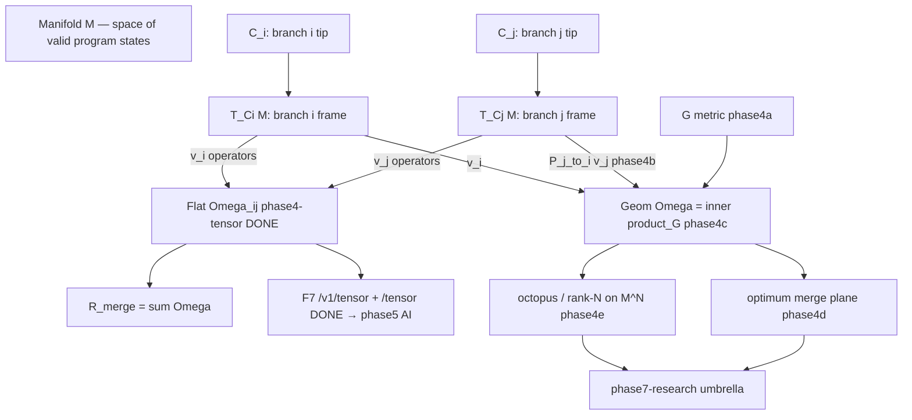

# Manifolds, Tangent Vectors, and the Conflict Tensor Ω_{ij}

A teaching guide that builds from differential-geometry basics (MIT 18.994, Ch. 16) up to GDSS's conflict tensor, grounded in this codebase.

**Status (living):** Flat rank-2 Ω is **done** (`phase4-tensor`). Product surface is **done** (`GET /v1/tensor` + `frontend-conflict-tensor` / `/tensor`). Geometric pieces (metric `G`, transport `P`, geometric Ω, geodesic merge plane, rank-N / octopus on `M^N`) are **queued** as `phase4a`–`phase4e` in [`harness/state/feature_list.json`](../harness/state/feature_list.json). Product intent: [`PRODUCT_INTENT.md`](PRODUCT_INTENT.md). Gaps: [`IMPLEMENTATION_GAP.md`](IMPLEMENTATION_GAP.md).

---

## 0. The one-paragraph answer

`Ω_{ij}` is a **rank-2 tensor** (an N×N matrix) indexed by **branch**. With `N` local branches, `Ω` is `N×N`: `Ω_{ij}` measures how much branch `i` and branch `j` interfere. The diagonal `Ω_{ii}` is a branch's self-energy (its drift from the attractor); off-diagonals are pairwise interference. There is **one** manifold `M` (the space of all valid program states); each branch is a **trajectory** `γ_i(t)` *on* `M`, not a manifold of its own. What each branch *does* have is its own **tangent space** `T_{C_i}M` at its tip — a local coordinate frame. Comparing two branches geometrically therefore requires **parallel transport** `P_{j→i}` to move branch `j`'s tangent vector into branch `i`'s frame before taking the inner product under a **Riemannian metric** `G`.

**What ships today:** the **flat** rank-2 Ω (pairwise marginal) — overlap weights + commutativity interference + drift on the diagonal — via [`gdss/conflict/tensor.py`](../gdss/conflict/tensor.py), `gdss tensor`, `GET /v1/tensor`, and the `/tensor` heatmap. **What is still missing:** `G`, `P_{j→i}`, geometric `⟨v_i, P(v_j)⟩_G`, geodesic optimum plane, and the full rank-N / octopus object on `M^N` (phases `4a`–`4e`).

---

## 1. What is a manifold, in plain terms

### 1.1 The textbook definition

From MIT 18.994, Chapter 16, Definition 16.1.1:

> An **n-manifold** `M` is a Hausdorff space, each point of which has a neighborhood homeomorphic to a domain in `R^n`.

Unpacked: a manifold is a space that *globally* can be curved, complicated, or have holes, but *locally* — around every point — looks flat, like a piece of `R^n`. A sphere `S^2` is the classic example: globally it is round and closed, but zoom in on any point and it looks like a flat disk (a piece of `R^2`).

### 1.2 The GDSS translation

In GDSS the manifold is **the space of all valid program states**:

| Geometry | GDSS |
|----------|------|
| Manifold `M` | Space of all valid repository states |
| A point `C ∈ M` | One specific repository state (a commit) |
| A curve `γ(t)` on `M` | A branch evolving over time |
| Tangent vector `dC ∈ T_C M` | A commit / a transformation `T_i: C → C'` |
| Reference/attractor trajectory | The `dev` (or configured reference) branch |
| Geodesic | The "shortest" / lowest-risk merge path |

This mapping is not decoration — it is stated in [`AGENTS.md`](../AGENTS.md) and the [glossary rule](../.cursor/rules/20-math-domain-glossary.mdc):

> Repository state = point on a semantic manifold `M`. Branch = trajectory `γ_i(t)` on `M`. Commit = tangent vector / transformation `dC`. Merge conflict = non-commutativity `[T_i, T_j] ≠ 0`.

### 1.3 Codebase instance

A concrete point on `M` is the set of parsed symbols at a commit. In code, a "point" is materialized by [`build_code_graph_from_repo`](../gdss/graph/graph_builder.py) → a [`CodeGraph`](../gdss/graph/code_graph.py) (nodes = symbols, edges = defines/calls/imports). Two different commits give two different graphs, i.e. two different points on `M`.

---

## 2. Charts, tangent spaces, and why "each branch has its own manifold" is almost right

### 2.1 Atlases and charts (Def 16.1.2)

An **atlas** for `M` is a collection of charts `(U_α, V_α, φ_α)` where `U_α ⊂ R^n`, `V_α ⊂ M` is open, and `φ_α: U_α → V_α` is a homeomorphism, with `∪_α V_α = M`. Each chart gives **local coordinates** on a patch of the manifold.

The key insight: a *single* global coordinate system may not exist (you cannot flatten a whole sphere into one disk without singularities). You need *many* charts. The transition maps `φ_α^{-1} ∘ φ_β` tell you how to convert coordinates between overlapping patches.

### 2.2 Tangent spaces

At each point `C ∈ M` there is a **tangent space** `T_C M` — the vector space of all "directions you can move from `C`." For an n-manifold, `T_C M ≅ R^n`, but it is attached to the *point* `C`. A tangent vector is the formal derivative of a curve through `C`.

This is the crux of your intuition. **There is one manifold `M`.** But each point `C` carries its *own copy* of `R^n` as its tangent space. So:

- Branch `i` sits at tip `C_i` and has tangent space `T_{C_i} M`.
- Branch `j` sits at tip `C_j` and has tangent space `T_{C_j} M`.
- These are **different vector spaces**, even though both are isomorphic to `R^n`.

A tangent vector in `T_{C_i} M` and one in `T_{C_j} M` **cannot be directly compared** — they live in different spaces. You cannot take their inner product until you move one into the other's frame. That movement is **parallel transport**.

### 2.3 The GDSS instance: each branch's "own frame"

Your feeling that "each branch has its own manifold" is the right instinct expressed slightly off. Each branch has its own **tangent space** (local frame) at its tip. In the codebase:

- A branch's tip state is its [`BranchTipVector`](../gdss/embeddings/types.py) — an L2-normalized mean of its symbol embeddings, a vector in `R^m`.
- A branch's tangent vectors are its [`SemanticOperator`](../gdss/core/transform_types.py) instances, extracted by [`extract_trajectory_operators`](../gdss/core/trajectory.py) along `merge_base(ref, HEAD)..HEAD`.

So per branch we have: a point (tip vector) + a list of tangent vectors (operators). Flat Ω compares operators by **discrete overlap + commutativity** without moving frames. Geometric Ω needs `P_{j→i}` first (`phase4b`).

---

## 3. The Riemannian metric and parallel transport

### 3.1 Riemannian metric (Def 16.5.1)

A **Riemannian metric** on `M` assigns to each point `C` an inner product `⟨·,·⟩_G` on `T_C M`, varying smoothly. In coordinates it is a positive-definite matrix `G_α` that transforms as `G_β = U^T G_α U` across charts (`U` = Jacobian of the transition map). The metric is what lets you measure **lengths** and **angles** of tangent vectors — and therefore **distances** along curves.

Without a metric, "distance between two branches" is not well-defined. You can only count diffs / use flat cosine.

**Queued as:** `phase4a-riemannian-metric` — pullback metric from embeddings `φ: M → R^m`,

$$
G_C(u, v) = (D\phi_C u)^T (D\phi_C v).
$$

### 3.2 Parallel transport (Def 16.3.2, 16.3.3)

A vector field `w` along a curve `α(t)` is **parallel** if `Dw/dt = 0` — the covariant derivative vanishes. **Parallel transport** `P_{γ}: T_{α(0)} M → T_{α(1)} M` moves a vector from one tangent space to another *along* `γ` while "keeping it as straight as the manifold allows."

This is exactly **semantic rebase** in GDSS vocabulary (glossary rule):

> Parallel transport `P_{j→i}` — semantic rebase: moving a transform into another branch's frame.

**Queued as:** `phase4b-parallel-transport` — re-extract branch `j`'s operators on top of branch `i`'s tip via sandbox; never auto-merge.

### 3.3 Geodesics (Def 16.3.4)

A **geodesic** is a curve whose tangent field is parallel to itself: `Dγ'/dt = 0`. On a sphere these are great circles; on a cylinder, helices (Example 9 in Ch. 16). Geodesics are the "straightest" curves on the manifold — the generalization of straight lines.

### 3.4 Hopf-Rinow (Theorem 16.4.6)

> If `M` is complete, any two points can be joined by a minimal geodesic.

This is the existence theorem that justifies "there is an optimal merge path." If the semantic manifold is complete (no missing states), then between any two branch states there exists a shortest, lowest-risk merge trajectory. **Finding** it is a search problem; **existence** is guaranteed by completeness. GDSS still **never auto-merges** — it may recommend an order.

**Queued as:** `phase4d-geodesic-merge` — minimize `R_merge` over merge orders in a sandbox.

### 3.5 The flat-chart approximation (what drift still uses)

Drift still measures tip distance with **flat cosine** in embedding space:

```python
# gdss/embeddings/branch_vector.py
def embedding_distance_to_attractor(branch_tip, attractor_tip) -> float:
    return float(cosine_distance(branch_tip, attractor_tip))
```

This treats `R^m` as a single global chart — no parallel transport, no per-point metric, no curvature. Fine for phase3 drift; geometric drift/Ω waits on `phase4a`+.

---

## 4. The conflict tensor Ω_{ij} — what `i` and `j` actually are

### 4.1 The indices are branch indices

`Ω` is a **rank-2 tensor**, i.e. a matrix. With `N` local branches, `Ω ∈ R^{N×N}`. The indices `i, j ∈ {1, …, N}` are **branch indices**. Three branches → a 3×3 matrix; ten branches → 10×10.

```
         branch_1  branch_2  branch_3
branch_1 [ Ω_11     Ω_12     Ω_13  ]
branch_2 [ Ω_21     Ω_22     Ω_23  ]
branch_3 [ Ω_31     Ω_32     Ω_33  ]
```

- **Diagonal `Ω_{ii}`** — branch `i` self-energy: drift magnitude from the attractor, passed in by the caller as `drift_magnitudes[branch]` ([`TensorEngine.compute`](../gdss/conflict/tensor.py); values from [`DriftSnapshot`](../gdss/drift/types.py)). Conflict layer **must not** import drift.
- **Off-diagonal `Ω_{ij}` (i ≠ j)** — pairwise interference: same file / function / symbol / dependency overlap + commutativity interference.

### 4.2 Why rank-2 *now* (settled)

- Merges people actually do are **pairwise**. `R_merge = Σ_{i,j} Ω_{ij}`.
- Manifold `M` is **fixed** — branches are trajectories on it, not dimensions of a bigger manifold.
- The **rank-N** tensor on configuration space `M^N` (N-way / “octopus” simultaneous merges) is the fuller object; **rank-2 is its pairwise marginal**. Build the marginal first (feasible, `O(N²)` sparse), defer full rank-N (exponential, mostly redundant for common workflows).

**Queued as:** `phase4e-config-tensor` — open research on rank-N; flat rank-2 remains the product default.

#### Pairwise merge chains vs octopus (N-way)

Two different merge *shapes* live in this math:

| Shape | What happens | Tensor object |
|-------|--------------|---------------|
| **Pairwise chain** | Merge `B₁` into attractor, then `B₂`, then … (or any order of 2-at-a-time merges) | Rank-2 `Ω_{ij}` — exactly what ships today |
| **Octopus / N-way** | Bring `N` tips into one simultaneous resolution (all branches “touch” at once) | Rank-N tensor on configuration space `M^N` |

Git’s everyday workflow is almost always a **chain of pairwise merges**. That is why flat `Ω_{ij}` is the right product object *now*: it scores every unordered pair and sums to `R_merge`, which is enough to rank “how dangerous is this multi-branch landscape if we keep merging two at a time.”

An **octopus merge** is the rarer simultaneous object: a point in `M^N` is an N-tuple of tips `(C_1, …, C_N)`; a rank-N conflict tensor would score joint interference among all of them at once. The pairwise matrix is the **marginal** of that object — every 2-slice of the N-way tensor. So:

- Implementing rank-2 first is not a simplification that throws octopus away; it is the **projection** you always need even after rank-N exists.
- Full rank-N is exponential in `N`, mostly redundant when teams merge sequentially, and open research (`phase4e`).
- Geodesic / optimum-plane work (`phase4d`) first asks: *which pairwise order minimizes accumulated `R_merge`?* That still lives in the rank-2 world. Octopus is “what if we refuse to factor into pairs.”

GDSS **never auto-merges** in either shape — it predicts risk and may recommend an order; humans (or an explicit accept path in later AI phases) still decide.

### 4.3 The two forms of Ω

**Flat form** (`phase4-tensor` — **implemented**):

$$
\Omega_{ij}^{\text{(flat)}} = w_f \cdot \mathbf{1}[\text{same file}] + w_\phi \cdot \mathbf{1}[\text{same function}] + w_\sigma \cdot \mathbf{1}[\text{same symbol}] + w_d \cdot \mathbf{1}[\text{dep overlap}] + w_c \cdot \frac{\text{interfering pairs}}{\text{contact pairs}}
$$

with vision-doc weights `w_f = 0.2, w_φ = 0.5, w_σ = 0.7, w_d = 0.4` and interference weight `w_c` in [`TensorEngine`](../gdss/conflict/tensor.py). Sparse: only store `ω > 0`. Commutativity skeleton: [`commutativity.py`](../gdss/conflict/commutativity.py) (`COMMUTE` / `INTERFERE` / `INDEPENDENT`). Surfaces: `gdss tensor`, `GET /v1/tensor`, UI `/tensor`.

**Geometric form** (`phase4c-geometric-tensor` — **pending**):

$$
\Omega_{ij}^{\text{(geom)}} = \big\langle v_i,\; P_{j \to i}(v_j) \big\rangle_G
$$

where:
- `v_i ∈ T_{C_i} M` is branch `i`'s tangent vector (aggregated transformation),
- `P_{j→i}: T_{C_j} M → T_{C_i} M` is parallel transport (semantic rebase),
- `⟨·,·⟩_G` is the Riemannian metric at `C_i`.

The geometric form reduces to the flat form **only when** the manifold is flat (single chart, identity metric, trivial transport). Flat Ω is the honest flat-space limit — not a fake geometric claim.

### 4.4 Merge risk

$$
R_{\text{merge}} = \sum_{i,j} \Omega_{ij}
$$

(vision doc L237-238). High `R_merge` ⇒ dangerous merge; recommend merge order or manual resolution. Printed by `gdss tensor` and shown on `/tensor` today (from the flat matrix). Never auto-merge.

### 4.5 Commutativity and Ω

The **commutator** of two transformations is:

$$
[T_i, T_j] = T_i T_j - T_j T_i
$$

- `[T_i, T_j] = 0` ⇒ order-independent ⇒ `Ω_{ij}` tends small (`COMMUTE` / no contact).
- `[T_i, T_j] ≠ 0` ⇒ order matters ⇒ `Ω_{ij}` tends large (`INTERFERE`).

So flat `Ω_{ij}` is a *magnitude of discrete non-commutativity / overlap* between branches `i` and `j`. The commutativity table is the discrete skeleton; the tensor is its continuous (still flat) refinement.

---

## 5. "Harnessing the dimensions" — the optimum plane of the manifold

### 5.1 What you are reaching for

Each repository state `C` is embedded as a vector `φ(C) ∈ R^m` (e.g. dim 384). The dimensions of `R^m` encode structure / symbols / call regions. A branch tip is `B_i = φ(C_i) ∈ R^m`.

The **manifold** `M` is *not* `R^m` itself — `R^m` is the ambient space. `M` is the submanifold of *valid* program states. The metric `G` is inherited from `R^m` but restricted to `M`, and generally **varies from point to point**.

### 5.2 The optimum plane

Given branches at tips `C_1, …, C_N` with tangent vectors `v_1, …, v_N`, the **optimum merge plane** is the geodesic submanifold through the attractor `C_dev` that minimizes total interference:

$$
\Pi^* = \arg\min_{\Pi \ni C_{\text{dev}}} \sum_{i \neq j} \big\langle v_i, P_{\Pi \to i}(v_j) \big\rangle_G
$$

Equivalently: find the merge **order** (a path on `M`) that parallel-transports each branch into the attractor's frame with minimum total `Ω`. By Hopf-Rinow, if `M` is complete, such a minimal geodesic exists.

**Queued as:** `phase4d-geodesic-merge` (after geometric Ω). Distinct from `phase5-ai` (assistive suggestions) — geodesic search is geometry; AI may help propose orders but never silently merges.

### 5.3 Why this matters

Without metric and transport, "optimum" is undefined — you only have flat `R_merge`. With them, "optimum" becomes a **variational problem on a manifold**. That is the research ladder `4a → 4b → 4c → 4d` (+ optional `4e`).

---

## 6. What is present vs missing (honest gap list)

### 6.1 Concept matrix

| Concept | Geometry | GDSS status | Feature / file |
|--------|---------|-------------|----------------|
| Manifold `M` | Space of valid states | Implicit via graph + embeddings | [`embeddings/`](../gdss/embeddings/), [`graph/`](../gdss/graph/) |
| Point `C ∈ M` | A commit / repo state | `CodeGraph`, `BranchTipVector` | [`code_graph.py`](../gdss/graph/code_graph.py) |
| Tangent vector `dC` | A transformation | `SemanticOperator` | [`transform_types.py`](../gdss/core/transform_types.py) |
| Trajectory `γ_i(t)` | A branch over time | `extract_trajectory_operators` | [`trajectory.py`](../gdss/core/trajectory.py) |
| Attractor | `dev` reference | `reference_branch` | drift + CLI |
| Drift `I(B_i)` | Divergence from attractor | **Done** (tip + trajectory integral) | `phase3-drift` |
| Flat conflict tensor `Ω_{ij}` | N×N pairwise marginal | **Done** — sparse + `R_merge` + `gdss tensor` | `phase4-tensor` → [`tensor.py`](../gdss/conflict/tensor.py) |
| Commutator / table | Discrete `[T_i,T_j]` | **Done** | [`commutativity.py`](../gdss/conflict/commutativity.py) |
| Heuristic Conflict P | Flat vs-ref score | **Done** (still used by `gdss drift` / dashboard) | [`probability.py`](../gdss/conflict/probability.py) |
| HTTP + UI for flat Ω | Product surface | **Done** | `GET /v1/tensor` + `frontend-conflict-tensor` (`/tensor`) |
| **Riemannian metric `G`** | Inner product per point | **Pending** — flat cosine only | `phase4a-riemannian-metric` |
| **Parallel transport `P_{j→i}`** | Semantic rebase | **Pending** | `phase4b-parallel-transport` |
| **Geometric `Ω_{ij}`** | `⟨v_i, P(v_j)⟩_G` | **Pending** | `phase4c-geometric-tensor` |
| **Geodesic / optimum plane** | Minimize `R_merge` over orders | **Pending** | `phase4d-geodesic-merge` |
| **Rank-N / octopus on `M^N`** | N-way simultaneous | **Pending** (research) | `phase4e-config-tensor` |
| Geometry umbrella | Experimental refinements | **Pending** | `phase7-research` (deps: 4d + 4e) |

### 6.2 Current integration vs geometric ladder

**Integrated today (flat pairwise world):**

- Engine: [`TensorEngine`](../gdss/conflict/tensor.py) + [`commutativity_table`](../gdss/conflict/commutativity.py)
- CLI: `gdss tensor` (composition: drift magnitudes + trajectory ops → sparse Ω → `R_merge`)
- API: `GET /v1/tensor?ref=` — same composition; `form: "flat"`; single-attractor → 200 + warning
- UI: `/tensor` heatmap, cell reasons, commutativity filter, `R_merge` card (deterministic / “not geometric”)
- Honesty: dashboard Conflict Risk stays the **heuristic** Conflict P and links to `/tensor` for real Ω

**Still missing from integration (plan Part B — geometry / octopus):**

1. **Metric `G`** — no pullback from embeddings; tip distance still flat cosine
2. **Transport `P_{j→i}`** — no sandbox semantic rebase of operators into another tip’s frame
3. **Geometric Ω** — UI/API never claim `⟨v, P(v)⟩_G`; only flat overlap + interference
4. **Geodesic merge plane** — no search over merge orders that minimizes `R_merge`
5. **Octopus / rank-N** — no `M^N` tensor; multi-branch risk is still “sum of pairs”
6. **Daemon `"conflict"` events** — out of scope for flat + F7; not wired
7. **Similar → Ω deep-link** — embedding Part B bridge not built

Flat Ω productized ≠ geometric merge intelligence. Do not treat `/tensor` as proof of Riemannian structure.

---

## 7. The path forward — feature IDs that match the math

### 7.1 Done: flat rank-2 Ω (`phase4-tensor`)

Discrete, deterministic, no metric, no transport, full branch×branch sparse matrix:

$$
\Omega_{ij}^{\text{(phase4)}} = w_f \cdot \mathbb{1}_{ij}^{\text{file}} + w_\phi \cdot \mathbb{1}_{ij}^{\text{func}} + w_\sigma \cdot \mathbb{1}_{ij}^{\text{sym}} + w_d \cdot \mathbb{1}_{ij}^{\text{dep}} + w_c \cdot \frac{\text{interfering}}{\text{contact}}
$$

Lives in `gdss/conflict/` (layer 7). Does **not** import `gdss.drift` or `gdss.embeddings`. Drift magnitudes for the diagonal are caller-supplied. Plan history: [`.cursor/plans/phase4_conflict_tensor_89938ae8.plan.md`](../.cursor/plans/phase4_conflict_tensor_89938ae8.plan.md); reframing: [`.cursor/plans/phase4_flat_tensor_+_geometric_phases_ddef528d.plan.md`](../.cursor/plans/phase4_flat_tensor_+_geometric_phases_ddef528d.plan.md).

### 7.2 Geometric ladder (queued)

| Phase id | Phase # | Builds | Depends on |
|----------|---------|--------|------------|
| `phase4a-riemannian-metric` | 1.9a | Pullback metric `G` from `φ` | `phase4-tensor` |
| `phase4b-parallel-transport` | 1.9b | `P_{j→i}` semantic rebase (sandbox) | `phase4a` |
| `phase4c-geometric-tensor` | 1.9c | `Ω_{ij} = ⟨v_i, P_{j→i}(v_j)⟩_G` | `phase4a`, `phase4b` |
| `phase4d-geodesic-merge` | 1.9d | Minimize `R_merge` over merge orders | `phase4c` |
| `phase4e-config-tensor` | 1.9e | Rank-N tensor on `M^N`; rank-2 = marginal | `phase4c` |
| `phase7-research` | 1.10 | Umbrella for experimental refinements | `phase4d`, `phase4e` |

Queue order in `feature_list.json`: product path (`phase5` → `phase6` → `sp1`) comes **before** this geometry ladder so agents do not treat `4a` as the immediate next feature after flat Ω.

### 7.3 Product path (orthogonal to geometry research)

North Star does not require waiting on `4a`–`4e` to surface merge risk:

1. **`GET /v1/tensor` + `frontend-conflict-tensor` (F7)** — **done** (flat Ω / `R_merge` in the UI).
2. **`phase5-ai`** — next product default; assistive suggestions; never auto-merge (can use flat Ω as context).
3. **`phase6-validation`** — evidence suggestions pass checks; still not a proof of correctness.

### 7.4 Honest ordering

```
Flat Ω (done)  →  F7 UI (done)  →  phase5-ai → phase6 → sp1
                ↘
                  G (4a) → P (4b) → geometric Ω (4c) → geodesic (4d)
                                              ↘ octopus / rank-N (4e) → phase7 umbrella
```

Trying to build geometric Ω before flat Ω was wrong; that surface now exists and is productized. Building `G`/`P` / octopus before `phase5-ai` is optional research, not a product blocker.

---

## 8. Summary, in one diagram



---

*Flat Ω: `gdss tensor`, `GET /v1/tensor`, UI `/tensor`. Geometric / octopus ladder: `feature_list.json` ids `phase4a`–`phase4e`. Math source for those phases: this document. Plan: [`.cursor/plans/phase4_flat_tensor_+_geometric_phases_ddef528d.plan.md`](../.cursor/plans/phase4_flat_tensor_+_geometric_phases_ddef528d.plan.md).*
