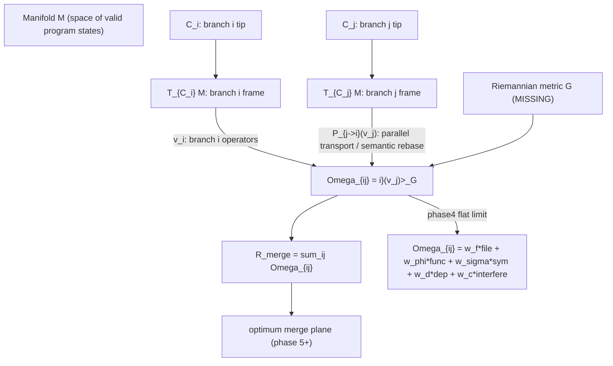

# Manifolds, Tangent Vectors, and the Conflict Tensor Ω_{ij}

A teaching guide that builds from differential-geometry basics (MIT 18.994, Ch. 16) up to GDSS's conflict tensor, grounded in this codebase. The goal: clarify what `i` and `j` are in `Ω_{ij}`, whether each branch has "its own manifold," and what is mathematically missing before phase4 can be honest.

---

## 0. The one-paragraph answer

`Ω_{ij}` is a **rank-2 tensor** (an N×N matrix) indexed by **branch**. With `N` local branches, `Ω` is `N×N`: `Ω_{ij}` measures how much branch `i` and branch `j` interfere. The diagonal `Ω_{ii}` is a branch's self-energy (its drift from the attractor); off-diagonals are pairwise interference. There is **one** manifold `M` (the space of all valid program states); each branch is a **trajectory** `γ_i(t)` *on* `M`, not a manifold of its own. What each branch *does* have is its own **tangent space** `T_{C_i}M` at its tip — a local coordinate frame. Comparing two branches therefore requires **parallel transport** `P_{j→i}` to move branch `j`'s tangent vector into branch `i`'s frame before taking the inner product. That geometric step is what the current code skips, and it is the missing piece.

---

## 1. What is a manifold, in plain terms

### 1.1 The textbook definition

From MIT 18.994, Chapter 16, Definition 16.1.1:

> An **n-manifold** `M` is a Hausdorff space, each point of which has a neighborhood homeomorphic to a domain in `R^n`.

Unpacked: a manifold is a space that *globally* can be curved, complicated, or have holes, but *locally* — around every point — looks flat, like a piece of `R^n`. A sphere `S^2` is the classic example: globally it is round and closed, but zoom in on any point and it looks like a flat disk (a piece of `R^2`).

### 1.2 The GDSS translation

In GDSS the manifold is **the space of all valid program states**:

| Geometry | GDSS |
|----------|------|
| Manifold `M` | Space of all valid repository states |
| A point `C ∈ M` | One specific repository state (a commit) |
| A curve `γ(t)` on `M` | A branch evolving over time |
| Tangent vector `dC ∈ T_C M` | A commit / a transformation `T_i: C → C'` |
| Reference/attractor trajectory | The `dev` (or configured reference) branch |
| Geodesic | The "shortest" / lowest-risk merge path |

This mapping is not decoration — it is stated in [`AGENTS.md`](../AGENTS.md) and the [glossary rule](../.cursor/rules/20-math-domain-glossary.mdc):

> Repository state = point on a semantic manifold `M`. Branch = trajectory `γ_i(t)` on `M`. Commit = tangent vector / transformation `dC`. Merge conflict = non-commutativity `[T_i, T_j] ≠ 0`.

### 1.3 Codebase instance

A concrete point on `M` is the set of parsed symbols at a commit. In code, a "point" is materialized by [`build_code_graph_from_repo`](../gdss/graph/graph_builder.py) → a [`CodeGraph`](../gdss/graph/code_graph.py) (nodes = symbols, edges = defines/calls/imports). Two different commits give two different graphs, i.e. two different points on `M`.

---

## 2. Charts, tangent spaces, and why "each branch has its own manifold" is almost right

### 2.1 Atlases and charts (Def 16.1.2)

An **atlas** for `M` is a collection of charts `(U_α, V_α, φ_α)` where `U_α ⊂ R^n`, `V_α ⊂ M` is open, and `φ_α: U_α → V_α` is a homeomorphism, with `∪_α V_α = M`. Each chart gives **local coordinates** on a patch of the manifold.

The key insight: a *single* global coordinate system may not exist (you cannot flatten a whole sphere into one disk without singularities). You need *many* charts. The transition maps `φ_α^{-1} ∘ φ_β` tell you how to convert coordinates between overlapping patches.

### 2.2 Tangent spaces

At each point `C ∈ M` there is a **tangent space** `T_C M` — the vector space of all "directions you can move from `C`." For an n-manifold, `T_C M ≅ R^n`, but it is attached to the *point* `C`. A tangent vector is the formal derivative of a curve through `C`.

This is the crux of your intuition. **There is one manifold `M`.** But each point `C` carries its *own copy* of `R^n` as its tangent space. So:

- Branch `i` sits at tip `C_i` and has tangent space `T_{C_i} M`.
- Branch `j` sits at tip `C_j` and has tangent space `T_{C_j} M`.
- These are **different vector spaces**, even though both are isomorphic to `R^n`.

A tangent vector in `T_{C_i} M` and one in `T_{C_j} M` **cannot be directly compared** — they live in different spaces. You cannot take their inner product until you move one into the other's frame. That movement is **parallel transport**.

### 2.3 The GDSS instance: each branch's "own frame"

Your feeling that "each branch has its own manifold" is the right instinct expressed slightly off. Each branch has its own **tangent space** (local frame) at its tip. In the codebase:

- A branch's tip state is its [`BranchTipVector`](../gdss/embeddings/types.py) — an L2-normalized mean of its symbol embeddings, a vector in `R^m`.
- A branch's tangent vectors are its [`SemanticOperator`](../gdss/core/transform_types.py) instances, extracted by [`extract_trajectory_operators`](../gdss/core/trajectory.py) along `merge_base(ref, HEAD)..HEAD`.

So per branch we have: a point (tip vector) + a list of tangent vectors (operators). What we do **not** yet have is the machinery to compare a tangent vector of branch `i` with a tangent vector of branch `j` *geometrically* — that is the gap.

---

## 3. The Riemannian metric and parallel transport

### 3.1 Riemannian metric (Def 16.5.1)

A **Riemannian metric** on `M` assigns to each point `C` an inner product `⟨·,·⟩_G` on `T_C M`, varying smoothly. In coordinates it is a positive-definite matrix `G_α` that transforms as `G_β = U^T G_α U` across charts (`U` = Jacobian of the transition map). The metric is what lets you measure **lengths** and **angles** of tangent vectors — and therefore **distances** along curves.

Without a metric, "distance between two branches" is not well-defined. You can only count diffs.

### 3.2 Parallel transport (Def 16.3.2, 16.3.3)

A vector field `w` along a curve `α(t)` is **parallel** if `Dw/dt = 0` — the covariant derivative vanishes. **Parallel transport** `P_{γ}: T_{α(0)} M → T_{α(1)} M` moves a vector from one tangent space to another *along* `γ` while "keeping it as straight as the manifold allows."

This is exactly **semantic rebase** in GDSS vocabulary (glossary rule):

> Parallel transport `P_{j→i}` — semantic rebase: moving a transform into another branch's frame.

### 3.3 Geodesics (Def 16.3.4)

A **geodesic** is a curve whose tangent field is parallel to itself: `Dγ'/dt = 0`. On a sphere these are great circles; on a cylinder, helices (Example 9 in Ch. 16). Geodesics are the "straightest" curves on the manifold — the generalization of straight lines.

### 3.4 Hopf-Rinow (Theorem 16.4.6)

> If `M` is complete, any two points can be joined by a minimal geodesic.

This is the existence theorem that justifies "there is an optimal merge path." If the semantic manifold is complete (no missing states), then between any two branch states there exists a shortest, lowest-risk merge trajectory. **Finding** it is the merge-simulation problem (phase 5); **existing** it is guaranteed by completeness.

### 3.5 The GDSS gap, precisely

The current code measures distance with **flat cosine** in embedding space:

```python
# gdss/embeddings/branch_vector.py
def embedding_distance_to_attractor(branch_tip, attractor_tip) -> float:
    return float(cosine_distance(branch_tip, attractor_tip))
```

This treats `R^m` as the manifold with the standard Euclidean/cosine metric. It is a **single global chart** — no parallel transport, no per-point metric, no curvature. That is fine as a first approximation but it means:

1. There is no `P_{j→i}` — we cannot geometrically move branch `j`'s operators into branch `i`'s frame.
2. The "distance" is symmetric and frame-independent only because we collapsed everything into one flat chart.
3. There is no notion of geodesic, hence no "optimum plane of manifold" / optimal merge path yet.

---

## 4. The conflict tensor Ω_{ij} — what `i` and `j` actually are

### 4.1 The indices are branch indices

`Ω` is a **rank-2 tensor**, i.e. a matrix. With `N` local branches, `Ω ∈ R^{N×N}`. The indices `i, j ∈ {1, …, N}` are **branch indices**. So yes: the number of branches defines the dimension of the tensor. Three branches → a 3×3 matrix; ten branches → 10×10.

```
         branch_1  branch_2  branch_3
branch_1 [ Ω_11     Ω_12     Ω_13  ]
branch_2 [ Ω_21     Ω_22     Ω_23  ]
branch_3 [ Ω_31     Ω_32     Ω_33  ]
```

- **Diagonal `Ω_{ii}`** — branch `i` against itself: its self-energy, i.e. how far it has drifted from the attractor `dev`. In the codebase this is `DriftSnapshot.magnitude.magnitude` ([`gdss/drift/types.py`](../gdss/drift/types.py)).
- **Off-diagonal `Ω_{ij}` (i ≠ j)** — pairwise interference between branch `i` and branch `j`: do their transformations collide on the same files, symbols, dependencies?

### 4.2 The two forms of Ω

**Heuristic form** (vision doc L1171-1184, what phase4 will build first):

$$
\Omega_{ij} = w_f \cdot \mathbf{1}[\text{same file}] + w_\phi \cdot \mathbf{1}[\text{same function}] + w_\sigma \cdot \mathbf{1}[\text{same symbol}] + w_d \cdot \text{dep overlap}
$$

with `w_f = 0.2, w_φ = 0.5, w_σ = 0.7, w_d = 0.4`. This is a weighted sum of overlap indicators — flat, no geometry.

**Geometric form** (vision doc L1881, the goal):

$$
\Omega_{ij} = \big\langle v_i,\; P_{j \to i}(v_j) \big\rangle_G
$$

where:
- `v_i ∈ T_{C_i} M` is branch `i`'s tangent vector (its aggregated transformation),
- `P_{j→i}: T_{C_j} M → T_{C_i} M` is parallel transport (semantic rebase) of branch `j`'s vector into branch `i`'s frame,
- `⟨·,·⟩_G` is the Riemannian metric at `C_i`.

The geometric form reduces to the heuristic form **only when** the manifold is flat (single chart, identity metric, trivial transport). The heuristic is the flat-space limit of the geometric truth.

### 4.3 Merge risk

$$
R_{\text{merge}} = \sum_{i,j} \Omega_{ij}
$$

(vision doc L237-238). High `R_merge` ⇒ dangerous merge; recommend merge order or manual resolution. This is the scalar the CLI should print after `gdss tensor`.

### 4.4 Commutativity and Ω

The **commutator** of two transformations is:

$$
[T_i, T_j] = T_i T_j - T_j T_i
$$

- `[T_i, T_j] = 0` ⇒ order-independent ⇒ safe auto-merge ⇒ `Ω_{ij}` is small.
- `[T_i, T_j] ≠ 0` ⇒ order matters ⇒ interference ⇒ `Ω_{ij}` is large.

So `Ω_{ij}` is the *magnitude* of non-commutativity between branches `i` and `j`. The commutativity table (Rename×Delete = X, etc., vision doc L1109-1113) is the **discrete skeleton** of `Ω`; the tensor is its continuous refinement.

---

## 5. "Harnessing the dimensions" — the optimum plane of the manifold

### 5.1 What you are reaching for

You asked: should we harness the dimensions to find the conflict tensor and produce the optimum plane of the manifold? Yes — and here is the precise formulation.

Each repository state `C` is embedded as a vector `φ(C) ∈ R^m` (in GDSS, `m` = embedding dim, e.g. 384 for CodeBERT-style). The dimensions of `R^m` encode: AST structure, dependencies, symbols, call graph, semantic regions (vision doc L1888-1894). A branch tip is `B_i = φ(C_i) ∈ R^m`.

The **manifold** `M` is *not* `R^m` itself — `R^m` is the ambient space. `M` is the submanifold of `R^m` consisting of *valid* program states (most random vectors in `R^m` are not valid programs). The metric `G` is inherited from `R^m` but restricted to `M`, and generally **varies from point to point** because the "valid program" constraint curves the submanifold.

### 5.2 The optimum plane

Given branches at tips `C_1, …, C_N` with tangent vectors `v_1, …, v_N`, the **optimum merge plane** is the geodesic submanifold through the attractor `C_dev` that minimizes total interference:

$$
\Pi^* = \arg\min_{\Pi \ni C_{\text{dev}}} \sum_{i \neq j} \big\langle v_i, P_{\Pi \to i}(v_j) \big\rangle_G
$$

Equivalently: find the merge **order** (a path on `M`) that parallel-transports each branch into the attractor's frame with minimum total `Ω`. By Hopf-Rinow, if `M` is complete, such a minimal geodesic exists. **Computing** it is the merge-simulation problem (phase 5): apply `T_i T_j` vs `T_j T_i` in a sandbox, measure AST divergence, pick the order with least non-commutativity.

### 5.3 Why this matters and what it changes

Without the metric and transport, "optimum" is undefined — you can only rank heuristically. With them, "optimum" becomes a **variational problem on a manifold**: minimize `R_merge` over merge orders. That is the genuinely new direction the project is pointing at but has not yet built.

---

## 6. What is missing in GDSS today (the honest gap list)

| Concept | Geometry | GDSS status | File |
|--------|---------|-------------|------|
| Manifold `M` | Space of valid states | Implicit via embeddings | [`embeddings/`](../gdss/embeddings/) |
| Point `C ∈ M` | A commit / repo state | `CodeGraph`, `BranchTipVector` | [`graph/code_graph.py`](../gdss/graph/code_graph.py) |
| Tangent vector `dC` | A transformation | `SemanticOperator` | [`core/transform_types.py`](../gdss/core/transform_types.py) |
| Trajectory `γ_i(t)` | A branch over time | `extract_trajectory_operators` | [`core/trajectory.py`](../gdss/core/trajectory.py) |
| Attractor | `dev` reference | `reference_branch` everywhere | drift/conflict code |
| **Riemannian metric `G`** | Inner product per point | **Missing** — flat cosine only | [`embeddings/similarity.py`](../gdss/embeddings/similarity.py) |
| **Parallel transport `P_{j→i}`** | Semantic rebase | **Missing** — no frame conversion | not implemented |
| **Commutator `[T_i, T_j]`** | Non-commutativity | Partial — `_operator_interference` heuristic | [`conflict/probability.py`](../gdss/conflict/probability.py) |
| **Conflict tensor `Ω_{ij}`** | N×N interference matrix | **Missing** — only pairwise vs ref | [`conflict/`](../gdss/conflict/) |
| **Geodesic / optimum plane** | Minimal merge path | **Missing** — phase 5 (merge sim) | not implemented |
| `R_merge = Σ Ω_{ij}` | Total merge risk | **Missing** | not implemented |

The current [`ConflictProbabilityEstimator`](../gdss/conflict/probability.py) is a **flat heuristic**: weighted sum of overlap booleans, branch-vs-reference only, no branch×branch matrix, no metric, no transport. It is the `R^m`-flat limit of the geometric `Ω`.

---

## 7. The path forward — how phase4 fits and what comes after

### 7.1 Phase 4 (now): the deterministic skeleton of Ω

Phase4 builds the **discrete, deterministic** conflict tensor — no metric, no transport, but a real N×N matrix instead of pairwise-vs-ref:

$$
\Omega_{ij}^{\text{(phase4)}} = w_f \cdot \mathbb{1}_{ij}^{\text{file}} + w_\phi \cdot \mathbb{1}_{ij}^{\text{func}} + w_\sigma \cdot \mathbb{1}_{ij}^{\text{sym}} + w_d \cdot |\text{impact}_i \cap \text{impact}_j| + w_c \cdot \frac{\text{interfering pairs}}{\text{contact pairs}}
$$

This is the **flat-space** `Ω` — honest about being a heuristic, but now a full matrix with `R_merge` and a commutativity table. It lives in `gdss/conflict/` (layer 7), does **not** import `gdss/drift` (layer 8); drift magnitudes are passed in by the caller as `dict[str, float]` for the diagonal. This matches the existing `ConflictProbabilityEstimator` pattern and the architecture rule.

### 7.2 Phase 5+: the geometric Ω

To move from the flat heuristic to the geometric form `Ω_{ij} = ⟨v_i, P_{j→i}(v_j)⟩_G`, three things must be built (later phases):

1. **A Riemannian metric `G` on `M`.** Not flat cosine. One honest option: a **pullback metric** from the embedding map `φ: M → R^m`, i.e. `G_C(u, v) = (Dφ_C u)^T (Dφ_C v)` — the metric inherited from the ambient embedding space. This makes `G` vary per point and respects the submanifold structure.

2. **Parallel transport `P_{j→i}` (semantic rebase).** Concretely: re-extract branch `j`'s operators *as if applied on top of branch `i`'s tip*, then compare. This is the geometric version of `git rebase i j` followed by operator extraction. It is expensive (a sandbox per pair) — which is exactly why merge simulation (phase 5) is its own phase.

3. **Geodesic search (optimum plane).** Over merge orders, minimize `R_merge`. By Hopf-Rinow a minimum exists on a complete `M`; the search is the merge-simulation sandbox. This is the "optimum plane of the manifold" you are reaching for.

### 7.3 The honest ordering

Phase4 = flat `Ω` matrix + commutativity table + `R_merge` (deterministic, no drift import).
Phase5 = parallel transport via merge simulation → geometric `Ω`.
Phase6+ = geodesic search → optimum merge plane.

Trying to build the geometric `Ω` before the flat one is like trying to define curvature before you have a surface. Phase4 is the surface; the metric and transport come after.

---

## 8. Summary, in one diagram



The flat `Ω` (phase4) is what we build now. The geometric `Ω` (with `G` and `P`) is the direction the math points to and the project is missing. That is the gap, and that is where this goes.

---

*Next: implement phase4 (the flat conflict tensor) following the plan in `.cursor/plans/phase4_conflict_tensor_89938ae8.plan.md`.*
