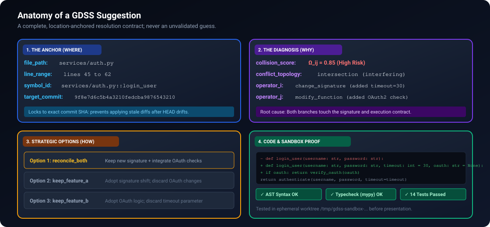
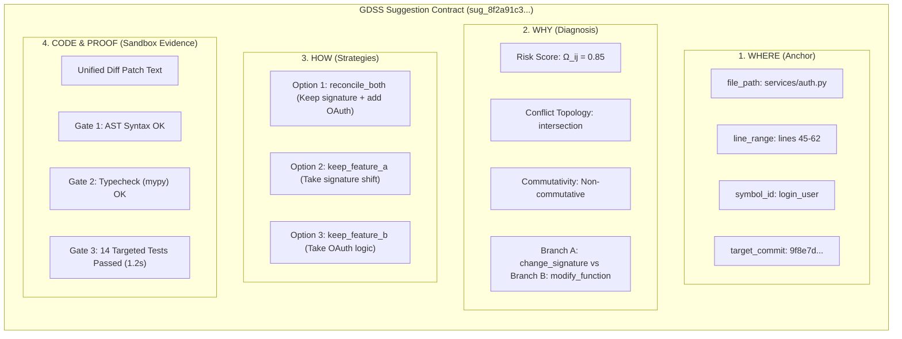
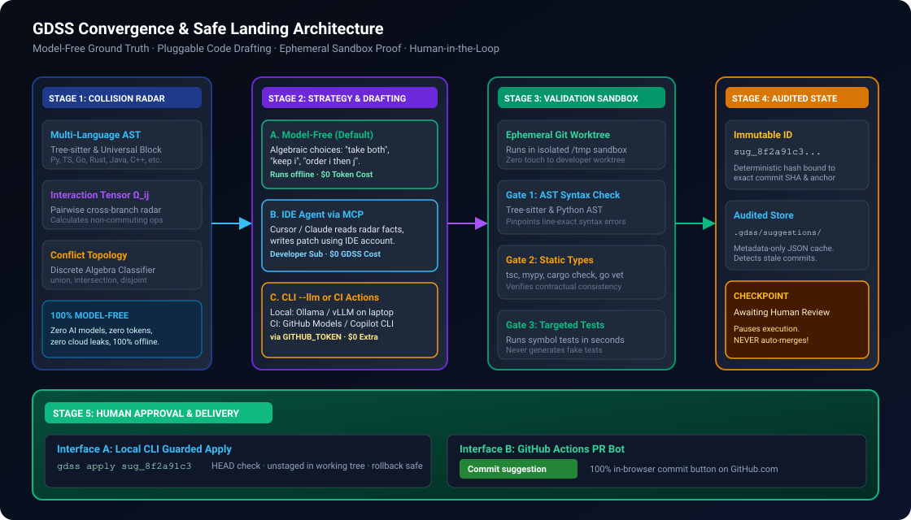
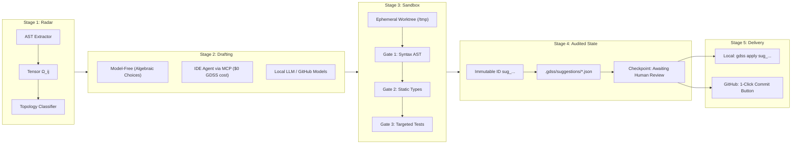

# GDSS Convergence & Suggestion Guide

> **A Complete Reference on What GDSS Suggests, How the Convergence Engine Operates, and Why It Is 100% Model-Free by Default.**

---

## 📑 Table of Contents

- [The Core Philosophy: Model-Free by Default](#-the-core-philosophy-model-free-by-default)
- [What Does the Suggester Actually Suggest?](#-what-does-the-suggester-actually-suggest)
  - [The 4 Dimensions of a Suggestion](#the-4-dimensions-of-a-suggestion)
  - [Suggestion Anatomy Diagram](#suggestion-anatomy-diagram)
- [The End-to-End Convergence Lifecycle](#-the-end-to-end-convergence-lifecycle)
  - [Convergence Lifecycle Diagram](#convergence-lifecycle-diagram)
  - [Stage 1: Collision Radar & Conflict Topology (Deterministic)](#stage-1-collision-radar--conflict-topology-deterministic)
  - [Stage 2: Strategy & Pluggable Drafting](#stage-2-strategy--pluggable-drafting)
  - [Stage 3: Ephemeral Sandbox Validation](#stage-3-ephemeral-sandbox-validation)
  - [Stage 4: Audited State & Immutable IDs (`sug_...`)](#stage-4-audited-state--immutable-ids-sug_)
  - [Stage 5: Human Approval & Safe Landing](#stage-5-human-approval--safe-landing)
- [The Two Delivery Interfaces](#-the-two-delivery-interfaces)
  - [Interface A: Local CLI Guarded Apply (`gdss apply`)](#interface-a-local-cli-guarded-apply-gdss-apply)
  - [Interface B: GitHub Actions 1-Click "Commit Suggestion" Button](#interface-b-github-actions-1-click-commit-suggestion-button)
- [Recent Implementations (Phase 5a & Phase 6)](#-recent-implementations-phase-5a--phase-6)
- [Zero Token Bleed & Security Invariants](#-zero-token-bleed--security-invariants)

---

## 💡 The Core Philosophy: Model-Free by Default

A common misconception about semantic merge tools is that an AI model is required "no matter what" to detect collisions and suggest resolutions.

In GDSS, **the core intelligence is 100% deterministic and model-free**:

```
┌────────────────────────────────────────────────────────────────────────┐
│                   DETERMINISTIC GROUND TRUTH (Default)                 │
│                                                                        │
│   • Multi-language AST Parsing (Tree-sitter + Universal Fallback)      │
│   • Pairwise Collision Radar (Interaction Tensor Ω_ij)                 │
│   • Commutativity & Non-Commutative Operator Classification            │
│   • Conflict Topology (union, intersection, disjoint, asymmetric)      │
│   • Strategic Options ("take both", "keep i", "order i then j")        │
│                                                                        │
│   ──► Runs in milliseconds offline · $0 Token Cost · Zero Cloud Leaks   │
└────────────────────────────────────────────────────────────────────────┘
                                    │
                                    ▼ (Optional)
┌────────────────────────────────────────────────────────────────────────┐
│                   PLUGGABLE CODE DRAFTING (Optional)                   │
│                                                                        │
│   An AI model is ONLY an optional typist used when a developer wants   │
│   code diff text synthesized automatically:                            │
│   • In Cursor / Claude Code: Developer's IDE subscription ($0 GDSS fee)│
│   • In Headless CLI: Offline Ollama / vLLM on localhost                │
│   • In GitHub Actions: GitHub Models / Copilot via GITHUB_TOKEN        │
└────────────────────────────────────────────────────────────────────────┘
```

1. **Deterministic Core:** All conflict detection, symbol anchors, commutativity equations, and resolution topologies are calculated from concrete AST trees and Git commit DAGs.
2. **Offline Resilience:** GDSS runs without an internet connection or GPU. It never crashes looking for third-party cloud credentials.
3. **Optional Typist:** When an AI model is invoked (`--llm` or an IDE agent), it strictly acts as a drafter to fill in replacement lines inside an approved symbol anchor.

---

## 🔍 What Does the Suggester Actually Suggest?

The suggester does **not** simply output a raw code diff. It outputs a **structured, location-anchored resolution contract** answering four essential developer questions:

### The 4 Dimensions of a Suggestion

1. **WHERE (The Anchor):**
   - Exact file path: `services/auth.py`
   - Exact line boundaries: `lines 45 to 62`
   - Exact AST symbol: `services/auth.py::login_user`
   - Target Commit SHA: `9f8e7d6c...` (locks the suggestion to an exact commit, preventing application against drifted code).
2. **WHY (The Diagnosis & Topology):**
   - Interaction Tensor Score: $\Omega_{ij} = 0.85$ (High Risk)
   - Left Branch Operation: `change_signature` (added `timeout: int = 30`)
   - Right Branch Operation: `modify_function` (added OAuth2 token verification)
   - Commutativity: `interfere` (non-commutative operations)
   - Topology Classification: `intersection` (both branches alter the execution contract of the same symbol).
3. **HOW (The Strategic Options):**
   GDSS derives algebraic options from the conflict topology:
   - **Option 1 (`reconcile_both`):** Preserve the new `timeout` parameter and integrate the OAuth2 verification block.
   - **Option 2 (`keep_left`):** Adopt the signature shift and discard the OAuth2 changes.
   - **Option 3 (`keep_right`):** Adopt the OAuth2 logic and discard the signature change.
4. **THE CODE & PROOF (Sandboxed Validation):**
   - The unified diff patch string.
   - **Ephemeral Sandbox Evidence:**
     - `✅ AST Syntax:` Verified via Tree-sitter / Python AST.
     - `✅ Static Types:` Verified via `mypy` / `tsc` / `cargo check`.
     - `✅ Regression Tests:` Verified via targeted test suite execution (`find_targeted_test_files`).

---

### Suggestion Anatomy Diagram

<p align="center">
  
</p>

<details>
<summary>📐 Mermaid source (click to expand)</summary>



</details>

---

## 🔄 The End-to-End Convergence Lifecycle

### Convergence Lifecycle Diagram

<p align="center">
  
</p>

<details>
<summary>🌀 Mermaid source (click to expand)</summary>



</details>

---

### Stage 1: Collision Radar & Conflict Topology (Deterministic)
- [`gdss/conflict/tensor.py`](../gdss/conflict/tensor.py) computes pairwise branch collision interaction $\Omega_{ij}$.
- [`gdss/ai/conflict_topology.py`](../gdss/ai/conflict_topology.py) classifies contact pairs into four topologies:
  - **Union:** Non-interfering changes that commute (can take both changes).
  - **Intersection:** Overlapping sub-blocks of the same symbol (requires reconciling code).
  - **Disjoint:** Non-commuting mutually exclusive operations (requires picking one branch).
  - **Asymmetric:** Order-sensitive operations (reordering $i \rightarrow j$ vs $j \rightarrow i$ yields different states).

### Stage 2: Strategy & Pluggable Drafting
- **Model-Free Mode (Default):** Generates strategy options using discrete algebraic templates (`enumerate_combinations`).
- **IDE Agent Mode (MCP):** IDE agents (Cursor, Claude Code) read the exact AST facts via MCP tools and generate code using the developer's chat subscription.
- **Headless Mode (`--llm` / CI):** Calls local Ollama/vLLM or GitHub Models via `GITHUB_TOKEN` to synthesize candidate diff hunks.

### Stage 3: Ephemeral Sandbox Validation
- [`gdss/validation/sandbox.py`](../gdss/validation/sandbox.py) checks out an isolated, temporary Git worktree in `/tmp/gdss-sandbox-...`.
- Tests the patch across three verification gates:
  1. `git apply --whitespace=fix` (validates hunk format and line drift).
  2. Multi-language AST syntax validator (detects syntax breaks).
  3. Static typechecker (`tsc`, `mypy`, `cargo check`, `go vet`).
  4. Targeted test runner (`run_targeted_tests` executing existing tests covering the symbol).
- **Non-Destructive:** Cleans up automatically; zero uncommitted files are written to the developer's repository.

### Stage 4: Audited State & Immutable IDs (`sug_...`)
- [`gdss/ai/suggestion_store.py`](../gdss/ai/suggestion_store.py) computes an immutable hash ID:
  $$\text{suggestion\_id} = \text{"sug\_"} + \text{sha256}(commit\_sha, file\_path, line\_start, line\_end, operator)[:20]$$
- Persists metadata to `.gdss/suggestions/<id>.json`.
- Halts at the `AWAITING_HUMAN_REVIEW` checkpoint. **GDSS never auto-merges or auto-commits.**

---

## 🚀 The Two Delivery Interfaces

Once a suggestion is validated and stored with its `sug_...` ID, it is delivered through two human-approved interfaces:

### Interface A: Local CLI Guarded Apply (`gdss apply`)
For developers working in a local terminal:
```bash
# 1. Inspect suggestions
gdss suggest --repo . --ref main

# Output shows: Suggestion 1: modify_function on services/auth.py (ID: sug_8f2a91c3)

# 2. Apply verified patch safely
gdss apply sug_8f2a91c3
```
- **Preflight Check:** Verifies current `HEAD` commit matches the suggestion's `target_commit`. If the developer has pulled new commits, GDSS warns with a clear WHAT/WHY/FIX error.
- **Unstaged Working Tree:** Places the patch in working files without staging or committing, allowing the developer to review with `git diff`.
- **Atomic Rollback:** Writes a rollback patch to `.gdss/rollback/` allowing instant undo via `gdss apply --abort`.

### Interface B: GitHub Actions 1-Click "Commit Suggestion" Button
For developers reviewing PRs on GitHub.com or mobile:
- When a PR is opened, the GitHub Action audits concurrent branches.
- If a collision occurs and validation passes, GDSS calls GitHub's Review Comments API with a native ````suggestion ```` block:
  ````markdown
  ### 🛡️ GDSS Convergence Radar: Verified Fix
  > **Validation:** ✅ AST Syntax OK | ✅ Mypy OK | ✅ 14 Tests Passed (1.2s)
  
  ```suggestion
  def login_user(username: str, password: str, timeout: int = 30, oauth_token: str | None = None):
      if oauth_token:
          return verify_oauth(oauth_token)
      return authenticate(username, password, timeout=timeout)
  ```
  ````
- GitHub's web interface renders the green **"Commit suggestion"** button.
- Clicking the button writes the verified commit to the PR branch directly in the web browser.

---

## 🛠 Recent Implementations (Phase 5a & Phase 6)

| Module | Location | Purpose |
| :--- | :--- | :--- |
| **Audited Suggestion Store** | [`gdss/ai/suggestion_store.py`](../gdss/ai/suggestion_store.py) | Generates `sug_<id>`, writes `.gdss/suggestions/`, and detects commit drift (`is_suggestion_stale`). |
| **Agent Orchestration** | [`gdss/ai/orchestration.py`](../gdss/ai/orchestration.py) | Coordinates `Analyze -> Draft -> Validate -> Checkpoint` with model-free defaults and optional LangGraph export. |
| **Validation Sandbox** | [`gdss/validation/sandbox.py`](../gdss/validation/sandbox.py) | Ephemeral Git worktree dry-run testing syntax, static types, and targeted regression tests. |
| **Multi-Language AST** | [`gdss/core/ast_parser.py`](../gdss/core/ast_parser.py) | 3-tier hierarchy: Tree-sitter specialized parsers (Py, TS, Go, Rust, Java, C/C++), Universal Node Walker, and Tier 3 Structural Fallback (Ruby, PHP, Shell, etc.). |
| **Repository Config** | [`.gdss.yml`](../CONTRIBUTING.md#️-repository-configuration-gdssyml) | Optional repository configuration for custom DSL extensions (`ast.additional_extensions`) and sandbox overrides (`validation.test_command`). |

---

## 🔐 Zero Token Bleed & Security Invariants

1. **Two-Brain Purity:** Deterministic modules (`core`, `graph`, `conflict`, `watcher`, `mcp`) never import probabilistic AI modules.
2. **Zero Proprietary API Billing:** GDSS does not host a token-billing proxy. IDE agents consume developer subscriptions; GitHub Actions runs on native repository entitlements.
3. **Zero Source Code Leaks:** In model-free and IDE MCP modes, zero private source code is sent to external cloud APIs.
4. **Never Auto-Merge:** GDSS calculates, diagnoses, and proves; humans always make the decision to land code.
