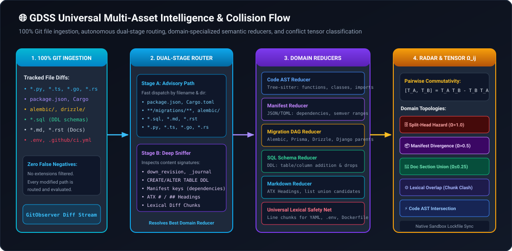
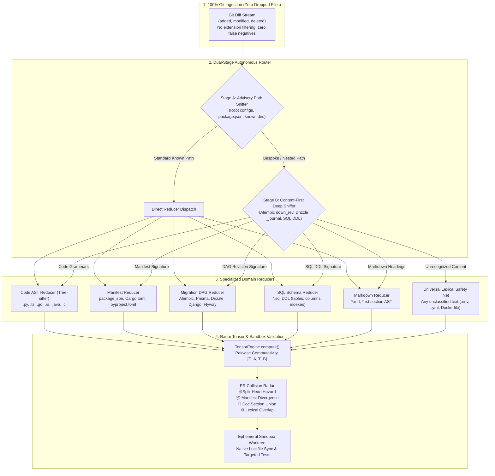

# Universal Multi-Asset Collision Engine & Domain Reducers

GDSS is designed to provide complete, deterministic visibility into branch divergence across concurrent pull requests. While traditional merge and conflict-detection systems operate either on raw line diffs (which miss semantic structure) or exclusively on programming language ASTs (which silently drop non-code files), GDSS provides a **Universal Multi-Asset Repository Intelligence Engine**.

This guide explains the architecture, dual-stage routing mechanism, domain reducers, and zero-token lockfile reconciliation pipeline that ensure **zero false negatives** across all repository files.

---

## Architecture Flow

<p align="center"></p>

<details>
<summary>🔄 Mermaid source (click to expand)</summary>



</details>

---

## The Production Problem: Why AST-Only Merging Fails

Real-world production repositories contain far more than just application source code:
1. **The Database "Split-Head" Catastrophe**: Two feature branches add new migration files (e.g. `0023_add_billing.py` and `0023_add_teams.py`). Because the filenames are unique, standard Git merges both files without reporting any conflict. However, both migrations declare `down_revision = '0022_initial'`, creating a divergent DAG head. In production, this causes migration engines (Alembic, Django, Flyway, Supabase) to fail with fatal runtime errors such as `MultipleHeadRevisionsError`.
2. **Package Manifest & Lockfile Divergence**: Concurrent PRs add dependencies to `package.json` or `Cargo.toml`. When merge tools diff 10,000-line lockfiles textually or ask LLMs to generate diffs, AI hallucinated package integrity hashes or inconsistent dependency trees emerge.
3. **Database DDL Clashes**: One PR drops a column (`ALTER TABLE users DROP COLUMN phone;`) while a concurrent PR introduces a query relying on that exact column.
4. **Documentation & Changelog Bottlenecks**: Multiple branches append release notes to the same section in `CHANGELOG.md` or `README.md`. Textual merge tools flag these as line conflicts even though they are purely additive unions.
5. **Configuration Drift**: Edits to `.github/workflows/ci.yml`, `Dockerfile`, or `.env.example` silently pass through AST-only analyzers as untracked files.

---

## Core Guarantees & Invariants

> [!IMPORTANT]
> **Zero False Negatives Invariant**: If two concurrent branches modify **any** identical file in a repository (regardless of whether it is Python, TypeScript, SQL, JSON, YAML, or plain text), GDSS will **never** report $\Omega_{ij} = 0.0$ ("All Clear"). It guarantees emission of at least a `lexical_overlap` advisory.

> [!NOTE]
> **Zero Token Bleed Lockfile Reconciliation**: GDSS never asks LLMs to textually synthesize or diff lockfiles (`pnpm-lock.yaml`, `package-lock.json`, `Cargo.lock`, `poetry.lock`). Instead, the validation sandbox invokes native package managers (`pnpm install --lockfile-only`, `cargo generate-lockfile`) against reconciled manifests in an ephemeral Git worktree.

---

## Dual-Stage Autonomous Router

File routing occurs in two stages without requiring users to manually configure paths:

### Stage A: Advisory Path Sniffer
The router examines the file path against standardized repository layout conventions:
- **Manifests**: `package.json`, `Cargo.toml`, `pyproject.toml`.
- **Migrations**: `**/migrations/**`, `**/migration/**`, `**/migrate/**`, `alembic/**`, `prisma/migrations/**`, `drizzle/**`, `db/migrations/meta/*.json`, `supabase/migrations/**`, `flyway/**`.
- **SQL DDL**: `*.sql`.
- **Documentation**: `*.md`, `*.rst`.
- **Code ASTs**: Extensions matching registered Tree-sitter parsers (`.py`, `.ts`, `.js`, `.go`, `.rs`, `.java`, `.c`, `.cpp`).

### Stage B: Content-First Deep Sniffer
If a project uses non-standard, custom, or nested folder paths (e.g. `src/modules/billing/db_rev_42.py`), the sniffer inspects file content:
- **Alembic / Django**: Looks for `down_revision = ...` or `dependencies = [...]`.
- **Drizzle Journal**: Identifies JSON arrays with `entries[].idx` or `meta/*_snapshot.json`.
- **SQL DDL**: Tokenizes `CREATE TABLE`, `ALTER TABLE`, `ADD COLUMN`, `DROP COLUMN`.
- **Manifests**: Inspects root JSON/TOML keys for `dependencies`, `devDependencies`, `dependencies.`.
- **Markdown**: Checks for ATX heading structures (`#`, `##`, `###`).
- **Universal Fallback**: Any unclassified file is assigned to the `UniversalLexicalReducer`.

---

## Domain Reducers

### 1. Migration DAG Reducer (`gdss/reducers/migration_reducer.py`)
Tracks database migration dependencies and sequence DAGs:
- **Frameworks Supported**:
  - **Alembic**: Inspects `down_revision` parent strings.
  - **Django**: Inspects `dependencies` list tuples `('app_name', '0001_initial')`.
  - **Prisma**: Tracks timestamp directory ordering under `prisma/migrations/`.
  - **Drizzle**: Parses `_journal.json` index sequences (`idx`) and meta snapshots.
  - **Flyway & Rails**: Extracts sequential version prefixes (`V1__...`, `20241028120000_...`).
- **Operator Generation**: Emits `OperatorType.MIGRATION_STEP` with target name `migration_parent::<parent_id>`.
- **Collision Behavior**: If two concurrent branches branch from the same parent, GDSS assigns $\Omega_{ij} = 1.0$ (Critical) with badge `🗄️ Split-Head Hazard` and recommends a re-parenting command.

### 2. Manifest Reducer (`gdss/reducers/manifest_reducer.py`)
Parses `package.json`, `Cargo.toml`, and `pyproject.toml`:
- **Granular Operators**:
  - `OperatorType.ADD_DEPENDENCY`: Target `manifest::<file>::dependencies.<pkg>`.
  - `OperatorType.MODIFY_DEPENDENCY`: Version constraint updates.
  - `OperatorType.REMOVE_DEPENDENCY`: Deleted packages.
- **Commutativity Logic**:
  - If Branch A adds `axios@^1.6` and Branch B adds `zod@^3.22`, the contact keys differ. They commute independently ($[\mathcal{T}_A, \mathcal{T}_B] = 0$, $\Omega_{ij} = 0.0$).
  - If Branch A adds `axios@^1.6` and Branch B adds `axios@^0.28`, the contact keys clash. The operators do not commute, triggering `📦 Manifest Divergence`.

### 3. SQL Schema Reducer (`gdss/reducers/sql_reducer.py`)
Tokenizes standard DDL statements:
- Extracts `CREATE TABLE <name>`, `ALTER TABLE <name> ADD COLUMN <col>`, and `DROP COLUMN <col>`.
- Emits `OperatorType.SCHEMA_ADD_TABLE`, `SCHEMA_ADD_COLUMN`, and `SCHEMA_DROP_COLUMN`.
- Prevents breaking changes between simultaneous schema refactors and query additions.

### 4. Markdown Section Reducer (`gdss/reducers/markdown_reducer.py`)
Diffs structured documentation:
- Analyzes changes scoped to ATX headings (`# Heading`, `## Subheading`).
- Classifies list item additions under identical sections as `🔀 Union` candidates ($\Omega_{ij} \le 0.25$), recommending automated union merging without developer friction.

### 5. Universal Lexical Safety Net (`gdss/reducers/lexical_reducer.py`)
The ultimate safety net for any text file:
- Emits `OperatorType.LEXICAL_CHUNK_EDIT` with 1-indexed line ranges and content hashes.
- Dispatches overlapping chunk edits as `⚙️ Lexical Overlap`, guaranteeing zero unpredicted merge conflicts.

---

## PR Collision Radar Domain Badges

When GDSS audits open pull requests in GitHub Actions CI or CLI (`gdss audit-pr`), detected collisions are badged with clear domain context:

| Topology Badge | Condition | Severity | Recommended Remediation |
| :--- | :--- | :---: | :--- |
| **🗄️ Split-Head Hazard** | Same migration parent revision across branches | **🚨 1.00** | Rebase incoming branch and increment down_revision / timestamp |
| **📦 Manifest Divergence** | Conflicting dependency versions in `package.json` / `Cargo.toml` | **⚠️ 0.70+** | Merge primary PR, rebase incoming PR, auto-sync lockfile |
| **🗃️ Schema Conflict** | Concurrent DDL modifications on same SQL table/column | **🚨 0.85+** | Verify schema compatibility and migration ordering |
| **🔀 Union** | Markdown section appends / non-conflicting doc items | **ℹ️ ≤ 0.25** | Independent union merge; either branch can merge first |
| **⚙️ Lexical Overlap** | Overlapping line edits in YAML, `.env`, Dockerfile, or configs | **⚠️ 0.50+** | Review overlapping line ranges and resolve manually |
| **⚡ AST Intersection** | Overlapping function/class modifications in code ASTs | **⚠️ / 🚨** | Ephemeral sandbox candidate patch & verified suggestion |

---

## Ephemeral Sandbox Lockfile Synchronization

When candidate patches or multi-branch reconciliations modify dependency manifests, GDSS executes native lockfile synchronization before running typecheck or targeted test gates:

```bash
# Detected package.json with pnpm-lock.yaml:
pnpm install --lockfile-only

# Detected package.json with yarn.lock:
yarn install --mode update-lockfile

# Detected package.json with package-lock.json:
npm install --package-lock-only

# Detected Cargo.toml:
cargo generate-lockfile

# Detected pyproject.toml with poetry.lock:
poetry lock --no-update
```

This guarantees that tests run against reproducible, validated lockfiles without polluting the developer's working tree or generating hallucinated AI diffs.

---

## Configuration (`.gdss.yml`)

While GDSS auto-discovers all project layouts, you can customize path inclusions and exclusions in `.gdss.yml`:

```yaml
version: 1

radar:
  fail_on_collision: false
  risk_threshold: 0.8
  same_base_only: true

hierarchy:
  same_base_only: true
  include:
    - "feat/*"
    - "fix/*"
  exclude:
    - "dependabot/*"

# Custom migration directory overrides (optional)
migrations:
  paths:
    - "backend/custom_db/versions"
    - "services/*/db/migrations"
```
