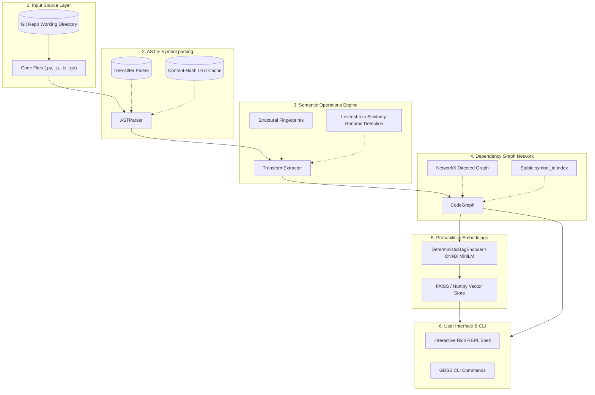

# GDSS Codebase Architecture & Technical Guide

GDSS (Geometric Distributed Software Synchronizer) is a semantic intelligence layer above Git. It treats software evolution as a continuous geometric-semantic dynamical system on a semantic manifold.

This document serves as your guide to understanding the codebase, how its modules interact, and how to explore it.

---

## 📐 Mathematical Reframing of Git

Instead of viewing code as flat lines of text, GDSS maps git concepts to differential geometry:

| Git Concept | GDSS Mapping | Mathematical Representation |
| :--- | :--- | :--- |
| **Codebase State** | Point on a semantic manifold | $P \in \mathcal{M}$ |
| **Commit** | Tangent vector / operator | $dC$ or $\mathcal{T}$ |
| **Branch** | Trajectory (integral of commits) | $\gamma_i(t) = \int dC_i$ |
| **Conflict** | Non-commutativity of operators | $[\mathcal{T}_i, \mathcal{T}_j] \neq 0$ |
| **Branch Drift** | Geodesic distance / Energy | $I(B_i) = \int \| \dot{\gamma}_i - \dot{\gamma}_{\text{ref}} \| dt$ |

---

## 🏗️ Visual Pipeline & Data Flow

Below is the layout showing how raw repository code flows from your files down to interactive queries:



---

## 📁 Directory & Code Structure

The source code resides under the [gdss](file:///home/sbasnet/projects/GDSS/gdss) directory. Below is the file-by-file breakdown grouped by functional layers.

### 1. Core Logic Layer: AST & Symbol Parsing
*Located in [gdss/core](file:///home/sbasnet/projects/GDSS/gdss/core)*

- [ast_parser.py](file:///home/sbasnet/projects/GDSS/gdss/core/ast_parser.py): Employs `tree-sitter` to parse code files into semantic ASTs. Features a content-hash LRU cache (`_content_cache`) to avoid re-parsing unchanged files. Contains the main [ASTParser](file:///home/sbasnet/projects/GDSS/gdss/core/ast_parser.py#L49) class.
- [transform_types.py](file:///home/sbasnet/projects/GDSS/gdss/core/transform_types.py): Defines the domain models: [CodeSymbol](file:///home/sbasnet/projects/GDSS/gdss/core/transform_types.py#L29) (methods, classes, functions), [SemanticOperator](file:///home/sbasnet/projects/GDSS/gdss/core/transform_types.py#L123) (ADD, DELETE, MODIFY, RENAME), and [BodyBlock](file:///home/sbasnet/projects/GDSS/gdss/core/transform_types.py#L12) representing symbol implementation segments.
- [symbol_identity.py](file:///home/sbasnet/projects/GDSS/gdss/core/symbol_identity.py): Generates position-independent, stable keys for code symbols. Keys are built using class scope and name (e.g., `(parent_class, name)`) to avoid collision across different classes.
- [structural_fingerprint.py](file:///home/sbasnet/projects/GDSS/gdss/core/structural_fingerprint.py): Extracts structural token patterns from symbol implementations and computes normalized Levenshtein similarities for matching.
- [transform_extractor.py](file:///home/sbasnet/projects/GDSS/gdss/core/transform_extractor.py): The [TransformExtractor](file:///home/sbasnet/projects/GDSS/gdss/core/transform_extractor.py#L15) class compares two sets of symbols to produce a set of semantic operators (e.g., matching renames via body structural fingerprints).
- [trajectory.py](file:///home/sbasnet/projects/GDSS/gdss/core/trajectory.py): Computes the path / sequence of committed operators from a Git merge-base to the branch head, plus any local uncommitted semantic delta.

### 2. Dependency Graph Layer
*Located in [gdss/graph](file:///home/sbasnet/projects/GDSS/gdss/graph)*

- [code_graph.py](file:///home/sbasnet/projects/GDSS/gdss/graph/code_graph.py): Maps files, classes, and functions to nodes in a `NetworkX` directed graph ([CodeGraph](file:///home/sbasnet/projects/GDSS/gdss/graph/code_graph.py#L7)). It traces reference dependencies and supports downstream impact queries via `get_downstream_impact()`.
- [operator_engine.py](file:///home/sbasnet/projects/GDSS/gdss/graph/operator_engine.py): Contains algebraic functions to apply and invert semantic operators against the codebase dependency graph.
- [graph_builder.py](file:///home/sbasnet/projects/GDSS/gdss/graph/graph_builder.py): Orchestrates traversing directories to ingest source file structures into the code graph.
- [graph_export.py](file:///home/sbasnet/projects/GDSS/gdss/graph/graph_export.py): Serializes the code graph into Graphviz DOT or JSON formats.

### 3. Distributed Runtime & Storage
*Located in [gdss/runtime](file:///home/sbasnet/projects/GDSS/gdss/runtime) and [gdss/storage](file:///home/sbasnet/projects/GDSS/gdss/storage)*

- [local_observer.py](file:///home/sbasnet/projects/GDSS/gdss/runtime/local_observer.py): Watches the local workspace, parsing working-copy modifications.
- [remote_monitor.py](file:///home/sbasnet/projects/GDSS/gdss/runtime/remote_monitor.py): Observes remote tracking branches to calculate ahead/behind status metrics.
- [context_engine.py](file:///home/sbasnet/projects/GDSS/gdss/runtime/context_engine.py): Manages current branch settings, active reference branches (`--ref`), and DB coordination.
- [db.py](file:///home/sbasnet/projects/GDSS/gdss/storage/db.py): Implements SQLite storage schema for persistence of branch tracking hierarchies and configurations.

### 4. Semantic Embedding Layer (Probabilistic Brain)
*Located in [gdss/embeddings](file:///home/sbasnet/projects/GDSS/gdss/embeddings)*

- [encoder.py](file:///home/sbasnet/projects/GDSS/gdss/embeddings/encoder.py): Contains the default offline `DeterministicBagEncoder` which encodes code body tokens into bag-of-words similarity representations.
- [onnx_encoder.py](file:///home/sbasnet/projects/GDSS/gdss/embeddings/onnx_encoder.py): Integrates optional local ONNX MiniLM transformer embeddings for high-fidelity vector representation.
- [vector_store.py](file:///home/sbasnet/projects/GDSS/gdss/embeddings/vector_store.py): Directs local vector storage indexing utilizing FAISS `IndexFlatIP` (with a NumPy fallback if `faiss-cpu` is not installed). Indexes are persisted locally under `.gdss/vectors/`.
- [cache.py](file:///home/sbasnet/projects/GDSS/gdss/embeddings/cache.py): Caches vector representations based on symbol body content hashes.

### 5. CLI & Interactive Shell Layer
*Located in [gdss/cli](file:///home/sbasnet/projects/GDSS/gdss/cli)*

- [start.py](file:///home/sbasnet/projects/GDSS/gdss/cli/start.py): Renders the interactive command shell (`GDSSShell`). Integrates `Rich` for colorized console layouts and logs, and computes dynamic branch status indicators:
  - 🟢 `●` indicates a clean git state.
  - 🟡 `✱` indicates uncommitted changes without AST semantic updates.
  - 🔴 `Δ` indicates uncommitted changes with extracted semantic operators.
- [main.py](file:///home/sbasnet/projects/GDSS/gdss/cli/main.py): Sets up the standard CLI argument parsing and entry points.

---

## 🛠️ Exploring & Interacting with the CLI

Here are practical commands you can run directly to see GDSS in action.

> [!NOTE]
> All CLI commands default to the current working directory, but you can explicitly specify any git repository using the `--repo <path>` flag.

### 1. Launching the Interactive Shell
Start the interactive console to explore commands:
```bash
gdss start
```

### 2. Viewing Branch Semantic Status
See current tracking branches, trajectories since reference branch, and uncommitted semantic delta:
```bash
gdss status --ref master
```

### 3. Reviewing Semantic Git Log
Print the list of semantic transformations (ADD, MODIFY, DELETE, RENAME) parsed from recent commits:
```bash
gdss log -n 5
```

### 4. Running Dependency Graph Analysis
Construct the dependency graph, parse class and function definitions, and print node counts:
```bash
gdss analyze
```

### 5. Finding Semantic Neighbors
Locate code symbols with similar structures/bodies using vector embeddings (from the vector index):
```bash
gdss similar process_payment -k 3
```

---

## 🧪 Verification & Development

To verify that the system runs cleanly and passes the multi-layered test suites:

```bash
# Initalize sandbox venv & verify healthy system configuration
bash harness/init.sh

# Run the 3-Layer verification gate:
# Layer 1: Static checks (ruff, mypy, architecture/DSA fitness boundaries)
# Layer 2: Pytest suites (unit/integration tests)
# Layer 3: End-to-end smoke test on a temporary git fixture
bash harness/verify.sh
```

> [!TIP]
> Tests are organized under the [tests](file:///home/sbasnet/projects/GDSS/tests) directory. You can run specific test components using pytest directly, for example: `pytest tests/test_transform_extractor.py`.
