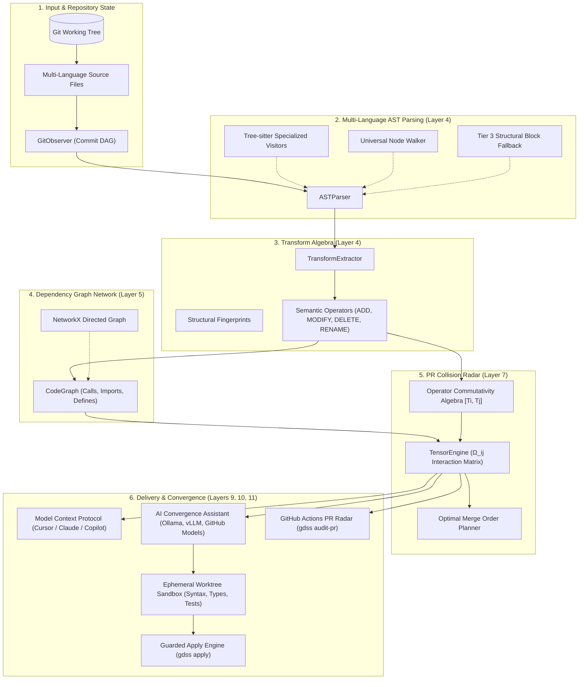

# GDSS Codebase Architecture & Technical Guide

GDSS (Gate Distributive Semantic Synopsis) is a semantic intelligence layer above Git. It operates as a PR Collision Radar and Convergence Assistant, tracking code evolution across concurrent branches to detect semantic collisions before merge.

This document serves as your technical guide to understanding how the codebase modules interact across the 10-layer hierarchy.

---

## 🏛️ Two-Brain Architecture & Layer Hierarchy

GDSS segregates its codebase into a **Deterministic Brain** (running on local CPU at $0 token cost) and an **Assistive / Probabilistic Brain** (consuming deterministic facts for similarity search and sandboxed patch drafting):

```
┌────────────────────────────────────────────────────────────────────────┐
│               DETERMINISTIC BRAIN (GDSS Core — $0 Token Cost)           │
│                                                                        │
│   Layer 0: Runtime & Storage (gdss/runtime, gdss/storage)              │
│   Layer 2: Watcher (gdss/watcher) - GitObserver, commit DAG walker      │
│   Layer 4: Core (gdss/core) - Multi-language Tree-sitter AST, operators │
│   Layer 5: Graph (gdss/graph) - CodeGraph, caller & import dependencies│
│   Layer 7: Conflict (gdss/conflict) - Tensor Ω_ij, commutativity       │
│   Layer 8: Drift (gdss/drift) - Trajectory integral, context engine     │
│   Layer 11: MCP Server (gdss/mcp) - stdio JSON-RPC 2.0 tools           │
└───────────────────────────────────┬────────────────────────────────────┘
                                    │ Pure deterministic facts
                                    ▼
┌────────────────────────────────────────────────────────────────────────┐
│               PROBABILISTIC BRAIN (Assistive & Validated)              │
│                                                                        │
│   Layer 6: Embeddings (gdss/embeddings) - Vector store, 3D PCA         │
│   Layer 9: AI Convergence (gdss/ai) - Suggester, prompt builder        │
│   Layer 10: Validation (gdss/validation) - Ephemeral sandbox, apply    │
└────────────────────────────────────────────────────────────────────────┘
```

> [!IMPORTANT]
> **Two-Brain Purity Invariant:** The deterministic brain must **never import** the probabilistic brain (`ai`, `embeddings`). Enforced statically by `python harness/sensors/architecture_fitness.py`.

---

## 🏗️ Visual Pipeline & Data Flow



---

## 📁 Directory & Code Structure

The source code resides under the [`gdss`](../gdss) directory:

### Layer 0: Runtime & Storage
*Located in [`gdss/runtime`](../gdss/runtime) and [`gdss/storage`](../gdss/storage)*
- [`local_observer.py`](../gdss/runtime/local_observer.py): Watches workspace for uncommitted working-copy modifications.
- [`context_engine.py`](../gdss/runtime/context_engine.py): Manages active branch configurations and reference branches (`--ref`).
- [`db.py`](../gdss/storage/db.py): SQLite storage schema for local state and branch tracking hierarchies.

### Layer 2: Watcher (Git Observer)
*Located in [`gdss/watcher`](../gdss/watcher)*
- [`git_observer.py`](../gdss/watcher/git_observer.py): High-performance Git interface. Lists branches, computes commit ranges (`get_commits_between`), retrieves file contents at arbitrary SHAs, and identifies merge bases.

### Layer 4: Core Logic & Multi-Language AST
*Located in [`gdss/core`](../gdss/core)*
- [`ast_parser.py`](../gdss/core/ast_parser.py): 3-tier AST parser (Tree-sitter visitors for Python, JS/TS, Go, Rust, Java, C/C++; Universal Node Walker; and Tier 3 Structural Block Fallback). Includes LRU content-hash caching.
- [`transform_types.py`](../gdss/core/transform_types.py): Core domain models (`CodeSymbol`, `SemanticOperator`, `OperatorType`, `BodyBlock`).
- [`transform_extractor.py`](../gdss/core/transform_extractor.py): Extracts semantic transformation operators between symbol sets.
- [`structural_fingerprint.py`](../gdss/core/structural_fingerprint.py): Levenshtein-based structural token matching for accurate rename detection.
- [`trajectory.py`](../gdss/core/trajectory.py): Calculates cumulative semantic operators from Git merge-base to branch head.

### Layer 5: Dependency Call & Import Graph
*Located in [`gdss/graph`](../gdss/graph)*
- [`code_graph.py`](../gdss/graph/code_graph.py): NetworkX directed graph mapping files, classes, and functions. Computes downstream impact sets via `get_downstream_impact()`.
- [`graph_builder.py`](../gdss/graph/graph_builder.py): Scans repository directories and ingests declarations and calls into the graph.
- [`graph_export.py`](../gdss/graph/graph_export.py): Serializes code graphs to Graphviz DOT or JSON formats.

### Layer 6: Semantic Embeddings (Probabilistic Brain)
*Located in [`gdss/embeddings`](../gdss/embeddings)*
- [`encoder.py`](../gdss/embeddings/encoder.py): `DeterministicBagEncoder` token encoder and `OnnxMiniLMEncoder` interface.
- [`vector_store.py`](../gdss/embeddings/vector_store.py): FAISS vector store with NumPy fallback.
- [`service.py`](../gdss/embeddings/service.py): Provides symbol similarity search (`gdss similar`) and 3D PCA dimensionality reduction for the web constellation UI.

### Layer 7: Collision Tensor & Commutativity Algebra
*Located in [`gdss/conflict`](../gdss/conflict)*
- [`commutativity.py`](../gdss/conflict/commutativity.py): Evaluates whether operator pairs commute ($[T_i, T_j] = 0$), interfere, or are independent.
- [`tensor.py`](../gdss/conflict/tensor.py): Constructs the sparse $N \times N$ collision tensor $\Omega_{ij}$ combining file overlap, symbol overlap, dependency overlap, and operator interference.
- [`merge_order.py`](../gdss/conflict/merge_order.py): Calculates greedy topological merge sequences minimizing integration friction across branches.
- [`rebase_plan.py`](../gdss/conflict/rebase_plan.py): Generates discrete transport rebase plans (kept, remapped, and blocked operators).

### Layer 8: Semantic Drift & Context Engine
*Located in [`gdss/drift`](../gdss/drift)*
- [`engine.py`](../gdss/drift/engine.py): Computes drift magnitude $I(B_i)$ measuring branch divergence from the attractor branch.
- [`context.py`](../gdss/drift/context.py): Builds `AnalysisContext` aggregating Git commits, AST operators, and collision tensors.

### Layer 9: AI Convergence Assistant
*Located in [`gdss/ai`](../gdss/ai)*
- [`suggester.py`](../gdss/ai/suggester.py): Read-only orchestration generating ranked resolution suggestions.
- [`orchestration.py`](../gdss/ai/orchestration.py): LangGraph state machine with agentic self-correction refinement loops (`should_refine`, `refine_step`).
- [`condensation.py`](../gdss/ai/condensation.py): AST-aware context condensation, 3-tier context discovery (`resolve_context_window()`), and code token budget management.
- [`prompt_builder.py`](../gdss/ai/prompt_builder.py): Instructional prompt builder injecting conflict topology and commit histories.
- [`openai_provider.py`](../gdss/ai/openai_provider.py), [`ollama_provider.py`](../gdss/ai/ollama_provider.py), [`vllm_provider.py`](../gdss/ai/vllm_provider.py): Pluggable LLM adapters.
- [`suggestion_store.py`](../gdss/ai/suggestion_store.py): Immutable hash IDs (`sug_...`) and `.gdss/suggestions/` storage.

### Layer 10: Validation Sandbox, Guarded Apply & CI Radar
*Located in [`gdss/validation`](../gdss/validation)*
- [`sandbox.py`](../gdss/validation/sandbox.py): Manages ephemeral Git worktree sandboxes to dry-run candidate patches with syntax checks, static types, and targeted test runs.
- [`guarded_apply.py`](../gdss/validation/guarded_apply.py): Preflight integrity checks (HEAD freshness, canonical paths, AST symbols), atomic file modifications, and self-healing syntax rollback.
- [`pr_audit.py`](../gdss/validation/pr_audit.py): GitHub Actions PR collision radar engine, posting sticky Markdown comments with native 1-click commit suggestions.

### Layer 11: MCP Server & CLI Entrypoints
*Located in [`gdss/mcp`](../gdss/mcp) and [`gdss/cli`](../gdss/cli)*
- [`server.py`](../gdss/mcp/server.py): Stdio JSON-RPC 2.0 Model Context Protocol server exposing deterministic radar tools to AI IDEs ($0 token cost).
- [`main.py`](../gdss/cli/main.py): Typer CLI argument parser implementing `status`, `suggest`, `apply`, `audit-pr`, `drift`, `tensor`, etc.
- [`start.py`](../gdss/cli/start.py): Interactive Rich terminal REPL shell.

---

## 🧪 Verification & Development

To verify that the system runs cleanly and passes the multi-layered test suites:

```bash
# Bootstrap virtual environment and editable installation
bash harness/init.sh

# Run the 3-Layer verification gate:
# Layer 1: Static checks (ruff, mypy 87 files, architecture/DSA fitness boundaries)
# Layer 2: Pytest test suite (271 tests)
# Layer 3: End-to-end smoke test on Git fixture
bash harness/verify.sh
```
