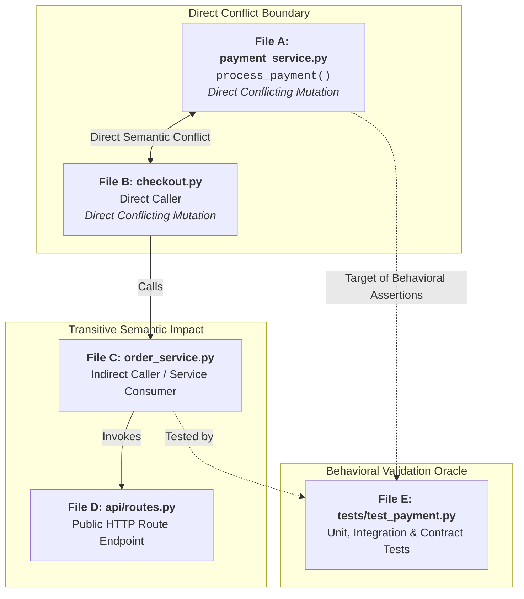
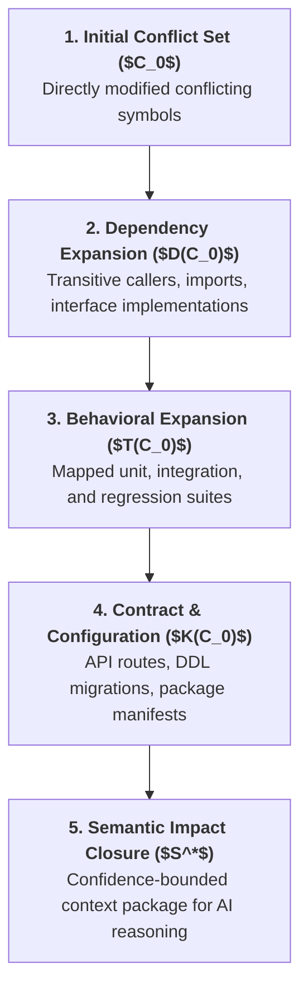
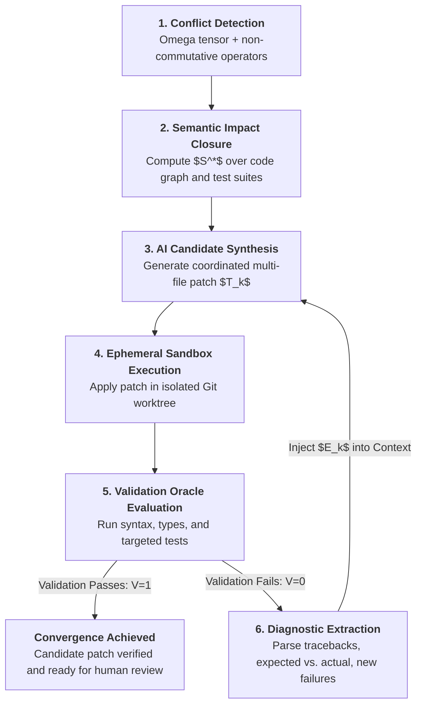

# Semantic Change-Impact Closure and Validation Feedback Problem

> **Formal Problem Specification:** Establishing repository-level semantic consistency under distributed branch transformations via transitive impact closures and closed-loop validation feedback.

---

## Executive Summary

A fundamental vulnerability in automated code-merge and semantic conflict-resolution systems is **local convergence myopically masquerading as global correctness**. When two concurrent branches introduce conflicting AST mutations or interface changes, resolving the syntactic or structural collision at the conflict site is necessary but rarely sufficient.

A single function renaming or signature adaptation induces ripples across downstream callers, schema contracts, build configurations, and test suites. If an AI convergence engine is fed only conflict-local context ($C_0$), it will produce patches that are locally consistent but globally destructive. 

This document formalizes the **Semantic Change-Impact Closure and Validation Feedback Problem**, specifies the **Semantic Impact Closure (SIC)** algebra, establishes the three-level correctness hierarchy, and designs an iterative closed-loop feedback engine that feeds test execution diagnostics back into semantic patch synthesis.

---

## 1. The Actual Problem: A Conflict Does Not Exist in Isolation

Consider a typical service architecture within a repository:



### The Failure Mode

Suppose two concurrently evolving branches introduce the following transformations:

#### Branch A — Refactoring
Renames the payment execution function:
```python
# Before
def process_payment(order):
    ...

# After
def execute_payment(order):
    ...
```

#### Branch B — Feature Development
Extends the function's parameter signature to support multi-currency transactions:
```python
# Before
def process_payment(order):
    ...

# After
def process_payment(order, currency):
    ...
```

GDSS's deterministic core detects semantic interference between these transformations ($[T_A, T_B] \ne 0$). The AI convergence engine receives the conflict descriptor and synthesizes a reconciled definition:

```python
# Locally reconciled candidate definition in payment_service.py
def execute_payment(order, currency):
    ...
```

### The Illusion of Resolution

The two directly conflicting files (`payment_service.py` and `checkout.py`) are now structurally reconciled. However:
1. `order_service.py` still invokes the obsolete symbol `process_payment(order)`.
2. `api/routes.py` still supplies the legacy single-argument interface.
3. `tests/test_payment.py` still imports `process_payment`.
4. Integration suites fail at runtime due to missing arguments or unresolved symbols.

> [!WARNING]
> **Local Correctness vs. Global Consistency**:  
> The patch is **locally correct** (the conflict site compiles and merges cleanly), yet the repository is **globally broken**. Traditional merge tools and naive AI prompt generators stop at File A and File B, blinding the model to the repository's broader contractual reality.

---

## 2. Architectural Root Causes: What is Missing?

We isolate this breakdown into three core deficiencies:

### Problem A — Incomplete Semantic Impact Awareness

The files containing the conflicting transformations represent only a fraction of the affected codebase. The complete impact envelope spans multiple orthogonal categories:

| Impact Category | Formal Definition | Concrete Example |
| :--- | :--- | :--- |
| **Directly Affected** | Files containing conflicting AST transformations | `payment_service.py` |
| **Dependency Affected** | Transitive callers, re-exporters, and type consumers | `checkout.py`, `order_service.py` |
| **Contract Affected** | External schemas, API routes, protobufs, and DDL migrations | `api/routes.py`, `schema.sql` |
| **Test Affected** | Unit, integration, regression, and end-to-end test suites | `tests/test_payment.py`, `tests/e2e/` |
| **Configuration Affected** | Environment settings, build scripts, package manifests | `pyproject.toml`, Dockerfiles |
| **Runtime Affected** | Dynamic reflection, dependency injection, worker queues | Celery tasks, event bus handlers |

$$\text{Conflict Set } (C_0) \neq \text{Semantic Impact Set } (S^*)$$

Supplying an LLM with only $C_0$ forces it to reason over an artificially truncated slice of the repository graph.

### Problem B — Missing Test-to-Code Semantic Relationships

Tests are not inert build artifacts; **they are the executable behavioral specification of the repository**.

GDSS requires structural awareness mapping production symbols to their verifying test oracles:
- Functions $\longleftrightarrow$ Unit tests
- Modules $\longleftrightarrow$ Integration flows
- API schemas $\longleftrightarrow$ Contract tests
- Database entities $\longleftrightarrow$ Migration / schema assertions

```text
payment_service.py
    │
    ├── checkout.py (Direct Caller)
    │
    ├── order_service.py (Indirect Caller)
    │
    └── tests/
          ├── test_payment.py (Direct Unit Tests)
          ├── test_checkout.py (Component Tests)
          └── integration/
                └── test_order_flow.py (End-to-End Invariants)
```

Altering `payment_service.py` implicates all three test suites even if none of them experienced a physical Git merge conflict.

### Problem C — Missing Iterative Validation Feedback (Closed-Loop Healing)

Consider the traditional feedforward lifecycle:
1. GDSS detects a collision.
2. AI drafts a patch.
3. Patch is applied in an isolated worktree.
4. Test suite executes and fails.
5. The process halts, outputting a generic error or leaving the PR unmerged.

A boolean `PASS` / `FAIL` signal is non-actionable for automated reasoning. The convergence engine requires **structured diagnostic feedback**:
- Exact failing test identifiers and assertions.
- Root-cause categorization (Syntax error, Type mismatch, Assertion failure, Timeout).
- Expected vs. actual values and runtime tracebacks.
- Source locations and newly implicated downstream symbols.
- Baseline differential: did this failure predate the candidate patch, or was it induced by the patch?

---

## 3. Formal Problem Statement

> [!IMPORTANT]
> ### The Semantic Change-Impact Closure and Validation Feedback Problem
> 
> *A semantic conflict-resolution system cannot reliably establish repository-level consistency by generating patches from conflict-local context alone. A transformation affecting a small set of symbols or files may induce changes across a wider dependency graph, including downstream consumers, interfaces, configuration, integration workflows, and behavioral tests.*
> 
> *When these indirect relationships are not discovered and incorporated into the AI's working context, a locally valid conflict-resolution patch may introduce regressions elsewhere in the repository.*
> 
> *Furthermore, without an iterative validation-feedback mechanism that exposes test failures, execution diagnostics, and relevant repository context back to the AI, the system cannot reliably diagnose and self-heal regressions introduced by its proposed transformations.*
> 
> *The central challenge is to discover the complete relevant impact scope of a proposed semantic transformation, validate it against the repository's behavioral contracts, and iteratively converge toward a repository-consistent candidate state.*

---

## 4. The Three Levels of Correctness

To prevent premature declarations of victory, GDSS structures convergence verification into three distinct tiers:

```
[ Level 1: Conflict Correctness ]  ──> Resolves local mutation collision (Site-local)
              │
              ▼
[ Level 2: Dependency Consistency ] ──> Harmonizes callers, imports, contracts (Subsystem)
              │
              ▼
[ Level 3: Behavioral Consistency ] ──> Satisfies test suite and runtime invariants (Repository-wide)
```

1. **Level 1 — Conflict Correctness (Local):**
   - *Question:* Did the patch reconcile the mutually exclusive AST transformations?
   - *Example:* `process_payment` renamed and parameters merged in `payment_service.py`.
2. **Level 2 — Dependency Consistency (Subsystem):**
   - *Question:* Are all callers, type references, and configuration interfaces across the repository updated to match the new definition?
   - *Example:* Call sites in `checkout.py` and `order_service.py` refactored to pass `currency`.
3. **Level 3 — Behavioral Consistency (Repository-wide):**
   - *Question:* Does the resulting repository satisfy all regression tests, behavioral invariants, and type checks?
   - *Example:* `tests/integration/test_order_flow.py` passes without runtime assertion violations.

> [!NOTE]
> Passing Level 1 does not imply Level 2 or Level 3. A robust convergence assistant must guarantee progression through all three tiers.

---

## 5. Architectural Solution: Semantic Impact Closure (SIC)

Rather than dispatching raw conflict files directly to the model, GDSS computes the **Semantic Impact Closure (SIC)** before invoking patch generation.



### Mathematical Formulation of SIC

#### 1. Initial Conflict Set
Let $C_0$ be the set of directly conflicted symbols extracted from the AST diff:
$$C_0 = \{s_1, s_2, \dots, s_n\}$$

#### 2. First-Order Expansion
Let:
- $D(C_0)$: Direct caller, callee, and type dependency symbols in the dependency graph $G = (V, E)$.
- $T(C_0)$: Test cases that directly import, call, or assert invariants on symbols in $C_0$.
- $K(C_0)$: Configuration entries, database schema migrations, and route contracts referencing $C_0$.

$$S_1 = C_0 \cup D(C_0) \cup T(C_0) \cup K(C_0)$$

#### 3. Iterative Transitive Expansion
Because an affected caller may itself expose an interface consumed by third-party modules, we expand transitively over the code dependency graph:
$$S_{k+1} = S_k \cup N_{\text{relevant}}(S_k)$$

Where $N_{\text{relevant}}(S)$ selects adjacent nodes in the code graph whose edge weight $w(u, v) \ge \theta_{\text{relevance}}$, filtering out tenuous relationships.

#### 4. Fixed-Point Convergence
The closure reaches a fixed point bounded by confidence and token budget:
$$S^* = \operatorname{Closure}(C_0) = \bigcup_{k=0}^{K} S_k$$

### Edge Strength and Relevance Filtering
Not all dependency edges carry equal significance. GDSS assigns explicit edge weights:

| Relationship Type | Confidence Weight ($w$) | Propagation Rule |
| :--- | :---: | :--- |
| Direct invocation / call | $1.00$ | Always include in impact closure |
| Type annotation / implementation | $0.95$ | Include in contract closure |
| Test coverage (Static / Dynamic) | $0.90$ | Include in validation target suite |
| Import without direct invocation | $0.50$ | Include only if symbol re-exported |
| Lexical naming heuristic | $0.25$ | Exclude unless verified by AST |

---

## 6. Closed-Loop AI Convergence Engine

The convergence lifecycle is an iterative feedback control loop executed in an isolated worktree sandbox:



### Diagnostic Evidence Structure

When validation fails, the runner extracts a structured diagnostic payload ($E_k$):

```json
{
  "iteration": 1,
  "status": "VALIDATION_FAILED",
  "diagnostics": [
    {
      "test_file": "tests/integration/test_order_flow.py",
      "test_case": "test_complete_checkout_workflow",
      "failure_type": "AssertionError",
      "expected": "payment_status == 'completed'",
      "actual": "payment_status == 'pending'",
      "traceback": [
        "File 'order_service.py', line 84, in finalize_order",
        "  status = update_order_status(payment_result)"
      ],
      "implicated_symbols": [
        "execute_payment",
        "update_order_status",
        "PaymentResult"
      ],
      "regression_origin": "INTRODUCED_BY_PATCH"
    }
  ]
}
```

This diagnostic payload is joined with the Semantic Impact Closure and fed into iteration $k+1$, enabling targeted self-healing.

---

## 7. Critical Invariant: Preventing Test Specification Gaming

> [!CAUTION]
> **The Threat of Test Suite Degradation (Goodhart's Law in APR)**:  
> When an automated agent is tasked with making tests pass, it faces a perverse incentive: modifying test assertions to match incorrect runtime behavior rather than correcting the production code.

To prevent this form of automated specification gaming, GDSS enforces strict test mutation policies:

| Scenario | Allowed Mutation | Enforcement Policy |
| :--- | :--- | :--- |
| **Internal Refactoring** | ❌ Strictly Forbidden | Tests must remain unaltered; production code must satisfy existing assertions. |
| **Intentional API Shift** | ⚠️ Allowed with Justification | Contract tests may update signature calls, but assertion semantics must hold. |
| **New Capability Added** | ✅ Allowed | Additive test cases are permitted to cover new parameter branches. |
| **Regression Exposed** | ❌ Strictly Forbidden | The test correctly flagged a defect; the candidate patch must be revised. |
| **Obsolete Test Case** | ⚠️ Quarantined | Flagged for explicit human review; never silently altered or deleted by the agent. |

GDSS tracks test file diffs separately from production code diffs. In CI reports, test modifications are isolated in an explicit **Contract Changes** review block requiring explicit human sign-off.

---

## 8. Integration with the GDSS Architecture

The proposed engines map directly onto GDSS's deterministic/probabilistic two-brain architecture:

```mermaid
graph LR
    subgraph Deterministic Core (0 Tokens, CPU)
        AST["AST Parser"] --> GRAPH["CodeGraph Engine"]
        GRAPH --> SIC["Semantic Impact Closure Engine"]
        BOX["Ephemeral Worktree Sandbox"] --> ORACLE["Validation Oracle"]
        ORACLE --> DIAG["Diagnostic Extractor"]
    end

    subgraph Probabilistic Brain (BYOK / LLM)
        LLM["AI Convergence Assistant"]
    end

    SIC -->|Structured Context Package| LLM
    LLM -->|Candidate Multi-File Patch| BOX
    DIAG -->|Iterative Feedback $E_k$| LLM
```

| Engine Component | Architectural Role | Source Implementation |
| :--- | :--- | :--- |
| **AST Engine** | Symbol extraction and scope boundary detection | [`gdss/core/ast_parser.py`](../../gdss/core/ast_parser.py) |
| **Transform Algebra** | Commutativity and operator detection ($[T_A, T_B]$) | [`gdss/core/trajectory.py`](../../gdss/core/trajectory.py) |
| **CodeGraph** | Dependency call/import graph traversal | [`gdss/graph/builder.py`](../../gdss/graph/builder.py) |
| **Conflict Tensor** | Branch collision intensity matrix ($\Omega_{ij}$) | [`gdss/conflict/tensor_engine.py`](../../gdss/conflict/tensor_engine.py) |
| **AI Orchestration** | Iterative multi-file patch synthesis | [`gdss/ai/orchestration.py`](../../gdss/ai/orchestration.py) |
| **Validation Runner** | Ephemeral Git worktree sandbox execution | [`gdss/validation/test_runner.py`](../../gdss/validation/test_runner.py) |

---

## 9. Mathematical Interpretation of Iterative Convergence

Let the repository state at the base reference attractor branch be:
$$R_0$$

Let the multi-file transformation synthesized by the AI convergence engine at iteration $k$ be:
$$T_k: R_k \rightarrow R_{k+1}$$

A naive conflict resolver considers only site-local structural resolution:
$$\operatorname{Resolve}(C_0, T) = \text{success}$$

However, repository-level semantic convergence requires satisfaction across the entire Semantic Impact Closure ($S^*$):
$$\operatorname{Validate}(R_{k+1}, S^*) = \text{pass}$$

We define the multi-layer validation oracle $\mathcal{V}: \mathcal{R} \rightarrow \{0, 1\}$ over static checks, type checking, and behavioral test gates:
$$\mathcal{V}(R) = \begin{cases} 1 & \text{if all required static, type, and test gates pass} \\ 0 & \text{otherwise} \end{cases}$$

When validation fails ($\mathcal{V}(R_k) = 0$), the diagnostic engine extracts the failure spectrum:
$$E_k = \operatorname{Diagnose}(R_k, \text{test failures, stack traces, AST regressions})$$

The subsequent candidate transformation $T_{k+1}$ is conditioned upon the initial conflict set $C_0$, the current closure $S_k$, and the cumulative diagnostic evidence $E_k$:
$$R_{k+1} = T_{k+1}(R_k \mid C_0, S_k, E_k)$$

The convergence loop executes until:
$$\mathcal{V}(R_k) = 1 \quad \text{or} \quad k \ge K_{\max}$$

Where $K_{\max}$ is the bounded refinement limit (configured via `radar.max_refinements`).

> [!NOTE]
> **Formal Soundness vs. Empirical Verification**:  
> In accordance with Dijkstra's principle, passing test gates does not constitute a mathematical proof of program correctness; it establishes that candidate state $R_k$ satisfies all formal validation oracles specified by the repository.

---

## 10. Re-defining AI Convergence in GDSS

To prevent subtle semantic bugs from landing in production, GDSS redefines the standard for automated convergence:

> **The Invariant of True Convergence**:  
> A conflict-resolution patch is **never** considered complete simply because git merge conflicts have been eliminated. Convergence is established only when the candidate state satisfies the full transitive Semantic Impact Closure under sandboxed execution.

### The 10-Step Convergence Protocol
1. **Detect Semantic Interference:** Compute pairwise branch interaction tensors ($\Omega_{ij}$).
2. **Isolate Conflicted Transformations:** Identify non-commutative operations ($C_0$).
3. **Compute Impact Closure:** Transitively expand callers, interfaces, and configurations ($S^*$).
4. **Map Behavioral Contracts:** Identify verifying unit, integration, and contract test suites ($T(C_0)$).
5. **Construct Lossless Context:** Assemble the token-budgeted context package.
6. **Synthesize Coordinated Candidate:** Generate patches spanning all implicated call sites.
7. **Sandbox Execution:** Apply candidate patches in an isolated Git worktree.
8. **Evaluate Validation Oracle:** Execute linters, typecheckers, and targeted tests.
9. **Extract Iterative Diagnostics:** Feed failure traces back into model reasoning if $\mathcal{V} = 0$.
10. **Emit Verified Pull Request Suggestion:** Present verified patch and evidence to human reviewers.

---

## 11. Final Problem Statement for GDSS Documentation

```text
Problem: Repository-Level Semantic Consistency Under Distributed Transformations

In a distributed software development environment, concurrent branch transformations
frequently introduce semantic conflicts whose blast radius extends far beyond the
directly edited files and AST symbols.

Traditional conflict detection tools identify overlapping text lines but cannot establish
the transitive closure of dependent components, caller interfaces, database migrations,
and behavioral test suites affected by a proposed resolution.

Consequently, an automated agent operating exclusively on conflict-local context generates
syntactically valid patches that inadvertently break global repository invariants.

Furthermore, in the absence of a closed-loop validation harness that translates test
diagnostics and stack traces into iterative feedback, an AI system cannot reliably
self-correct introduced regressions.

GDSS resolves this through:
1. Deterministic Semantic Impact Closure (SIC) computation over repository code graphs.
2. Lossless context packaging linking production symbols to behavioral test oracles.
3. Iterative, sandboxed validation feedback loops driving multi-file convergence.

The ultimate objective is not merely eliminating merge conflicts, but guaranteeing
that independently evolving branches converge into a coherent, verified repository state.
```
