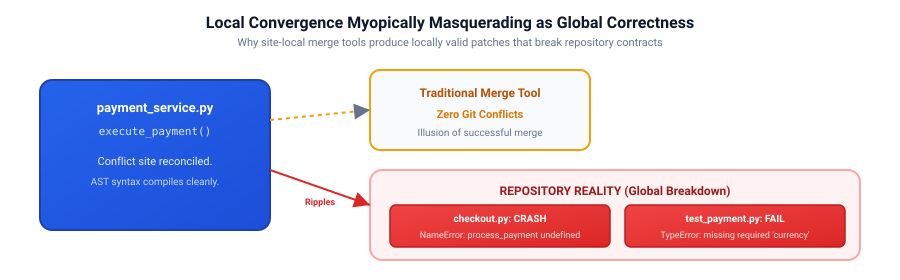
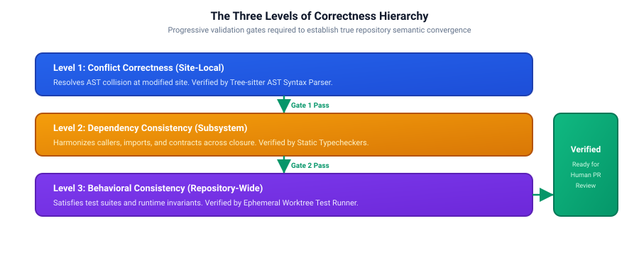
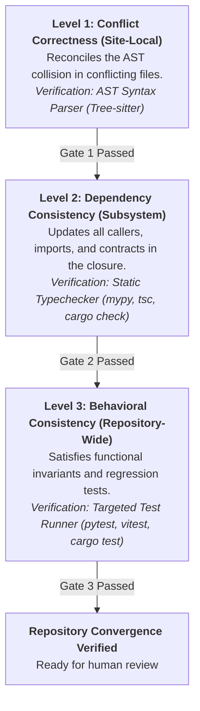
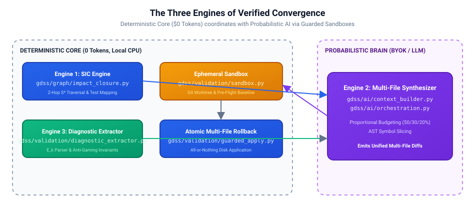

# Semantic Change-Impact Closure and Validation Feedback Solution

> **Formal Solution Specification:** Architectural resolution to the Semantic Change-Impact Closure and Validation Feedback Problem in GDSS. Bridges the gap between local conflict resolution and repository-level semantic consistency through deterministic graph closures, coordinated multi-file patch packaging, and closed-loop validation diagnostics.

---

## Executive Summary

When concurrent Git branches introduce conflicting AST mutations or interface changes, reconciling the conflict site alone creates an **illusion of convergence**: the conflicting file merges cleanly, yet callers across the repository fail at runtime, API contracts break, and test suites regress.

This document presents the complete architectural and mathematical solution to this fundamental challenge. The solution coordinates three deterministic and probabilistic engines:
1. **Deterministic Semantic Impact Closure (SIC) Engine**: Expands conflict sites ($C_0$) across 2 hops of weighted dependency, contract, and test relationships to form the complete impact envelope ($S^*$) at $0 token cost.
2. **Multi-File Coordinated Patch Packaging & Synthesis Engine**: Packages multi-file unified diffs that update conflict sites and transitive callers simultaneously, backed by all-or-nothing atomic rollback.
3. **Closed-Loop Validation Diagnostics & Anti-Gaming Invariants**: Executes candidate patches in isolated worktrees, isolates patch-induced regressions from pre-existing base failures via differential baselines, and enforces strict anti-gaming invariant policies on test assertions.

---

## 1. Glossary of Technical Jargon (Plain-English Definitions)

To ensure this specification is fully accessible to engineers, mathematicians, and AI practitioners alike, the following table defines all key terms used in Round 1 and Round 2 of the system design:

| Term / Notation | Formal Name | Plain-English Definition |
| :--- | :--- | :--- |
| **$C_0$** | Initial Conflict Set | The specific set of code symbols (functions, classes, variables) that directly collided between two branches in Git. |
| **$S^*$** | Semantic Impact Closure | The complete "blast radius" of code affected by $C_0$, including all callers, interface implementations, and tests that depend on the collided symbols. |
| **$E_k$** | Diagnostic Evidence ($k$-th iteration) | The structured report of why a test or build failed during the $k$-th validation attempt, including stack traces, expected vs. actual values, and failing line numbers. |
| **AST** | Abstract Syntax Tree | The tree representation of code syntax parsed by compilers (e.g. Tree-sitter), allowing GDSS to understand functions and classes rather than just lines of text. |
| **$\Omega_{ij}$** | Conflict Tensor | A mathematical matrix in GDSS measuring how severely two branches ($i$ and $j$) collide based on their shared code modifications and dependency overlap. |
| **Two-Brain Architecture** | Deterministic vs. Probabilistic Separation | The architectural rule in GDSS where algorithmic logic (graph math, parsing, test running) runs locally on CPU for \$0 and 0 tokens, while AI (LLMs) is only invoked for creative code synthesis. |
| **Ephemeral Git Worktree** | Sandboxed Temporary Workspace | A temporary, isolated folder on disk linked to the Git repository where candidate code can be built and tested without touching the developer's working directory. |
| **Goodhart's Law** | Automated Specification Gaming | The vulnerability where an AI, tasked with making a test suite pass, simply deletes or loosens the test assertions (`assert result == 100` $\rightarrow$ `assert True`) rather than fixing the broken code. |
| **Differential Baseline** | Baseline-Subtracted Failure Attribution | Running the test suite on the base branch *before* applying the AI patch to record pre-existing failures ($F_{\text{base}}$), ensuring the AI is only held accountable for bugs it actually introduced. |
| **AST Symbol Slicing** | Proportional Context Extraction | Extracting only the specific function signature, docstring, and call site from a 5,000-line file so the AI gets the context it needs without exceeding token limits. |
| **Atomic Multi-File Rollback** | All-or-Nothing Application | If an AI patch touches 5 files and 4 pass syntax checks but the 5th has a syntax error, GDSS immediately reverts all 5 files so the repository is never left in a corrupted partial state. |
| **Transitive Closure (2 Hops)** | Multi-Step Dependency Reach | If A calls B, and B calls C, then A is 1 hop away from B, and 2 hops away from C. A 2-hop closure captures the immediate ripple effect across caller chains. |

---

## 2. Plain-English Problem vs. Solution Intuition

### The Problem in Simple Terms
Imagine an e-commerce platform. Branch A refactors `payment_service.py` to rename `process_payment(order)` to `execute_payment(order)`. Concurrently, Branch B modifies `process_payment(order)` to accept a new required parameter: `process_payment(order, currency)`.

If an AI merge tool only looks at `payment_service.py`, it reconciles the definition to `execute_payment(order, currency)`. Git reports zero merge conflicts. **However:**
- `checkout.py` (which calls `process_payment(order)`) crashes with `NameError`.
- `tests/test_payment.py` (which asserts payment behavior) fails with `AttributeError`.
- The repository is broken despite having a "successful" merge!

<p align="center"></p>

<details>
<summary>🔄 Mermaid source (click to expand)</summary>

```mermaid
flowchart LR
    subgraph Traditional Local Merge (Myopic)
        A["payment_service.py<br/>(Reconciled definition)"] -.->|Compiles Cleanly| OK["Zero Git Conflicts<br/>(Illusion of Success)"]
    end
    
    subgraph Repository Reality (Global Regression)
        A -->|Unresolved Call Site| B["checkout.py<br/><b>CRASH: NameError</b>"]
        A -->|Outdated Assertion| C["test_payment.py<br/><b>FAIL: AttributeError</b>"]
    end
```

</details>

### The Solution in Simple Terms
GDSS solves this by refusing to treat a conflict as an isolated file:
1. **Find the Ripple Effect (SIC)**: Before generating any code, GDSS consults its repository code graph to find every file that calls the conflicting function, every schema that defines its inputs, and every test that verifies it.
2. **Fix All Implicated Files Together**: The AI convergence assistant generates a single coordinated patch that updates the definition in `payment_service.py`, updates the call sites in `checkout.py`, and updates the invocation in `tests/test_payment.py`.
3. **Verify in an Isolated Sandbox**: The patch is applied in an isolated Git worktree. GDSS runs syntax checks, typecheckers, and unit tests.
4. **Self-Correct with Stack Traces**: If a test fails, GDSS parses the exact stack trace and failure reason ($E_k$) and gives it back to the AI to refine its fix until all tests pass.
5. **Protect the Safety Net**: The AI is strictly barred from deleting or weakening test assertions to game the test suite.

---

## 3. The Three Levels of Correctness

GDSS verifies candidate convergence through a strict hierarchical progression:

<p align="center"></p>

<details>
<summary>🔄 Mermaid source (click to expand)</summary>



</details>

1. **Level 1 — Conflict Correctness (Site-Local)**: The conflicting AST nodes are harmonized into a valid grammatical construct.
2. **Level 2 — Dependency Consistency (Subsystem)**: Every caller, consumer, and type reference across the repository matches the new signature and contract.
3. **Level 3 — Behavioral Consistency (Repository-Wide)**: All functional invariants, assertions, and edge-case behaviors defined in the test suite pass cleanly without regressions.

---

## 4. Mathematical Formulation of the Solution

### 4.1 The Semantic Impact Closure ($S^*$)

Let the repository code graph be a directed, edge-weighted multigraph:
$$G = (V, E, w)$$

Where:
- $V = V_{\text{symbol}} \cup V_{\text{file}} \cup V_{\text{test}} \cup V_{\text{contract}}$
- $E \subseteq V \times V$ represents semantic relationships (e.g., `calls`, `defines`, `imports`, `tests`, `annotates`).
- $w: E \rightarrow [0, 1]$ represents relationship confidence and propagation strength:

$$\begin{aligned}
w(e) = \begin{cases}
1.00 & \text{if } e \text{ is direct invocation / call} \\
0.95 & \text{if } e \text{ is type annotation / interface implementation} \\
0.90 & \text{if } e \text{ is behavioral test verification} \\
0.50 & \text{if } e \text{ is module import without direct call} \\
0.25 & \text{if } e \text{ is lexical heuristic naming match}
\end{cases}
\end{aligned}$$

#### Step 1: Initial Conflict Set ($C_0$)
From the 3-way AST comparison between base commit $R_{\text{base}}$ and branches $R_A, R_B$:
$$C_0 = \{s \in V \mid [T_A, T_B](s) \ne 0\}$$

#### Step 2: First-Order Impact Expansion ($S_1$)
We define three distinct expansion projections:
1. **Dependency Callers & Consumers**:
   $$D(C_0) = \{u \in V \mid \exists v \in C_0, (u, v) \in E_{\text{calls}} \lor (u, v) \in E_{\text{types}}\}$$
2. **Behavioral Test Oracles**:
   $$T(C_0) = \{t \in V_{\text{test}} \mid \exists v \in C_0, (t, v) \in E_{\text{tests}} \lor \operatorname{Imports}(t, v)\}$$
3. **Contracts & Configurations**:
   $$K(C_0) = \{k \in V_{\text{contract}} \mid \exists v \in C_0, \operatorname{References}(k, v)\}$$

The base 1-hop impact envelope is:
$$S_1 = C_0 \cup D(C_0) \cup T(C_0) \cup K(C_0)$$

#### Step 3: Weighted Adaptive 2-Hop Transitive Expansion
Because updating a direct caller $u \in D(C_0)$ may alter $u$'s own interface, we expand to second-order neighbors $u' \in N(u)$, filtered by edge weight threshold $\theta_{\text{relevance}} = 0.70$:
$$S_2 = S_1 \cup \left\{ u' \in V \mid \exists u \in S_1, (u', u) \in E \text{ and } w(u', u) \ge \theta_{\text{relevance}} \right\}$$

#### Step 4: Fixed-Point Impact Closure ($S^*$)
Under our 2-hop bounded expansion policy with budget-aware pruning:
$$S^* = \operatorname{Closure}(C_0, \text{hops} \le 2) = \operatorname{PruneToBudget}(S_2, \text{TokenLimit})$$

Where pruning strictly preserves $C_0$, $D(C_0)$, and $T(C_0)$, shedding low-confidence 2-hop edges ($w < 0.80$) if the context budget is constrained.

---

### 4.2 Closed-Loop Validation Diagnostics & Differential Baseline

Let $R_0$ be the base repository state (HEAD of the reference branch).

#### Pre-Flight Differential Baseline ($F_{\text{base}}$)
Before applying candidate patch $T_k$, the sandbox runs the targeted test oracle $T(C_0)$ on clean $R_0$:
$$F_{\text{base}} = \operatorname{RunTests}(R_0, T(C_0))$$

Where $F_{\text{base}}$ is the set of test cases that fail *prior* to any convergence patch.

#### Candidate Patch Execution
Candidate transformation $T_k$ is applied to an ephemeral worktree, yielding state $R_k$:
$$R_k = T_k(R_0)$$

The test suite runs against $R_k$, yielding test results $F_{\text{candidate}}$:
$$F_{\text{candidate}} = \operatorname{RunTests}(R_k, T(C_0))$$

#### Diagnostic Feedback Formulation ($E_k$)
The differential diagnostic set isolates true regressions:
$$\Delta F_k = F_{\text{candidate}} \setminus F_{\text{base}}$$

For each failing test $f \in \Delta F_k$, the diagnostic engine constructs evidence vector $e_f$:
$$e_f = \langle \text{File}(f), \text{Name}(f), \text{FailureType}(f), \text{Expected}(f), \text{Actual}(f), \text{Traceback}(f), \text{ImplicatedSymbols}(f) \rangle$$

The cumulative diagnostic payload injected into iteration $k+1$ is:
$$E_k = \left( \bigcup_{f \in \Delta F_k} e_f, \operatorname{RegressionOrigin} = \text{INTRODUCED\_BY\_PATCH} \right)$$

Pre-existing failures ($f \in F_{\text{base}}$) are tagged `PRE_EXISTING_BASELINE` and do not trigger refinement rejection.

---

## 5. Architectural Implementation: The Three Engines

The implementation is structured strictly along GDSS's Two-Brain architecture:

<p align="center"></p>

<details>
<summary>🔄 Mermaid source (click to expand)</summary>

```mermaid
graph TB
    subgraph Deterministic Core (0 Tokens, Local CPU)
        AST["AST Parser (Tree-sitter)"]
        CG["CodeGraph Engine"]
        SIC["<b>Engine 1: Semantic Impact Closure (SIC)</b><br/>gdss/graph/impact_closure.py"]
        BOX["Ephemeral Worktree Sandbox"]
        RUN["Targeted Test Runner"]
        DIAG["<b>Engine 3: Diagnostic Extractor & Anti-Gaming</b><br/>gdss/validation/diagnostic_extractor.py"]
        APPLY["<b>Atomic Multi-File Rollback</b><br/>gdss/validation/guarded_apply.py"]
    end

    subgraph Probabilistic Brain (BYOK / LLM Assistant)
        ORCH["Convergence Orchestrator<br/>gdss/ai/orchestration.py"]
        CTX["Context Builder (Symbol Slicing)<br/>gdss/ai/context_builder.py"]
        SYNTH["<b>Engine 2: Multi-File Synthesizer</b><br/>gdss/ai/multi_file_patch.py"]
    end

    AST --> CG
    CG --> SIC
    SIC -->|Structured S* Package| CTX
    CTX --> ORCH
    ORCH --> SYNTH
    SYNTH -->|Unified Multi-File Diff| BOX
    BOX --> RUN
    RUN --> DIAG
    DIAG -->|Differential Diagnostics Ek| ORCH
    ORCH -->|Approved Unified Diff| APPLY
```

</details>

---

### Engine 1: Deterministic Semantic Impact Closure (SIC) Engine
*File: `gdss/graph/impact_closure.py`*

**Responsibilities:**
1. Ingests conflict symbols $C_0$ and the active `CodeGraph`.
2. Computes the 2-hop weighted expansion across callers, implementations, contracts, and test files.
3. Assigns edge relevance weights and applies budget-aware pruning.
4. Identifies verifying test suites $T(C_0)$ using test pattern discovery, file conventions, and AST import graphs.
5. Produces an immutable, serializable `ImpactClosureResult` for downstream context construction.

#### Configuration & Two-Tier Precedence Strategy (`.gdss.yml` vs Built-in Heuristics)

To guarantee absolute precision in monorepos while retaining zero-config convenience out-of-the-box, the SIC engine resolves test suites and schema contracts using a **Two-Tier Precedence Strategy**:

1. **Tier 1 (Explicit Configuration in `.gdss.yml`)**:
   Repository maintainers declare explicit glob patterns. When a file matches a declared pattern, it is classified with 100% deterministic precision:
   ```yaml
   # .gdss.yml
   impact_closure:
     max_hops: 2                    # Traversal depth (default: 2)
     relevance_threshold: 0.70      # Edge weight cutoff (default: 0.70)
     token_budget: 4000             # Context ceiling (default: 4000)
     test_patterns:                 # Explicit test glob overrides
       - "tests/**"
       - "e2e/**/*.spec.ts"
       - "qa/sanity/**"
     contract_patterns:             # Explicit schema & contract overrides
       - "proto/**"
       - "schemas/**/*.json"
       - "src/contracts/**"
   ```
2. **Tier 2 (Final Resort / Built-in Multi-Language Heuristics)**:
   If `.gdss.yml` is omitted or a file does not match any custom pattern, GDSS falls back to its built-in knowledge base supporting 9 ecosystems (Python, TS/JS, Go, Rust, C#, Java, C/C++, Protobuf, GraphQL, SQL).

```python
@dataclass(frozen=True)
class ClosureNode:
    symbol_id: str
    file_path: str
    node_type: str  # function, class, contract, test
    hop_distance: int
    weight: float
    implicated_by: str

@dataclass(frozen=True)
class ImpactClosureResult:
    conflict_symbols: tuple[str, ...]
    closure_nodes: tuple[ClosureNode, ...]
    implicated_files: tuple[str, ...]
    target_tests: tuple[str, ...]
    contract_files: tuple[str, ...]
    total_estimated_tokens: int
```

---

### Engine 2: Multi-File Coordinated Patch Packaging & Synthesis Engine
*Files: `gdss/ai/multi_file_patch.py`, `gdss/ai/context_builder.py`, `gdss/validation/guarded_apply.py`*

**Responsibilities:**
1. **Tiered Proportional Token Budgeting**:
   - 50% budget allocated to conflict site 3-way representations ($C_0$).
   - 30% budget allocated to direct callers, contracts, and interfaces ($D(C_0) \cup K(C_0)$).
   - 20% budget allocated to test assertions and diagnostic traces ($T(C_0) \cup E_k$).
2. **AST Symbol Slicing**: Slices caller files to include only target functions, signatures, and call sites, avoiding monolithic whole-file dumping.
3. **Atomic Multi-File Unified Git Diff Format**: Synthesizes patches formatted as standard multi-file git diffs (`diff --git a/file1 b/file1 ... diff --git a/file2 b/file2`).
4. **All-or-Nothing Atomic Rollback**:
   - Prior to local disk application, `guarded_apply.py` saves snapshot backups for all affected files in `.gdss/rollback/{suggestion_id}.json`.
   - Post-apply AST syntax checks run across *every* modified file.
   - If *any* file exhibits a syntax error, all files are instantly restored to their pre-apply state.

---

### Engine 3: Closed-Loop Validation Diagnostics & Anti-Gaming Invariants
*Files: `gdss/validation/diagnostic_extractor.py`, `gdss/validation/sandbox.py`, `gdss/ai/orchestration.py`*

**Responsibilities:**
1. **Differential Baseline Testing**: Runs targeted tests on clean $R_0$ before patch application; tags pre-existing failures as `PRE_EXISTING_BASELINE` and suppresses false alarms.
2. **Structured Diagnostic Parsing ($E_k$)**: Parses tool outputs (`pytest`, `vitest`, `cargo test`, `mypy`) into structured diagnostics:
   - Assertion details, expected vs. actual values.
   - Exact file lines and stack traces.
   - Implicated symbols and failure categories (`AssertionError`, `TypeError`, `SyntaxError`, `Timeout`).
3. **Strict Test Anti-Gaming Invariant Enforcement**:
   - **Allowed**: Adapting call signatures, updating symbol imports, and adding new test functions to cover new parameters.
   - **Quarantined**: Mutating or deleting existing assertions (e.g., removing `assert` statements or loosening threshold boundaries).
   - Any test assertion alteration triggers an `ANTI_GAMING_WARNING` and is quarantined into an isolated **Contract & Test Changes** review block requiring explicit human sign-off.
4. **Iterative Self-Healing Loop**: Feeds $E_k$ back into `refine_step()` up to `max_refinements` (default: 2 iterations).

---

## 6. End-to-End 10-Step Convergence Protocol

```text
[Step 1: Detect]      ──> Compute pairwise branch interaction tensors (Omega_ij) and isolate non-commutative operations.
[Step 2: Isolate]     ──> Extract AST conflict symbols C0 = {s1, s2, ...}.
[Step 3: Expand]      ──> Execute 2-hop weighted closure: S* = Closure(C0) over CodeGraph.
[Step 4: Map Oracles] ──> Identify verifying test suites T(C0) and contracts K(C0).
[Step 5: Assemble]    ──> Build token-budgeted prompt context with AST symbol slicing (50% / 30% / 20%).
[Step 6: Baseline]    ──> Run T(C0) on base worktree to record pre-existing failures F_base.
[Step 7: Synthesize]  ──> AI drafts atomic multi-file patch Tk spanning conflict site and downstream callers.
[Step 8: Sandbox]     ──> Apply Tk in ephemeral worktree; execute syntax, types, and targeted tests.
[Step 9: Feedback]    ──> If validation fails (V=0), parse Ek = Diagnose(Tk) \ F_base and loop back to Step 7.
[Step 10: Human Gate] ──> When V=1, present verified multi-file patch and test evidence for human review.
```

---

## 7. Verification and Test Strategy

The implementation must satisfy the GDSS Three-Layer Verification Gate (`bash harness/verify.sh`):

### Layer 1: Static Code and Architectural Purity
1. **Two-Brain Purity Sensor**:
   - `gdss/graph/impact_closure.py` must NEVER import `gdss.ai` or `gdss.embeddings`.
   - `gdss/validation/diagnostic_extractor.py` must NEVER import `gdss.ai`.
2. **DSA Complexity Check**:
   - Graph closure traversal must execute in $O(|V| + |E|)$ time with bounded 2-hop breadth.
3. **Typechecking & Linting**:
   - `mypy --strict` and `ruff check` 100% clean.

### Layer 2: Targeted Runtime Unit & Integration Tests
1. `tests/graph/test_impact_closure.py`:
   - Validates 2-hop transitive caller expansion on multi-branch dependency graphs.
   - Validates relevance edge weighting and token-budget pruning.
2. `tests/validation/test_diagnostic_extractor.py`:
   - Validates extraction of structured $E_k$ from raw pytest and vitest outputs.
   - Validates differential baseline calculation ($F_{\text{candidate}} \setminus F_{\text{base}}$).
3. `tests/validation/test_anti_gaming.py`:
   - Validates that call-site updates pass, while assertion deletions trigger `ANTI_GAMING_WARNING`.
4. `tests/ai/test_multi_file_patch.py`:
   - Validates multi-file patch synthesis, AST symbol slicing, and atomic rollback in `guarded_apply.py`.

### Layer 3: End-to-End CLI Smoke Gate
1. `harness/sensors/cli_smoke.sh`:
   - Runs `gdss analyze`, `gdss suggest`, and `gdss validate` on realistic multi-file fixture repositories.
   - Verifies that multi-file patches apply cleanly and roll back completely upon failure.

---

## Summary of Architectural Commitments

| Component | Policy | Enforcement |
| :--- | :--- | :--- |
| **Token Cost** | $0 for Deterministic Core | Impact Closure ($S^*$), Baseline Execution, and Diagnostic Extraction ($E_k$) run locally on CPU without LLM tokens. |
| **Safety Invariant** | Never Auto-Merge | GDSS prepares and sandboxes candidate patches; humans hold exclusive merge authority. |
| **Atomicity** | All-or-Nothing Application | Partial multi-file patches are strictly prevented; any syntax error triggers immediate rollback. |
| **Integrity** | Test Suite Protection | Test assertions cannot be silently weakened or deleted to game validation gates. |
