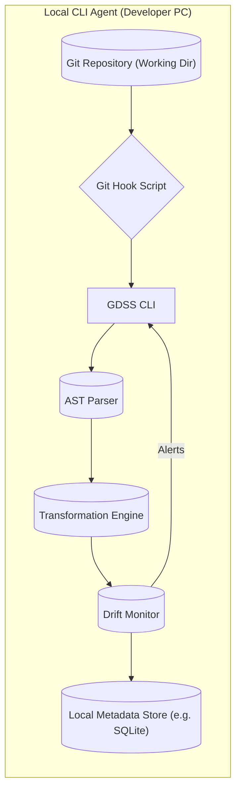
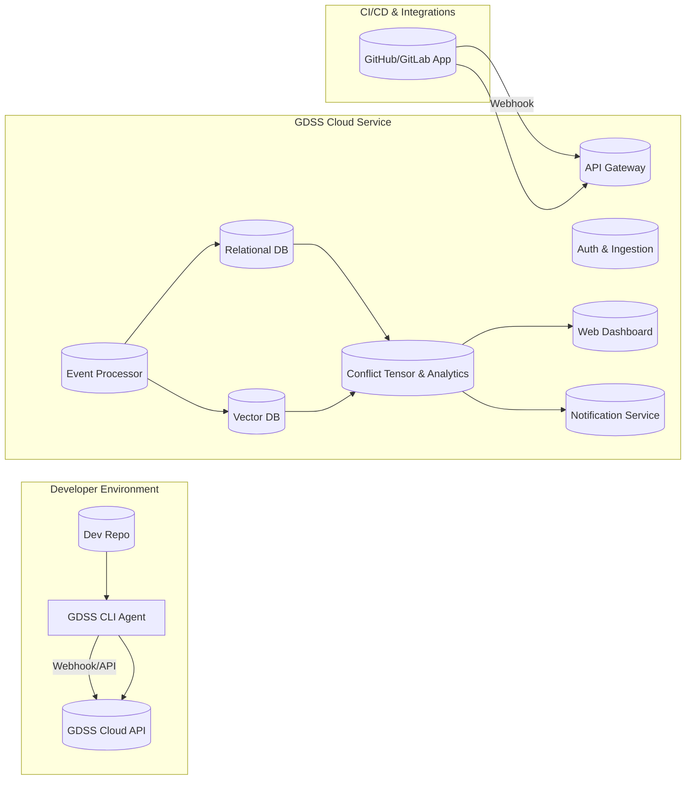
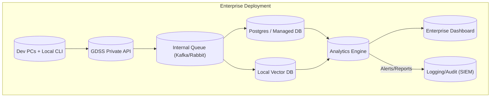

# Executive Summary

GDSS is a novel developer tooling platform that integrates a local CLI agent with optional cloud or enterprise backends.  It is best viewed as **“merge-intelligence” software** rather than a simple Git plugin.  The core product will have three deployment variants: (1) a **Local CLI Agent** for developers, (2) a **Cloud SaaS** back end for aggregated analytics and dashboards, and (3) a **Self-Hosted Enterprise** edition for on-premise deployments.  Key components include an AST parser, a semantic transformation engine, code embeddings, drift monitors and conflict-prediction tensors, a telemetry metadata pipeline, and team dashboards.  Developers use the CLI to visualize branch drift and conflict risks; the cloud service aggregates team-wide insights (without ever shipping raw code) and provides a web UI and alerts.  

A phased rollout is recommended: start with an open-source CLI (pip/brew) to drive adoption, then add a GitHub/GitLab integration (marketplace listing) and optional cloud service.  Pricing will be hybrid: base per-user subscription (for feature access) plus usage/tiered plans or outcome-based metrics (e.g. engineering-hours saved).  Revenue flows come from cloud subscriptions and enterprise licenses (with premium support).  Telemetry will collect **only anonymized metadata** (e.g. operation counts, environment stats, drift metrics) and exclude source code or any PII, with TLS encryption in transit and strict retention policies to meet GDPR/SOC2 standards.  

Operationally, we will build CI/CD pipelines (GitHub Actions/Jenkins), containerize the SaaS components, and use managed databases and vector stores for scaling.  We’ll track uptime/SLOs (e.g. 99.9% API availability), implement monitoring/alerting, and provide support via docs, forum and SLA-backed enterprise support.  A sample pricing table and ROI calculator will help customers justify the investment.  Finally, risks include competition from major platforms (GitHub/GitLab) and complexity of adoption.  We mitigate these by emphasizing **tangible ROI** (“hours saved by avoiding conflicts”) and compliance features for enterprise buyers, and by leveraging developer-friendly channels (CLI distribution, GitHub Marketplace, developer advocacy).

## (1) Technical Product Classification and Components

- **CLI Agent (Local)** – A Python CLI (or Go, Rust etc) that runs on each developer’s machine.  It hooks into Git (via pre-commit or pre-push hooks) to analyze the current branch in real time.  Components include a lightweight **AST parser** (e.g. Tree-sitter or language’s AST) and a **Transformation Operator Engine** that converts diffs/commits into semantic operations.  A **Drift Monitor** computes metrics like semantic divergence $I(B_i)=\int\|B_i(t)-D(t)\|\,dt$.  If internet is available, it streams metadata (no code!) to the server; otherwise it caches locally (e.g. SQLite).  The CLI also provides commands like `gdss status` and `gdss log` for immediate feedback.  

- **Cloud SaaS (Multi-Tenant)** – A managed service that ingests metadata from CLI agents (and from GitHub/GitLab via an app or Webhook).  Key back-end components include:  
  - **Metadata Pipeline:** Ingests events (AST deltas, dependency graphs, drift scores) via a secure API/GitHub App.  
  - **Storage:** A relational DB (Postgres/Aurora) for user/org data, and a vector database (e.g. Qdrant or Weaviate) for code symbol embeddings and branch vectors.  
  - **Conflict Tensor Engine:** Computes pairwise branch commutativity (Ωij) and predicts merge conflicts before they happen.  
  - **Dashboard/UI:** A React (or Vue) web front-end where engineering leads see org-wide metrics (top-drifting branches, risk heatmaps).  
  - **Integrations:** CI/CD integrations (GitHub/GitLab apps, Slack/Teams notifications) and SSO (OAuth/SAML) for enterprise customers.  

- **Self-Hosted Enterprise** – A single-tenant deployment (containerized or VM) sold to large organizations.  It includes all SaaS components but runs on the customer’s infrastructure.  Installation options: Docker image, Kubernetes Helm chart, or native packages.  Data stores can be hosted by the customer (e.g. their own Postgres and Qdrant instances) for full data control.  Like FusionAuth, we aim to support air-gapped scenarios and let enterprises “own their telemetry”.  An enterprise plan includes premium support and custom SLAs, and may integrate with corporate monitoring (e.g. Splunk, Elastic) for observability.

**Key components required:**

- **AST Parser Engine:** Multi-language support (Tree-sitter or language-specific). Builds parse trees to feed semantic diffing.  
- **Transformation Operators:** Models file edits as algebraic operations (rename, insert, delete, refactor) that can be combined and commuted.  
- **Semantic Embeddings:** e.g. MiniLM or CodeBERT vectors for code symbols, used to measure semantic similarity and drift.  
- **Drift Monitor:** Continuously computes branch distance metrics (vector-space norms) and flags when drift exceeds thresholds.  
- **Conflict Tensor Engine:** Uses matrix Ωij to quantify inter-branch interference; alerts on likely conflicts before developers merge.  
- **Metadata Pipeline:** Secure event queue (Kafka/RabbitMQ or HTTP/REST ingestion) carrying anonymized metrics.  
- **Dashboard & Analytics:** Web front-end with React/D3 showing timelines, heatmaps, and drift indicators.  
- **Integrations:** Git hook scripts (bash/python) for GitHub/GitLab apps, CI plugins to embed into workflows (e.g. GitHub Action or GitLab CI job), and notifications (Slack, email).  

These pieces form a “semantic version control” stack.  The CLI and operator engine handle real-time developer feedback, while the cloud/or on-prem services compute cross-team analytics and host the UI.  This classification ensures clarity: the CLI is **free** (driving adoption), the SaaS and Enterprise backends are **paid** (delivering organization-level value).

## (2) System Architectures

We design three deployment models. Each has the same functional components but different data flows, storage, and security boundaries.

### 2.1 Local-Only CLI Architecture

In this model, the GDSS **CLI** runs entirely on the developer’s machine.  A Git hook (pre-commit/push) or the user manually triggers `gdss status`.  The CLI parses the working copy (`AST Parser`), computes semantic diffs (`Transformation Engine`), and updates a local database (`Cache`) of branch analytics.  The **Drift Monitor** computes divergence scores continuously and can display them.  No data leaves the machine unless the developer opts in.  This “air-gapped” mode maximizes privacy: it only needs local OS (Windows/Mac/Linux) and minimal dependencies.

**Storage:** SQLite or simple JSON/YAML files store branch vectors, dependency graphs, and logs.  
**Scaling/Fault Tolerance:** N/A (single-user).  Performance must be light (quick CLI response).  If a sync or update fails (e.g. no network), it just continues offline.  
**Security Boundary:** Entirely local.  No server communications. Sensitive: the CLI should encrypt or sanitize any telemetry before optional upload (see Section 4).

### 2.2 Hybrid (Local Agent + Cloud SaaS) Architecture

Here, the local CLI periodically **uploads metadata** (via HTTPS) to the cloud.  The cloud has multiple components:

- **API Gateway & Auth:** Authenticate and receive events.  Developers may authenticate via GitHub OAuth or API keys.  
- **Event Processor:** Validates and stores each incoming event/metric.  
- **Relational DB (Postgres/Aurora):** Stores org accounts, branch history metadata, user configs.  
- **Vector Database (Qdrant/Weaviate):** Stores high-dimensional embeddings for code tokens and branches.  Enables fast similarity queries (e.g. find branches with similar semantic changes).  
- **Conflict Tensor Engine:** Consumes DB/VecDB to compute pairwise conflict metrics.  It also regularly pulls from GitHub via the GitHub App to catch new PRs/branches (or this could be driven by CLI data alone).  
- **Dashboard & Notifications:** A web UI and email/Slack system to show health dashboards, trends, and to alert teams of predicted conflicts or critical drift.  

**Data Flow:** Developers push code; the CLI processes AST diffs and sends *anonymized metadata* to the Cloud API (never raw source code).  For example, it may send “DriftScore: 0.25 for branch feature-X”.  The GitHub App can push SCM events (PR opened, merges) into the same pipeline.  The cloud correlates these to build an org-wide view.

**Storage & Scaling:** Use managed services (e.g. AWS RDS, DynamoDB, S3, Elasticsearch).  The vector DB can be an open-source cluster (Qdrant) auto-scaling on Azure/AWS.  The API and backend services run on Kubernetes (EKS/GKE) or serverless containers (AWS Fargate).  We set up multi-AZ clusters and read-replicas for fault tolerance.  Time-series data (drift logs) could go to a time-series DB (InfluxDB) for SLO reporting.

**Security:** Strong boundaries are crucial.  All communication is TLS-encrypted.  We enforce OAuth scopes for the GitHub app.  No code leaves the premises — we only transmit hashes, metrics, symbol embeddings.  The cloud is SOC2-certified (isolation of data, encryption at rest, strict IAM).  Access to telemetry data is audited; data retention is limited (e.g. auto-delete after 90 days) to comply with GDPR.

### 2.3 Fully Self-Hosted Enterprise Architecture

For enterprise customers, we ship the full stack as a **turnkey appliance**.  It can be deployed on-prem (VMs, Kubernetes) or in a private cloud.  The architecture is similar to the hybrid model but hosted behind the customer’s firewall.  

**Components:** All cloud components (API, DB, vector store, analytics) run on VMs or containers managed by the customer.  Optionally, we deliver as Docker images or a Helm chart (for Kubernetes) to simplify deployment.  

**Data Flow:** Identical to cloud, except data never leaves the corporate network.  Enterprise users may still use the CLI to connect to the local API, or the enterprise admin can set up a global “team server” which the CLI syncs to.  

**Storage & Scaling:** Enterprises might use existing infrastructure (their own Postgres cluster, an on-prem Qdrant or Elasticsearch).  We provide scripts for setting up high-availability (master/slave DBs, multiple analytic nodes).  Alternatively, we offer a managed service component where we monitor the on-prem instance through secure tunnels or a management plane (subject to customer consent).

**Security:** Since data is company-sensitive, we emphasize **data locality**.  All traffic stays on the corporate network unless explicitly opted into cloud.  We recommend Kubernetes with network policies, TLS for all internal service calls, and integration with SSO/LDAP.  This aligns with SOC2: data is encrypted at rest, network access is tightly controlled, and audit logs integrate with corporate SIEM.  

**Fault Tolerance:** The enterprise package should offer DB backups, optional multi-node clusters, and clear rollback procedures (e.g. Docker container snapshots).  Support contracts include upgrade testing (n-1 compatibility) and a “beta channel” for customers to try new versions (see [3]).  

## (3) Distribution Strategy

A **multi-channel** distribution plan ensures GDSS is easy to adopt:

- **Packaging (CLI):** Publish on **PyPI** (so developers can `pip install gdss`).  Provide Docker images for containerized use (e.g. CI runners).  Build platform packages: **Homebrew tap** for macOS (`brew tap company/gdss` then `brew install gdss`), and Linux package (`.deb` or Snap) for apt-based systems.  Support Windows via a pip wheel or MSI installer.  The FusionAuth guide recommends “multiple delivery mechanisms: Homebrew, RPMs, Docker”.  

- **Installers & Auto-Update:** Offer a scriptable installer (`sh <(curl...)`) that downloads and installs the latest CLI.  Use semantic versioning and embed a simple `gdss update` command.  Homebrew has built-in auto-updates; pip users can use `pip install -U`.  For enterprise, provide a Chef/Ansible or Terraform module to automate deployment of on-prem components.  

- **Git Hooks & Init Command:** As in many devtools, provide a command `gdss init` that sets up Git hooks (`pre-commit`, `pre-push`) in the repo.  This ensures drift analysis runs at the right times.  Hooks can call back to the CLI with appropriate flags.  Document how to disable/override hooks if needed (per [10] best-practices on opt-outs).  

- **GitHub/GitLab Apps & Marketplace:** Build a GitHub App (and GitLab integration) that connects via OAuth and webhooks.  This app, when installed, can post PR comments with risk reports, or block merges (via check runs) if conflicts are predicted.  List the app in the GitHub Marketplace.  To meet marketplace requirements, ensure we have a verified publisher, a clear description, privacy policy, and support links.  Similarly, join the GitLab Partner Program and list on GitLab’s marketplace.  

- **Onboarding Flows:** Provide quick-start guides: e.g. “3 steps to add GDSS to your repo”.  For cloud SaaS, a signup page with email verification and GitHub Org OAuth.  Offer a free tier (e.g. first 3 users or open source projects) to encourage trial.  For enterprise, a guided demo and PoC program.  Use email drip campaigns, in-app tooltips, and a CLI `--help` that clearly links to documentation.

By meeting developers in familiar channels (CLI, brew, GitHub), we maximize reach.  A good install experience is crucial: as one industry guide notes, *“The best installation experience is not documentation, it’s installation scripts… plan to support multiple installation paths”*.  We should also create a Homebrew tap (GitHub-hosted) so macOS users can easily `brew install gdss`.

## (4) Telemetry & Privacy

GDSS collects **no source code** or PII.  We only gather **aggregated metadata** to improve the product. Key principles and practices:

- **What to Collect:** Track events like “status command run”, branch drift scores, number of symbols changed, OS/version, CLI version, and high-level dependency changes.  We will *never* capture file contents, branch names with user info, or commit messages.  (For example, SonarQube’s CLI explicitly avoids personal data and allows opting out.)  A tracking plan will enumerate allowed fields, and we will sanitize arguments (e.g. remove file paths or emails) as recommended.  

- **Consent and Opt-Out:** On first run, the CLI should display a one-time notice about telemetry (user can continue or disable).  Users can opt-out via a config flag (`gdss config --telemetry off`) or environment variable.  Enterprise admins can enforce an environment-level opt-out.  This follows best practice: tools like Homebrew provide both command and env-var to disable data collection.  All telemetry is *opt-in by default* or opt-out explicitly.  

- **Encryption:** All data in transit uses HTTPS/TLS.  In the cloud and enterprise, data at rest is encrypted (use disk encryption, DB encryption at rest).  We will follow SOC2 practice: e.g. require TLS for all Collector endpoints, mutual TLS between services, etc..  Only authorized services/engineers can access telemetry stores.

- **Data Minimization (GDPR/SOC2):** We follow GDPR’s data minimization: collect only what we need.  For instance, we may hash or bucket developer IDs (avoid storing real email).  Purpose limitation: use telemetry only for product improvement (not for marketing or selling data).  We define a strict data retention policy (e.g. purge raw telemetry logs older than 90 days) and support “right to erasure” requests.  

- **Data Handling:** Metadata is processed in backend pipelines; logs contain no sensitive data.  We will implement role-based access so only authorized employees can see anonymized usage stats.  Audit logs record who accessed telemetry.  This aligns with GDPR’s need to “encrypt data in transit and at rest” and provide data subject rights.  

- **Compliance:** We will publish a Privacy Policy and Data Processing Addendum.  Telemetry will use “legitimate interest” or “consent” as lawful basis.  For enterprise customers, we are prepared to sign GDPR/MDSAP data agreements.  The architecture mirrors what observability vendors do to stay compliant.

In summary: **no code, no PII, opt-out available, encrypted and limited retention**.  This satisfies SOC2 and GDPR standards for a SaaS product, and will be explicitly stated in marketing (“GDSS never sees your source code – only abstract metrics”).

## (5) Monetization & Financial Engineering

**Pricing Metrics:** We will consider a *hybrid model*.  The simplest is a **per-seat subscription** (common for dev tools).  But we also can incorporate usage or outcome-based tiers.  For example:

- **Free Tier:** Up to 3 users or 1 repo, basic CLI features.  
- **Team Plan:** \$10–\$15 per user/month. Includes cloud dashboards, drift alerts, up to N repos.  
- **Business Plan:** \$25 per user/month. All Team features plus advanced analytics (conflict predictions), premium support, up to M repos.  
- **Enterprise:** Custom pricing (per seat or flat fee) with on-prem licensing, dedicated support, custom SLAs.

We may also meter on **engineering-hours saved**. For instance, a plan could cap by number of predictions or offer ROI guarantees (“X hours saved per $Y spent”).  Bain research notes that blending per-seat with usage/outcome metrics is increasingly popular.  For instance, we might charge extra for monitoring *very large* repos or extensive API calls.  But per-seat + tier is straightforward.

**Sample Pricing Table:**

| Plan         | Price (per user/month) | Features                                             | Support        |
|:-------------|:-----------------------|:----------------------------------------------------|:--------------|
| **Free**     | \$0 (limited)          | Core CLI, local analysis, basic dashboards          | Community      |
| **Team**     | \$10                   | All CLI + Cloud sync, branch drift monitoring, weekly email reports | Email support |
| **Business** | \$25                   | Team + Conflict prediction, SLA alerts, unlimited repos | Priority email & chat |
| **Enterprise** | Custom              | Self-hosted deployment, enhanced security, custom integrations, 24×7 support | 24×7 enterprise SLA |

*Note: example pricing. Custom/negotiated for >100 users or special use-cases.*

**ROI and Payback:** We emphasize cost-justification with an ROI calculator.  E.g., if an engineer’s fully-loaded cost is \$80/hr (≈\$166k/year), then saving just **2 hours per week** (0.5 hour per day) per developer is \$8,320/year each.  For a 50-engineer team, that’s \$416k saved annually.  Charging \$20/user/mo (\$12k/yr for 50 seats) yields >30× ROI.  In a case study, one dev-tool provider estimated saving \$70k/month for 100 engineers, versus \$4k in tool cost.  We’ll provide a payback table such as:

| Team Size | Hours Saved/Week (per dev) | Eng. Cost (\$/hr) | Annual Value Saved | Yearly Cost (@\$20/user/mo) | ROI (Saved/Cost) |
|----------:|:--------------------------:|:-----------------:|:-----------------:|:---------------------------:|:---------------:|
| 10        | 2 hrs                      | \$80              | \$83,200          | \$2,400                     | 34.7×          |
| 50        | 2 hrs                      | \$80              | \$416,000         | \$12,000                    | 34.7×          |
| 100       | 2 hrs                      | \$80              | \$832,000         | \$24,000                    | 34.7×          |

This “hours saved” approach echoes how developers estimate ROI.  Even more conservative assumptions (1 hr/week) still yield 17× ROI in this example.

**Financial Projections (3-year example):**  

Assume Year1: 50 customers (mostly small teams) at avg \$500/month ARPU = \$300k ARR; Year2: 150 customers (\$900k ARR); Year3: 400 customers (\$2.4M ARR), driven by Enterprise deals.  This is illustrative.  A focused SaaS startup might aim for **$1M+** ARR by Year2 if growth is strong. Churn is mitigated by high switching cost (projects become integrated), and by demonstrating ROI.  

**Churn & Retention:** We minimize churn by: offering a free tier (hooking users early), ensuring the product is “sticky” (dashboard and alerts by default, so devs see immediate benefit), and having a dedicated customer success team for enterprise accounts.  We also collect usage metrics (with consent) to identify at-risk accounts (low activity) and re-engage them.

## (6) Operational Plan

- **CI/CD & Builds:** Use GitHub Actions (or GitLab CI) to test and deploy all components.  For the CLI: run tests on each PR, build/test wheels for Python or binaries for Go/Rust, and publish to PyPI/GitHub Packages.  For the SaaS: use containerized microservices; deploy via Docker images to AWS ECR (or similar) and Kubernetes.  CD pipelines will auto-deploy to staging and production on merge.  We will maintain **infrastructure-as-code** (Terraform/Helm charts) for reproducibility, as recommended for self-hosted products.

- **Observability:** Instrument all services with metrics (Prometheus/Grafana) and logging (ELK/Datadog/Sentry).  Set SLOs (e.g. 99.9% uptime, 300ms API latency) and configure alerts.  Use distributed tracing to debug issues across the pipeline.  Weekly status pages will be generated automatically for transparency.

- **Incident Response:** Adopt an SRE-like process.  On-call rotation for the Ops team; use PagerDuty/Slack for alerts.  Post-mortems for any significant outage.  We’ll maintain a public **status page**.  For self-hosted customers, provide a knowledge base on common issues (e.g. how to allocate more memory for large repos).

- **Customer Support:** 
  - *Community/Free:* Provide a public forum/Slack for user Q&A.  Documentation (docs.gdss.com) must be thorough (installation guides, config, API refs).  
  - *Business:* Email support with 24-48h SLAs.  Priority tickets for top plans.  
  - *Enterprise:* 24×7 phone/Slack support with guaranteed response times (e.g. 1h critical).  We may also offer training workshops.  

- **SLA Commitment:** For cloud service, offer a 99.9% uptime SLA for paid customers.  This is standard for B2B SaaS.  This informs our high availability architecture (multi-AZ, failover DB replicas).  

## (7) Roadmap & Go-to-Market

Align product milestones with revenue triggers:

- **Phase 1 – CLI Beta (Months 0–6):** Complete AST/dep-graph engine and basic CLI. *Milestone:* v1.0 CLI released on PyPI/Homebrew. *Goal:* 500 dev installations.  
- **Phase 2 – Semantic Analysis (M6–12):** Add embeddings, drift-monitoring, and simple conflict warnings. Launch GitHub Action integration. *Milestone:* GitHub App available (free). *Goal:* 50 org pilots onboarded, gather feedback.  
- **Phase 3 – SaaS Launch (M12–18):** Release cloud dashboard (drift visualizations, team metrics) and paid plans. *Milestone:* 10 paying teams, $100k ARR.  Kick off content marketing (case studies showing hours saved).  
- **Phase 4 – AI Assistant (M18–24):** Implement Phase 4/5 from roadmap (Conflict Tensor predictive engine, auto-rebase suggestions). *Milestone:* 50 paying teams, launch ROI calculator publicly. *Goal:* Achieve product-market fit; prepare enterprise sales kit.  
- **Phase 5 – Enterprise Edition (M24+):** Build the on-prem deployment (Phase 6–7). *Milestone:* First self-hosted deal (target verticals like finance, healthcare).  *Goal:* Enterprise roadmap synced with inbound leads.  

At each phase, revenue triggers guide next steps.  E.g. “if 100 paying teams and churn <5%, invest in an enterprise sales team.”

## (8) Risks, Mitigations & Competitive Positioning

- **Competing Platforms:**  
  - *GitHub/GitLab:* These are the incumbents. They currently offer only textual merge tools (diff/rebase).  If GitHub/Lab build advanced conflict prediction, it could disrupt us.  Mitigation: **First-mover advantage** in semantic merging and focus on differentiation (open architecture, multi-VCS support).  Also, target teams using multiple platforms (Enterprise may use GitLab but want GDSS for conflict analysis).  
  - *JetBrains/KDiff3:* GUI merge tools exist, but they are manual and language-agnostic.  GDSS’s strength is **automation and prediction** before merge.  
  - *Linear (linear.app):* Linear is a PM tool (task/issue tracking), not a direct code-collaboration competitor.  Mentioning it suggests analogy: Linear maps developer workflows, but GDSS focuses on code integration.  We could integrate with Linear (link branches to tickets).  
  - *Datadog/NewRelic:* They monitor production apps, not VCS.  Datadog does some developer observability (RUM, APM) but not code-merge.  GDSS could be positioned as “Datadog for codebases” – monitoring branching/merging health as Datadog monitors systems.  Actually, we should approach Datadog-style positioning (observability of dev workflow) rather than competing on APM metrics.  

- **Adoption Friction:** Devs may resist new tools or see merge conflicts as “inevitable”.  Mitigation: Make CLI frictionless (easy install, opt-out of telemetry), and emphasize time savings.  Use in-product messaging: “Your branch drift is high – consider rebasing soon!” to demonstrate value early.  

- **Technical Feasibility:** Building a robust semantic merge engine is complex.  Risk of underperformance or false positives.  Mitigation: Start with simpler features (AST diff linting) and iterate.  Use user feedback loops to refine predictions.  Partner with academic experts on differential geometry if possible.  

- **Data Privacy Fear:** Some companies may worry about sending code metadata.  Mitigation: Be transparent about telemetry (Sections 4).  Offer on-prem solution for sensitive sectors (finance, healthcare).  

- **Market Education:** This is a new category (“semantic VCS”). Customers may not understand the value immediately.  Mitigation: Focus marketing on practical pain points (merge conflict costs, DORA metrics).  Use customer stories and ROI metrics (engineering-hours saved).  

In summary, GDSS competes by **specializing in preventing integration pain**.  We are not building another Git client; we are building **intelligence around Git workflows**.  With clear ROI messaging and a solid technical moat (the transformation algebra and conflict tensor), we can carve out a niche even alongside giants.

